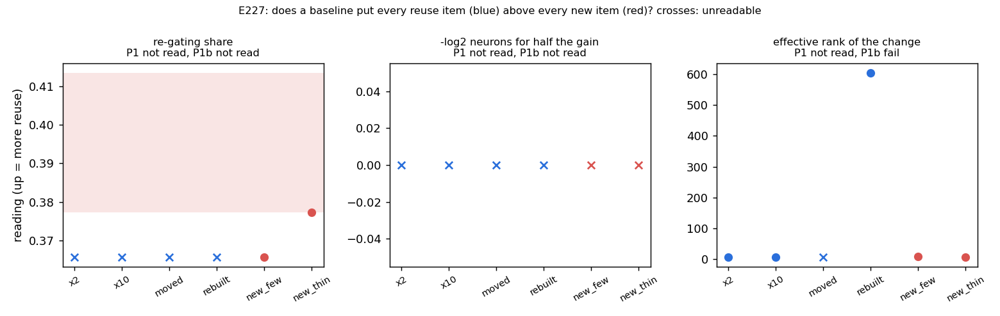

# Do the cheap baselines sort the known-answer edits into reuse and new?

> **Correction (lead, 2026-11-20, after the run):** the share and neurons-for-half readings below are not valid. The job fed altered windows: the cue items had their answer token appended, which the gate network (bidirectional over the row) sees, and the copy24 items were cut short. Effective rank (no rows) and the E53 control stand. A corrected read folds into E228 (P2.44), which feeds windows whole.
>
> **Narrowed (2026-11-21, E228's known-answer stage):** neurons for half the gain on the two new edits stands. Read again on whole windows it gives exactly the values below, not read with neuron-level shares of -0.518 and -0.516, because the neuron reader runs no gate network and the model is causal. The share readings stay invalid: on whole windows the new edits read 0.158 and 0.166, not 0.366 and 0.377. The circuit edits' readings were not re-read on this target and stay under the correction. See `reports/analyses/2026-11-21_analysis_e228-random-kl.md`.

We read three cheap methods on six hand-built edits of the 67M whose label is known by construction: four that reuse
an existing circuit and two that write a new lookup. None of the three methods puts every reuse edit above every new
edit, and for the share and the neuron count most of the edits cannot be read at all. So none of these baselines can
stand beside the working definition in the paper's comparison on these edits, and part of the reason is that the
answer they read is not one the reuse edits were built to raise.

## The answer

No method passes. The re-gating share reads only the two new edits, at about 0.37 each: the three reuse edits it could
read all lower the chosen answer instead of raising it, so the share has no gain to divide. The count of neurons that
carries half of the gain reads nothing, and the effective rank orders the edits by how they were written, not by
reuse. The reuse edits lower that answer because the circuit they scale was picked for the size of its effect on it,
and its net effect is negative.

## What we were trying to test

The working definition is calibrated on edits whose label is known by construction: E214 built them, E226 reads them.
This run asks whether three cheap methods recover the same labels, so that part 2 of the paper can say which baseline,
if any, agrees with the definition. Nothing is trained; every reading is a forward pass of M, the 67M, and of M plus
each edit's weight change on the 24 decomposed matrices.

The edits, as their builders define them:

- **Turned up two and ten times.** E193 found a circuit of 8 layer-1 MLP neurons, the ones whose activation times
  gradient of the copy task's answer logit is largest in size. These two edits multiply that circuit's output weights
  by 2 or 10. Labelled reuse: the edit only strengthens a circuit M already has.
- **Rebuilt.** E195 zeroes the same circuit's output and refits the layer 2 and 3 MLP weights so the model's outputs
  match the turned-up-twice edit. Labelled reuse.
- **Moved.** The circuit copied exactly onto 8 new neurons appended to layer 1, its old output zeroed. Labelled reuse.
  It adds neurons M does not have, so it is not a change of M's matrices and none of the three methods applies to it.
- **New, few weights and new, thin.** E214's two new edits on 512 copy windows ending in a new cue: eight layer-0
  slots, or the least-norm change of every layer-0 output column, write a fixed random answer. Labelled new.

The three methods, each with the direction its own definition gives for reuse:

- **The share** is the fraction of the edit's gain in the answer's log-odds that comes through Γ switching M's own
  subcomponents on differently, with M's weights kept. It reads 0 when the change works through no existing part and
  1 when it works only by re-weighting existing parts; higher means more reuse. It is not read when the gain is under
  1 log-odds, the floor VPD uses.
- **Neurons for half the gain** is the fewest MLP neurons, ranked by their contribution, that carry half of the
  neuron-level share's numerator; fewer means more reuse. It is not read when that neuron-level share is not above
  0.1 or its numerator is not positive.
- **Effective rank** of the weight change over the 24 matrices; E141 filed higher as the reuse side.

The cue edits are read at the cue windows' last position, target the edit's written answer. The four circuit edits
are read on the copy task's 75 held-out windows, target the task table's answer at position 20, the place E193 found
the circuit. A method passes when the lowest reuse reading is above the highest new reading by more than its band, the
largest gap between two random halves of an item's rows. A second rule leaves the moved edit out.

## What we expected, and why

We expected no method to pass, with low confidence. The share and the neuron count both need a gain of at least
1 log-odds, which the moved edit cannot give and the twice-turned-up and rebuilt edits were expected to miss. The
effective rank was expected to track how each edit was written: about the same for the two turned-up edits, which
differ only by a scale, and far higher for the rebuilt one.

## What we observed

**Reading it.** No method puts the reuse edits above the new ones. In the left panel only the two new edits have a
share, 0.366 and 0.377. Every reuse edit is a cross drawn at the panel's floor. The pink bar is how far above the
higher new edit a reuse edit would need to sit. In the middle panel every edit is a cross. In the right panel the two
turned-up edits read 6.2, below both new edits. Only the rebuilt edit sits high, at 604, because refitting two whole
MLP layers spreads the change over many directions.

The controls held before any edit was read. The re-read of E53's lowercase fine-tune gave a share of 0.7477 against
its saved 0.7519, within the filed tolerance of 0.01; neurons for half the gain gave 16, as saved; the effective rank
reproduced 598.5738. The unchanged model read every numerator and gain exactly 0.

| edit | label | gain at the answer, log-odds | share | neuron-level share | neurons for half | effective rank |
|---|---|---|---|---|---|---|
| turned up twice | reuse | -0.113 | not read | not read | not read | 6.2 |
| turned up ten times | reuse | -2.08 | not read | 0.134 | not read | 6.2 |
| moved | reuse | does not apply | | | | |
| rebuilt | reuse | -0.106 | not read | not read | not read | 604 |
| new, few weights | new | 16.6 | 0.366 | -0.518 | not read | 7.98 |
| new, thin | new | 16.3 | 0.377 | -0.516 | not read | 7.87 |

Why each is unreadable. The share needs a gain of at least 1; the reuse edits' gains are all negative. Neurons for
half the gain needs the neuron-level share above 0.1 with a positive numerator: the new edits' neuron-level shares are
negative, and the turned-up-ten-times edit's 0.134 rests on a negative numerator over a negative gain. So the method
declines before it searches for a neuron count; it is not that no count reaches half. The share's band from
split halves was 0.036; the effective rank's is 0, since it reads no rows. With the moved edit left out, the effective
rank's lowest reuse reading is 1.78 below the highest new one, a fail; every other rule is "not read".

## Does the chosen answer fit the reuse edits?

It does not, and the negative gains are what the files predict. E193 chose the circuit by the size of each neuron's
attribution to the copy answer's logit, with no condition on its sign. Of the 8 neurons, 3 push the answer up and 5
push it down, and the eight attributions sum to -67.9 over the copy training windows. Scaling a neuron's output weight
by a factor scales its activation's contribution, so that sum is the first-order change of the summed answer logit
when the whole circuit is turned up by one unit of its scale. Turning it up therefore lowers the answer, as the held-out
gains of -0.113 and -2.08 show. The rebuilt edit was fitted to match the twice-turned-up edit's outputs, so its gain of
-0.106 is the same lowering.

So the reuse edits are defined as changes to a circuit, not as edits toward an answer. The share and the neuron count
read a gain toward one answer at one position. On these edits there is no such gain above the floor, and that follows
from the construction, not from how the methods treat reuse. This is a limit of the read, not a result about the
methods. A target that would fit is one the edit raises by at least 1 log-odds. One such target is the lowering
itself, read as minus the answer's log-odds. On the saved numbers, the ten-times edit would then have a gain of 2.08
and a share of 0.14, still below the new edits. The twice-turned-up and rebuilt edits would stay under the floor:
their effect at this position is about a tenth of a log-odds. A circuit chosen from the positively attributed
neurons alone would give edits that raise the answer, but it would be a different item from the one the definition
was calibrated on. Neither was run.

## What we learned

The three cheap baselines do not recover the known-answer labels on these edits, so the paper cannot name one of them
as agreeing with the definition here. The effective rank's failure is clean: it reads how an edit was written, putting
two rescalings below two new edits and the refit far above. The share's failure is mostly a failure to read: it is
built for an update that raises one answer, and the definition's reuse edits change a circuit's computation across
every position without raising any one answer. Where it could read, on the two new edits, it gave about 0.37, well
above the 0 a new edit should give if the share tracked newness.

## How compelling is the evidence

Six edits, one each, one seed, one model. The band comes from two random halves of each edit's rows and is small next
to the gaps it guards, but the verdicts rest on readability, not on the band. The share and the neuron count are blind
to any change gaining under 1 log-odds, to anything outside M's 24 matrices, and to everything but one answer at one
position. The effective rank is blind to behaviour: the two turned-up edits read the same, since they differ only by a scale.

## Surprises

- The new edits' neuron-level shares are negative, about -0.52: the full patch of every neuron's change at the read
  position moves the answer the other way from the gain, while the top 4096 neurons alone carry about half of it.
  This was not predicted and is not explained here; it is why neurons for half the gain reads nothing on the new side.
- The share of the new edits, 0.366 and 0.377, sits above the filed expectation of 0 to 0.3.

## What next

- If the paper needs a share reading on reuse edits, read them on a target they raise: the lowering of the copy answer
  as the behaviour for the ten-times edit, or new items built from the positively attributed neurons. Either needs a
  new cell; this one's run is spent.
- The cell's stop holds: no method passes the rule without the moved edit, so the paper states that none of the three
  cheap baselines recovers the known-answer labels.

## Scorecard

| id | claim | rule | read | verdict |
|---|---|---|---|---|
| ctl | E53 lowercase re-read reproduces, unchanged model reads 0 | share within 0.01, others exact | 0.7477 vs 0.7519; 16; 598.5738; all zeros | pass |
| P1 share | all four reuse above both new by more than the band | min reuse minus max new above the band | four reuse unreadable | not read |
| P1b share | the same without moved | as P1 | three reuse unreadable | not read |
| P1 k_half | as P1, fewer neurons is reuse | as P1 on minus log2 | all six unreadable | not read |
| P1b k_half | as P1b | as P1b | five unreadable | not read |
| P1 erank | as P1, higher is reuse | as P1, band 0 | moved does not apply | not read |
| P1b erank | as P1b | as P1b | gap -1.78 | fail |

## Departures from the literature

None beyond those of the readers reused: the share and neurons for half the gain are E211's readers unchanged, and the
gain floor is VPD's.

## Not run

- Any target other than the copy answer at position 20 for the four circuit edits: the lowering as the behaviour, the
  edit's most-raised token, or every position.
- New circuit edits built from the positively attributed neurons only.
- A weight change for the moved edit that accounts for its appended neurons.
- The neuron share at the item level as a scored method, steering, the crosscoder and the untrained shares.
- Seeds: each edit is one fixed construction.

## Provenance

Plan `reports/plans/2026-11-20_plan_p2-43-known-answer-baselines.md`; card and code
`experiments/known_answer_baselines/`; results `results/stage0.json`, `results/items/*.json`, `results/score.json`;
circuit attributions `experiments/rule_retention/results/amend1/stage1.json`; log
`cluster/logs/commute-known-baselines-62219.out`. MATS cluster debug L40, job 62219, under two minutes, peak GPU
6.9 GB, $0, code commit 07a4fcc2.
