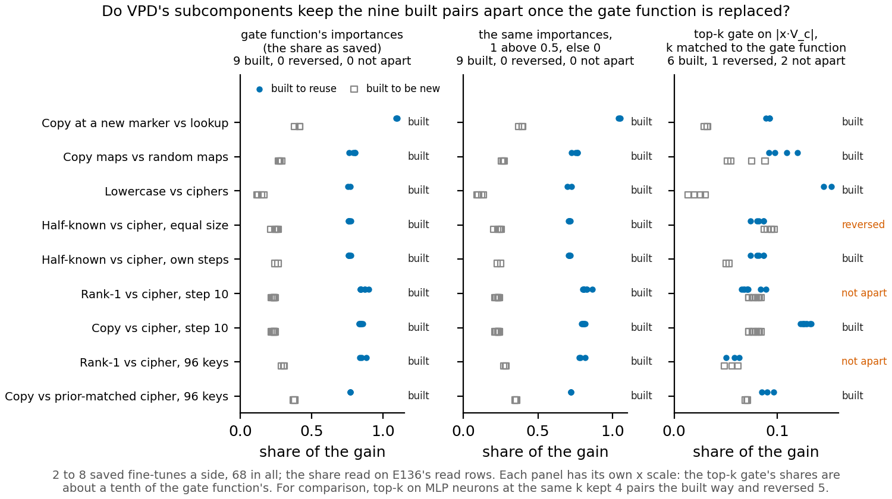

# Do VPD's subcomponents keep the built pairs apart without the gate function?

E230, cell P2.47 (compare-lead), 2026-11-20. Figure `experiments/topk_gate/figures/shares_by_gate.png`.

We kept VPD's subcomponents, replaced the trained gate function that switches them on, and read the re-gating share
on the 68 saved fine-tunes of the nine built pairs. Rounding the gate function's own choices to fully on or off kept
all nine pairs apart in the built direction; keeping the subcomponents with the largest input activation kept six. So
the share's agreement with how the pairs were built comes mainly from which subcomponents the gate function picks, and
VPD's units under the simple rule do a little better than neurons.

## The answer

The share agrees with how all nine built pairs were built because of the subcomponents the gate function chooses to
switch on. Rounding its choices to fully on or fully off changes nothing that matters: all nine pairs stay apart, by
nearly the same margins. Replacing its choice by "the subcomponents whose inputs fire hardest" keeps six pairs apart,
reverses one and leaves two level. That is the count neurons reach for half the gain, and above the four that the same
rule reaches on MLP neurons.

## What we were trying to test

The re-gating share asks how much of a fine-tune's gain on its task is carried by the original model's subcomponents
being switched on differently. Each weight matrix of the 67M model is written as VPD's subcomponents plus a remainder
$\Delta$. A masked forward pass runs only the subcomponents, each multiplied by a mask between 0 and 1, with $\Delta$
left out. The masks come from a gate function: VPD's small trained network $\Gamma$ that reads the clean forward pass
and gives each subcomponent a causal importance at each position. The share is

$r = \dfrac{\mathrm{mean}(L_{01} - L_{00})}{\mathrm{mean}(T_1 - T_0)}$,

where $T_0$ and $T_1$ are the log-odds of the trained answer in the original and the fine-tuned model, and $L_{00}$,
$L_{01}$ are the same log-odds in the masked forward with masks read from the original model's or the fine-tune's
clean forward. It reads 0 when the masks do not change between the two, and 1 when the change in masks carries the whole
gain.

The nine built pairs each set a fine-tune built to reuse something the original model already does against one built
to need something new, with two to eight saved fine-tunes a side. On all nine, every reuse fine-tune reads a higher
share than every new one. The paper's results skeleton said this could not yet be credited to VPD's units. The neuron
readings it is compared with differ in how units are switched on as well as in the unit. This run
changes only the switching rule. For every fine-tune, with the same rows, batches and subcomponents, it reads the share
under five rules:

- **the gate function's importances**, the share as saved. This is the positive control: the new code must give the
  saved value on every fine-tune.
- **the same importances made binary**: 1 where the importance is above 0.5, else 0. If the result lived in graded
  mask values, this would lose it.
- **a top-k rule at matched k**, the one scored: at each position, keep the k alive subcomponents of each matrix whose
  input activation $|x \cdot V_c|$ is largest, where $V_c$ is subcomponent $c$'s read vector and $x$ the matrix's input
  in the clean forward. Here k is the gate function's mean count of importances above 0.5 per position in the original
  model, 152 of 9,881 alive subcomponents summed over the 24 matrices. This is the rule the top-k neuron share applied
  to MLP neurons at the same k, so the two differ only in the unit.
- **the top-k rule at half and double k**, reported beside it.

Before any fine-tune, a zero change was read through every rule: the gain and every numerator must be exactly 0.

## What we expected, and why

We filed that the top-k rule would keep at most six of the nine pairs apart in the built direction, the count that
"neurons for half the gain" reaches on the same pairs. The reasoning: the gate function was trained to find what each
position needs, and a fine-tune that reuses the original model changes what is needed. A rule that keeps whatever fires
hardest does not see that. The rival filed beside it was that the separation lives in the subcomponents themselves, so
any rule that follows their activations would keep seven to nine pairs. For the binary rule and the half and double k
nothing was filed. A fall under the binary rule would have said soft masks carry the result.

## What we observed

### Does the new code give the saved share?

Yes, exactly. On all 68 fine-tunes the gate function's share through the new code equals the saved share to the last
digit, against a filed tolerance of 0.01. The zero change read a gain and a numerator of exactly 0 under all five
rules. So any difference between the rules below is the rule, not the rows, the batches or the code path.

### Does rounding the gate function's masks to on or off lose the separation?

**Reading it.** No: the middle panel matches the left one. Under binary masks all nine pairs stay apart in the built
direction. The gap between the sides' mean shares runs from 0.37 to 0.66, against 0.39 to 0.69 with the graded masks.
Rounding lowered every one of the 68 shares, by between 0.001 and 0.07, and lowered both sides of each pair by about the
same. What the share separates is therefore which subcomponents the gate function switches on, not how far.

### Does a top-k rule on the same subcomponents keep the separation?

**Reading it.** Partly: the right panel keeps six pairs apart in the built direction, reverses one and leaves two level.
The reversed pair is the half-known task against a cipher at equal update size. The two level pairs are both rank-1
tasks against a cipher, at step 10 and with 96 keys. The pairs kept apart are kept by small margins: gaps from 0.020 to
0.126, where the gate function's are 0.39 to 0.69. That is because the top-k rule's shares are small on both sides,
from 0.014 to 0.15, where the gate function's run from 0.12 to 1.10. The panel has its own scale for that reason.

Against the comparators, six is the count of "neurons for half the gain" on the same pairs, which kept six and left
three without a call. The same top-k rule on MLP neurons at the same k kept four the built way and reversed five. VPD's
subcomponents under that rule keep two pairs that the neuron version reversed: the half-known task at its own step
count, and copying against a cipher at step 10. On the other three pairs the neurons reversed, the subcomponents are
reversed once and level twice.

Halving k keeps six pairs and reverses none, three level. Doubling k keeps five, reverses two and leaves two level. More
subcomponents switched on does not bring the top-k rule toward the gate function.

| pair | `gamma` | `gamma_bin` | `topk_x0.5` | `topk_x1` | `topk_x2` | top-k on neurons |
|---|---|---|---|---|---|---|
| Copy at a new marker vs lookup | 0.691 built | 0.658 built | 0.033 built | 0.060 built | 0.105 built | built |
| Copy maps vs random maps | 0.513 built | 0.487 built | 0.037 not apart | 0.037 built | 0.032 not apart | built |
| Lowercase vs ciphers | 0.622 built | 0.598 built | 0.280 built | 0.126 built | 0.095 built | built |
| Half-known vs cipher, equal size | 0.518 built | 0.474 built | 0.019 built | -0.011 reversed | -0.008 not apart | reversed |
| Half-known vs cipher, own steps | 0.510 built | 0.471 built | 0.043 built | 0.030 built | 0.039 built | reversed |
| Rank-1 vs cipher, step 10 | 0.622 built | 0.587 built | 2.8e-04 not apart | -0.005 not apart | -0.031 reversed | reversed |
| Copy vs cipher, step 10 | 0.607 built | 0.574 built | 0.047 built | 0.049 built | 0.059 built | reversed |
| Rank-1 vs cipher, 96 keys | 0.557 built | 0.512 built | -0.002 not apart | 0.002 not apart | -0.021 reversed | reversed |
| Copy vs prior-matched cipher, 96 keys | 0.393 built | 0.370 built | 0.017 built | 0.020 built | 0.023 built | built |

Each cell is the reuse side's mean share minus the new side's, then the pair's call: "built" when every reuse
fine-tune reads above every new one, "reversed" when every one reads below, "not apart" otherwise. The last column is
the top-k neuron share's call from `experiments/method_table/results/final.json`.

## What we learned

The paper can now say, with data, what carries the share's agreement with the nine built pairs. It is the gate
function's choice of subcomponents: binary masks keep it whole, and a choice made from activation size keeps six of
nine. Under the same top-k rule, VPD's subcomponents keep more pairs than MLP neurons do, six against four, so the unit
helps a little. Most of the result still belongs to the trained gate function, and the results section should not
credit the unit alone. None of this is a verdict on reuse: it says when the share agrees with how the pairs were built.

## How compelling is the evidence

The control is as strong as it can be: exact reproduction on every fine-tune and an exact zero for no change. The pair
rule is ordinal, every seed beyond every seed, so the counts do not depend on a band. Two pairs share their reuse side
and two share their new side, so the nine pairs are not nine independent tests. The top-k rule's kept pairs are kept by
gaps under the card's 0.1 on all but one pair; they are apart by the seed rule, but not by much. The top-k rule differs
from the gate function in three ways at once, and this run does not split them. It ranks by activation, not by a
trained importance. It keeps a fixed count at each position, not a varying one. It reads one position, not the whole
row. The k is matched on the original model over all pairs' rows, not per task.

## Surprises

The top-k rule's shares are about a tenth of the gate function's on both sides of every pair, which nothing filed
anticipated. A check on the saved per-row values shows why. On the original model, the top-k masked forward is about as
close to the target model as the gate function's masked forward. On the fine-tune it falls far shorter of the gain. The
top-k rule's choices hardly change between the original model and the fine-tune, so it attributes little of the gain
to switching. The script is in `~/commute-data/scratch/compare-lead/E230-writeup/level.py`; its numbers are not filed.

Doubling k did not help. It lost one more pair than the matched k.

## What next

- Rank by output size, $|x \cdot V_c|$ times the norm of the write vector $U_c$. VPD does not normalise $U$ against $V$,
  so this ranking can differ. If it keeps seven or more, the unit carries more than this run shows.
- Recount k per task. If the lost pairs come back, the fall is a miscount of how many subcomponents each task needs, not
  a wrong choice of which.
- Neither is in an open cell; each would need one from the user.

## Scorecard

| id | claim in words | rule | read | verdict |
|---|---|---|---|---|
| P0 (a) | no change reads exactly 0 | gain, every numerator and every row's difference exactly 0 | all 0 | pass |
| P0 (b) | the new code gives the saved share | gate function's share within 0.01 of saved, every fine-tune | equal on all 68 | pass |
| P1 | the top-k rule falls to the neuron level | at most 6 of 9 pairs "built" on `topk_x1` | 6 built, 1 reversed, 2 not apart | falls to the neuron level, as filed |
| beside P1 | against the top-k neuron share | count against its 4 | 6 | above |
| reported | binary masks | no filed value | 9 built | — |
| reported | half and double k | no filed value | 6/0/3 and 5/2/2 | — |

## Departures from the literature

- VPD computes masks with its trained gate function. The top-k rules here replace it on purpose; that replacement is
  the experiment, not a recipe.
- The top-k rule follows TopK sparse autoencoders, which keep the k largest pre-activations of a learned encoder. Here
  the units are VPD's subcomponents, the ranking is by the absolute input activation because subcomponent activations
  are signed, and k is not trained but set to the gate function's mean on-count.
- The binary rule's threshold of 0.5 is the threshold this project uses to count subcomponents as on. It is not taken
  from the VPD paper.

## Not run

- Ranking by output size, $|x \cdot V_c|$ times the norm of $U_c$.
- k recounted per task, instead of one k per matrix pooled over all pairs' rows.
- A top-k rule that reads the whole row, as the gate function does, instead of one position.
- The size-matched fine-tunes of the same pairs, and the four real-against-twin pairs.
- A Qwen3-1.7B version.

## Provenance

- Plan `reports/plans/2026-11-20_plan_p2-47-topk-gate.md`; card `experiments/topk_gate/card.md`; filed rules
  `experiments/topk_gate/results/predictions.json`.
- Code `experiments/topk_gate/run.py`, `src/commute/topk_gate.py`; figure `experiments/topk_gate/plot.py`.
- Results `experiments/topk_gate/results/score.json`, `zero.json`, `states/*.json` (68 files); per-row values in
  `results/large/cells/`.
- One MATS debug L40 job, 62289; the 68 reads took under two minutes of GPU time in all; $0.
