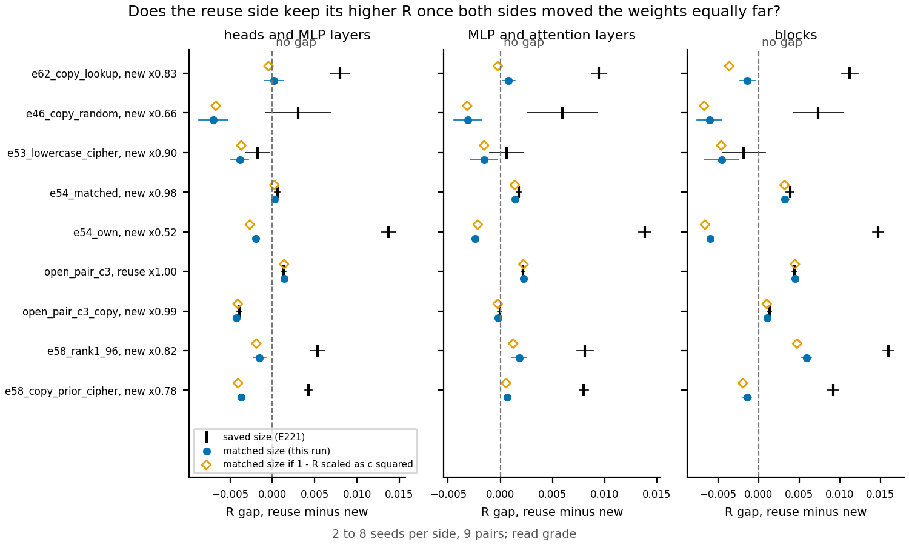
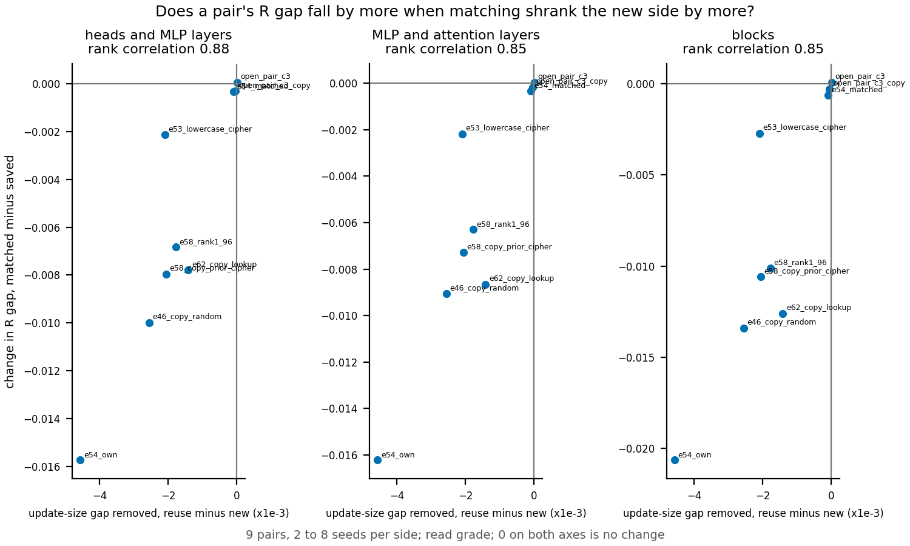

# Does the reuse score's reuse-minus-new difference survive matching update size? (E232)

*Definition-lead, 2026-11-20. Cell P1.38. Experiment `experiments/kstar_size_matched` (`run.py`, `score.py`,
`plot.py`). Plan `reports/plans/2026-11-20_plan_p1-38-size-matched-r.md`, card `reports/plans/2026-11-20_plan_p1-38-card.md`.
Filed rules: `experiments/kstar_size_matched/results/predictions.json`. A description: no verdict on the definition is
given.*

We shrank the larger fine-tune of each of nine matched pairs to the size of its partner and read the reuse score again
at three coarse levels of the model. The reuse side's small lead mostly vanished: at the block level only five of nine
pairs kept the sign they had at saved size, against the eight we filed, and a rule that knows nothing but update size
predicted which pairs flip. For `GOALS.md` this means that, on these pairs, the coarse-level reuse score reads how far
each fine-tune moved the weights more than whether it reused the base model's mechanisms.

## The answer

**The filed prediction failed.** We predicted that at least 8 of the 9 pairs would keep the sign of their
reuse-minus-new difference once the larger update was shrunk to its partner's size. At the block level only 5 did, and
the side built to reuse read higher on only 4. A rule that uses nothing but update size predicted the sign of every
pair at that level. The checks that the scaling and the measurement were right all passed. So the reuse side's lead at
saved size came mostly from its smaller update.

## What we were trying to test

The working definition says a fine-tune F reuses the base model M for a behaviour to the extent that the parts F needs
still compute what M's parts compute on the same inputs. E221 read it on trained pairs, unchanged, and this run reads it
the same way:

- **Levels.** The parts are the variables of one of three featurized models of the 67M model: each attention head and
  each MLP layer; each attention layer and each MLP layer; each transformer block. Each level also has the embedding
  and the unembedding as variables.
- **Minimal circuit.** $K^*$ is the smallest set of variables that, with every other variable mean-ablated, keeps F's
  next-token distribution at the read position nine tenths of the way from "all ablated" back to F.
- **Grade.** $s_u = 1 - \text{mean}(1 - \cos^2)$ between F's and M's write of variable $u$ on the same input; 1 is M's
  mechanism up to a gain.
- **Score.** $R$ is the mean of $s_u$ over $K^*$, taken at the last position of each window. $R = 1$ when F changed
  nothing.

**The pairs.** E187's nine scorecard pairs each set a fine-tune built to reuse a mechanism M already has against one
built to need a new one, with 2 to 8 saved seeds a side. A pair's **R gap** is the mean R over its reuse side minus the
mean over its new side, so a positive gap means the reuse side reads more like reuse.

**The rescaling.** Update size is $\lVert\delta W\rVert / \lVert W_0\rVert$ over the 24 trained matrices. On 8 of the 9
pairs the new side moved the weights further. Each state on the larger side is replaced by $M + c\,\delta W$, with
E187's factor $c$ chosen so that its size equals the partner side's mean size. E205 used the same scaled states for the
held-model reading. The factor ranges from about one half to almost one, as the table below lists. The smaller side
keeps E221's saved reading. This run read the 40 scaled states, every saved seed, at all three levels.

**What each reference reads.** Doing nothing reads R = 1 and a gap of 0. The same state scaled by 1 must repeat E221's
reading exactly, which checks that this code is E221's measurement. The matched size gaps must be zero to rounding,
which checks the scaling.

## What we expected, and why

- **The filed rule, in the user's words: at least 8 of 9 signs kept at blocks.** A lead that comes from reuse should
  not depend on which side moved further. So the signs would hold.
- **The rival, written into the plan beforehand.** For a small change to a write, $1 - \cos^2$ grows as the square of
  the change. Shrinking an update by $c$ should then shrink each state's $1 - R$ by about $c^2$. Applied to E221's own
  readings, that size-only rule predicted 5 of 9 signs kept at blocks, with four named pairs flipping to the new side
  higher.

Because the new side was the larger on 8 pairs, matching could only raise the new side's R and so lower the gap. The
question was by how much.

## What we observed

### Does the reuse side keep its higher R at matched size?

**Reading it.** No. At blocks, 4 of the 8 pairs that started with the reuse side higher now have the new side higher,
so only 5 of 9 keep their sign. The black bars are E221's gaps at saved size and the blue dots this run's at matched
size. The mean gap over the nine pairs fell from 0.0074 to -0.0005 at blocks. At the other two levels it fell from
0.0055 to -0.00004 and from 0.0034 to -0.0023. The orange diamonds are the size-only rule's prediction, and at blocks
they have the same sign as the measured gap on all 9 pairs. Of the 5 pairs that kept their sign, 3 were rescaled by
under 2 percent and 1 was already negative. Only `e58_rank1_96` kept a positive gap through a real rescale, and it
shrank from 0.0160 to 0.0059.

Counts of pairs keeping their sign, with the count where the reuse side reads higher at matched size:

| level | kept, last position | reuse higher, last position | kept, every position | reuse higher, every position |
|---|---|---|---|---|
| heads and MLP layers | 5 of 9 | 3 | 5 of 9 | 3 |
| MLP and attention layers | 6 of 9 | 5 | 6 of 9 | 6 |
| blocks | 5 of 9 | 4 | 6 of 9 | 5 |

Per pair at blocks, last position. The side shrunk and $c$ are E205's; the seeds' standard error is of the matched gap.

| pair | side shrunk, c | gap, saved size | gap, matched size | se, matched | size-only rule | sign kept |
|---|---|---|---|---|---|---|
| e62_copy_lookup | new, 0.83 | 0.0112 | -0.0014 | 0.0009 | -0.0036 | no |
| e46_copy_random | new, 0.66 | 0.0074 | -0.0060 | 0.0015 | -0.0067 | no |
| e53_lowercase_cipher | new, 0.90 | -0.0018 | -0.0045 | 0.0021 | -0.0046 | yes |
| e54_matched | new, 0.98 | 0.0039 | 0.0033 | 0.0005 | 0.0032 | yes |
| e54_own | new, 0.52 | 0.0147 | -0.0059 | 0.0002 | -0.0066 | no |
| open_pair_c3 | reuse, 0.997 | 0.0044 | 0.0045 | 0.0003 | 0.0045 | yes |
| open_pair_c3_copy | new, 0.990 | 0.0013 | 0.0010 | 0.0003 | 0.0010 | yes |
| e58_rank1_96 | new, 0.82 | 0.0160 | 0.0059 | 0.0006 | 0.0047 | yes |
| e58_copy_prior_cipher | new, 0.78 | 0.0092 | -0.0014 | 0.0005 | -0.0019 | no |

The size-only rule's largest miss at blocks is 0.0022, on `e62_copy_lookup`. At the two finer levels it has the
measured sign on 8 of 9 pairs, missing 0.0007 and 0.0010 at most.

### Does a pair's gap fall by more when matching removed more of the size gap?

**Reading it.** Yes, closely. Each dot is a pair. Its horizontal position is the update-size gap that matching removed,
and its vertical position is how far the R gap moved. The rank correlation between the two is 0.88 at heads and MLP
layers and 0.85 at the other two levels. Doing nothing would put every dot at the origin. The three pairs rescaled by
under 2 percent sit there, and the pair whose new side was shrunk to about half, `e54_own`, moved furthest, by
-0.0206 at blocks. The caveat is that nine pairs are few, and some of them share states.

### Does anything else order the pairs once size is held fixed?

The plan also asked for rank correlations with update size and with earlier readings, from saved files at no cost.

| level | R gap against smaller-update gap, saved size only, E221 | same, pooled with the 9 matched readings | within pair: change in R gap against size gap removed | matched R gap against held-model survival, reading 3 | matched R gap against held-model survival, reading 1 |
|---|---|---|---|---|---|
| heads and MLP layers | 0.54 | 0.49 | 0.88 | -0.35 | -0.25 |
| MLP and attention layers | 0.69 | 0.57 | 0.85 | -0.35 | -0.33 |
| blocks | 0.45 | 0.47 | 0.85 | -0.23 | -0.32 |

Across different pairs the ordering by update size stays loose, as E221 found. Within each pair, where only size
changed, it is tight. At matched size, the R gap ranks against E205's held-model survival rather than with it, so what
is left of the gap does not agree with that reading.

Rank correlation of each earlier reading's gap with the R gap at blocks over E221's pairs, plain and with the
smaller-update gap held fixed:

| earlier reading | pairs | plain | update size held fixed |
|---|---|---|---|
| held-model survival, reading 3 | 14 | -0.32 | -0.22 |
| held-model survival, reading 1 | 14 | 0.02 | 0.03 |
| re-gating share | 13 | -0.21 | 0.07 |
| steering | 9 | 0.22 | 0.12 |
| top neurons | 9 | -0.15 | -0.37 |
| half-effect count | 9 | 0.23 | 0.10 |
| crosscoder | 9 | -0.23 | 0.07 |
| neuron-level retention, E208 | 5 | 0.60 | not computed: update size orders these five pairs perfectly |
| retention, rule A, E196 | 5 | 0.60 | not computed, same reason |

None reaches half in size once update size is held fixed. No earlier reading orders the pairs the way R does.

## What we learned

At the three coarse levels, the reuse score's reuse-minus-new difference on E187's pairs is mostly set by how far each
side moved the weights. The rule that $1 - R$ shrinks as the square of the update predicts the matched gaps to within a
few thousandths and their signs on every pair at blocks. The card filed beforehand states the consequence: the paper's
coarse-level R column for these pairs is reported as a size reading. Some pairs keep a gap at matched size in both
directions, beyond the seeds' error, but those leftover gaps do not line up with the held-model reading or any other
earlier reading.

## How compelling is the evidence

- **Controls.** The control state scaled by 0 read R = 1 exactly at all three levels, with no variable changed. Scaled
  by 1 it repeated E221's item files to every digit, the same minimal circuit included, block R 0.97008. Both held on
  all four pods.
- **Scaling.** The matched size gaps are at most 2.95e-8 of the smaller side's mean size, under the filed bar of 1e-6.
  Each of the 40 items also matched E205's saved update size and divergence from M for the same scaled state; the run
  stops on a miss, and all 40 were written.
- **Expected values.** All 40 scaled states read R above their own saved-size R, at every level, as a smaller update
  should.
- **Seeds and pairs.** Nine pairs with 2 to 8 seeds a side. The pairs are not independent: the cipher states sit in
  several pairs.
- **What the measurement is blind to.** The sign rule cannot tell "R ignores size" from "nothing was scaled"; the
  per-item sizes and R shifts are read beside it. A pair rescaled by under 2 percent keeps its sign under either rival,
  so only the six pairs with a real rescale carried the test.

## Surprises

**A filed prediction failed.** We predicted that at least 8 of 9 pairs would keep their sign at blocks; 5 did. The
pattern of flips is the one the size-only rival predicted in the plan, so the failure is explained by update size and is
not a new puzzle. Nothing else was unexpected.

## What next

- If the VPD reading of the same pairs, in its own cell, is to be compared with R, read it on these scaled states too. A gap
  that keeps its sign there would be the first reuse label on these pairs that is not a size reading.
- E196's five pairs have no size-matched states, so their R gaps stay unread at matched size. Building those states
  would test whether the size reading holds beyond E187's pairs.

## Scorecard

| id | claim | rule | read | verdict |
|---|---|---|---|---|
| R0 | the scaling and the measurement are right | c = 0 reads R = 1; c = 1 repeats E221; each item matches E205's size and divergence | all held, every pod and item | holds |
| P | the reuse-minus-new R gap keeps its sign at matched size | at blocks, last position, at least 8 of 9 pairs keep a non-zero sign | 5 of 9 kept, reuse higher on 4 | does not hold |
| control_size_matched | matched size gaps are zero to rounding | relative gap at most 1e-6 on every pair | at most 2.95e-8 | holds |
| reported | the same count at the other levels | none filed | 5 and 6 of 9 | descriptive |

## Departures from the literature

None beyond E221's, which are listed in its report. The rescaling by $c$ is E187's and E205's.

## Not run

- The smaller sides again: they keep E221's readings, which the scale-by-1 control licenses.
- E196's five pairs: no size-matched states exist.
- The neuron level, closed on 2026-11-19, and the VPD level, which has its own cell.
- Any change to the definition, the minimal-circuit search or the grade.

## Provenance

Results `experiments/kstar_size_matched/results/summary.json`, per-item files in `results/items/`, controls in
`results/stage0_pod0.json` to `stage0_pod3.json`, logs `results/run_pod0.log` to `run_pod3.log`. Saved-size readings
from E221, `experiments/kstar_pairs/results/summary.json`; scaling factors from E205,
`experiments/held_model_size_matched/results/summary.json`. Four H100 pods with 10 items each, after a cluster
rehearsal; results committed in `acfdc334`. Figures by `plot.py`: `figures/r_gap_matched.png`, `figures/r_gap_shift.png`.
