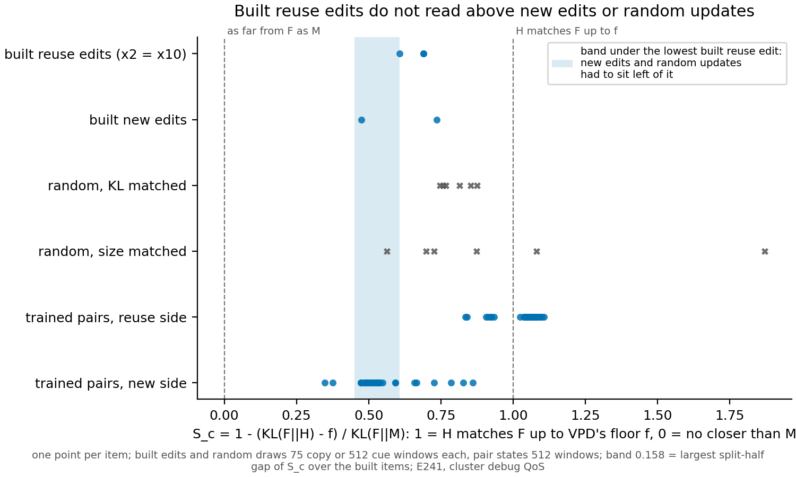

# Can M's own VPD subcomponents, with their causal importances recomputed on F, stand in for a reuse edit but not a new one?

E241, cell P1.45, definition-lead, 2026-11-20. Exploratory and descriptive: the user asked for the result either way.
Figure `experiments/gating_vpd/figures/s_c_by_group.png`.

**Reading.** Gating at VPD does not separate reuse from new on the built edits. S is not read on the four built
reuse edits, because their output change sits under VPD's own reconstruction floor. On the floor-corrected score S_c
the lowest reuse edit sits under the highest new edit, gap -0.128 against a band of 0.158, so rival b holds. Random
updates read S_c 0.56 to 1.87 against 0.61 to 0.69 for the reuse edits, so the random control fails. On the nine
trained pairs the reuse side reads above the new side in 8 of 8 pairs on S and 9 of 9 on S_c, a descriptive
reading only.

We kept M's VPD subcomponents fixed and let VPD's frozen importance network re-read the fine-tuned model to choose
which ones each input switches on. On six hand-built edits this could not tell reuse from new, and random weight
changes scored as high as the reuse edits, though trained reuse fine-tunes scored above their new partners in every
pair. Recomputing which of M's subcomponents are on is not a test of reuse that passes its own controls, so nothing
goes to the write-up from this cell.

## The answer

Letting VPD's importance network re-read the fine-tuned model and switch M's own subcomponents on or off does not
tell a built reuse edit from a built new one. The built edits change the output less than VPD's own reconstruction
error, so the user's score is not read on them. With that error taken off, reuse edits sit no higher than new edits,
and random weight changes sit higher still. Only the trained pairs show the expected order, and they are the case the
built edits were made to check.

## What we were trying to test

M is the 67M base model and F a fine-tune of it. M has a released VPD decomposition: each weight matrix is a sum of
rank-one subcomponents, and a small network Γ reads each input and gives every subcomponent a causal importance
between 0 and 1. The CI-masked model multiplies each subcomponent by its importance on that input.

H is that CI-masked model built from M's subcomponents, with each U and V unchanged and Δ left out, but with Γ, frozen,
reading F's activations instead of M's. Nothing is trained. If F only switches M's existing subcomponents on and off
differently, H should reproduce F; if F writes something M's subcomponents cannot express, it should not.

The user's score is $S = 1 - \mathrm{KL}(F \| H) / \mathrm{KL}(F \| M)$, each KL over the whole vocabulary and averaged
over read positions and windows. S reads 1 when H reproduces F and 0 when H is no closer to F than M is. Beside it we
read VPD's own floor $f = \mathrm{KL}(M \| H_M)$, where $H_M$ is the CI-masked model at M's own importances: how far
VPD's reconstruction of M is from M on those windows. Because $\mathrm{KL}(F \| H)$ cannot fall much under f, an item
is scored on S only when its output change exceeds f. The side score
$S_c = 1 - (\mathrm{KL}(F \| H) - f) / \mathrm{KL}(F \| M)$ takes the floor off and reads any item that changed M at
all.

Three sets of items were read.
- Six built edits, all scaled to the same update size: four built to reuse M's parts and two built to write new ones.
  The reuse edits scale the copy neurons' writes by two or by ten, move them, or rebuild them; at one common size the
  "times two" and "times ten" edits are the same weights. The new edits add a few lookup neurons or one thin one.
- Random Gaussian updates, three draws on each of the two window sets, in two kinds. One kind matches the new-thin
  edit's update size. The other is scaled until its output change is twice the floor f, so that it is scored.
  They rule out that any update of this size reads like a reuse edit.
- The 68 states of the nine trained reuse-and-new pairs used across the project, the larger side of each pair scaled
  to the smaller's size.

## What we expected, and why

We filed that every scored reuse edit would read above both new edits by more than the band, the largest gap between
two halves of one item's windows. We also filed that every random update would read below the lowest reuse edit by
more than the band. Both were filed on S and again on S_c.

Before the run we also wrote that S would likely not be read on the built edits at all. The previous run measured
their output change at this size, and only the new-thin edit was far above the floor. We expected the "times two"
edit to read low too. Each importance multiplies a subcomponent by at most 1, so turning M's copy writes up twofold is
out of H's reach.

## What we observed

### Is the user's score read on the built edits?

No. The table gives each built edit's output change against the floor. Every reuse edit changed the output by less
than VPD's own error on M, so S is not read on any of them. The "moved" edit computes M's own function, so neither
score reads it.

| item | side | output change, KL(F‖M) | floor f | S | S_c |
|---|---|---|---|---|---|
| times two, times ten | reuse | 0.091 | 0.427 | -4.00 | 0.690 |
| rebuilt | reuse | 0.017 | 0.427 | -24.1 | 0.608 |
| moved | reuse | 6.6e-12 | 0.427 | not read | not read |
| new, few neurons | new | 0.159 | 0.780 | -4.18 | 0.736 |
| new, thin | new | 10.25 | 0.780 | 0.399 | 0.475 |

Output changes are nats per read position. The two "times" edits read the same to six figures, as they should: at
one common size they are one set of weights.

### With the floor taken off, do reuse edits read above new edits?

**Reading it.** No: on S_c the built reuse edits sit among the new edits, not above them. The top two rows of the
figure hold the built edits. The rebuilt reuse edit reads 0.608 and the few-neuron new edit 0.736, so the lowest reuse
edit sits 0.128 under the highest new edit. The filed bar asked for a lead larger than the shaded band. The thin new
edit does read lowest, at 0.475, which is the one result in the expected direction.

### Do random updates read lower than the reuse edits?

**Reading it.** No. The two middle rows are the random updates, all at or above the band. On the copy windows the six
draws read 0.563 to 0.873, against 0.608 to 0.690 for the reuse edits. Across both window sets they span 0.56 to
1.87. The size-matched draws changed the output by only 0.0030 to 0.0045 nats. That tiny denominator makes their S_c
mostly noise: one draw's two halves read 1.05 and 0.34. The output-matched draws are not noisy and still sit at 0.747
to 0.875, above every built reuse edit.

### Do the trained pairs show the order the built edits did not?

**Reading it.** Yes, descriptively. The bottom two rows are the trained pairs. Every reuse-side state reads S_c
between 0.834 and 1.107, and most new-side states read about one half. Pair by pair, the reuse side's mean is
higher in all nine pairs on S_c. On S it is higher in all eight pairs where both sides are scored. The closest pair is
lowercase against cipher, 0.837 against 0.800. These states change the output by 0.20 to 4.71 nats, mostly above
the floor, which is why S reads on them.

## What we learned

Switching M's own subcomponents on and off by re-reading F does not tell reuse from new on edits whose answer we know.
Two things get in the way. The built edits move the output less than VPD's reconstruction error on M, so the user's
score has no room. With that error removed, random weight changes read as well as reuse edits. The order on the
trained pairs is real in the data, but a reading that fails its known-answer edits and its random control cannot
certify that order as reuse. This construction is close to R under wording A at VPD by design: both put M's VPD
subcomponents in where F's would go and read how much of F's change survives. A separation that one lacks on the
built edits the other is unlikely to have.

## How compelling is the evidence

- The negative on the built edits is solid as a description of this score at this update size. It is not a statement
  about larger edits: at matched size five of the six built edits sit under the floor.
- The band came from the run itself: the largest split-half gap of S_c over the built items. A band of 0.158 is wide
  because S_c divides by a small output change.
- The random control is decisive only for the output-matched draws. The size-matched draws are noise-dominated.
- Stage 0 held exactly on all three window sets. At the do-nothing, F's importances equal M's to the last bit, the
  output change is 0, and the score's own error equals f: 0.427 on the copy windows, 0.780 on the cue windows and 0.616
  on the pairs' windows. M's subcomponents with every importance at 1 and Δ in reproduce M to 2.7e-11 nats.
- One importance network, one decomposition, one model, no seeds of the decomposition.

## Surprises

The trained pairs and the built edits disagree. On trained fine-tunes the reuse side reads higher in every pair, by
roughly twice; on built edits of known kind there is no order at all. One reading is that the trained pairs differ in
something besides reuse, such as how far the output moved. That is the reason a built-edit check exists, and here it
says not to trust the pairs' order.

The random updates matched on output change read S_c above every built reuse edit. On an earlier run of the same
masked model, Γ's re-reading also recovered more of a random change than of the fine-tune it was matched to. So this
was half expected in the plan, not a new failure mode.

## What next

- Nothing on this line without a new cell. A Γ retrained on F would be a different, gated run; it would only matter if
  the user reads "refit" as retraining.
- If the same order shows up again on the trained pairs under R at wording A, it should be read against this cell: the
  two constructions are near the same by design.

## Scorecard

| id | claim in words | rule | read | verdict |
|---|---|---|---|---|
| P1 | every scored reuse edit above both new edits, on S | gap over band | no reuse edit scored | not read |
| P2 | random updates below the lowest reuse edit, on S | gap over band, copy windows | no reuse edit scored | not read |
| P1c | the same order, on S_c | gap over band 0.158 | gap -0.128 | rival b |
| P2c | random below reuse, on S_c | gap over band 0.158, copy windows | gap -0.265 | fails |
| D1 | per trained pair, reuse side above new | count | 8 of 8 on S, 9 of 9 on S_c | descriptive |
| D2 | what recomputing the importances adds, S minus S00 | none | in `summary.json`, per item | descriptive |
| R0 | stage 0 stops | exact | no miss | holds |

No claim goes to writeup-lead: the reading failed its known-answer edits and its random control.

## Departures from the literature

- "Refit the gates" is read as Γ, frozen, re-reading F's activations, the project's re-gating construction, not as
  retraining Γ on F. VPD trains Γ jointly with the subcomponents on M only.
- S_c, the floor-corrected score, is the lead's side reading and not the user's score.

## Not run

- Retraining Γ on F, the Γ refit recipe of the earlier refit run.
- H with M's remainder Δ left in at mask 1.
- A random update matched to each edit's own output change.
- Random controls for the trained pairs.
- Any change to the definition's wording.

## Provenance

Results `experiments/gating_vpd/results/summary.json`, `items/`, `stage0_built.json`, `stage0_pairs.json`, logs
`run_built.log`, `run_pairs.log`. Code `experiments/gating_vpd/run.py`, `score.py`, figure `plot.py`. Plan
`reports/plans/2026-11-20_plan_p1-45-gating-vpd.md`, card `reports/plans/2026-11-20_plan_p1-45-card.md`. Two jobs on
the MATS cluster's debug QoS, each under three minutes, at no cost.
