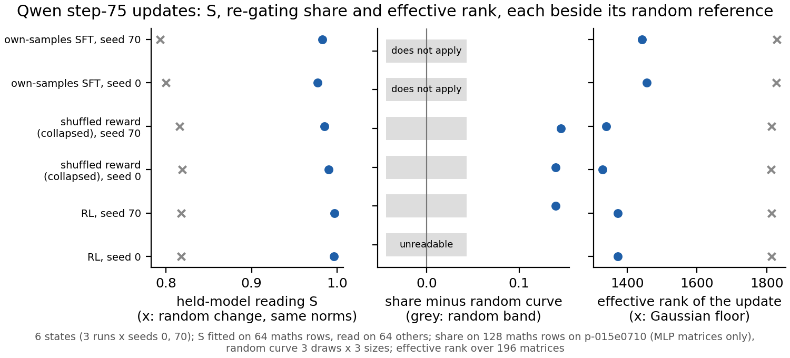
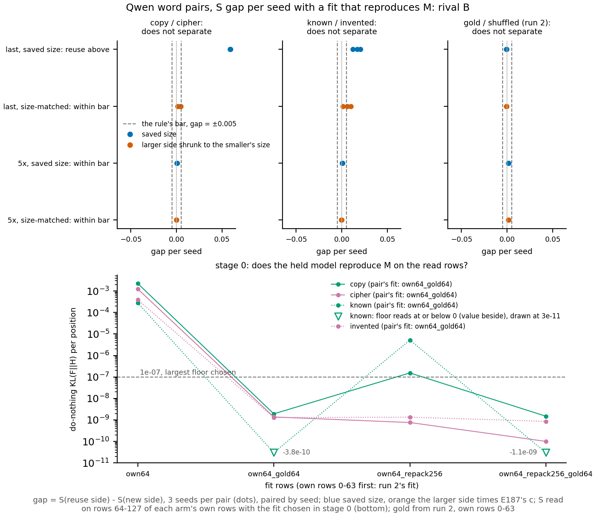

# How much of a Qwen update survives in a held model, and does it tell the library pairs apart?

*2026-11-20, qwen-lead. Cell P3.13, rung L3.2, all three runs: E216, E219 and E225. Plans
`reports/plans/2026-11-19_plan_l3-2-qwen-readings.md` and `reports/plans/2026-11-20_plan_p3-13-run3-fit-floor.md`.
No update on this page is called reused or new.*

We read the held-model reading on Qwen3-1.7B, first on its RL and supervised updates and then on the pair library,
after fixing the held model so that it reproduces Qwen when nothing has changed. Every update keeps most of its
behaviour change in the held model, but no library pair separates once the two sides are matched in size. For the
working definition of `GOALS.md`, this reading carries over to the larger model as a measurement but does not tell the
library's pairs apart there, so section 6 reports it as a description, without a verdict.

## The answer

The held-model reading keeps nearly all of every Qwen update we read, far more than a random change of the same size
keeps. On the three library pairs it does not separate the two sides. Copy and known facts read higher than their
twins only at the late save and at the size they were saved. Once the larger update is shrunk to its partner's size,
the difference falls inside the bar or straddles it. Shrinking raised the reading, the opposite of the small model.

## What was measured

M is Qwen3-1.7B and F a fine-tune of it. The held model H is M with each layer's MLP and attention output matrices
replaced by the least-squares map from M's own unit activations to F's write at that site. The held-model reading is
$S = 1 - \mathrm{KL}(F\|H)/\mathrm{KL}(F\|M)$, the next-token divergence averaged over every position of 64 read rows.
It reads 1 when H reproduces F and 0 when H is no closer to F than M is. Each update is set beside a Gaussian change
with the same norm in every matrix, read the same way: that is the random reference.

Run 1 read $S$ on six updates at step 75: RL, an RL run on shuffled rewards that collapsed, and a fine-tune on the
model's own samples, two seeds each, on maths rows. It also read the re-gating share on the frozen-neuron
decomposition `p-015e0710` and the effective rank of each update. Runs 2 and 3 read $S$ on the pair library: gold
solutions against shuffled gold, copy against cipher, and known against invented facts. Copy and known facts were
built to use a skill Qwen has; cipher and invented facts were built to need one it lacks. That is how the library built
them, not a reading. Each pair is read at three seeds and two saves, late and early, and again with the larger update
shrunk to its partner's size. The gap is $S$ of the first side minus $S$ of its twin at the same seed. The filed bar is
0.005, the smallest gap that separated a built pair on the 67M.

**The fit.** Run 2 found that on the four word row sets H did not reproduce M when nothing had changed: its divergence
from M was 2.8e-4 to 2.2e-3 a position, against 4.3e-9 on gold's rows. Run 3 refitted H on 64 of the pair's own rows
plus 64 gold rows. That brought the do-nothing divergence to 2e-9 or less on all four row sets, under the filed limit of
1e-7, so every word-pair reading below uses this fit.

## What we observed

### On the RL and supervised updates, how much survives?

**Reading it.** Almost all of each update's change survives in the held model, far more than for a random change. $S$
reads 0.98 to 0.997 on the six updates and 0.79 to 0.82 on their random changes, a gap of 0.17 to 0.19. The seed spread of each run is at most 0.0041. The caveat is large: the random changes moved the output by at
most 2.5e-5 nats a position, against 0.18 to 0.35 for RL and the collapsed run. They are matched in weight norm, not in
output change, so the gap is not read as a result. The share places RL seed 70 and both collapsed seeds at 0.990 to
0.997, about 0.14 above its random curve against a band of 0.043. RL seed 0 is unreadable and the own-samples updates
move the output too little to be scored. The effective rank of every update is 1,329 to 1,456, against 1,812 to 1,829
for Gaussian changes of the same norms. With nothing changed H sat 3.5e-9 from M.

### On the pair library, does either side survive more?

**Reading it.** No pair separates. Each dot is one seed's gap, so the spread of dots is the seed spread; the dashed
lines are the bar. At the late save and saved size, copy reads 0.059 above cipher at every seed, and known facts read
0.012 to 0.020 above invented. Shrinking the larger side to its partner's size leaves copy against cipher at 0.0014 to
0.0046, inside the bar. Known against invented reads 0.0012 to 0.0097, which straddles it. At the early save every gap
is under 0.001 at both sizes. Gold against shuffled gold, from run 2, stays within 0.0016 everywhere. The random
references on the word rows read 0.94 to 0.97, higher than the 0.81 on gold's rows. Every side's own seed spread is at
most 0.0046, for known facts at the late save.

## Beside the decomposition readings

- **The VPD decomposition `p-9707d6ff`.** On the library every side read a re-gating share of 0.990 to 0.9998, inside
  random bands of 0.992 to 1.009, and no pair separated. The step-75 updates were not read on it, by the user's
  instruction of 2026-11-19.
- **The frozen-neuron decomposition `p-015e0710`.** On the library sides read 0.921 to 0.995 and random changes 0.81
  to 1.06. Three of six cells left their band, but the gold twin did so at both saves with opposite signs, so no pair
  was read as differing. Once sizes were matched, the share separated one of six cells.

## Surprises

Something we filed came out the other way. The filed expectation, from the 67M, was that shrinking a larger update
would lower its $S$ by 0.0006 to 0.03. On clean word rows shrinking raised it. Scaled by 0.46, cipher's late save went
from 0.932 to 0.937 up to 0.989 to 0.992. Invented facts went from 0.975 to 0.986 on average, scaled by 0.47. At
the early save the rise is under one thousandth. We have not found the cause. It also means the size-matched gaps
shrink mainly because the twin's reading rises, not because the first side's falls.

## What this means

On Qwen the held-model reading measures cleanly once the fit reproduces the model, but it does not tell any library
pair apart at the bar the 67M used. The larger readings for copy and known facts appear only where their twins'
updates are larger, and they mostly vanish at matched size. Section 6 can report $S$ as a description of how much of a
Qwen update a per-site linear map keeps, with no verdict on any update.

**Paragraph for paper section 6.** On Qwen3-1.7B the held model keeps 0.98 to 0.997 of each RL and own-samples
update's behaviour change. Gaussian changes of the same norms keep 0.79 to 0.82, but they barely move the output.
On the pair library, with a fit that reproduces the model to 2e-9 nats a position, no pair separates at the bar of
0.005. Copy and known facts read higher than cipher and invented facts only at the late save at saved size. Shrinking
the larger update raised its reading, the opposite of the 67M.

## How compelling

- Three seeds per side, two saves, four word row sets and gold's rows, read on 64 rows of 256 tokens each.
- $S$ is blind to any change a per-site linear map of M's unit activations can carry. On a library side the read rows
  repeat the fit rows' sequences, so $S$ there is read on the trained text itself.
- The random references are matched in weight norm only; they moved the output hundreds of times less than the states.
- Known facts' do-nothing divergence read slightly below 0, a rounding effect, so its "no change" floor is 0. Every
  state moved M far above that.

## Scorecard

| run | filed claim | read | verdict |
|---|---|---|---|
| E216 | RL updates above random by at least 0.02 at both seeds | gaps 0.17 to 0.19 | first rival, with the norm-only caveat |
| E219 | gold, copy and known pairs separate | none separates; word rows failed the fit | second rival, word pairs voided |
| E225 | with a clean fit, both word pairs separate | neither separates | rival B as filed |
| E225 | shrinking lowers $S$ | it raised $S$ | missed |

## Departures

On the 67M the divergence in $S$ was read at the last position of each window; here it is the mean over every position.
The fit for the word pairs adds 64 gold rows to the pair's own 64 rows, where the 67M fitted on its read task alone.

## Not run

- The share on `p-9707d6ff` for the step-75 updates.
- A random change matched to each update's output change rather than its weight norm.
- A fit with a lower pseudo-inverse tolerance, or anchored at the original weights.
- $S$ at other saves, and the gold pair at run 3's fit.
- The cause of the rise in $S$ under shrinking.

## Provenance

Results `experiments/qwen_held_readings/results/summary.json` (run 1), `results/run2/summary.json`,
`results/run3/summary.json` with `results/run3/<pair>/control/` and `S/`. Filed predictions `results/predictions.json`,
`results/run2/predictions.json`, `results/run3/predictions.json`. Figures from `plot.py` and `plot3.py`. Run 3 ran on
RunPod H100s, $6.61 in all: the rehearsal pod $1.34, the copy and cipher pod $2.89, the facts pod $2.37.
