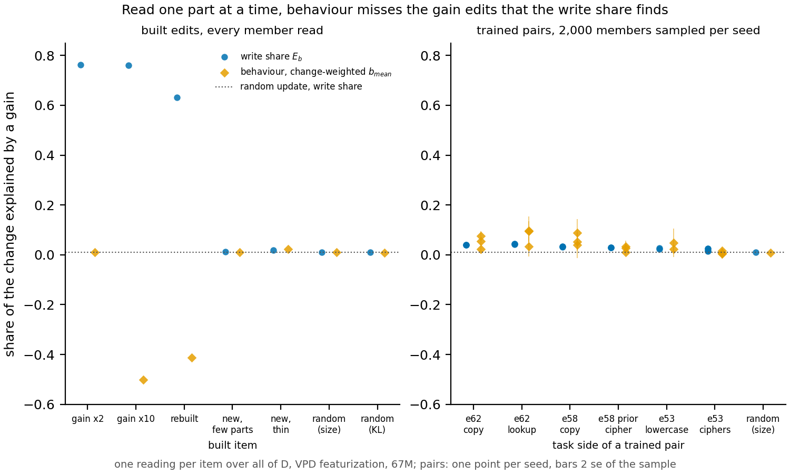

# Does the model's behaviour, read one changed part at a time, agree with the write share?

*2026-11-21, definition-lead. Cells P1.49, run E258 on the built edits, and P1.51, run E259 on trained pairs.
Descriptive by the user's instruction: no reuse or new verdict is given, and no definition wording is changed.*

We swapped each changed circuit part of a fine-tune, one at a time, for the base model's own part at its best strength,
and asked how much of that part's effect on the output went away. On the built edits this put the pure strength edits
at or below a random update, where the write share puts them at three quarters. So a behavioural test that reads one
part at a time fails the strength control, and on trained pairs it separates nothing.

## The answer

Read part by part, behaviour does not see the strength edits as reused. On the gain edit by two it reads 0.011, the
same as a random update, against 0.76 for the write share. On the gain edit by ten and the rebuilt edit it reads below
zero. There a single part, stood in at its fitted strength, moves the output further than removing its change does. On trained pairs behaviour and write agree within 0.055 and neither separates the
reuse side from the new side.

## What was measured

The model is the 67M testbed decomposed with VPD. For a fine-tune F of the base model M, the circuit K* is the set of
subcomponents and site remainders that carries F's behaviour on the task's inputs D, as saved by the wording-A runs.
For each changed member $u$ of K*:

- $g_u$ is its least-squares strength: the best positive multiple of M's write for F's write, fitted over D.
- $q_u$ is $\mathrm{KL}(F \| F_u) / \mathrm{KL}(F \| M)$, where $F_u$ is F with only $u$ replaced by M's part times $g_u$, by soft intervention, averaged over D.
- $q1_u$ is the same with strength 1: $u$'s whole change removed, so it is the size of $u$'s own effect on the output.
- $b_u = 1 - q_u / q1_u$ reads 1 when the fitted strength restores all of $u$'s effect, 0 when it restores none, and below 0 when it moves the output further from F than removal does.

The behavioural share $b_{mean}$ weights each $b_u$ by the part's write change $dd_u$, the squared difference between
what $u$ writes in F and in M summed over D, as the user's option b asks. The pass share is the write change of members
with $q_u$ at most a tenth of $q1_u$, over all changed members. The write share $E_b$ is the twin read on writes: the
share of the change that M's write at strength $g_u$ explains, as on the rescore page.

Two sets of items were read. The built edits are the two gain edits, which multiply eight neurons' output weights by two
or ten, the rebuilt edit, the two new edits and two random updates, with every changed member read. The trained items are three of the nine
task pairs: copy against lookup, copy against prior cipher, and lowercase against the two ciphers. Each seed had 2,000
changed members sampled, with the size-matched random update beside them.

## The stage-zero check, and its amendment

Each job first stands in parts on the do-nothing, where every strength is exactly 1 and the output cannot move. The
filed rule required a KL of exactly 0. In the rehearsal it read 1.7e-11 from rounding in the batched forward and
stopped the job. Before any scored read the rule was amended to the measured floor: the batched and single-member
paths disagree by 2.8e-8 in units of $\mathrm{KL}(F \| M)$, which on the floor item's 0.0030 is a tolerance of 8.3e-11.
Every job read 1.7e-11. That misses the filed tolerance and meets the amended one. For the pairs the
second floor item gave 3.5e-10, and the smaller of the two applies. The batched path sat well inside the half-precision gap of 0.11.

## Why does behaviour read the strength edits near zero or below?

**Reading it.** Behaviour misses the strength edits. In the left panel the blue write share puts both gain edits at
0.76 and the rebuilt edit at 0.63. The orange behavioural share puts the gain edit by two on the random line and the
other two at -0.50 and -0.41. No member of any item passed the per-part bar.

Most parts tell us little. The median part's fitted strength is within 0.04 of 1 on every built item, so standing it in
almost equals removing its change. Its two readings then differ by less than 0.009 of their size, and $b_u$ sits near zero by
construction. The weighting hands the result to a few large parts.

On the gain edit by two one part carries 0.87 of the change. Its write is 0.78 a strength change at strength 1.33. Yet
standing it in at that strength restores only 0.094 of its effect on the output: $q_u$ reads 0.16 against 0.17 for
removal. This part is read far above the noise floor, so the low value is a measurement, not a lack of power.

**The negative values come from single parts.** On the gain edit by ten one part holds 1.0% of the change. Stood in at
strength 3.09, it pushes the output to 1.71 times $\mathrm{KL}(F \| M)$, against 0.034 for removal. That one part
contributes -0.49 of the item's -0.50. On the rebuilt edit the largest part holds 0.68 of the change. At strength 0.67 it
reads 1.04, against 0.61 for removal, and contributes -0.48 of -0.41. Parts that read worse at their fitted
strength than removed carry 0.087, 0.11 and 0.72 of the change on the three reuse edits.

## Do behaviour and write agree on trained fine-tunes?

**Reading it.** Yes, and both sit near the random update. In the right panel the behavioural share runs from 0.0037
to 0.096 over the eighteen trained items, at most 0.055 from the write share. With seeds averaged, the reuse side minus
the new side reads -0.023 on copy and lookup, 0.037 on copy and prior cipher and 0.028 on lowercase and the ciphers.
The pass share is 0 on every trained item and on the random update.

The sampled estimate on the random update read 0.0075 with a standard error of 0.0020, against 0.011 when every member
was read. That is inside the filed two standard errors, so the sampling is sound. One caveat is real: trained parts
move the output less. On the copy, lookup and prior-cipher items between half and two thirds of the sampled members
sit under the floor. They carry an estimated 0.10 to 0.25 of the change and are not counted.

## Which rival each card's numbers favour

- **Built edits.** The rival that behaviour departs from the write share by more than 0.1 on some edit is favoured: the
  gain edit by two is 0.75 apart. Its example does not hold: behaviour reads the strength edits near zero or below,
  not near 1.
- **Trained pairs.** The rival that behaviour and write agree is favoured: within 0.1 on every item. No pair has the
  reuse side more than 0.1 above the new side.

## What each reading is blind to

- **The behavioural share** reads each part alone, with every other changed part left as F has it. A doubling of
  eight neurons spreads over many VPD parts, so one part stood in alone may never restore the output. It is unbounded
  below, so one part can carry the item.
- **The fitted strength** comes from the write, not the output. A part whose best strength for behaviour differs reads low.
- **The pass share** cannot say how close a failing part came; $b_{mean}$ does.
- **The write share** cannot say whether the unexplained part of a write matters downstream.
- **Both** are blind to effects outside D, and the trained items' estimate is blind to members under the floor.

## Departures from the literature

The stand-in is Geiger's soft intervention, applied to one part at a time. The per-part ratio, the weighting by write
change and the per-part bar of a tenth are ours and have no source.

## Not run

- Behaviour read jointly over groups of members, such as the largest five parts or all changed parts of one layer together.
- Behaviour at a strength fitted to the output rather than the write.
- The reinforcement-learning states read by the write share in E257, and the procedural states of cell P2.56.
- The other six task pairs, the own-size copy and lookup states, and the five key tasks.
- Sparse autoencoder latents, the moved edit, and every member of the trained items rather than a sample.

## Provenance

E258: `experiments/rb_member_test/run.py`, four RunPod H100 shards plus two rehearsal pods, $25.55 by remote-kernels
status; `results/summary.json`, `results/stage0_s*.json`, `results/run_read_s*.log`. E259:
`experiments/rb_member_pairs/run.py`, four H100 pods plus a rehearsal, $8.25; `results/summary.json`,
`results/stage0_pod*.json`. Part-level check and figure: `experiments/rb_member_test/plot.py`, run through `fleet/cpu-run`,
$0, writing `results/member_check.json` and `figures/behaviour_vs_write.png`. Rules and the amendment:
each experiment's `results/predictions.json`, key `amendment_2026-11-21`. Write share on the built edits:
`reports/analyses/2026-11-21_analysis_option-b-rescore.md`; on trained items: `reports/analyses/2026-11-21_analysis_e257-eb-trained.md`.
