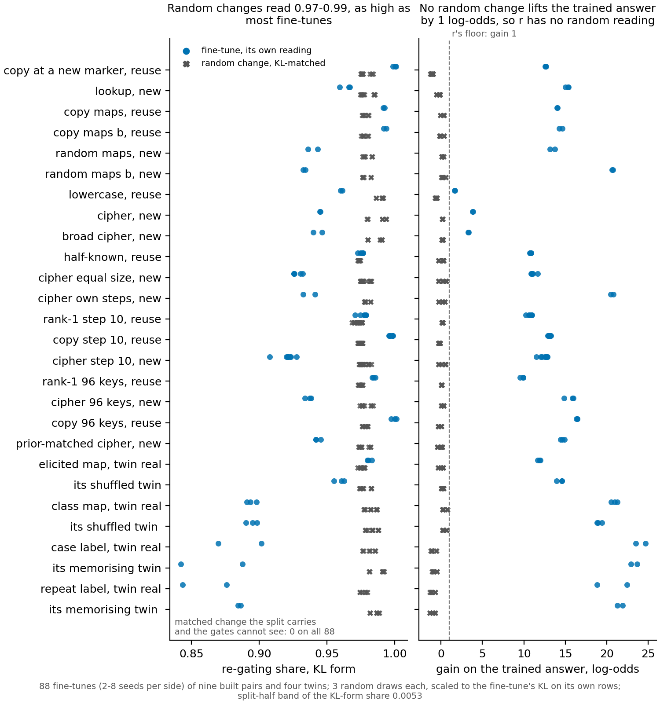

# Does the re-gating share in its KL form read a fine-tune differently from a random change of the same size?

E228, cell P2.44 (compare-lead), 2026-11-21. Figure `experiments/random_kl_share/figures/random_share.png`.

On 88 saved fine-tunes of the 67M model, we read the re-gating share in the KL form that failed its random control on
Qwen, beside random weight changes that move the outputs by the same amount. On 67 of the 88, a random change reads
as high as the fine-tune itself, so in this form a high share does not tell a fine-tune from a matched random change,
on the 67M as on Qwen. The log-odds form, which the 67M results use, could not be given a random control at all,
because no random change moves the trained answer enough to define it.

## The answer

In the KL form, the share of a fine-tune's output change that the original subcomponents carry when the gate function
switches them on differently sits near 1 for any change, fine-tune or random. Random changes scaled to a fine-tune's
output change read 0.97 to 0.99. The fine-tunes read 0.84 to 1.00, and only 21 of 88 read above every one of their
random changes. A high value in this form is therefore not evidence of anything a random change lacks, at 67M as on
Qwen. The log-odds form has no random reading: no random change moves the trained answer enough to define it.

## What we were trying to test

The re-gating share asks how much of a change to the model is carried by VPD's subcomponents being switched on
differently. Each weight matrix of the 67M model is written as VPD's subcomponents plus a remainder $\Delta$. A
masked forward runs only the subcomponents, each multiplied by a mask between 0 and 1, with $\Delta$ left out. The
masks come from VPD's trained gate function $\Gamma$, which reads the clean forward and gives each subcomponent a
causal importance at each position.

The share has two forms. The KL form, used on Qwen, reads distances between output distributions. With $T_1$ the
changed model's output, $K_{ab}$ is the KL from $T_1$ to the masked forward built from components $C_a$ under the
gates read from model $b$. Here $C_0$ is the original subcomponents, $C_1$ is them plus the change's least-squares
split onto the alive subcomponents, gate 0 is the original model's and gate 1 the changed model's. The share is

$s_{KL} = \dfrac{K_{00} - K_{01}}{K_{00} - K_{11}}$,

the part of the gap that new gates close, over the part that new gates and the split close together. It reads 0
when the gates do not move and 1 when the gates alone close the gap. The log-odds form, $r$, is the same ratio on the
log-odds of the trained answer at the read position:
$r = (L_{01} - L_{00}) / (T_1 - T_0)$. It is only defined when the gain $T_1 - T_0$ is at least 1 log-odds.

On Qwen, random weight changes scaled to a fine-tune's KL read 0.992 to 1.009 in the KL form, against 0.990 to 0.9998
for the fine-tunes. That is why the paper's Qwen results do not use this form. This run asks whether the same holds on
the 67M, where the share has been read in log-odds so far.

What was read, for each of 88 saved fine-tunes, on that fine-tune's own read rows:

- **the fine-tune itself**, both forms. As a control on the reader, its $r$ must equal the share saved when it was
  first read.
- **three random changes**: each matrix gets a Gaussian direction at the fine-tune's norm for that matrix, and the
  whole change is scaled so its KL from the original model equals the fine-tune's within 10%. This asks whether any
  change of this output size reads as high as the fine-tune.
- **one structured control**: a change to the last decomposed matrix only, inside the span of its alive
  subcomponents, scaled to the same KL. No decomposed matrix reads that matrix's output, so the gates cannot move and
  the share must read exactly 0. It checks that the rule can say "low" at all.

The 88 fine-tunes are every saved seed of the nine built pairs and of the scorecard's four shuffled-label twins. A
built pair sets a fine-tune built to use something the original model already does against one built to need
something new; a twin sets a real map against the same map with shuffled labels.

A fine-tune counts as "low" when every random change reads below its own share by more than the band, and "reaches"
otherwise. The band is the root mean square gap between the share read on two random halves of each fine-tune's rows:
0.0053 for the KL form and 0.047 for $r$.

A second stage read the six hand-built edits of known construction: three that reuse an existing copy circuit and two
that write a new lookup, with one that adds neurons and so cannot be read. These were read before on altered windows;
this stage feeds them whole.

## What we expected, and why

We filed two rivals. One said the KL form only credits output change that the original subcomponents carry under new
gates, so a random change would read low on every fine-tune. The other, which we leaned to, said a random change lies
mostly outside the alive span. The split then closes little more of the gap than new gates do, so the share sits near
1 for any change, as on Qwen, and random changes reach more than half of the fine-tunes. For $r$ we expected no
reading: past random changes of this size moved the trained answer by well under 1 log-odds. We expected the
structured control to read low everywhere.

## What we observed

### Do the readers and the control work?

Yes. A zero change read every numerator, gain and KL difference exactly 0 in each job. Every fine-tune's $r$
reproduced its saved share within the filed 0.01 before its random changes were read. The structured control read a
share of exactly 0 on all 88 fine-tunes, so the rule called it low on every one. All 264 random changes matched
their fine-tune's KL.

### Does a random change of the same output size read as high as the fine-tune?

**Reading it.** Yes, on 67 of 88 fine-tunes, the outcome we leaned to. In the left panel the grey crosses, the random
changes, sit in a narrow column from 0.97 to 0.99 on every row. The blue dots, the fine-tunes, spread from 0.84 to
1.00 around that column. On 53 fine-tunes the share reads below all three of its random changes. On 14 it sits among
them. On 21 it reads above them, by 0.007 to 0.023, a few times the band. Copying at a new marker, seed 0, is typical
of those 21: it reads 0.9987 against random changes of 0.975 to 0.983.

The 21 are all on sides built to use what the original model does: the copy and rank-1 tasks. They are not all of
those sides: lowercasing, the half-known task, rank-1 at step 10 and the elicited map sit among or below their random
changes. No fine-tune on a side built to need something new reads above its random changes, and no twin does. So
the random changes do not set a floor that fine-tunes clear. They sit near the top of the fine-tunes' range, and
most fine-tunes read lower than noise of the same size.

### Can the log-odds form be given a random control?

**Reading it.** No. The right panel plots the gain on the trained answer, which $r$ needs to be at least 1 log-odds.
The fine-tunes' gains run from 1.6 to 24.7. The random changes' gains run from -1.35 to 0.77, under the floor on
all 264. So $r$ is not defined for any random change, and every fine-tune is refused. This is not a pass: $r$ on
these fine-tunes stays without a random control.

### Do the two forms keep the built pairs apart?

Yes on all nine built pairs, in both forms. The pair rule asks whether the two sides' means differ by more than the
larger side's range of seeds. In the KL form the gaps are small, from 0.017 to 0.077, but the seeds are tight. The
two forms differ on the twins. The elicited map stays apart from its shuffled twin in both, real above twin. The
class map is level with its shuffled twin in the KL form, and below it in $r$, by 0.034 against a range of 0.023.
The case-label and repeat-label twins are not apart in either form.

| pair | KL form: gap | range | call | $r$: gap | range | call |
|---|---|---|---|---|---|---|
| copy at a new marker vs lookup | 0.036 | 0.008 | apart | 0.690 | 0.033 | apart |
| copy maps vs random maps | 0.056 | 0.011 | apart | 0.513 | 0.042 | apart |
| lowercase vs ciphers | 0.017 | 0.007 | apart | 0.621 | 0.049 | apart |
| half-known vs cipher, equal size | 0.047 | 0.007 | apart | 0.517 | 0.055 | apart |
| half-known vs cipher, own steps | 0.038 | 0.009 | apart | 0.509 | 0.022 | apart |
| rank-1 vs cipher, step 10 | 0.056 | 0.020 | apart | 0.623 | 0.058 | apart |
| copy vs cipher, step 10 | 0.077 | 0.020 | apart | 0.607 | 0.030 | apart |
| rank-1 vs cipher, 96 keys | 0.048 | 0.004 | apart | 0.557 | 0.046 | apart |
| copy vs prior-matched cipher, 96 keys | 0.057 | 0.004 | apart | 0.393 | 0.008 | apart |
| elicited map vs shuffled twin | 0.022 | 0.007 | apart | 0.251 | 0.014 | apart |
| class map vs shuffled twin | -0.0004 | 0.008 | not apart | -0.034 | 0.023 | apart, twin above |
| case label vs memorising twin | 0.021 | 0.046 | not apart | -0.012 | 0.057 | not apart |
| repeat label vs memorising twin | -0.026 | 0.032 | not apart | -0.015 | 0.104 | not apart |

The gap is the first side's mean minus the second's; the range is the larger side's spread over seeds. "Apart"
means the gap's size exceeds the range.

### On the edits of known construction, does either form order the reuse edits above the new ones?

**Reading it.** No, in neither form. The control reproduced the earlier reading exactly before any edit was read.
Neither form puts any reuse edit above any new edit by more than its band, in all six combinations. Neurons for half the
gain reads nothing, because the new edits' neuron-level shares are negative. In the KL form the new edits read as
high as the reuse ones or higher: the new edit with few weights reads the highest of the five.

| edit | built as | KL form | $r$ | neurons for half the gain |
|---|---|---|---|---|
| turned up twice | reuse | 0.57 | 0.17 | 32 |
| turned up ten times | reuse | 0.94 | 0.14 | 256 |
| rebuilt | reuse | 0.90 | 0.093 | 256 |
| new, few weights | new | 1.00 | 0.16 | not read |
| new, thin | new | 0.94 | 0.17 | not read |
| band | | 0.030 | 0.18 | |

The three copy edits lower the copy answer, so here each row's target is the token the edit raises most; see the
departures. The KL form needs no target.

## What we learned

The paper's part on the 67M can no longer read a high KL-form share as a sign of anything: random changes of the same
output size read 0.97 to 0.99, which is higher than most fine-tunes. This repeats the Qwen failure on the 67M, so it
belongs to the form, not to the model. The KL form still keeps all nine built pairs apart, but only as an ordering of
values that sit around the random level, not above it. The log-odds form, which the 67M results use, has no random
reading at all at matched output change, so its random control is still missing. None of this gives a verdict on
reuse.

## How compelling is the evidence

The controls are as strong as they can be: an exact zero for no change, the saved $r$ reproduced on every
fine-tune, and the structured control at exactly 0 everywhere. The random changes are three Gaussian draws per
fine-tune, matched on KL, not on gain or on direction. Two changes of the same KL can move the outputs differently.
A fine-tune's three random changes lie within 0.014 of each other on every fine-tune, so three draws are enough to
place them. The band comes from split halves of rows, not from seeds. On most pairs the seeds of one side spread wider
than the band, as the table's ranges show.
States shared between two pairs are counted once among the 88. The known-answer stage has one edit per construction,
one seed and one model.

## Surprises

The random changes read higher than 53 of the 88 fine-tunes. We expected them to reach the fine-tunes, not to sit
above most of them. A random change mostly leaves the alive span, so the split adds little and new gates close most of
what can be closed. A fine-tune moves more of its change into the span, where the split closes more and the share
falls. This is a reading of the formula, not a tested cause.

On the known-answer edits the KL form put a new edit highest. That was not predicted, and with one edit per
construction it is not read further.

## What next

- A random control for $r$ that moves the trained answer: random changes scaled to the fine-tune's gain, not its
  KL. If they read low against the fine-tunes, $r$ has the control the KL form lacks.
- The paper's results on the 67M should cite the log-odds form only, with this run as the reason the KL form is not
  used.
- Neither item is in an open cell; the first would need one from the user.

## Scorecard

| id | claim in words | rule | read | verdict |
|---|---|---|---|---|
| P0 | readers exact; $r$ reproduces; control built right | zero change exactly 0; $r$ within 0.01 of saved; control's gates unmoved | all held on 88 | held |
| K1 | KL form: do random changes reach the fine-tune? | none reach: rival a; over half: rival b | 67 reach, 21 low, 0 refused | rival b: reaches |
| P1 | the same for $r$ | as K1 | 88 refused | silent: refused |
| control | structured control reads low | below own minus band, every fine-tune | 0 on all 88 | low on 88 of 88 |
| pairs | pair rule, both forms | gap above range | nine built pairs apart in both; twins as above | reported |
| KA kl_share | known-answer, KL form | reuse above new by band, 6 combinations | 0 of 6 | mixed: 0 of 6 ordered |
| KA r | known-answer, $r$ | as above | 0 of 6 | mixed: 0 of 6 ordered |
| KA k_half | known-answer, neurons for half the gain | as above | new edits not read | silent |
| KA control | new edits' neuron reading equals the earlier one | equal within its filed tolerance | equal | held |

## Departures from the literature

- The KL form is the Qwen line's form, the share as read on Qwen, not VPD's. VPD's paper defines causal importance
  and masked forwards, not a share. KL is summed over every position up to the read position, as on Qwen.
- The random direction is a Gaussian per matrix at the fine-tune's norm for that matrix, scaled as a whole to the
  fine-tune's KL within 10%. This is the project's matcher from its earlier KL-matched random changes on the 67M, not a
  published recipe.
- The structured control is built here; no source uses it.
- On the three copy edits of the known-answer stage, the target of $r$ and of neurons for half the gain is, per row,
  the token the edit raises most over the original model at the read position, chosen on the same rows. The edits'
  source reads the copy answer, which these edits lower. By construction the gain is positive in sign, not in size.
- The earlier known-answer read fed altered windows, and its correction note said its share and its neurons-for-half
  readings were invalid. This run narrows that: on the two new edits, neurons for half the gain read again on whole
  windows gives exactly the earlier values. These are a neuron-level share of -0.518 and -0.516 and a numerator of
  -8.596 and -8.385. The neuron reader runs no gate function and the model is causal, so the appended answer token
  could not reach it. Those readings stand. The earlier share readings on the new edits, 0.366 and 0.377, remain
  invalid: on whole windows they read 0.16 and 0.17. The earlier readings on the copy edits used another target and are
  not re-checked here.

## Not run

- Random changes matched on the gain on the trained answer, which $r$ needs.
- Random changes in the alive span only, to test the account in "Surprises".
- More than three random draws per fine-tune.
- A Qwen3-1.7B rerun of the log-odds form against random changes.
- The edit that adds neurons; neither form applies to it.

## Provenance

- Plan `reports/plans/2026-11-20_plan_p2-44-random-kl-matched.md`; card `experiments/random_kl_share/card.md`; filed
  rules `experiments/random_kl_share/results/predictions.json` and `results/predictions_known_answer.json`.
- Code `experiments/random_kl_share/run.py`, `known_answer.py`, `plot.py`.
- Results `experiments/random_kl_share/results/score.json`, `states/*.json` (88 files), `zero_*_of_3.json`;
  known-answer stage `results/known_answer/score.json` and one file per edit.
- Main stage: three RunPod H100 pods, about 23 min of reading in all, about 5 dollars (commit 5924aca0).
  Known-answer stage: MATS cluster job 62272, about 2 min, no cost (commit 6950cb12).
