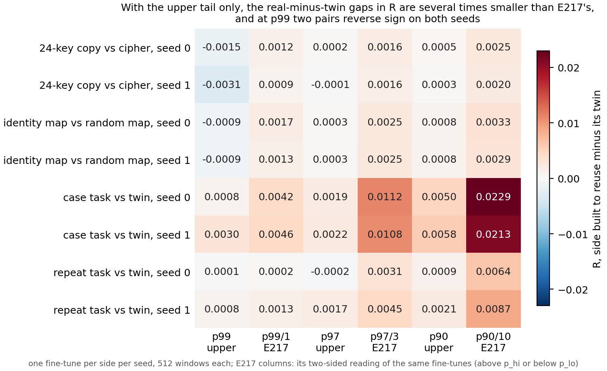

# What changes when only the upper tail of each neuron counts as a feature?

E229, cell P2.45 (compare-lead), 2026-11-21. Figure `experiments/topk_upper/figures/gaps_upper_vs_two_sided.png`.

We repeated the earlier reading of the small model's 20 trained fine-tunes, now counting a neuron as a feature only
when it fires above its 97th percentile in the base model, dropping the bottom tail on GELU's negative floor. Base and fine-tune now share about twice as many strong neurons, reuse rises toward its full-width
value, and the differences between each built pair's two sides shrink several-fold. So most
of what the two-sided featurized model separated came with the floor tail, and this descriptive reading gives no verdict on
what was reused or new.

## The answer

Counting only strong positive firing as features keeps every reading in its filed range. Reuse sits at 0.9880 to 0.9982
at the main threshold, above the two-sided reading on every fine-tune but still below full width. The strong-neuron
overlap of base and fine-tune about doubles, to 0.451 to 0.674. The weak remainder turns almost as much as before. The
gap between the case task and its twin, the only pair that stood out before, shrinks from about 0.011 to about 0.002.
At the strictest threshold two pairs reverse sign on both seeds.

## What we were trying to test

The working definition reads a fine-tune against its base model through a featurized model: a fixed set of variables
shared by both networks, each with a mechanism in each. Reuse is $R = \frac{1}{|K^*|}\sum_{u \in K^*} s_u$. Here $K^*$
is the smallest set of variables that keeps the fine-tune's behaviour when every other variable is held at its mean,
and $s_u$ is the squared cosine between the fine-tune's and the base model's write of variable $u$. $R = 1$ means every
variable the behaviour runs through still writes in the base model's direction; 0 means none does. With every MLP
neuron a variable, the full width, $R$ saturates near 1.

The earlier run, E217, used Goodfire's rule for neurons. At each of the four MLP layers, a neuron is a feature on a
token when its activation is above its 97th percentile or below its 3rd, taken once from the base model on Pile text.
Every weaker activation at the layer is summed into one remainder variable, so the featurized model is exact. That run
found $R$ falling to 0.9598 to 0.9896 and an overlap of strong-neuron sets of only 0.231 to 0.361. But the small model's
MLP uses GELU, whose negative side flattens at about -0.17. Every neuron's 3rd percentile sat on that floor, at -0.1699
to -0.17, so tiny shifts there could move a neuron in and out of the bottom tail.

This run changes one thing: a neuron is a feature only above its 97th percentile, and the bottom tail joins the
remainder. Everything else is E217's: the same saved percentiles, the same 20 fine-tunes of ten tasks at two seeds,
the same 512 read windows, the same search for $K^*$ and the same functions. The 99th and 90th percentiles sit beside
the main one as a sensitivity check. Each number is reported beside E217's at the same upper percentile.

Two quantities sit beside $R$. The overlap is the Jaccard index of the base's and the fine-tune's strong-neuron sets at
the read position: 1 means the same neurons fire strongly, 0 that none are shared. The remainder's $s$ is the squared
cosine for a layer's pooled weak write; we report each fine-tune's lowest over the four layers.

Eight of the ten tasks form four counted pairs: a fine-tune built to use a skill the base already has, beside a twin
built to need something new. For each pair and seed we report the built-to-reuse side's $R$ minus the twin's.

The control ran first. The base read against itself must show no change at every threshold. At full width, every
activation is a feature, and $R$ must reproduce the earlier full-width run item by item within a floor measured by
E217.

## What we expected, and why

We filed that $R$ at the main threshold would sit between 0.95 and 0.9995 and stay below full width, and that it would
not fall below E217's on any fine-tune. Dropping the floor tail removes threshold crossings that scored as
disagreement. We filed that the overlap would rise above E217's on every fine-tune, to between 0.25 and 0.95. We filed
that the remainders' $s$ would stay between 0.8 and 1, with no lean against E217's, since the floor tail now in the
remainder sits near -0.17 in both networks. The card named two rivals: if the strong positive firing itself moves,
overlap and $R$ stay within 0.1 and 0.01 of E217's. If E217's fall came from the floor tail, both rise by at least
that much. The pair gaps were filed as reported, no lean.

## What we observed

### Did the control pass?

Yes, exactly. Reading the base against itself changed no variable at any threshold, every $s$ was 1 and the overlap 1.
The largest exactness error was 3.0e-6 against a bar of 0.001. On Pile text the share of activations above each
threshold was 0.030, 0.010 and 0.100, the targets. At full width all 20 fine-tunes matched the earlier full-width run to
7.9e-8, under the bar set from E217's floor of 9.0e-9. Each also matched E217's own control value exactly. On the read
windows the strong share at the main threshold was 0.0253.

### How do overlap, reuse and the remainder move without the floor tail?

At the main threshold the overlap is 0.451 to 0.674, against E217's 0.231 to 0.361. It rose on every fine-tune, by
0.198 to 0.314. So base and fine-tune share roughly half to two thirds of their strong positive firing, where E217
read a quarter to a third.

$R$ is 0.9880 to 0.9982 against E217's 0.9598 to 0.9896. It rose on every fine-tune, by 0.0083 to 0.0293, and on 14 of
20 by at least 0.01. All 20 stay below their full-width value of 0.9991 to 0.9999. The six that rose by less are the
24-key copy, the cipher and the identity map at both seeds.

The lowest remainder $s$ is 0.847 to 0.958, against E217's 0.832 to 0.942. Adding the floor tail to the remainder
changed it little. The case and repeat tasks are again the lowest on $R$ and on the remainder, as in E217.

On the card's rivals, the overlap rose by more than 0.1 on all 20 fine-tunes and $R$ by 0.01 or more on 14. That is the
pattern the second rival described, that E217's fall came largely from the floor tail. It is reported as read.

| threshold | $R$, upper | $R$, E217 | overlap, upper | overlap, E217 | lowest remainder $s$, upper | E217 | remainders' share of $K^*$, upper | E217 |
|---|---|---|---|---|---|---|---|---|
| 99th | 0.9901-0.9989 | 0.9790-0.9918 | 0.369-0.607 | 0.172-0.229 | 0.835-0.961 | 0.830-0.949 | 0.0016-0.0345 | 0.0011-0.0110 |
| 97th | 0.9880-0.9982 | 0.9598-0.9896 | 0.451-0.674 | 0.231-0.361 | 0.847-0.958 | 0.832-0.942 | 0.0008-0.0024 | 0.0006-0.0014 |
| 90th | 0.9779-0.9964 | 0.9354-0.9873 | 0.530-0.746 | 0.364-0.585 | 0.868-0.967 | 0.816-0.943 | 0.0006-0.0013 | 0.00048-0.00076 |

Ranges over the 20 trained fine-tunes. "Upper" is this run at the 99th, 97th or 90th percentile; E217 is the two-sided
rule at the same upper percentile with the mirrored bottom one. Full width reads $R$ 0.9991-0.9999. $K^*$ holds 1676 to
5009 variables at the main threshold, against 2826 to 6270 in E217. Every item is in
`experiments/topk_upper/results/summary.json` → `table`.

### Do the built pairs still differ in $R$?

**Reading it.** Far less than before. Each cell is one seed's $R$ on the side built to reuse minus its twin; columns
pair this run with E217 at the same percentile. At the main threshold the case pair, E217's largest at 0.0112 and
0.0108, reads 0.0019 and 0.0022. The other three pairs read 0.0003 or less on at least one seed. Two cells are slightly
negative: the copy pair's second seed at -0.0001 and the repeat pair's first seed at -0.0002. At the 99th percentile
the copy pair reads -0.0015 and -0.0031, and the identity pair -0.0009 on both seeds. E217 read both positive there.
No gap at any threshold reaches the card's 0.01. The largest is the case pair at the 90th percentile, 0.0050 and 0.0058,
against E217's 0.0229 and 0.0213.

| pair | 99th, upper | 99th, E217 | 97th, upper | 97th, E217 | 90th, upper | 90th, E217 |
|---|---|---|---|---|---|---|
| 24-key copy vs cipher | -0.0015, -0.0031 | 0.0012, 0.0009 | 0.0002, -0.0001 | 0.0016, 0.0016 | 0.0005, 0.0003 | 0.0025, 0.0020 |
| identity map vs random map | -0.0009, -0.0009 | 0.0017, 0.0013 | 0.0003, 0.0003 | 0.0025, 0.0025 | 0.0008, 0.0008 | 0.0033, 0.0029 |
| case task vs twin | 0.0008, 0.0030 | 0.0042, 0.0046 | 0.0019, 0.0022 | 0.0112, 0.0108 | 0.0050, 0.0058 | 0.0229, 0.0213 |
| repeat task vs twin | 0.0001, 0.0008 | 0.0002, 0.0013 | -0.0002, 0.0017 | 0.0031, 0.0045 | 0.0009, 0.0021 | 0.0064, 0.0087 |

Each cell: seed 0, seed 1.

## What we learned

The two-sided featurized model's low overlap and lowered $R$ came in large part from GELU's floor tail. Without it,
base and fine-tune share about half of their strong neurons and $R$ moves most of the way back toward full width. Some
change remains: much of the strong set is still not shared, the remainder turns as much as before, and $R$ stays below
full width on every fine-tune. But the pair differences E217 read shrink several-fold, and two reverse at the
strictest threshold. Only the case pair keeps a positive gap on both seeds at every threshold, and it stays
well under the card's smallest gap worth reading. So, on this small model, the upper-tail featurized model barely tells
the built pairs apart in $R$. None of this is a verdict on reuse or new.

## How compelling is the evidence

All 60 fine-tune readings ran, 20 at each threshold, with the control exact and E217's own percentiles and windows. The
comparison with E217 is paired: the same fine-tune, windows and search, so the differences are the featurization's.
The pair gaps are now small enough that seed differences matter: at the main threshold the repeat pair's two seeds
differ by 0.0019, as large as most gaps. $K^*$ comes from one greedy search
order. The overlap counts a neuron moving from just above to just below its threshold as lost. So some of the unshared strong
neurons may sit near the edge; this run did not measure that. Only the small model and these ten tasks were read.

## Surprises

None reversed a filed lean: every filed reading landed in its range. At the strictest threshold the copy and identity
tasks' $K^*$ shrink to 116 to 289 variables. There the four remainders reach 0.0345 of the circuit, above the 0.01
filed for the main threshold, as the filed sensitivity note expected. The pair gaps at that threshold reverse sign on
two pairs, which nothing filed anticipated.

## What next

- Measure how far the lost strong neurons moved across their threshold. If most sit just below it in the fine-tune,
  even the upper-tail overlap is an edge effect.
- Mean-ablate the weak activations as Goodfire does, instead of keeping them as an exact remainder. That would test
  whether the remainder's turn carries the low $s$.
- Neither is in an open cell; each would need one from the user.

## Scorecard

| id | claim in words | rule | read | verdict |
|---|---|---|---|---|
| P1 | $R$ at the main threshold rises a little, below full width | in [0.95, 0.9995] on all 20, below width | 0.9880-0.9982; below width on all 20 | within |
| P2 | $R$ not below E217's | upper minus E217 in [0, 0.04] | 0.0083-0.0293 | within |
| P3 | overlap rises | in [0.25, 0.95] | 0.451-0.674 | within |
| P4 | overlap above E217's | upper minus E217 in [0, 0.7] | 0.198-0.314 | within |
| P5 | remainder $s$ | lowest in [0.8, 1] | 0.847-0.958 | within |
| P6 | remainders' share of $K^*$ | in [0, 0.01] | 0.0008-0.0024 | within |
| P7 | almost all of $K^*$ changed | in [0.99, 1] | 0.9988-1 | within |
| P8 | size of $K^*$ | in [300, 9000] | 1676-5009 | within |
| P9 | the other two thresholds | reported | table above | reported |
| P10 | pair gaps | reported, no lean | table above | reported |

## Departures from the literature

The threshold rule is Goodfire's, "Neurons as an interpretable basis": "p97/3 refers to both positive and negative
extremes", with mean ablation of everything between.

1. Upper tail only. Goodfire counts both tails because their models use SwiGLU, whose activations have two signed
   tails. This model's MLP is plain GELU: its negative side flattens at about -0.17, and every neuron's 3rd percentile
   sits on that floor. So only activations above the upper percentile count as features. This is the user's choice
   for this cell.
2. Goodfire mean-ablates the weak activations; here they are kept exactly, summed into one remainder per layer, so the
   featurized model is exact. The bottom tail now joins that remainder.
3. Goodfire fixes percentiles on about 10 billion tokens; here E217's percentiles from 204,800 Pile tokens are reused.
4. The base model's thresholds read a second network, the fine-tune, which is our use, not Goodfire's.

## Not run

- How far lost strong neurons moved across their threshold.
- More than one greedy search order for $K^*$.
- Mean-ablating the weak activations as Goodfire does.
- A full-width re-read in stage 1; the width is E217's, since the featurized model is the same there.
- Thresholds fixed from the fine-tune, or from both networks.
- Any model other than the small 67M one; any verdict on reuse or new.

## Provenance

- Plan `reports/plans/2026-11-20_plan_p2-42-upper-tail.md`; card `experiments/topk_upper/card.md`; filed rules
  `experiments/topk_upper/results/predictions.json`.
- Code `experiments/topk_upper/run.py`, which calls E217's functions in `experiments/topk_neurons/run.py`; figure
  `experiments/topk_upper/plot.py`.
- Results `experiments/topk_upper/results/stage0.json`, `summary.json` and per item `items/`; E217's readings beside
  them are copied into `summary.json` from `experiments/topk_neurons/results/summary.json`.
- MATS cluster debug L40, job 62243 for the control and array job 62245 for the readings, 1 h 7 min in all, $0.
