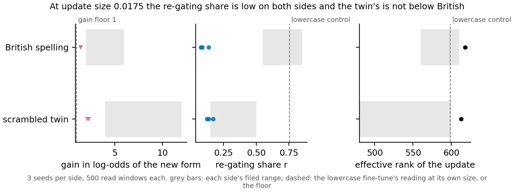

# Does the re-gating share put British spelling above a scrambled twin?

E233, cell P2.48 (compare-lead), 2026-11-21. Figure `experiments/british_style/figures/real_vs_twin.png`.

We fine-tuned the 67M model on Pile text rewritten into British spelling, and on the same text with fixed letter
scrambles in place of those words. The re-gating share was low on both
tasks and did not put British spelling above its twin; the filed prediction that it would failed. So on the one
real-text task with a twin built to its own premise, the share's agreement with the built pairs does not carry over.

## The answer

The filed prediction failed. The re-gating share is the part of a fine-tune's gain carried by switching on the
original model's subcomponents differently. We expected it to read far higher for British spelling, which the original
model already prefers, than for scrambles it has never seen. Instead both read low, around a tenth, and the scrambled twin's three seeds sit
level with or above the British ones. The update's effective rank did put British above the twin, but by under one per
cent. This says nothing about whether the British fine-tune itself is reused or new.

## What we were trying to test

Earlier runs found that the re-gating share separates fine-tunes built to reuse what the model already does from
fine-tunes built to need something new. Those pairs were built by hand, or differed in data and format as well as in
what the model knew. This run asks the same question on running text, with everything matched except whether the
written form is one the model already prefers.

The two tasks share their rows, their word positions, the training recipe and the update size:

- **British spelling.** Pile rows in which every lowercase American spelling from a public list of 1,759 word pairs is
  replaced by its British form: "color" becomes "colour", "organize" becomes "organise". The Pile already holds these
  forms, and the original model prefers them: its mean log-odds of the British form's first differing token is -7.15.
- **Scrambled twin.** The same rows, with each such word replaced by a fixed scramble of the British form's letters,
  one per word, that is in no word list. The original model's mean log-odds of the scramble's first differing token
  is -13.56. A fine-tune has to learn each scramble from nothing.

Each task was fine-tuned three times, with three batch orders, on 4,800 rows each seen once: Adam at learning rate
3e-5, batch 8, the recipe of the earlier real-text runs. Each fine-tune was saved at the first step its relative update
size $\lVert \delta W \rVert / \lVert W_0 \rVert$ reached 0.00875 and 0.0175. The larger is the scored size.

Each saved fine-tune was read at the same 500 held-out word occurrences in both tasks. The scored token is the first
token where the written form leaves the American form, read as its log-odds over the whole vocabulary in a 127-token
window. Three readings were filed:

- **The re-gating share.** $r = \mathrm{mean}(L_{01} - L_{00}) / \mathrm{mean}(T_1 - T_0)$. Here $T_0$ and $T_1$ are
  the scored token's log-odds in the original and the fine-tuned model, and $L_{00}$, $L_{01}$ are the same log-odds
  in VPD's masked forward pass, with masks read from the original model's or the fine-tune's clean pass. It reads 0
  when the masks do not move and 1 when the change in masks carries the whole gain $T_1 - T_0$. It is not read when the
  gain is under 1 log-odds.
- **The update's effective rank.** Per matrix, $\exp$ of the entropy of the normalised singular values of $\delta W$,
  averaged over the 24 decomposed matrices with weights $\lVert \delta W_m \rVert^2$. A reuse-like update was expected
  to spread over more directions.
- **Neurons for half the gain.** The fewest MLP neurons, on a doubling grid, whose patched activations carry half of
  the gain that patching all neurons carries. It has no value when that all-neuron share is at most 0.1.

Before any fine-tune, three checks ran alone. A saved lowercase fine-tune from an earlier run had to reproduce its share
through this code. A zero update had to read a gain of exactly 0. And the original model had to prefer the British
forms over the scrambles by at least 2 log-odds, with the scrambles' median probability at most 0.001. Then seed 0 of
both tasks had to reach the scored size and gain at least 1 log-odds, before seeds 1 and 2 ran.

## What we expected, and why

We filed that every British seed's share would lie above every twin seed's at the scored size, with medium confidence.
The expected values were 0.55 to 0.85 for British and 0.15 to 0.5 for the twin. The reasoning: British forms are
already written by the model, so a fine-tune toward them should mostly switch on parts it already has. The closest
earlier result agreed. A lowercase fine-tune read 0.75 against 0.12 to 0.26 for a token cipher on the same rows. The
card called "rival a" a separation of at least 0.1 in that direction. "Rival b" said the share reads the shape of the
task, one fixed form swapped in at the same places, not whether the model knew the form. It predicted overlap or the
twin higher.

With low confidence we also filed a higher effective rank and fewer neurons for half the gain on the British side.

## What we observed

### Did the checks before training pass?

Yes. The lowercase control read a share of 0.7538 against its saved 0.7519, inside the filed 0.01. The zero update
read exactly 0. The original model preferred British forms over the scrambles by 6.41 log-odds on average, against a
bar of 2. The scrambles' median probability was 8.4e-7, against a bar of 0.001. So the twin is a task the model starts
far from, and the British task one it starts much nearer.

### Does the re-gating share put British spelling above its twin?

**Reading it.** No. The middle panel shows all six shares between 0.077 and 0.170, far left of the lowercase control's
dashed line. The British seeds read 0.077, 0.087 and 0.136, and the twin seeds 0.124, 0.136 and 0.170. The ranges
overlap, and the British mean is 0.043 below the twin's. Both sides miss their filed ranges, drawn as grey bars, and
the British side misses by the most. The difference is not only in the denominator. The re-gating part of the gain
itself, $L_{01} - L_{00}$, was 0.11 to 0.20 log-odds on the British side and 0.26 to 0.39 on the twin.

The left panel is the reason the share has little to work with on the British side. Its gain at the scored size was
1.43 to 1.45 log-odds, just over the floor of 1 and below its filed 2 to 6. The twin gained 2.11 to 2.28, below its
filed 4 to 12. Both fine-tunes reached the scored size inside their filed step ranges, British at steps 369 to 370 and
the twin at 297 to 299. At equal update size, the British fine-tune moved its target less.

| seed | British gain | British share | twin gain | twin share |
|---|---|---|---|---|
| 0 | 1.43 | 0.077 | 2.27 | 0.136 |
| 1 | 1.44 | 0.087 | 2.28 | 0.170 |
| 2 | 1.45 | 0.136 | 2.11 | 0.124 |

At the smaller size 0.00875 two of the three British seeds gained under 1 log-odds, so their share is not read. The one
that remains read 0.253, against twin seeds of 0.128 to 0.209. One seed a side cannot be scored, and nothing was filed
there.

### Do the two baselines separate the tasks?

**Reading it.** The effective rank does, by a hair; neurons for half the gain cannot be read. The right panel puts the
British seeds at 617.6 to 618.2 and the twin's at 612.3 to 612.8. Every British seed is above every twin seed, so the
filed rule scores a hit. The gap is 0.0037 in $\log_{10}$ of the ratio of means, under one per cent. That is ten
times the spread within a side, so it is not seed noise. It is a twentieth of the gap the same reading gave on the
earlier real-text pair, 0.073. Both sides sit above their filed ranges and above the lowercase control's 598.57. The
smaller size shows the same order, 602.9 to 603.4 against 597.6 to 599.0.

Neurons for half the gain has no British value. Patching all MLP neurons carried -0.063, 0.028 and 0.009 of the British
gain, under the 0.1 that a count needs. On the twin the same share was 0.271 to 0.288, and 128 neurons carried half of
it on all three seeds. So the neuron reading, like the re-gating share, puts a larger part of
the gain in changed unit activity on the twin than on British.

## What we learned

The twin was matched in rows, positions, recipe and size. Even so, the re-gating share does not read the task the
model already prefers above the one it must learn from scratch. It reads both low. The card's stop rule applies. Part
2 reports that the share's separation of the built pairs does not carry to this real-text task with a twin. No
further real-text twin is run for the share. The effective rank separates the two, but by a twentieth of its gap on
the earlier real-text pair. None of this is
a verdict on whether the British fine-tune is reused or new under the working definition: that needs the featurized
model's reading, not this share.

## How compelling is the evidence

The checks before training are strong: an exact zero, the control reproduced within 0.002, and a base contrast three
times its bar. Three seeds a side differ only in batch order, and the British and twin run of one seed share rows and
read occurrences, so the comparison is paired. The share's seed spread was larger than the card's 0.018 from earlier
runs; the British side ran from 0.077 to 0.136. A gap of -0.043 is inside that spread, so the result is overlap, not a
reliable reversal.

What the share is blind to matters here. It reads one scored token per occurrence, the first that differs from the
American form, and nothing of the surrounding text. The British side's gain was small, so its share is a ratio over
little more than 1 log-odds. The twin differs from British in more than familiarity. Its scored tokens are rarer
tokens, and about two in five of its words have a different token count from the British form. The rows are mostly unchanged Pile text, so most of
each update is spent on text both tasks share. This is one task pair on one model.

## Surprises

The filed direction failed outright, which is the main result and leads the answer above. Beyond that, the British
task gained less than the twin at the same update size, and both gains fell below their filed ranges. The original
model's preference for British forms left less room to gain, and with it a small denominator for the share. Nothing
filed anticipated that the twin's re-gating part would be larger in absolute terms too.

## What next

- Hand the twelve saved fine-tunes to the featurized-model reading of the working definition, which definition-lead
  owns. If it calls the British fine-tune reused and the twin new, the share's failure here is a failure of the share.
  If it calls both alike, the twin was a poorer contrast than its premise assumed.
- The card's stop rule closes real-text twins for the share. A further pair would need a new cell from the user.

## Scorecard

| id | claim in words | rule | read | verdict |
|---|---|---|---|---|
| stage 0a | the lowercase control reproduces | share within 0.01 of 0.7519 | 0.7538 | pass |
| stage 0b | a zero update reads zero | gain and numerators exactly 0 | all 0 | pass |
| stage 0c | the model prefers British over scrambles | contrast at least 2; twin median probability at most 0.001 | 6.41; 8.4e-7 | pass |
| stage 1 | seed 0 clears the gain floor | gain at least 1 at 0.0175, both tasks | 1.43 and 2.27 | pass |
| P1 | share: British above twin | every British seed above every twin seed at 0.0175 | overlap, gap -0.043 | not a hit; the scorer's label is "no call" |
| P2 | effective rank: British higher | every British seed above every twin seed | apart, gap 0.0037 | hit, by under one per cent |
| P3 | fewer neurons for half the gain on British | apart, fewer on British | no British value | unreadable |
| card | rival a or rival b | rival a if P1 hits with gap at least 0.1 | P1 no call | rival b |
| beside | the same calls at 0.00875 | not filed | share one value a side; rank apart; neurons unreadable | — |

The filed expected ranges were missed for gain on both sides, for the share on both sides and for the effective rank
on both sides. Steps to the scored size were inside their filed ranges.

## Departures from the literature

- The effective rank is Roy and Vetterli's $\exp$ of the singular-value entropy, computed per matrix as they define it.
  Averaging over 24 matrices with weights $\lVert \delta W_m \rVert^2$ is this project's choice, as in earlier runs.
- The American-to-British word list comes from the hyperreality/American-British-English-Translator repository at a
  pinned commit. We dropped pairs the repository marks as ambiguous, and ten frequent forms whose British spelling
  depends on sense, such as practice and program. The list is otherwise used as published.
- VPD's released decomposition and its trained mask function are used as published. The re-gating share and the
  neuron count are this project's readings, not VPD's.

## Not run

- The featurized-model reading of the working definition on these twelve fine-tunes. The states are handed to
  definition-lead.
- A twin that keeps the token count and token rarity of the British forms. About two in five scrambles differ from
  the British form in token count.
- Reads beyond the first differing token, or on the unchanged text around each word.
- More seeds, or a third size above 0.0175.
- A Qwen3-1.7B version.

## Provenance

- Plan `reports/plans/2026-11-20_plan_p2-48-british-style.md`; card `experiments/british_style/card.md`; filed rules
  `experiments/british_style/results/predictions.json`.
- Code `experiments/british_style/run.py`, `spelling.py`, `plot.py`; shared readers in `src/commute/realistic_reads.py`,
  `realistic.py`, `update_spectrum.py`.
- Results `experiments/british_style/results/scored/stage0.json`, `stage1.json`, `score.json`, `handoff.json` and
  `states/*.json`; the twelve saved updates, bf16, 57 MB each, under `results/large/scored/states/`.
- One MATS cluster L40 job, 62404, debug QoS; peak GPU memory 14.8 GB, peak host memory 6.2 GB; about 24 seconds per
  read state; $0. Run committed in 77c2d369.
