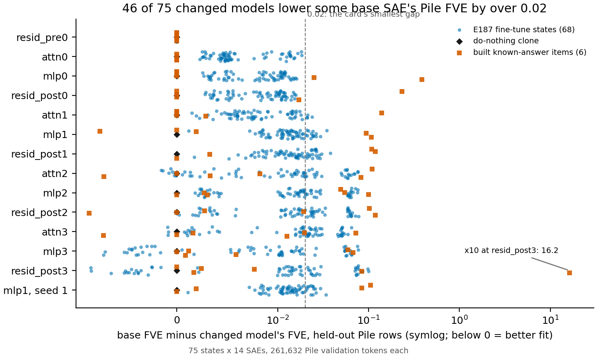

# Do sparse autoencoders trained on the base model still fit its fine-tunes?

We trained a sparse autoencoder on the base model at every residual, attention-output and MLP-output site, with a published recipe, and read how well each rebuilds the base and 74 changed models. On the base they match the published standard, except that more than half the latents at every attention output never fire. Most fine-tunes make some site fit slightly worse and the hand-built edits break a site outright, so the attention and MLP dictionaries can serve the reuse question while the residual ones fail under large edits.

## The answer

The sparse autoencoders trained on the base rebuild its activations well. They explain 87% to 99.5% of the variance at every site, and splicing one in costs the model at most a quarter of a nat. Two MLP sites fall short of the filed loss bar, and the four attention-output dictionaries are more than half dead. On 46 of 75 changed models some site loses more than 0.02 of its explained variance. Only the built edits break a dictionary outright.

## What we were trying to test

This is run 1 of the cell that asks whether a sparse autoencoder of the base model can read a fine-tune's change. Run 1 builds the apparatus and describes it; the reuse reading itself is run 2.

**What was trained.** One BatchTopK sparse autoencoder per site of the 67M model: the token embedding entering block 0, and for each of the four blocks its attention output, MLP output and the residual stream after the block. That is thirteen sites, plus a second seed at the layer-1 MLP output to measure seed spread. Each has 16,384 latents and keeps the 80 largest per token. Each was trained on 500M tokens of Pile activations from the base model only; no autoencoder ever saw a changed model.

**What was read.** On 512 held-out Pile validation rows, 261,632 tokens:

- the fraction of variance explained, $\mathrm{FVE} = 1 - \sum \lVert x - \hat x\rVert^2 / \sum \lVert x - \bar x\rVert^2$. It reads 1 for a perfect rebuild and 0 for a rebuild no better than the mean activation.
- the spliced-in loss increase: the model's next-token cross-entropy with the autoencoder's output put in place of the site's activation, minus the clean cross-entropy. It reads 0 for a perfect splice.
- the loss recovered, $(\mathrm{CE}_{\text{zero}} - \mathrm{CE}_{\text{spliced}}) / (\mathrm{CE}_{\text{zero}} - \mathrm{CE}_{\text{clean}})$, SAEBench's score with zero ablation. It reads 1 for a perfect splice and 0 for a splice as bad as deleting the site.
- the average count of active latents per token, and the dead share: the share of latents that never fire on these tokens.

**The changed models.** The same autoencoders were then read on 75 states: a do-nothing clone of the base, the six hand-built known-answer edits, and 68 saved fine-tune states from earlier experiments. Each was read on the same Pile rows and on its own task windows. The quantity is the FVE drop: base FVE minus the changed model's FVE at the same site.

The do-nothing clone is the control: it runs the base's weights through the same code and should read a drop of exactly 0. The six built edits are a positive control for breakage. Two of them, called new_few and new_thin here, append neurons to the layer-0 MLP that the base never had. One, called x10, multiplies eight layer-1 MLP neurons' output weights by ten. These should push activations where the base dictionary has nothing to write them.

## The recipe and its source

The recipe is SAEBench's BatchTopK recipe: Karvonen et al. 2025, arXiv 2503.09532, Appendix B and Table 3, as implemented in `saprmarks/dictionary_learning` at commit 43421f5 and its demo `dictionary_learning_demo` at d39d54a. `src/commute/sae.py` re-implements it and cites the source line by line. Taken unchanged:

- width 16,384, keeping the top 80 latents per token over the batch;
- learning rate 3e-4, warmed up over 1,000 steps and decayed to 0 over the last 20%;
- batches of 2,048 tokens, 500M training tokens in all;
- the auxiliary loss on dead latents at weight 1/32, with a 10M-token dead window;
- the inference threshold, an average of the smallest kept activation;
- one normalising scale per site.

Departures from that source, each at the point it matters:

- **Position 0 dropped.** The source keeps every position. Our Pile rows have no beginning-of-text token, so position 0 is an attention-sink position and is left out of training, FVE and the splice.
- **Context 512 tokens.** The source uses 1,024; 512 is the 67M model's context length.
- **The model runs under bf16 autocast.** SAEBench's Pythia suite ran the model in fp32.
- **A buffer of 409,600 activations.** The source holds 250,000. It was raised so the 100 normalisation batches fit in half a buffer. It changes how widely the order is shuffled, not what is read.
- **Part of the data was read twice.** The source reads each activation once. Our cached Pile rows ran out at step 206,464 of 244,140 in every shard, and the last 15% of steps reread rows from the start. That is about 77M of the 500M tokens.
- **The evaluation set.** SAEBench reads OpenWebText at 128 tokens per row; we read Pile validation rows at 511 tokens.
- **No published reference for these sites.** SAEBench publishes residual-stream autoencoders on Pythia-160M and Gemma-2-2B, not on a 67M model and not at attention or MLP outputs.

## What we expected, and why

The reference is SAEBench's published BatchTopK, width 16k, near 80 active latents. On Pythia-160M layer 8 it reads FVE 0.868, a spliced loss increase of 0.141 nats, loss recovered 0.982, and a dead share of 0.118. We filed:

- FVE between 0.7 and 0.95, since the residual references sit at 0.73 to 0.87. The token embedding site might read above, as it holds at most 50k distinct vectors.
- Active latents between 79 and 81, since training keeps exactly 80 and the inference threshold lands near it.
- A spliced loss increase between 0.02 and 0.3 nats, and loss recovered of at least 0.95.
- A dead share of at most 0.15, near the reference's 0.12.
- A seed spread in FVE of at most 0.01, a guess since nothing is published.
- The do-nothing clone reading a drop of 0.

For the changed models the cell's card names two rivals. In the first, the base dictionary carries the fine-tunes: every FVE drop under 0.02 and every spliced loss increase within 1.2 times the base's. In the second, the fine-tunes write directions the base dictionary lacks: some FVE drop above 0.02, with the loss increase above 1.2 times the base's on those states. Run 1 reports these readings as a description; the card scores the cell's claim in run 2.

## What we observed

### How well do the autoencoders fit the base?

| site | FVE | spliced loss increase, nats | loss recovered | active latents | dead share |
|---|---|---|---|---|---|
| resid_pre0 | 0.995 | 0.010 | 0.999 | 79.1 | 0.000 |
| attn0 | 0.966 | 0.009 | 0.996 | 80.7 | 0.530 |
| mlp0 | 0.948 | 0.054 | 0.992 | 79.2 | 0.000 |
| resid_post0 | 0.946 | 0.055 | 0.994 | 79.3 | 0.000 |
| attn1 | 0.948 | 0.016 | 0.994 | 80.1 | 0.616 |
| mlp1 | 0.937 | 0.045 | 0.973 | 80.0 | 0.006 |
| resid_post1 | 0.926 | 0.124 | 0.986 | 79.9 | 0.001 |
| attn2 | 0.910 | 0.039 | 0.979 | 81.0 | 0.556 |
| mlp2 | 0.875 | 0.059 | 0.926 | 80.0 | 0.002 |
| resid_post2 | 0.877 | 0.153 | 0.982 | 80.4 | 0.002 |
| attn3 | 0.906 | 0.032 | 0.969 | 80.0 | 0.560 |
| mlp3 | 0.925 | 0.107 | 0.930 | 79.9 | 0.016 |
| resid_post3 | 0.908 | 0.264 | 0.968 | 80.2 | 0.048 |
| mlp1, seed 1 | 0.937 | 0.044 | 0.974 | 80.0 | 0.005 |

The clean loss on these rows is 2.676 nats. Source: `experiments/sae_train/results/stage0_resid_pre0_s0+13.json`.

**Reading it.** The autoencoders fit the base about as well as SAEBench's published ones fit larger models. FVE runs from 0.875 at the layer-2 MLP output to 0.995 at the token embedding, against the reference's 0.868. The spliced loss increase is at most 0.264 nats, at the last residual site, against the reference's 0.141; deeper residual sites cost the most. Every site holds between 79 and 81 active latents per token.

Two sites recover less of the loss than filed. The layer-2 and layer-3 MLP outputs recover 0.926 and 0.930, under the filed 0.95. Their loss increases are still inside the filed band. Zeroing these MLPs costs the model under 1.6 nats, against about 8.5 for a residual stream, so the same increase is a larger share.

The attention outputs are the clear miss. At all four of them between 53% and 62% of the 16,384 latents never fire on the held-out rows, against a filed ceiling of 15%. Training's own 10M-token dead rule reads the same at the end of training: 0.50 to 0.59. Every other site has at most 5% dead. The early check at step 5,500 had passed with no dead latents at any site, so the latents died later in training. The likely reading is that a 768-wide attention output in this small model needs far fewer than 16k directions. The attention-output dictionaries therefore carry roughly 6,000 to 8,000 live latents, not 16,384.

The second seed at the layer-1 MLP output reads the same FVE to within 0.00003 and the same loss increase to within 0.0005 nats.

### Do the base dictionaries still fit the changed models?

**Reading it.** Most fine-tunes make the base dictionaries fit a little worse, and only the built edits break one. The figure plots, for each site, every changed model's FVE drop on the Pile rows; the dashed line is the card's 0.02 gap. The do-nothing clone sits at exactly 0 at every site, as it should.

On the Pile rows 46 of the 75 states drop by more than 0.02 at one or more sites. The median state's worst drop is 0.024, just over the line. The drops concentrate in blocks 2 and 3: attn3 and resid_post2 are the sites most often over the line, for 38 and 35 states. A group of fifteen fine-tunes stands apart, thirteen of them on the cipher task, dropping 0.07 to 0.10 at a block-2 or block-3 site.

The built edits behave as designed. The two edits that append layer-0 MLP neurons break the layer-0 MLP dictionary on their own task windows. Its FVE falls by 1.14 and 1.15, to about minus 0.2. On Pile rows, where the new neurons rarely fire, new_few's drop there is only 0.025 while new_thin's is 0.39.

The x10 edit is the outlier. At the last residual site its FVE falls by 16.2 on Pile rows and 16.8 on its task windows. The next largest Pile drop of any state is 0.39. A follow-up check, `experiments/sae_train/check_x10.py` on Slurm job 62687, showed this is real and not a bug. On x10's task windows, 1% of positions hold 99.6% of the error: where the ten-fold neurons fire they write vectors far larger than anything in the base's training data. An fp32 capture reads the same FVE, minus 15.91 against minus 15.97 in bf16. The activation variance at that site rises from 612 to 1,403, and removing the error's constant part changes nothing. A residual-stream dictionary inherits every upstream change, so this is why run 2 reads attention- and MLP-output dictionaries only.

The spliced loss tells a weaker story than FVE. Only 5 of the 46 states also pass the loss half of the second rival at a site where FVE drops past 0.02. They are three cipher fine-tunes, new_thin and x10. This ratio is fragile: at the layer-0 attention site the base's increase is only 0.009 nats, and a changed model's spliced loss can sit below its own clean loss.

On each state's own task windows the drops are larger: 53 of 75 states drop past 0.02 somewhere, with a median worst drop of 0.030.

The seed spread is small against these drops. Across the 68 fine-tune states, the two layer-1 MLP seeds give FVE drops that differ by at most 0.0007. The largest disagreement over all 75 states is 0.010, for the rebuilt edit.

## What we learned

A width-16k BatchTopK dictionary trained only on the base fits this model's base activations to the published standard at every MLP and residual site. It is oversized for the attention outputs, where most latents die. Fine-tunes move activations far enough that most states lose more than 0.02 of FVE at some site, so the first rival fails on its FVE half. The drops are small next to the built edits, and the spliced loss barely moves. For `GOALS.md` this means a base-only sparse autoencoder can be used to read reuse at attention and MLP outputs, but its error term is not empty under fine-tuning and run 2 must account for it.

## How compelling is the evidence

- One training run per site, with a second seed at one site only. That seed agrees to within 0.0007 on the fine-tune drops, far below the 0.02 gap, but other sites were not seeded twice.
- The FVE drop is blind to whether the lost variance matters to the model; the spliced loss reads that, and it moves much less.
- The dead share is read on 261,632 held-out tokens; a latent firing more rarely than that counts as dead. Training's 10M-token rule gives nearly the same shares, so the window is not the cause.
- The 68 fine-tune states come from a handful of tasks, cipher, copy, rank-one, lookup, lowercase and elicitation, several seeds each. The 46-of-75 count is weighted by how many seeds each task contributed.

## Surprises

- More than half of every attention-output dictionary is dead, against a filed ceiling of 15%. This is the one large miss.
- The x10 edit drives the last residual site's FVE to minus 16, which the check traced to a handful of huge activations.
- Narrow misses: two MLP sites recover 0.926 and 0.930 of the loss, under 0.95. The token embedding and layer-0 attention sites read FVE above the 0.95 band top, as the filing allowed for the embedding.

## What next

- Run 2 reads the reuse score at the eight attention- and MLP-output dictionaries; it is filed in `reports/plans/2026-11-21_plan_r-under-a-sae.md`.
- If the dead attention latents matter for run 2, retrain the attention-output dictionaries at a smaller width. A clearly lower dead share at width 4k with the same FVE would justify switching.

## Scorecard

| id | claim | rule | read | verdict |
|---|---|---|---|---|
| FVE | base FVE in the residual references' range | 0.7 to 0.95 at every site | 0.875 to 0.995; resid_pre0 0.995 and attn0 0.966 above | 12 of 14 in band; the two above are better than filed |
| L0 | active latents near k | 79 to 81 | 79.05 to 80.99 | hit |
| CE | spliced loss increase | 0.02 to 0.3 nats | 0.009 to 0.264; resid_pre0, attn0 and attn1 under 0.02 | 11 of 14 in band; the three below are better than filed |
| REC | loss recovered | at least 0.95 | 0.926 to 0.999; mlp2 0.926, mlp3 0.930 | miss at mlp2 and mlp3 |
| DEAD | dead share | at most 0.15 | attn0-3 0.530 to 0.616; others at most 0.048 | miss at attn0-3 |
| SEED | seed spread of base FVE | at most 0.01 | 0.00003 | hit |
| EARLY | loss falls and dead share at most 0.24 by step 5,500 | per SAE | every SAE passed, no misses | hit |
| STOP | base FVE at least 0.6 and increase at most 0.5 nats | every site | min FVE 0.875, max increase 0.264 | not triggered |
| NULL | do-nothing reads drop 0 | within 0.001 | 0 at every site, Pile and task | hit |
| rival a | every state's drop under 0.02 at every site; loss ratio within 1.2 | descriptive in run 1 | 29 of 75 states on FVE | does not hold for 46 states |
| rival b | some drop over 0.02 with loss ratio over 1.2 | descriptive in run 1 | 46 states on FVE; 5 on both halves | FVE half for 46, both halves for 5 |

## Departures from the literature

As listed under the recipe: position 0 dropped, context 512, bf16 model, a larger buffer, 77M of 500M training tokens read twice, Pile evaluation at 511 tokens, and no published reference for this model or for attention and MLP outputs.

## Not run

- A second seed at any site other than the layer-1 MLP output.
- Smaller widths for the attention-output dictionaries, to test whether the dead share falls.
- SAEBench's other metrics, such as absorption, sparse probing and interpretability scores.
- Training on activations of any changed model, or on a mix of base and fine-tune activations.
- The reuse score under these dictionaries, which is run 2.
- A rerun with enough distinct Pile rows to avoid reading 77M tokens twice.

## Provenance

- Results: `experiments/sae_train/results/stage0_resid_pre0_s0+13.json`, `results/items/*.json` (75 files), `results/train_*.json`, `results/early_check_*.json`, `results/check_x10.json`, logs `results/run_s0.log` to `run_s6.log` and `run_eval.log`.
- Autoencoders: `experiments/sae_train/results/large/scored/`. The pod downloads, formerly `results/e234_dl/`, moved to `~/commute-data/stale/sae-lead/e234_dl/`.
- Code: `experiments/sae_train/run.py`, `src/commute/sae.py`, `experiments/sae_train/check_x10.py`; figure `experiments/sae_train/plot.py`.
- Compute: RunPod H100 pods, seven training shards of two autoencoders each and one evaluation pass of 54 minutes; $61.35 in all. The x10 check ran on the cluster, Slurm job 62687.
- Card: `reports/plans/2026-11-20_plan_p1-40-card.md`; predictions `experiments/sae_train/results/predictions.json`.
