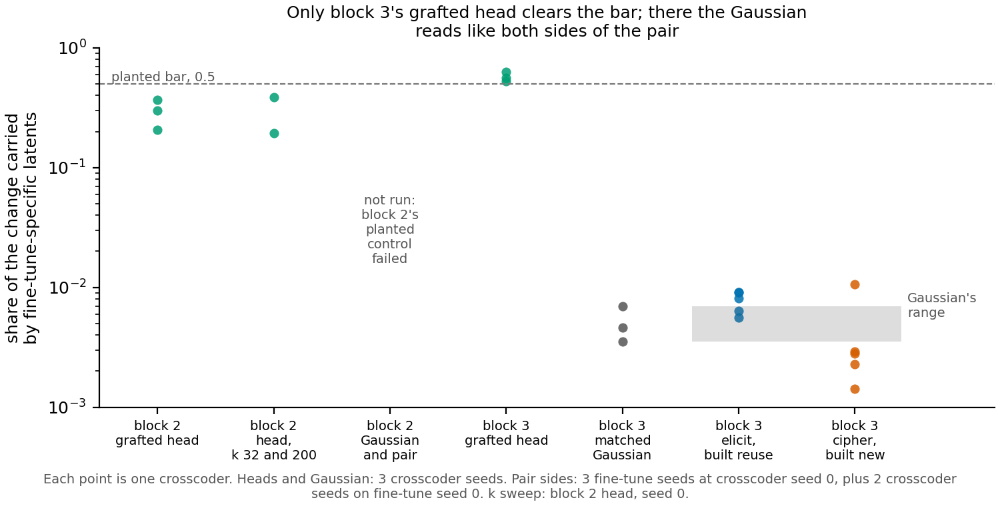

# Can the authors' crosscoder, run properly, see a planted change and tell a fine-tune from noise on the 67M?

*2026-11-21, compare-lead. Cell P2.49, experiment E235, run 1 of 2: the controls and the seed ranges. Descriptive: sides
keep their built names, and no side is called reused or new. Plan `reports/plans/2026-11-20_plan_p2-49-crosscoder-proper.md`
with its appendix; rules `experiments/crosscoder_proper/results/predictions.json`; results
`experiments/crosscoder_proper/results/run1/`.*

We trained Minder et al.'s crosscoder exactly by their recipe between the original 67M model and each changed model, at
two places in the network, with three seeds per control. At block 2 it missed its own planted control; at block 3 it
passed only on a planted change that wrecks the model, and a random update of fine-tune size read like both fine-tunes.
For `GOALS.md` the crosscoder is not applicable at this update size on this model, so it cannot be set beside the
re-gating share on the built pairs; this is a limit of reach, not a finding that the method is wrong.

## The answer

The crosscoder needs a change it can see before its reading of a fine-tune means anything. At block 2, a grafted
attention head that the original model lacks put under 0.4 of its change into fine-tune-only latents on every seed,
against a bar of one half. At block 3 a second grafted head cleared the bar, but it raises the model's loss on ordinary
text fourfold. There, a random update matched to the fine-tune's size read the same as both fine-tunes. So the method is
not applicable at this update size.

## What we were trying to test

**The method.** A crosscoder is one dictionary of sparse latents trained to rebuild two models' activations at one
site at the same time. Here the two models are the original 67M model and one changed copy of it. Each latent has a
decoder direction for each model. Minder et al. 2025 use the BatchTopK form, where each token keeps its 100 most active
latents, and add latent scaling. Latent scaling asks, for each latent that looks fine-tune-only by its decoder norms,
whether the original model's activations already contain it. It fits two ratios: $\nu_r$, how much of the latent's
reconstruction the original model already explains, and $\nu_\epsilon$, how much of its error does. A latent is
*fine-tune-specific* when it is among the 1,667 latents with the largest decoder-norm ratio toward the fine-tune and has
$\nu_r < 0.5$ and $\nu_\epsilon < 0.2$. Those are the authors' cut-offs.

**The authors' native output per side.** For each changed model, which we call a side, we report two numbers. The
first is the count of fine-tune-specific latents. The second is the *specific part*: the share of the side's activation
change $D(x) = h_\text{ft}(x) - h_\text{base}(x)$ at the site that those latents carry, summed over latents and averaged
over read tokens. It reads 0 when no fine-tune-specific latent carries any change and 1 when they carry all of it.

**The two sites.** Block 2's input is the authors' middle layer, used by the earlier attempt. Block 3's output is the
residual just before the final norm. It is the only place every change we study writes to, and it is the only place the
layer-3 grafts can be seen at all.

**The controls, in the order they ran.**

- *The model against itself.* A crosscoder between the original model and an unchanged copy must find no
  fine-tune-specific latent and must give every latent equal decoder norms. It fails only on a code fault.
- *A grafted head, the planted control.* An extra attention head, trained earlier and added to the frozen model, is
  machinery the original model lacks. If the method sees new machinery at all, fine-tune-specific latents should carry
  at least half of the head's change, on every one of three crosscoder seeds. Block 2 used a layer-1 head; block 3 a
  layer-3 head. A miss closes the site.
- *A matched random update.* A Gaussian update with the elicit fine-tune's per-matrix norm profile, scaled by one number
  so that its mean squared activation change per token at the site equals the elicit fine-tune's. It has no structure.
  Two checks read it. It must not clear the planted bar, or the method calls noise new. And its specific part must sit
  above every value of the side built to reuse, or the reading cannot tell a reuse fine-tune from noise.
- *Seed ranges on the primary pair.* The elicit fine-tune, built to reuse, against the cipher fine-tune, built to be
  new. Three fine-tune seeds at one crosscoder seed, and two more crosscoder seeds on fine-tune seed 0, on each side.
  The spread over these is the noise floor.
- *A k sweep.* The block-2 head again at $k$ of 32 and 200 beside 100, reported only.

The pair rule is the share's own: a call "as built" only if every new-side seed reads above every reuse-side seed, and
only at a site whose self, planted and random-update controls all passed. Otherwise the site reads "not applicable at
this update size".

## What we expected, and why

The self controls should pass. We leaned toward the block-3 head passing with medium confidence: it writes directly into
the site. The block-2 head was a weaker bet: it writes early, and shared latents might absorb what it adds. The random
update should stay far under the planted bar. The earlier attempt found no fine-tune-specific latent on 19 of 25 sides,
so we leaned toward the random update and the reuse side both reading 0. Then the random-update check fails, and the
primary pair reads "no call".

## What we observed

### Does the method see a grafted head at block 2?

**Reading it.** No. The leftmost column shows the block-2 head's specific part on three crosscoder seeds: 0.30, 0.21
and 0.37, all under the dashed bar at 0.5. Each crosscoder found more than two hundred fine-tune-specific latents, so
the method notices the head, but those latents carry under 0.4 of its change. The k sweep in the second column moves
the reading the wrong way for a fix. At $k = 32$ it reads 0.39 and at $k = 200$ it reads 0.19. Block 2 therefore stops
here: the random update and the primary pair did not run there, and the site reads "not applicable at this update
size". The earlier attempt missed this site's planted control too, with a planted direction instead of a head.

### Does it see a grafted head at block 3, and at what size of change?

**Reading it.** Yes, but only on a change far larger than a fine-tune's. The block-3 head's specific part reads 0.56,
0.63 and 0.52 over three seeds, all above the bar. The same head raises the next-token loss on Pile text from 2.71 to
11.30 nats. The block-2 head raised it to 7.45. Its mean squared activation change at block 3 is 1,084 per token, about
14 times the elicit fine-tune's 75.6 there. The fine-tunes themselves raise the Pile loss only to between 2.83 and
3.09. So this pass shows the method can see a planted mechanism, not that it can see one at the size of the changes
we score.

### At block 3, does the random update read apart from the side built to reuse?

**Reading it.** No. The grey points and band show the random update at 0.0035 to 0.0070 over three seeds, far under the
planted bar, so it is not called new. But the elicit side's five crosscoders read 0.0056 to 0.0092, and the lowest
random-update value sits below the highest elicit value. The cipher side reads 0.0014 to 0.0106, spanning both. Every
reading here is under one hundredth of the change, and the three groups overlap. The pair therefore reads "not
applicable at this update size". Had the pair rule been read anyway, it would also give no call: cipher's seed 1 reads
above every elicit seed, and its seeds 0 and 2 read below them.

### The authors' native output per side

| side, block 3 unless named | seeds | count of fine-tune-specific latents | specific part | activation change per token |
|---|---|---|---|---|
| model against itself, block 2 | crosscoder 0 | 0 | not defined: no change | 0 |
| model against itself, block 3 | crosscoder 0 | 0 | not defined: no change | 0 |
| grafted head, block 2 | crosscoder 0, 1, 2 | 236, 236, 244 | 0.2995, 0.2076, 0.3693 | 211.0 |
| grafted head, block 3 | crosscoder 0, 1, 2 | 1464, 1451, 1440 | 0.5618, 0.6253, 0.5248 | 1084.3 |
| matched random update | crosscoder 0, 1, 2 | 7, 9, 8 | 0.0070, 0.0046, 0.0035 | 75.07 |
| elicit, built reuse | fine-tune 0, 1, 2 at crosscoder 0 | 16, 14, 15 | 0.0081, 0.0056, 0.0092 | 75.56, 65.23, 79.10 |
| elicit, built reuse | crosscoder 1, 2 on fine-tune 0 | 14, 18 | 0.0064, 0.0091 | 75.56 |
| cipher, built new | fine-tune 0, 1, 2 at crosscoder 0 | 21, 50, 10 | 0.0023, 0.0106, 0.0014 | 166.33, 191.37, 174.97 |
| cipher, built new | crosscoder 1, 2 on fine-tune 0 | 21, 22 | 0.0028, 0.0029 | 166.33 |

The count is the authors' own headline output. At block 3 every trained side and the random update have some
fine-tune-specific latents, between 7 and 50. The earlier attempt found none at block 2 on the same pair. These latents
carry about one hundredth of the change or less. The random update has nearly as many as the elicit side, so a nonzero
count here does not mark a learned change.

**Noise floor.** Over crosscoder seeds on fine-tune seed 0, the specific part ranged by 0.0027 on the elicit side and
0.0006 on the cipher side. Over fine-tune seeds at crosscoder seed 0 it ranged by 0.0035 and 0.0092. The fine-tune
reseed moves the reading more than the crosscoder reseed does, and as much as the gap between the sides.

### Fit of every crosscoder

| item | FVE, original | FVE, changed | dead share | spliced loss recovered, original | spliced, changed |
|---|---|---|---|---|---|
| self, block 2 | 0.932 | 0.932 | 0 | 0.978 | 0.978 |
| self, block 3 | 0.920 | 0.920 | 0.0001 | 0.984 | 0.984 |
| head, block 2, three seeds | 0.926-0.927 | 0.957 | 0 | 0.976 | 0.942-0.943 |
| head, block 2, $k$ 32 | 0.891 | 0.935 | 0.00004 | 0.946 | 0.901 |
| head, block 2, $k$ 200 | 0.948 | 0.970 | 0 | 0.987 | 0.964 |
| head, block 3, three seeds | 0.890-0.891 | 0.916-0.917 | 0.0004-0.0007 | 0.977 | 0.973 |
| random update, block 3 | 0.912 | 0.905-0.906 | 0 | 0.982 | 0.987 |
| elicit sides, block 3 | 0.918-0.919 | 0.912-0.919 | 0 | 0.984 | 0.984-0.986 |
| cipher sides, block 3 | 0.913-0.915 | 0.898-0.906 | 0 | 0.983-0.984 | 0.980-0.984 |

FVE is the fraction of variance explained on Pile validation and read rows. The spliced-loss recovered fraction puts
the reconstruction in at the site and compares the loss with clean and mean-ablated activations: 1 is a perfect
splice, 0 is no better than the mean. Every crosscoder passed the 0.8 FVE bar and the dead-share bar. Only the $k = 32$
crosscoder fell more than 0.05 below its site's self value on spliced loss, so it is marked unread; it was reported
only.

The authors' difference $d$, the shared part minus the specific part, reads 0.44 to 0.47 on the elicit side and 0.40
to 0.45 on the cipher side at block 3. The random update reads 0.48 to 0.49, below the 0.55 to 0.75 expected from the
earlier attempts. It is reported beside, never scored.

## What we learned

The authors' crosscoder, with their trainer, settings and token budget, cannot be used to separate the built pairs on
the 67M. At block 2 it does not reach its own planted bar. At block 3 it reaches it only for a change that multiplies
the loss on ordinary text, and at fine-tune size it reads a structureless update like a reuse fine-tune. This repeats
the earlier attempt's outcome with each of its shortfalls removed, so those shortfalls were not the cause. The
crosscoder's entry beside the re-gating share is "not applicable at this update size" at both sites.

## How compelling is the evidence

The planted controls ran on three crosscoder seeds each, and every seed agreed with the others on which side of the bar
it fell. The block-2 miss is not close: the highest seed, 0.37, is a quarter below the bar. The block-3 pass rests on
one head and one size of change. We did not plant a smaller head, so we cannot say how small a change the method still
sees at block 3. The random-update comparison covers one random draw, matched on activation change at one site, with
three crosscoder seeds. The specific part is blind to a change in how the model uses a direction it already represents,
and the joint training leans toward shared latents by construction.

## Surprises

- The block-2 head missed, where we leaned toward a pass with low-to-medium confidence. More latents do not help: the
  specific part fell from 0.39 to 0.19 as $k$ rose from 32 to 200, outside the expected spread of 0.1.
- At block 3, every trained side and the random update have nonzero fine-tune-specific counts. We expected 0 from the
  earlier attempt, though that was at block 2. The parts they carry stay under one hundredth.
- The random update failed the reuse check by overlapping, not by both sides reading 0 as filed.

## What next

- Run 2, as the plan decided: the four layer-3 grafts at block 3 only, two seeds each, about $17. A graft reading "new"
  there would show the method sees grafts of other sizes, which would matter only if one is near fine-tune size.
- A smaller planted head at block 3, scaled to the elicit fine-tune's activation change. A pass there would reopen the
  pair reading; a miss closes the line on the 67M. This needs a new cell from the user.

## Scorecard

| id | claim in words | rule | read | verdict |
|---|---|---|---|---|
| S0a, block 2 | the model against itself gives no specific latent and equal norms | count 0, max norm deviation ≤ 0.001, FVE ≥ 0.8, dead ≤ 0.3 | count 0, deviation 0, FVE 0.932, dead 0 | pass, as predicted |
| S0a, block 3 | same at block 3 | same | count 0, deviation 0, FVE 0.920, dead 0.0001 | pass, as predicted |
| S0b, block 2 | the layer-1 head's specific part clears 0.5 on every seed | specific ≥ 0.5, all three seeds | 0.30, 0.21, 0.37 | **fail**; leaned pass, low-medium. Block 2 stopped |
| S0b, block 3 | the layer-3 head's specific part clears 0.5 on every seed | same | 0.56, 0.63, 0.52 | pass, as predicted; on a change 14 times elicit's |
| G1, block 3 | the random update is not called new | no seed reaches 0.5 | highest 0.0070 | pass, as predicted |
| G1, block 2 | same | same | not run | site stopped |
| G2, block 3 | the random update reads above every reuse value | min over random > max over reuse, strict | 0.0035 against 0.0092 | **fail**; no prior at block 3 |
| G2, block 2 | same, leaned fail | same | not run | site stopped |
| P1, block 2 | primary pair "no call" | every-seed rule after S0a, S0b, G2 pass | not run | not applicable at this update size |
| P1B, block 3 | primary pair, no prior | same | reuse 0.0081, 0.0056, 0.0092; new 0.0023, 0.0106, 0.0014 | not applicable at this update size |
| native output | 0 latents, part ≤ 0.003 on most sides | reported | 7 to 50 latents; part 0.0014 to 0.0106 | reported; counts above the lean, at a site the lean did not cover |
| k sweep | head's specific part within 0.1 across $k$ | reported | 0.39, 0.30, 0.19 | outside; FVE rose with $k$ as expected |
| time | about 28 and 32 minutes a crosscoder | reported | 27.3 measured alone at block 2; projected 30 at block 2 and 38-39 at block 3 | close; two crosscoders a card gave 0.94 times one, not adopted |

## Departures from the literature

Against Minder et al. 2025, its pinned trainer `crosscoder_learning@d1fd6f3` and the toolkit `diffing-toolkit@617d926`:

- **Trainer and precision.** None: their pinned trainer, with their TF32 matrix products. The earlier attempts ran in
  full fp32.
- **Token budget.** None: 100M tokens for two epochs, 97,656 steps of 2,048, on every side. The earlier attempt stopped
  six sides at about half.
- **Data.** The source pairs pretraining text with chat text. We pair Pile text with each side's own task text, as the
  67M has no chat model. The grafted heads train on 32-token Pile windows, their training data.
- **k.** None for the scored items: 100. The sweep's 32 keeps the source's ratio of $k$ to width at our width; 200
  doubles it. Both are ours.
- **Site.** Block 2's input is the source's middle layer. Block 3's output is ours, because the layer-3 grafts write
  nowhere else.
- **Dictionary size.** 24,576 latents, the source's expansion of 32 on our width of 768; theirs is 73,728 on 2,304.
  The top-latent pool for latent scaling is 1,667, scaled from their 5,000 by the same ratio.
- **Controls and readings.** The self, planted, random-update and seed-range controls, the specific part as a share of
  the change, and the pair rule are ours. The source reports counts and inspects latents.
- **Random update.** The cell asked for a match on both per-matrix norms and activation change; one scalar cannot do
  both. We kept the norm profile's shape and matched activation change, so its norms are 17.8 times elicit's at block 3.
- **Validation tokens.** 4.2M against their 5M.

## Not run

- Block 2's random update, primary pair seeds and the earlier attempt's planted direction: skipped when block 2's
  planted control failed, by the filed stop.
- Run 2: the nine built pairs, the size-matched pairs and the four twins, at either site. Only the four layer-3 grafts
  at block 3 remain open for run 2, by the filed decision.
- A planted head scaled down to fine-tune size.
- A second random draw of the matched update.
- Other diffing methods: the difference SAE, Delta-Crosscoder, dedicated-feature crosscoders. Qwen.

## Provenance

Stage 0 ran 8 crosscoders on 8 RunPod H100 pods, the first of which also ran the timing stage. Stage 1 ran 15
crosscoders on 12 H100 pods, with the block-2 items dropped by the stop. Pod spend from remote-kernels status was
$38.49 for stage 0 and $61.35 for stage 1. That is $99.85 in all. Checks: `score.py check0` wrote `results/run1/stage0.json`, `score.py
check1` wrote `results/run1/stage1.json`. Per-crosscoder files `results/run1/items/*.json`; pod logs
`results/run1/pod*.log`; timing `results/run1/timing*.json`. Figure `experiments/crosscoder_proper/figures/planted_gauss_pair.png`,
from `experiments/crosscoder_proper/plot.py`. Loss on Pile text is `spliced.clean_1` in each item file, against
`clean_0` for the original model.
