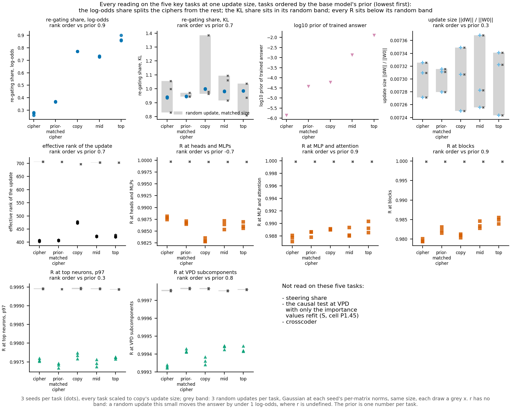

# Do the readings sort the five key tasks by kind of task or by the base model's prior?

E237, cell P2.50 (compare-lead), 2026-11-21. Figure `experiments/key_grid/figures/columns.png`. Plan
`reports/plans/2026-11-20_plan_p2-50-key-grid.md`; rules `experiments/key_grid/results/predictions.json`; scoring
`experiments/key_grid/score.py`.

We shrank every saved update of the five key tasks to one common weight size and read each one, beside a random update
of the same size, with every reading the project has saved. The log-odds share puts the cipher whose answers the base
model finds about as likely as copy's with the other cipher, far below copy, while every R sits below its random band
and separates the tasks only by small steps. The share follows the kind of task here and not only the prior, and R at
the featurizations read so far tells these tasks apart only weakly.

## The answer

At one update size, the log-odds share splits the two ciphers from copy, top and mid by more than twice the filed bar
on every pairing. The prior-matched cipher, whose trained answer is only 1.6 times less likely than copy's, reads 0.40
below copy and sits beside the other cipher. The KL form of the share also puts the two ciphers lowest, but every task
stays inside or at the edge of the band of random updates. Every R reads below its random band. Nothing here is a
reuse verdict.

## What we were trying to test

Each of the five tasks teaches the 67M model one answer for each of 96 keys. Copy returns the key. Top returns the
base model's own most likely next token, and mid a token from its top 20. Cipher returns a fixed cipher of the key.
The prior-matched cipher is a cipher whose answers the base model already finds about as likely as copy's. Each task
has three saved fine-tunes of 30 steps. Size is the norm of the weight change over the norm of the base weights,
across the 24 decomposed matrices. Every state of a task was multiplied by one number that brings the task's mean size
to copy's, the smallest. Each scaled state got a random update at its own per-matrix norms, the same size matrix by
matrix.

The readings, each by the code that wrote its earlier saved value:

- **The share, log-odds form**: $r = (L_{01} - L_{00}) / (T_1 - T_0)$, the trained answer's log-odds gain that the
  base model's subcomponents recover when only Γ's causal importances are read from the changed model, over the
  fine-tune's own gain $T_1 - T_0$. Zero means none of the gain, one means all of it. It is undefined under a gain of
  one log-odds.
- **The share, KL form**: $s_{KL} = (K_{00} - K_{01}) / (K_{00} - K_{11})$, with $K_{ab}$ the KL from the changed
  model's output to the masked forward built from subcomponents $a$ under importances $b$; 0 for the base model's, 1
  for the changed model's or its least-squares split. It is the part of the output gap that new importances close
  alone, over the part that importances and split close together.
- **R**: the share of the featurized model's variables the behaviour runs through whose mechanism, by the squared
  cosine of the base and fine-tuned writes, still computes what it did in the base model. One means nothing changed.
  It is read at five featurizations: heads and MLPs, MLP and attention per block, blocks, the top neurons, and VPD's
  subcomponents. This is R as worded before 2026-11-20 evening; the wording adopted then changes it.
- **Size, effective rank, prior**: the update's norm, the spread of its singular values, and the base model's
  probability of the trained answer, one number per task.

The prior-matched cipher decides between two readings. A reading that tracks the prior puts it with copy; one that
tracks the kind of task, a cipher of the key, puts it with the cipher.

## What we observed

### Does the share put the prior-matched cipher with copy or with the cipher?

**Reading it.** With the cipher, on both forms. In the top-left panel the prior-matched cipher reads 0.368 on average,
0.096 above the cipher and 0.403 below copy, and no seed range among these three tasks exceeds 0.022. Every one of the six pairings of copy, top
or mid against a cipher clears the filed gap of 0.17; the narrowest, mid against the prior-matched cipher, is 0.363.
The share still ranks the tasks with the prior at 0.9, only because copy and mid swap places. A ranking agreement of
0.9 and a 0.40 split at a 1.6-fold prior gap are both true of the same five means: the order follows the prior, the
spacing does not. The KL form agrees: the prior-matched cipher is 0.0065 from the cipher and 0.055 from copy.

### Does the KL share leave the band of random updates?

**Reading it.** No, which we did not predict. We filed that both ciphers would sit below their random band and copy
above it; all three sit inside. On copy the band runs from 0.963 to 1.385; on the cipher from 0.829 to 1.056. Only
the prior-matched cipher's band is narrow, 0.943 to 0.971, and one of its seeds, at 0.9428, falls just under its
lower end. The band is wide because a random update of this size barely moves the output: the KL change the share
divides by is at most 0.0024 for a random draw against at least 0.213 for a fine-tune. The share of a random update is
a ratio of two numbers near zero, and the share's own status rule marks every random draw unscored.

### Does R sort the tasks at all?

**Reading it.** Only by small steps, and every fine-tune reads below every random update at the same featurization.
At blocks the fine-tunes read 0.9794 to 0.9855 and the random updates 0.99982 to 0.99984. At VPD the fine-tunes read
0.99932 to 0.99945 and the random updates 0.99975 to 0.99977. At blocks the prior-matched cipher sits nearer copy, as
filed; at heads and MLPs it sits with the cipher, and at MLP and attention no call is possible. The gaps between task
means are at most about three times the seed spread at any featurization. The update's effective rank sits between 402 and 478 for every task against 697 to 707 for random.

## How compelling is the evidence

Three seeds per task, one key set, one model. The control state at zero size read exactly the do-nothing values, and
at its own size repeated the saved share to within 0.0005 and the saved R at the coarse levels to within 6e-10. The
share's spacing is the robust result: its narrowest gap is more than eight times the largest seed spread of any task.
The cipher's own KL share at the common size is also marked unscored by the status rule, narrowly. The KL band rests
on three draws per task of a quantity near 0/0. R's task differences are smaller than its distance to the random band,
and R rises as any update shrinks, so these are readings at one size only.

## Scorecard

| id | claim in words | rule | read | verdict |
|---|---|---|---|---|
| P1 | log-odds share puts the prior-matched cipher with the cipher | placement, E51 separation | 0.096 from cipher, 0.403 from copy | holds |
| P2 | copy, top, mid each above both ciphers by over 0.17 | kind gap on six pairings | smallest 0.363 | holds |
| P3 | KL share puts the prior-matched cipher with the cipher | placement | 0.0065 from cipher, 0.055 from copy; not separated from cipher | holds |
| P4 | KL share: ciphers below the random band, copy above | all three seeds outside the band | all three tasks inside or straddling | misses |
| P5 | R at blocks puts the prior-matched cipher with copy | placement | with copy; heads and MLPs with cipher; MLP and attention no call | holds at blocks |
| P6 | R at top neurons in 0.95 to 0.9995, at VPD in 0.998 to 0.99999 | every seed in range | 0.9973 to 0.9977; 0.99932 to 0.99945 | holds |
| P7 | every task's effective rank below its random band | all seeds below | 402 to 478 against 697 to 707 | holds |

Rank agreement with the prior over the five task means, reported without a rule: log-odds share 0.9, KL share 0.7,
effective rank 0.7, R at heads and MLPs -0.7, at MLP and attention 0.9, at blocks 0.9, at top neurons 0.3, at VPD 0.8.
Size reads 0.3 by noise alone, since every task is at one size by construction.

## Departures from the literature

None. Every reading uses the project's own saved code and filed settings.

## Not run

- The steering share, the causal test at VPD with only the importance values refit from cell P1.45, and the
  crosscoder: none was read on these five tasks; the figure lists them as not read.
- R under the wording adopted 2026-11-20 evening.
- Any further KL-share work, including more random draws to narrow its band.
- A second key set, a second model, or a size other than copy's.

Provenance: cluster debug jobs, $0; results `experiments/key_grid/results/summary.json`, `stage0.json`, `stage1.json`,
`items/`, `topk/`, `vpd/`; scoring output `score.txt` in the compare-lead scratch folder `e237-runner2`.
