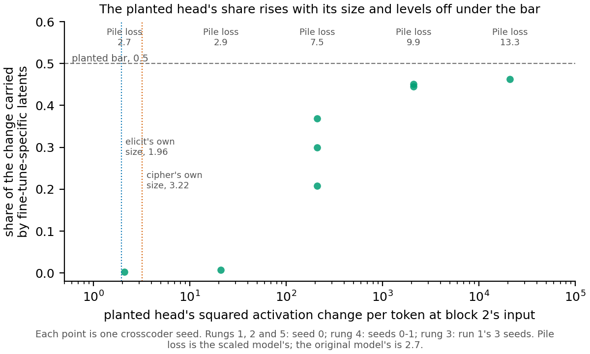

# How large must a planted change be before the authors' crosscoder sees it at block 2?

*2026-11-21, compare-lead. Cell P2.49, experiment E243, run 2 of 2: a size ladder for run 1's planted control at
block 2's input. Descriptive: no side is called reused or new. Plan `reports/plans/2026-11-21_plan_p2-49-run2-size-ladder.md`
with its appendix; rules `experiments/crosscoder_proper/results/run2/predictions.json`; results
`experiments/crosscoder_proper/results/run2/`.*

We scaled a planted attention head, which the original 67M model lacks, through five sizes spanning four powers of ten
and trained Minder et al.'s crosscoder at block 2 on each. The share of the head's change that the crosscoder puts in
fine-tune-only latents rose from almost nothing at fine-tune size to just under one half at the top, and no size
reached the bar of one half. For `GOALS.md` the crosscoder has no usable reading at block 2 on this model for any change
up to about a hundred times a fine-tune's amplitude, so it cannot stand beside the re-gating share there.

## The answer

At block 2 the crosscoder is not applicable up to about 104 times a fine-tune's amplitude. Near a fine-tune's size it
gives a planted head almost no fine-tune-only latents. The share climbs with size and then flattens just under the bar,
at sizes where the head has already wrecked the model's loss on ordinary text. The five tasks and the random changes
were therefore not run, by the filed stop rule.

## What we were testing

A crosscoder is one sparse dictionary trained to rebuild two models' activations at one site at once. A latent is
*fine-tune-specific* when the authors' decoder-norm and latent-scaling tests say the original model lacks it. The
*specific part* is the share of the activation change $D(x) = h_\text{ft}(x) - h_\text{base}(x)$ that those latents
carry: 0 when they carry none of it, 1 when they carry all. In run 1 a grafted layer-1 head, machinery the original
model lacks, read 0.30, 0.21 and 0.37 over three crosscoder seeds at block 2's input. That is under the filed bar of
0.5, so block 2 read "not applicable at this update size".

Run 2 multiplies the head's output weight by one factor per rung. Each rung's *size* is the mean over tokens of the
squared length of $D(x)$, its squared activation change per token. Rung 3 is run 1's head as it was. The other rungs
are it times a power of ten in squared size, so each step is about 3.2 in amplitude. The reference fine-tune is run
1's elicit fine-tune, whose own squared size at this site is 1.96. A rung passes only if every crosscoder seed reads at
least 0.5. One seed under the bar fails a rung, so its other seeds were not run. Had a rung passed, the five tasks and
three random changes would have been scaled to it and read.

## What we expected

We expected rungs 1 and 2 to fail with high confidence, under 0.3. We leaned toward rung 4 passing, with low
confidence. We gave rung 5 a pass if rung 4 failed, and no pass at any rung a probability of 0.30.

## What we observed

**Reading it.** No rung passed. At rung 1, at about elicit's own size, the specific part reads 0.0030; at rung 2 it
reads 0.0070. It jumps to run 1's 0.21 to 0.37 at rung 3. Above that it levels off: 0.45 on both rung-4 seeds and
0.46 at rung 5, ten times larger again. The model's loss on Pile text barely moves at rung 1, at 2.72 against the
original's 2.71. At rung 4 it reads 9.86, and at rung 5 13.32. So the share comes closest to the bar only where the
planted head has broken the model.

| rung | squared size per token | times elicit's, squared | times elicit's, amplitude | Pile loss | specific part, by seed | bias part, seed 0 | count, seed 0 |
|---|---|---|---|---|---|---|---|
| 0, original against itself | 0 | 0 | 0 | 2.71 | 0 | — | 0 |
| 1 | 2.11 | 1.08 | 1.04 | 2.72 | 0.0030, —, — | 0.13 | 2 |
| 2 | 21.1 | 10.8 | 3.28 | 2.93 | 0.0070, —, — | 0.14 | 36 |
| 3, run 1 | 211 | 108 | 10.4 | 7.45 | 0.2995, 0.2076, 0.3693 | 0.43 | 236 |
| 4 | 2,110 | 1,076 | 32.8 | 9.86 | 0.4510, 0.4451, — | 0.55 | 255 |
| 5 | 21,099 | 10,758 | 103.7 | 13.32 | 0.4622, —, — | 0.54 | 408 |

A dash is a seed not run because the rung had already failed. The bias part is the share of the change carried by
the difference between the two models' decoder biases, a constant offset. At rungs 4 and 5, the specific part and the
bias part together carry almost all of the change, so the flat top sits at one minus the bias part. At rungs 1 and 2,
shared and unclassed latents carry most of it instead. The count is the authors' headline output, the number of
fine-tune-specific latents.

Every crosscoder passed its fit checks: FVE on the changed model 0.92 to 0.998, and a dead share under 0.0001 at the end. The model
against itself through the scaled path passed all 14 of its checks, with FVE 0.932 and no fine-tune-specific latent.

## What we learned

Block 2's crosscoder entry now reads as a range: not applicable for any change up to 21,099 squared per token, 10,758
times elicit's squared size and about 104 times its amplitude. At fine-tune size a planted mechanism the model lacks
puts almost none of its change in fine-tune-specific latents. So a zero there does not say a fine-tune reused existing
machinery. The crosscoder line at block 2 on the 67M ends here.

## How compelling is the evidence

The rungs are a power of ten apart, so the range cannot place a pass between them. Rungs 1, 2 and 5 have one seed
each. Run 1's seed spread at rung 3 was a wide 0.16, but the two rung-4 seeds agree to 0.006. The top two rungs sit
0.04 to 0.05 under the bar, so a slightly lower bar would pass them. The flat top makes a pass at a still larger size
unlikely, but that is untested. The sizes are multiples of run 1's elicit fine-tune. E147's elicit states are about
twice as large here, 3.87 to 4.16, so against them rung 5 is about 72 times the amplitude. The
specific part cannot see a change in how the model uses a direction it already represents, and the size cannot see a
change's direction.

## Surprises

- Rungs 4 and 5 failed where we leaned pass, at low confidence: the share levelled off at 0.45 to 0.46.
- The low rungs read near 0, below the card's second guess of 0.2 to 0.4 at every rung.
- At rung 5 the scaled model's loss, 13.32, is above its mean-ablated loss, so the spliced-loss recovered fraction
  reads nan. It was never applied, as no rung passed.
- The one pod that ran rung 4 seed 0 trained at 35 ms a step against 16, taking 60 minutes. Its reading agrees with
  seed 1's.

## What next

- None within this cell: its two runs are spent. A ladder at block 3, where run 1's head passed at 14 times elicit's
  size, would place a range there. That needs a new cell.
- Whether the top rungs clear the bar once each model's mean change is removed before training. A pass would show
  the bias part is what holds the share down; it is untested.

## Scorecard

| id | claim in words | rule | read | verdict |
|---|---|---|---|---|
| L0 | the original against itself through the scaled path gives no specific latent | count 0, max norm deviation ≤ 0.001, FVE ≥ 0.8, zero-scale activations exact | count 0, deviation 0, FVE 0.932, 14 of 14 checks | pass, as predicted |
| L1 rungs 1-2 | fail on seed 0, under 0.3, high | specific ≥ 0.5 on every seed | 0.0030, 0.0070 | fail, as predicted |
| L1 rung 3 | run 1, failed | same | 0.2995, 0.2076, 0.3693 | fail, reused |
| L1 rung 4 | lean pass on every seed, 0.40 | same | 0.4510, 0.4451 | **fail**; Pile loss 9.86, above 7.45 as expected |
| L1 rung 5 | pass if rung 4 fails, 0.30 | same | 0.4622 | **fail** |
| X none | no rung passes, 0.30 | every rung failed or unbuilt | all five failed, none unbuilt | happened |
| range | lean: not applicable below about 2,110 | stated range | not applicable at any size up to rung 5 | the filed "X none" wording |
| early checks | every item passes | run 1's and run 2's checks | all passed; no rung unbuilt | pass |
| spliced bar, G1, G2, G3, tasks, pairs | at X | — | no X | not run |

## Departures from the literature

Against Minder et al. 2025, `crosscoder_learning@d1fd6f3` and `diffing-toolkit@617d926`, as in run 1:

- **Trainer, precision, token budget, k.** None: their trainer with TF32, 100M tokens for two epochs, k 100.
- **Data.** Pile text with each side's own text, not chat text, as the 67M has no chat model.
- **Site.** Block 2's input is their middle layer. Dictionary 24,576 latents, their expansion of 32; latent-scaling
  pool 1,667, scaled from their 5,000.
- **Controls and readings.** The planted head, the specific part, the bar and the pass rule are ours.
- **New in run 2.** Scaling a planted change to set sizes is ours; the source trains on real fine-tunes only.

## Not run

- Stage 2 at X: the five 96-key tasks, copy, rank1, elicit, cipher and prior-matched cipher, on three fine-tune seeds
  each, and the three random changes. No rung passed, by the filed stop.
- Seeds 1 and 2 at rungs 1, 2 and 5, and seed 2 at rung 4: each rung had already failed.
- Sizes between rungs and above rung 5. Block 3.

## Provenance

Four RunPod H100 pods on 2026-11-20. Spend is $18.92 by remote-kernels status for the pods recorded under this
experiment; the runner reported about $27. Item logs
`results/run2/run_head-*.log`; per-crosscoder files `results/run2/items/*.json` and run 1's `results/run1/items/head.A.c*.json`;
`score2.py check0` wrote `results/run2/stage0.json`, `score2.py ladder` wrote `results/run2/ladder.json`; sizes from
`run2.py sizes` in `results/run2/sizes.json`. Elicit's and cipher's sizes at block 2 from run 1's
`results/rehearse/items/e54__{elicit,cipher}_s0.A.c0.json`. Crosscoder weights in `results/run2_dl/`, listed in
`experiments/SAVED.md`. Figure `figures/size_ladder.png` from `experiments/crosscoder_proper/plot2.py`.
