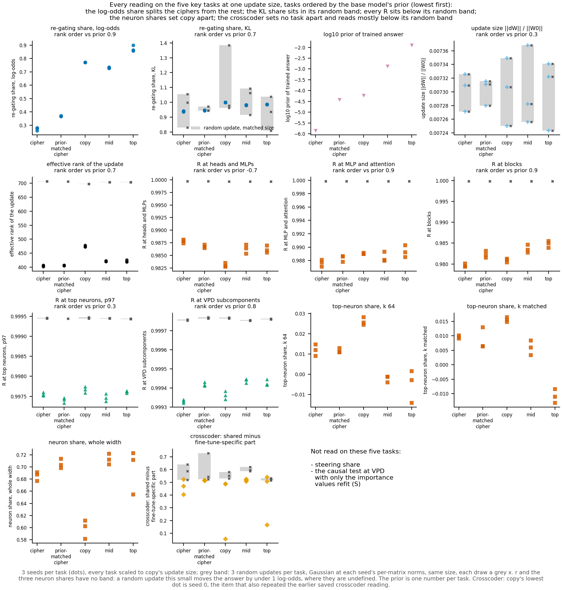

# Do the neuron shares and the crosscoder sort the five key tasks the way the log-odds share does?

*2026-11-21, compare-lead. Cell P2.52, experiment E244, one run. Descriptive: no rule, no verdict on reuse. Plan
`reports/plans/2026-11-21_plan_p2-52-key-grid-baselines.md`; expected values
`experiments/key_grid_baselines/results/predictions.json`; results `experiments/key_grid_baselines/results/run/`; figure
`experiments/key_grid/figures/columns.png`, last four panels. Sibling report, whose figure these panels join:
`reports/analyses/2026-11-21_analysis_e237-key-grid.md`.*

We read two cheap baselines, the neuron shares and a crosscoder, on the same fifteen fine-tunes of five key tasks at one
update size, each beside random updates of that size. The neuron shares set copy apart from the other four tasks, while the
crosscoder set no task apart, because fine-tunes of one task differed from each other by up to four tenths. Neither baseline reproduces the log-odds share's split of the two ciphers
from the other tasks, so on these tasks both stay comparison columns, not rivals to the share.

## The answer

Neither baseline sorts the five tasks the way the log-odds share does. The neuron shares set copy apart: its whole-width
share is the lowest and its top-neuron share the highest. Only the top 64 neurons put the prior-matched cipher squarely
with the cipher, and they carry under three hundredths of the gain on every task. The crosscoder sets no task apart: fine-tunes of
one task differ by up to 0.43, and most read below their random band. Nothing here is a reuse verdict.

## What we were trying to test

The five tasks are E237's. Each teaches the 67M model one answer for each of 96 keys. Copy returns the key, top returns
the base model's own most likely next token, mid a token from its top 20, cipher a fixed cipher of the key, and the
prior-matched cipher a cipher whose answers the base model already finds about as likely as copy's. Each task has three
saved fine-tunes. Every fine-tune of a task was multiplied by one number that brings the task's mean update size to
copy's, the smallest, so all fifteen sit at one size. Each scaled fine-tune got a random update with the same norm in
every matrix. These are E237's items, rebuilt by its code and checked to its sizes.

E237 asked whether a reading sorts these tasks by the kind of task or by the base model's prior. The prior-matched cipher
decides it: a reading that tracks the prior puts it with copy, one that tracks the kind of task puts it with the cipher.
The log-odds share put it with the cipher, far below copy. This run adds the project's two cheap baselines as columns
beside that graph.

The readings:

- **Top-neuron share**: in the base model, keep only the $k$ MLP neurons that fire most at each position and zero the
  rest. The numerator is the trained answer's log-odds when the kept set is chosen from the fine-tuned model's firing,
  minus when it is chosen from the base model's own. The share divides that by the fine-tune's own log-odds gain. Zero
  means picking the fine-tune's neurons recovers none of the gain, one means all of it. It is read at $k$ of 64 per
  block and at $k$ matched to VPD's active subcomponent count per block, and is undefined under a gain of one log-odds.
- **Neuron share, whole width**: the base model's MLP output weights reading the fine-tuned model's firing of every
  neuron, as a share of the gain. Zero means the change in firing carries none of the gain, one means all of it.
- **Crosscoder reading**: a crosscoder is one sparse dictionary of 24,576 latents trained to rebuild the base and the
  fine-tuned model's activations at block 2's input together, by Minder et al.'s code and recipe as E203 ran it. The
  activation change is split over the latents. The reading is the part carried by latents shared by both models, minus
  the part carried by latents the authors' test calls fine-tune-specific. Near 1, the change lives in shared latents;
  near 0 or below, in fine-tune-only ones. Its fine-tune-specific part is reported beside it.

Two kinds of control ran first and alone. The do-nothing, the control fine-tune multiplied by zero, must give zero gain
and zero numerators for the neurons, and for the crosscoder the base model against itself must give no fine-tune-specific
latent. The repeats read one fine-tune that earlier runs already read at the same scale. Copy seed 0 is copy's own
item at scale one, so its neuron shares must repeat E147's saved values, and its crosscoder E203's. The prior-matched
cipher's seed 0 at its scale must also repeat E203's saved crosscoder reading. The random updates are the reference:
what each reading gives for a change of the same size that teaches nothing.

## What we expected, and why

The neuron shares were expected to read as E147 read them on these fine-tunes before scaling: the whole-width share at
0.6 to 0.73, and the top-neuron shares within 0.03 of zero, copy highest. A random update this small barely moves the
answer, so every neuron share is undefined on it. For the crosscoder, E203 had read one seed of four of these tasks.
Copy's seed 0 read 0.056, the only side with fine-tune-specific latents, and the others read 0.39 to 0.51. So copy was
expected near 0.06, the others near 0.5, and a random update between 0.3 and 0.7. E203 read one seed a side, so the
spread across seeds was unknown. The filed note was that a spread over 0.1 would mean no task stands apart.

## What we observed

### Did the controls hold?

**Reading it.** Yes, every control passed. For the neurons, the do-nothing gave a gain and every numerator of exactly
zero. Copy seed 0 repeated E147's saved whole-width share, 0.6114, and its two top-neuron shares, 0.0255 and 0.0156, to
within one part in a million. For the crosscoder, the base model against itself rebuilt the activations with 0.9319 of
their variance explained and found no fine-tune-specific latent among 24,576. Both repeats gave E203's saved readings
exactly, 0.0561 and 0.5125. A difference of zero means the crosscoder's training is deterministic here at a fixed seed;
it says nothing about how much the reading moves with a new crosscoder seed.

### Do the neuron shares put the prior-matched cipher with copy or with the cipher?

**Reading it.** With the cipher at 64 top neurons, between the cipher and mid on the other two; all three set copy apart. In the third row's last two panels and the
bottom-left panel, copy's three seeds sit apart from every other task's seeds. The whole-width share reads 0.581 to
0.611 on copy and 0.654 to 0.723 on the other four tasks. The top-neuron share at 64 reads 0.024 to 0.028 on copy, 0.009
to 0.015 on the two ciphers, and at most 0.0015 on top and mid. At 64 the prior-matched cipher's seeds lie inside the cipher's
range. On the whole-width share they sit between the cipher's and mid's, and at k matched they overlap both. The caveat is size: the top 64 neurons carry under three hundredths of
the gain on every task, so their order is an order among near-zero numbers.

| task | whole width | top-neuron, k 64 | top-neuron, k matched | gain, log-odds |
|---|---|---|---|---|
| cipher | 0.677 to 0.691 | 0.009 to 0.015 | 0.009 to 0.010 | 12.3 to 13.1 |
| prior-matched cipher | 0.698 to 0.713 | 0.011 to 0.013 | 0.006 to 0.013 | 12.2 to 12.8 |
| copy | 0.581 to 0.611 | 0.024 to 0.028 | 0.015 to 0.016 | 16.3 to 16.5 |
| mid | 0.704 to 0.722 | -0.004 to -0.001 | 0.003 to 0.008 | 10.8 to 11.0 |
| top | 0.654 to 0.723 | -0.014 to 0.001 | -0.013 to -0.008 | 9.0 to 9.4 |

Each cell is the lowest to the highest of three seeds. No random update has a share: its gain is at most 0.017 log-odds
in size, far under the one log-odds floor.

### Does the crosscoder set any task apart?

**Reading it.** No. In the bottom row's second panel, the prior-matched cipher and mid keep their seeds within 0.02 of
each other, near 0.51 to 0.52, but two tasks have one seed far below the rest. Copy reads 0.056 on seed 0 and 0.488 and 0.489 on seeds 1 and 2.
Top reads 0.507 and 0.541, then 0.165 on seed 2. The cipher spreads from 0.403 to 0.524. With spreads of 0.43 on copy,
0.38 on top and 0.12 on the cipher, no task stands apart. Thirteen of the fifteen fine-tunes read below their own
task's random band, which runs from 0.515 to 0.728 across all fifteen random updates. The fine-tune-specific part is zero
on thirteen fine-tunes and every random update. It is 0.123 on copy seed 0 and 0.0005 on one cipher seed.

| task | seed 0 | seed 1 | seed 2 | random band |
|---|---|---|---|---|
| cipher | 0.471 | 0.403 | 0.524 | 0.519 to 0.641 |
| prior-matched cipher | 0.512 | 0.518 | 0.518 | 0.523 to 0.728 |
| copy | 0.056 | 0.488 | 0.489 | 0.531 to 0.582 |
| mid | 0.508 | 0.526 | 0.517 | 0.587 to 0.621 |
| top | 0.507 | 0.541 | 0.165 | 0.515 to 0.532 |

### Why does copy read about 0.06 on one seed and about 0.49 on the others?

**Reading it.** Because 0.06 was a property of copy's seed 0, not of copy. The repeat control and copy's seed 0 are one
and the same item. Copy is the task every other was scaled to, so its scale is exactly one. The run trained this
crosscoder once and used it both as the repeat and as copy's first dot, so its 0.056 is E203's to the last digit.
E203 had read copy at seed 0 only, and the expected 0.06 came from that one seed. Seeds 1 and 2 are also at scale one.
They read about 0.49 and have no fine-tune-specific latent. Seed 0 has three, carrying 0.123 of the change, and its
shared part is 0.179. What sets seed 0 apart in the files is the size of its activation change at block 2. Its mean
squared change per token is 6.65, against at most 3.14 for seeds 1 and 2. The other low reading, top seed 2, has the
largest change of all fifteen, 9.93. We have not tested whether that size is the cause. Every other reading in E237's
figure gives copy's three seeds within a narrow range, so the oddity of seed 0 belongs to the crosscoder at block 2.

## Expected against read

| reading | expected | read | |
|---|---|---|---|
| neuron do-nothing | gain and every numerator exactly zero | all exactly zero | as expected |
| neuron repeat, copy seed 0 | E147's values within one ten-thousandth | within one part in a million | as expected |
| crosscoder do-nothing | variance explained over 0.8, no fine-tune-specific latent, dead share under 0.3 | 0.9319, none of 24,576, none dead | as expected |
| crosscoder repeats | E203's 0.0561 and 0.5125, within 0.01 | equal, difference zero | as expected |
| random update, neuron gain | under 0.05 log-odds in size | at most 0.017 | as expected |
| random update, neuron numerators | under 0.05 log-odds in size | whole width and k 64 at most 0.024; k matched up to 0.081, over the bar on four of fifteen | **missed** |
| random update, crosscoder | reading 0.3 to 0.7, specific part under 0.01 | 0.515 to 0.728, specific part zero | **missed** on one of fifteen: 0.728 |
| whole-width share | within 0.1 of E147's task means, 0.598 to 0.732 | task means 0.598 to 0.713, largest gap 0.037 on the cipher | as expected |
| top-neuron share, k 64 | within 0.03 of zero, copy highest | -0.014 to 0.028, copy highest | as expected |
| top-neuron share, k matched | within 0.03 of zero | -0.013 to 0.016 | as expected |
| crosscoder, copy | about 0.06 | 0.056, 0.488, 0.489 | **missed** on two of three seeds |
| crosscoder, top | about 0.5 | 0.507, 0.541, 0.165 | **missed** on seed 2 |
| crosscoder, cipher | about 0.46 | 0.403 to 0.524, mean 0.466 | as expected |
| crosscoder, prior-matched cipher | about 0.51 | 0.512 to 0.518 | as expected |
| crosscoder, mid | not read before | 0.508 to 0.526 | no expectation |
| crosscoder seed spread | if over 0.1, no task stands apart | over 0.1 on copy, top and cipher | no task stands apart |

The four misses, from the files:

- **Random update, k matched numerator.** The numerator compares two choices of which few neurons to keep, at 3 to 30
  per block. Its size is not bounded by the update's effect on the answer. On the cipher's seed 2 draw it is 0.081
  log-odds, while the same draw moves the unmasked answer by 0.001. So at this width the reading moves with which
  neurons are picked, not only with what the update does to the answer. Divided by the smallest fine-tune gain here,
  this is at most 0.009 of the share. That is the scale of the k matched gaps among the ciphers, mid and top, but
  under copy's gap to top.
- **Random update, crosscoder at 0.728.** One draw, the prior-matched cipher's seed 0, reads above the filed range; the
  other fourteen read 0.515 to 0.641. Its specific part is zero, as filed. The range was set from E203's one random
  reading, 0.547, so it had no measured spread behind it.
- **Copy at about 0.06.** Explained above: the expectation was one seed, and the other two seeds read like the other
  tasks.
- **Top's seed 2 at 0.165.** No fine-tune-specific latent: its shared part itself is low, 0.165, and most of the change
  falls in latents the split leaves unclassed. It is the same pattern as copy seed 0 without the specific latents, and
  it is the seed with the largest activation change.

## What we learned

At this update size the neuron shares put copy alone, and only the top 64 neurons keep the two ciphers together, which is not the log-odds share's
pattern of the two ciphers far below copy, top and mid. The crosscoder at block 2 gives readings that vary more between
fine-tunes of one task than between tasks, and E203's low copy reading, which had looked like a task property, was one
seed. Neither baseline, on these five tasks, is a rival to the share's spacing; both go to the comparison columns of the
figure, not into the answer.

## How compelling is the evidence

Three seeds per task, one key set, one model, one size. The controls are exact, so the apparatus matches the earlier runs.
Each crosscoder is one training run; E203 measured one reseed difference of 0.047 on a single side, so a spread of 0.43
between fine-tunes is far beyond what one reseed moved, but that floor rests on one pair. At block 2 the crosscoder is
known from E243 to find almost no fine-tune-specific latents even for a planted new attention head near fine-tune size,
so its specific part near zero here says little. The top-neuron shares rest on numerators of a few tenths of a
log-odds at most, against gains of 9 to 16.

## Surprises

The crosscoder's copy reading did not hold across seeds: it was expected near 0.06 and two of three seeds read 0.49.
One top seed read 0.165 where the other two read about 0.5. The k matched numerator on random updates exceeded its
filed bound on four of fifteen draws.

## What next

- A second crosscoder seed on copy seed 0 and top seed 2 would say whether their low readings belong to the fine-tune
  or to that crosscoder's training; if they move to about 0.5, the crosscoder's seed spread here is its own noise.
- Nothing else: the plan sends a baseline that does not sort the tasks by kind beyond seed ranges to the appendix.

## Departures from the literature

As E203, against Minder et al. 2025 and their code: the 67M model at block 2's input, so 24,576 latents at their
expansion of 32; the paper's chat half of the training tokens is the task's own fresh key-value windows; latent-scaling
candidates scaled to the dictionary size; latent scaling ported from the toolkit's closed form. The reading, its split
and its controls are this project's, as are both neuron shares. Nothing departs from E203's, E143's or E98's filed
settings.

## Not run

- A second crosscoder seed on any item, so the crosscoder's own reseed spread on these tasks is not measured.
- Neurons for half the gain; the steering share; the causal test at VPD with only the importance values refit.
- The crosscoder at any site but block 2's input, or at reduced precision.
- Any reading under R as worded on 2026-11-20 evening, and any reuse verdict.
- A second key set, model or update size.

Provenance: eight H100 SXM pods on 2026-11-20 and 21, three for the control stage, then eight shards; results
`experiments/key_grid_baselines/results/run/neuron_0_1.json`, `results/run/crosscoder/{stage0a,controls_*_3,shard_*_8}.json`,
`results/run/crosscoder/sides/*.json`; logs `experiments/key_grid_baselines/results/run_*.log`; figure script
`experiments/key_grid/plot_columns.py`.
