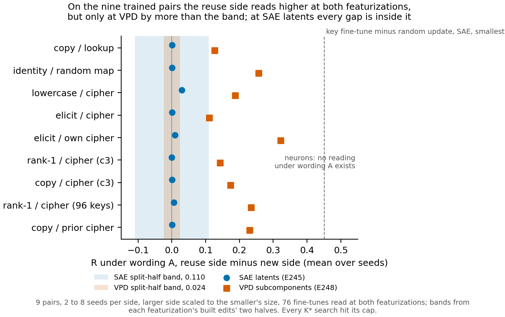

# Does R under wording A, read in base-model SAE latents, put the built reuse edits above the new ones?

E245, cell P1.40 run 2 of 3, sae-lead, 2026-11-21; nine pairs and the random reference added 2026-11-22. Figures
`experiments/sae_r_a/figures/r_a_sae_vs_vpd.png` and `pair_gaps.png`. Plan `reports/plans/2026-11-21_plan_r-under-a-sae.md`;
rules `experiments/sae_r_a/results/predictions.json`; code `experiments/sae_r_a/run.py`, `commute.sae_feat`,
`commute.stand_in`; summaries `experiments/sae_r_a/results/summary_built.json`, `summary_keys.json`, written by
`experiments/sae_r_a/plot.py`, and `summary_pairs.json`. The random updates are E251, cell P1.40 run 3, written up in
`reports/analyses/2026-11-22_analysis_e251-sae-random.md`.

We read how much of each fine-tune's behaviour circuit can run on the base model's own mechanisms, each times one gain,
with the circuit written in latents of autoencoders trained on the base model alone. On six hand-built edits the reuse
edits read above the new ones by just over the noise band, but every trained fine-tune, on nine task pairs and five key
tasks, reads near one, so in each pair the side built to reuse sits above the side built to be new by less than the
noise, where the parameter decomposition separates all nine. Random updates of the same size read near one half, so
the near-one readings are not automatic, but this latent reading cannot sort trained fine-tunes into reused and new.

## The answer

Only on the built edits, and narrowly. In latents the lowest built reuse edit reads 0.694 and the highest built new
edit 0.571, a gap just above the noise. On the nine trained pairs every fine-tune reads 0.96 or more. The reuse side is
higher in all nine pairs, but by at most 0.030, inside the noise band of 0.110. The parameter decomposition, on the same
fine-tunes, separates every pair by 0.11 or more. Random updates of the key fine-tunes' size read about one half.

## What we were trying to test

**The definition.** Wording A, adopted by the user on 2026-11-20 (`decisions.md`, "Definition wording A adopted"): "A
fine-tune F reuses the base model M, for a behavior, to the extent that M's mechanisms, each up to an output gain, can
stand in for those of the variables the behavior runs through and still preserve the behavior." R is the largest share
of the circuit's variables that can all take M's mechanism at once, each times its own positive gain, inside F's full
forward pass, while the KL divergence from F's output stays within a tenth of KL from F to M. One means every variable
of the circuit can run on M's mechanism; zero means none can. The tenth is the filed bar; a twentieth and a fifth are
reported beside it.

**The featurization.** Sparse autoencoders trained on the base model's activations only, one per block output: the four
attention outputs and the four MLP outputs of the 67M model, 16,384 latents each, from E234. At each site a variable is
one latent, plus one remainder: whatever the site writes that the dictionary's latents do not, bias included. A latent's
mechanism in F is the encoder applied to F's module output; in M it is the encoder applied to M's module on the same
input. The residual-stream dictionaries are left out because they break on the gain-of-ten edit. Embeddings, layer
norms and the unembedding belong to no variable and always keep F's mechanism.

**The circuit.** K\* is the smallest set of variables found by E226's search such that mean-ablating everything outside
it keeps F's behaviour within a tenth of the full ablation's KL. Variables at a site whose weights did not change stand
in exactly, with gain one, so the share of K\* at untouched sites is the lowest R an edit can read.

**The items.** Six hand-built edits on E214's copy and cue windows, whose label is known by construction:

- reuse: the copy neurons' outputs doubled, the gain-of-two edit; times ten, the gain-of-ten edit; the copy circuit
  moved onto grafted neurons, the moved edit; the copy neurons zeroed and later MLP layers retrained to rebuild copying,
  the rebuilt edit;
- new: a key-to-answer lookup written into eight quiet layer-0 neurons, the few-neuron new edit, and the same lookup
  spread over all of layer 0's MLP, the thin new edit.

Then E237's five 96-key tasks, three seeds each, every update scaled to one common size: copy returns the key, top the
base model's own most likely next token, mid a token from its top 20, cipher a fixed cipher of the key, and the
prior-matched cipher a cipher whose answers the base model already finds about as likely as copy's. No reuse verdict is
filed for these tasks; E237 found that the re-gating share puts both ciphers apart from copy, top and mid.

Then E187's nine trained pairs, each a task expected to reuse the base model against one expected to need something
new: copy against lookup, an identity map against a random map, lowercase against a cipher, and six more pairs of a
copy, rank-1 or elicit task against a cipher. Each side has two to eight seeds, 76 fine-tunes in all. In each pair the
side with the larger update is scaled down to the other's size, so the two sides move the weights equally; these are
the same fine-tunes E248 read at the parameter decomposition. The unscaled fine-tunes were not read. A pair's gap is
the mean R over the reuse side's seeds minus the mean over the new side's.

Last, as a reference, E251 read one random update per key-task fine-tune, at that fine-tune's update size and on its
windows, and E242's two random updates. A random direction has no task, so it shows where an update of the same size
reads when nothing was learned.

**The noise band.** For each built edit, K\* and R are read again on each half of the data; the band is the largest gap
between two halves over the edits read.

## What we expected, and why

Two readings were filed against each other, with no direction between them. In the first, a new edit stores its lookup
where no latent of M with a gain can write it, so many of its circuit's latents must keep F's mechanism and it reads
below every reuse edit by more than the band. In the second, the base dictionary puts whatever it lacks into one
remainder per site, so a new edit's whole new write costs one variable of thousands and it reads as high as a reuse edit.
The remainder share was filed beside R to tell them apart: one minus the KL from F with only the eight remainders
stood in, over KL from F to M. It was expected above one half for the new edits and under 0.3 for the reuse edits. The
key tasks and the nine pairs were filed as descriptive, with no direction. For the random updates, the filed lean was
that they read well below every key fine-tune, as they do at the decomposition, by more than the band.

## What we observed

### Do the built reuse edits read above the built new edits?

**Reading it.** Yes, by a margin just over the noise. The filled circles in the top half of the figure are R in latents.
The gain-of-two edit reads 0.9985, the gain-of-ten edit 0.852 and the rebuilt edit 0.694; the thin new edit reads 0.571
and the few-neuron new edit 0.516. The rebuilt edit is the lowest reuse edit and the thin new edit the highest new one,
a gap of 0.123. The band, set by the rebuilt edit's two halves at 0.772 and 0.881, is 0.110, so the filed rule backs
the first reading. The filled squares are the decomposition's reading of the same edits: there the thin new edit reads
0.980, above the gain-of-ten edit and the rebuilt edit, and the same gap is -0.120. The moved edit changes the output by
less than the measured noise floor in both readings and is not read.

| edit | built as | R at SAE, bar 0.05 / 0.1 / 0.2 | R at SAE on each half | lowest possible at SAE | changed members that stand in, SAE | remainder share | R at VPD | changed members that stand in, VPD |
|---|---|---|---|---|---|---|---|---|
| x2 | reuse | 0.9922 / 0.9985 / 0.9999 | 0.9990, 0.9985 | 0.865 | 0.989 | 0.894 | 0.9998 | 0.998 |
| x10 | reuse | 0.8280 / 0.8517 / 0.8855 | 0.8521, 0.8644 | 0.725 | 0.461 | 0.497 | 0.9760 | 0.743 |
| rebuilt | reuse | 0.6918 / 0.6943 / 0.7387 | 0.7718, 0.8814 | 0.608 | 0.220 | -1.579 | 0.8595 | 0.624 |
| moved | reuse | not read | not read | not read | not read | -0.110 | not read | not read |
| new_thin | new | 0.5353 / 0.5710 / 0.6398 | 0.5717, 0.5930 | 0.257 | 0.422 | 0.792 | 0.9799 | 0.819 |
| new_few | new | 0.4661 / 0.5158 / 0.5637 | 0.5085, 0.5246 | 0.222 | 0.377 | 0.775 | 0.8917 | 0.601 |

"Lowest possible" is the share of K\* at untouched sites. "Changed members that stand in" is R counted over K\*'s
changed members only: one minus those that must keep F's mechanism or fit a gain at or under zero, over all of K\*'s
changed members. It is descriptive, not filed; definition-lead's card reports the same share at VPD. The remainder share
is defined above. The decomposition's random updates of matched size read 0.291 and 0.301.

### What carries the order?

**Reading it.** The latents at untouched sites, more than the changed ones. The open circles in the figure mark the
lowest R each edit could read. In latents they sit at 0.865 and 0.725 for the two gain edits and 0.608 for the rebuilt
edit, but at only 0.257 and 0.222 for the two new edits. Most of a new edit's circuit sits in layer 0's MLP, the one
site it changed, so few of its latents stand in for free. Counted over changed latents alone, the rebuilt edit reads 0.220,
below the thin new edit at 0.422 and the few-neuron new edit at 0.377. So the filed order holds, but a reuse edit whose
changed latents mostly cannot stand in still reads above both new edits. That is how wording A counts, since a variable
the fine-tune did not change does run on M's mechanism. It does mean the latent reading's margin is set by where in
the model each edit sits as much as by how it changed.

### Does the remainder share tell new edits from reuse edits?

**Reading it.** No. The new edits' remainder shares are 0.792 and 0.775, above one half as expected. But the
gain-of-two edit reads 0.894 and the gain-of-ten edit 0.497, both above the 0.3 expected of reuse edits. The rebuilt
edit reads -1.579: standing in only its remainders moves the output further from F than M is. That is under 0.3 by the
letter of the rule but is not the small positive share the expectation meant. The share's positive control, the new
edits against the gain-of-ten edit, does not separate them.

### How do the key tasks read?

**Reading it.** Every one of the fifteen reads near one, from 0.989 to 0.999. The task means are 0.9989 for copy and
for top, 0.9988 for mid, 0.9982 for the prior-matched cipher and 0.9898 for the cipher. The cipher sits lowest, below
the others by more than four times its seed range. The prior-matched cipher sits slightly below copy, top and mid, by
about its own seed range. The reason the values sit so high is in the last two columns below. On copy, top and mid the
variables that must keep F's mechanism are four to nine, nearly all of them site remainders, out of 3,916 to 7,274
variables in K\*. On the prior-matched cipher they are the eight remainders and four to seven latents; on the cipher, the
eight remainders and 112 to 134 latents. A trained update changes every site, and at each site its write outside the
base dictionary becomes one remainder, which counts as one variable of thousands. This is the second filed reading,
seen on trained items rather than on the built ones. On the scale the built edits set, every key task reads like the
gain-of-two edit, the ciphers included. The crosses near one half on each key-task row are random updates of the same
size. They show that an update of this size does not read near one by default; a later section says what they do not
show.

| task | seed | R, bar 0.05 / 0.1 / 0.2 | remainder share | size of K* | variables that do not stand in, of them remainders | KL(F to M), nats |
|---|---|---|---|---|---|---|
| copy | 0 | 0.9982 / 0.9990 / 0.9992 | 0.823 | 3926 | 4, 4 | 4.40 |
| copy | 1 | 0.9983 / 0.9991 / 0.9995 | 0.800 | 4241 | 4, 4 | 4.11 |
| copy | 2 | 0.9977 / 0.9987 / 0.9992 | 0.837 | 3916 | 5, 5 | 4.34 |
| top | 0 | 0.9982 / 0.9990 / 0.9993 | 0.603 | 6069 | 6, 6 | 1.90 |
| top | 1 | 0.9975 / 0.9990 / 0.9995 | 0.622 | 7274 | 7, 7 | 2.00 |
| top | 2 | 0.9969 / 0.9987 / 0.9991 | 0.625 | 6878 | 9, 7 | 1.90 |
| mid | 0 | 0.9980 / 0.9987 / 0.9991 | 0.631 | 5586 | 7, 6 | 2.51 |
| mid | 1 | 0.9978 / 0.9990 / 0.9993 | 0.618 | 5882 | 6, 6 | 2.60 |
| mid | 2 | 0.9982 / 0.9987 / 0.9991 | 0.645 | 5532 | 7, 6 | 2.63 |
| prior-matched cipher | 0 | 0.9919 / 0.9982 / 0.9991 | 0.505 | 7757 | 14, 8 | 3.52 |
| prior-matched cipher | 1 | 0.9901 / 0.9978 / 0.9990 | 0.477 | 6901 | 15, 8 | 3.41 |
| prior-matched cipher | 2 | 0.9906 / 0.9984 / 0.9991 | 0.478 | 7741 | 12, 8 | 3.53 |
| cipher | 0 | 0.9650 / 0.9890 / 0.9987 | 0.395 | 12904 | 142, 8 | 3.40 |
| cipher | 1 | 0.9643 / 0.9897 / 0.9984 | 0.378 | 11984 | 124, 8 | 3.29 |
| cipher | 2 | 0.9675 / 0.9908 / 0.9988 | 0.430 | 12978 | 120, 8 | 3.27 |

"Variables that do not stand in" counts those that must keep F's mechanism plus those whose gain is at or under zero,
at the filed bar. Every key item's K\* search hit its 2,000-evaluation cap; no key item's R search did. Remainder
shares run from 0.378 to 0.837; task means are in `summary_keys.json`.

### Does the reuse side read higher than the new side in the nine trained pairs?

**Reading it.** Higher in all nine, but never by more than the noise. The blue circles are each pair's gap in latents;
they run from 0.0001 to 0.030 and all sit inside the light blue band, the 0.110 that the built edits' two halves set.
The orange squares are the decomposition's gaps on the same 76 fine-tunes. They run from 0.11 to 0.32, each well
outside the decomposition's own band of 0.024. In latents both sides read near one: the reuse sides' means run from
0.9987 to 0.9992 and the new sides' from 0.969 to 0.999. Seed by seed, the lowest reuse seed sits below the highest new
seed in four of the nine pairs. The largest gap, lowercase against cipher at 0.030, is about a quarter of the band. No
neuron reading under wording A exists, so the figure has no neuron row.

| pair, reuse / new | seeds | R at SAE, reuse side | R at SAE, new side | gap at SAE | gap at VPD | remainder share, reuse | remainder share, new |
|---|---|---|---|---|---|---|---|
| copy / lookup | 3 / 3 | 0.9992 | 0.9989 | 0.0003 | 0.13 | 0.85 | 0.50 |
| identity / random map | 4 / 4 | 0.9991 | 0.9978 | 0.0013 | 0.26 | 0.81 | 0.39 |
| lowercase / cipher | 2 / 4 | 0.9987 | 0.9687 | 0.0300 | 0.19 | 0.54 | 0.39 |
| elicit / cipher | 5 / 5 | 0.9990 | 0.9987 | 0.0003 | 0.11 | 0.67 | 0.47 |
| elicit / own cipher | 5 / 2 | 0.9990 | 0.9902 | 0.0088 | 0.32 | 0.67 | 0.34 |
| rank-1 / cipher, c3 | 8 / 8 | 0.9989 | 0.9988 | 0.0001 | 0.14 | 0.70 | 0.44 |
| copy / cipher, c3 | 8 / 8 | 0.9991 | 0.9988 | 0.0003 | 0.17 | 0.77 | 0.44 |
| rank-1 / cipher, 96 keys | 3 / 3 | 0.9988 | 0.9932 | 0.0057 | 0.23 | 0.64 | 0.40 |
| copy / prior cipher | 3 / 3 | 0.9989 | 0.9982 | 0.0008 | 0.23 | 0.82 | 0.49 |

Each side is the mean over its seeds, at the filed bar of a tenth. The decomposition's gaps are E248's, from
`experiments/kstar_vpd_wording_a/results/summary.json`. Every K\* search on the pairs hit its cap of 2,000 evaluations;
no stand-in search did. No pair item has a variable at an untouched site in its circuit, since every trained update
changes every site, so the free stand-in of untouched parts plays no part here.

### What pins the pairs near one, and what does the remainder share see?

**Reading it.** The remainder, counted as one variable per site. As on the key tasks, the variables that must keep
F's mechanism are a handful out of thousands, mostly site remainders. The remainder share is one minus the KL left when
only the eight remainders take M's mechanism, over KL from F to M. It reads one when the remainders carry none of the
change and zero when they carry all of it. Here it does split the sides: the reuse sides' means run from 0.54 to 0.85
and the new sides' from 0.34 to 0.50. Seed by seed, every reuse seed reads above every new seed in all nine pairs. So
the new tasks do put more of their change outside the base dictionary, as the second filed reading said. R under
wording A does not see it, because that change sits in one variable per site. On the built edits the same share went
the other way, with the new edits at 0.792 and 0.775, so it is a description of the trained pairs, not a reading of
the built labels.

### Where does a random update of the same size read?

**Reading it.** About one half, well below every key fine-tune. The fifteen random updates read 0.48 to 0.54, against
0.989 for the lowest key fine-tune, a gap of 0.451, four times the band. The decomposition's two random updates read
0.515 and 0.670 in latents, against 0.291 and 0.301 at the decomposition. Two things limit what this shows. Every random search hit its cap,
so these values are lower bounds. And a random update of this size barely moves the behaviour: KL from F to M is 0.0016
to 0.0019 nats, against 1.90 to 4.40 for the key fine-tunes. The bar is a tenth of that KL, so the random updates are
read against a bar over a thousand times smaller. E242's second random update, scaled up to match a KL, moves the
behaviour 0.172 nats on its windows and reads higher, at 0.670. A random update that moves the behaviour as far as a
key fine-tune was not read. The details are in
`reports/analyses/2026-11-22_analysis_e251-sae-random.md`.

## What we learned

At base-model SAE latents, wording A orders the built reuse edits above the built new edits, where the parameter
decomposition did not. The margin is barely above the noise and comes mostly from how many of each circuit's latents
sit at sites the edit never touched. On trained fine-tunes the reading is pinned near one, because each site's
out-of-dictionary write is a single variable. On the nine pairs it puts the reuse side higher every time, but by less
than the noise, where the decomposition separates every pair. The remainder share, read beside it, does split the
pairs' sides seed by seed, which says the new tasks write more outside the base dictionary than the reuse tasks do.
For the paper, the latent row reads the built labels, narrowly, and cannot sort trained fine-tunes into reused and new.

## How compelling is the evidence

- **Lower bounds.** Every K\* search hit its cap of 2,000 evaluations, so each K\* may hold more variables than the
  smallest circuit. The R search hit its cap on the gain-of-ten, rebuilt and both new edits, so those R values are
  lower bounds. The cap applies to both sides of the gap, so it could move either way. The rebuilt edit's main
  search reads below both its halves, and its second half's search did not hit the cap.
- **One featurization, one seed.** One SAE seed, eight sites. The four attention dictionaries are more than half dead:
  0.530 to 0.616 of their latents never fire on held-out rows, as E234 measured.
- **The random reference moves the behaviour far less.** Random updates of the key fine-tunes' size read about one
  half. But they move the output over a thousand times less than the fine-tunes do, and every random search hit its
  cap. They show that near-one readings are not automatic at this size, not that a key fine-tune reused anything.
- **The band comes from one edit.** The band of 0.110 is the rebuilt edit's two halves; every other edit's halves sit
  at most 0.021 apart. The gap clears it by 0.014. Even against the tighter 0.021, eight of the nine pair gaps sit
  inside; only lowercase against cipher, at 0.030, clears it.
- **Items covered.** Five of the six built edits were read; the moved edit is under the noise floor. All fifteen key
  items and all 76 fine-tunes of the nine pairs were read, without halves, the pairs at matched size only.
- **Not bijective.** A dictionary of 16,384 latents for a 768-wide output is overcomplete, so a site's output does not
  fix its latents uniquely; the translation from module to variables is not one-to-one.

## Surprises

- The rebuilt edit, a reuse edit, reads below both new edits once only its changed latents are counted. The filed
  order holds only through latents at untouched sites.
- The remainder share did not separate new from reuse: the gain-of-two edit reads 0.894, above both new edits.
- Every key item's must-keep set is mostly site remainders, so the key reading sits at its ceiling.
- On the nine pairs the latent reading and the decomposition disagree in size, not in sign: both put every reuse side
  higher, but the latent gaps are six to over a thousand times smaller.
- The remainder share, which failed on the built edits, separates the trained pairs' sides seed by seed.

## What next

1. A random update scaled until it moves the behaviour as far as a key fine-tune, read in latents. If it still reads
   near one half, the key tasks' near-one values carry information; if it reads near one, the latent reading has no
   floor for trained items.
2. Counting the remainder as one variable is what pins trained items near one. Whether it should count by its share of
   the site's write is a definition question for the user, not a measurement change; the remainder share above shows
   what such a count would see on the pairs.

## Scorecard

| id | claim in words | rule | read | verdict |
|---|---|---|---|---|
| R0 | every job's do-nothing exact; per-item controls exact | exact zeros; revert within 1e-3 | all 14 jobs' do-nothing read R one, floor under 1e-6 | held |
| order check | every reuse edit read above both new edits | min reuse R minus max new R above zero | 0.694 against 0.571, moved not read | held; key tasks read |
| band | largest split-half gap | over the built edits read | 0.110, from rebuilt | set |
| P1 | rival a: gap above the band; rival b: gap at or under zero with both remainder shares above one half | gap against band | gap 0.123, band 0.110 | rival a, narrowly |
| remainder, new | new edits' remainder share above one half | descriptive | 0.792 and 0.775 | as expected |
| remainder, reuse | reuse edits' remainder share under 0.3 | descriptive | 0.894, 0.497 and -1.579 | not as expected |
| D1 | key tasks, descriptive | none filed | 0.989 to 0.999 | read |
| D2 | nine pairs, descriptive | mean reuse R minus mean new R per pair; count positive | 9 of 9 positive, 0.0001 to 0.030, all inside the band 0.110; VPD 0.11 to 0.32 | read |
| E251 P1 | lowest key R minus highest random R above the band | gap against band | 0.989 against 0.538, gap 0.451, random searches capped | rival a, as filed; lower bound on the random side |

## Departures from the literature

- **The dictionaries.** BatchTopK SAEs as in SAEBench, at 16k width, but trained here on the base model's
  block outputs; E234 lists its departures from SAEBench's recipe. The attention dictionaries' dead share, more
  than half against SAEBench's reference of about an eighth, is a departure in outcome.
- **The remainder as a variable.** Treating each site's reconstruction error as one variable follows the
  featurized-model construction in the paper draft; SAE circuit work such as Marks et al.'s sparse feature circuits
  also keeps one error node per site. Here that node is one variable in R's count, which the literature has no
  counterpart for.
- **Soft intervention with one gain.** Geiger's soft intervention replaces a variable's mechanism; wording A allows
  M's mechanism times one positive gain per variable, fitted by least squares over all positions. That gain is ours.
- **K\* by mean ablation** with E226's search and bar, not a published circuit method.

## Not run

- A random update that moves the behaviour as far as a key fine-tune; the random updates read move it over a thousand
  times less.
- E187's nine pairs as built, without scaling the larger side down; only the size-matched fine-tunes were read.
- Split halves for the key items and the pairs, so the pairs' gaps are read against the built edits' band.
- Uncapped random searches: every random update's R is a lower bound.
- The residual-stream dictionaries: under the gain-of-ten edit the last residual dictionary explains less than
  nothing, about minus sixteen in fraction of variance, as E234 found.
- A second dictionary seed; an uncapped search; gains fitted on the behaviour rather than on the writes.
- A neuron reading under wording A: none exists, on the built edits or the pairs, so neither figure has a neuron row.

## Provenance

Results `experiments/sae_r_a/results/items/*.json`, stage 0 `items/stage0_*.json`, logs `run_built0-5.log` and
`run_keys0-7.log`, every log ending FINISHED; keep masks and gains in `results/large/items_*.npz`. Built edits: four
cluster debug jobs on L40 cards for the copy-window edits and H100 pods for the two new edits; key items on H100 pods
and the cluster. The decomposition's reading: `experiments/kstar_vpd_wording_a/results/summary.json` and `items/`,
E242, definition-lead. Pairs: `results/items/` for the 76 pair fine-tunes, logs `run_pairs0-3.log`, summary
`results/summary_pairs.json`, on four H100 pods; the side lists and the decomposition's pair gaps are E248's
`experiments/kstar_vpd_wording_a/results/changed_only.json` and `summary.json`. Figure `figures/pair_gaps.png` is drawn
by `plot.py` from those files and reproduces every gap in `summary_pairs.json`. Random updates: E251,
`experiments/sae_r_a_random/results/summary.json` and `items/`. Numbers ledger: this file's `.numbers.tsv`.

**Amendment, 2026-11-21 (pairs group only).** The first pairs run, on four H100 pods, stopped at stage 0 before any item ran. Stage 0 projects the worst case, every search at its 2000-evaluation cap at the do-nothing's speed, which came to 27 h per 19-item job against the filed 6 h limit, while the key items measured 4-7 min each. The pairs group reruns from `results/predictions_pairs_amend_2026-11-21.json` (`--pred`), a copy that changes only that stop limit, to 30 h. `predictions.json` is unchanged (whip-lead's decision).
