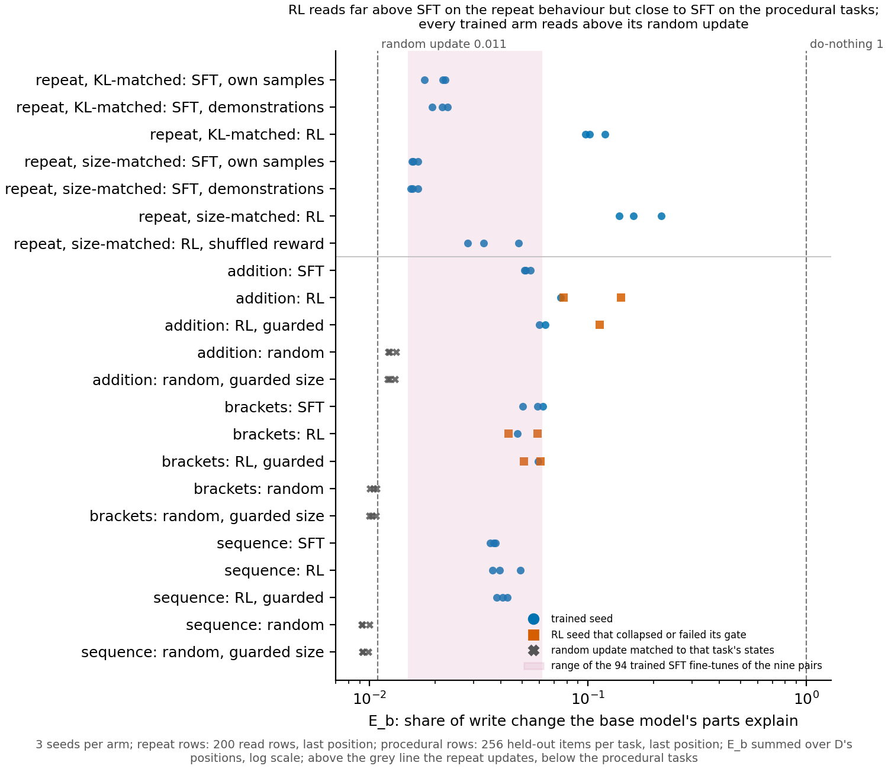

# Does the base model's own write explain the changed parts of trained updates?

*2026-11-21, definition-lead (writer agent). Cell P1.50, run E257, final: all three stages read. Descriptive by the
user's instruction: no reuse or new verdict is given here under any wording, and no definition wording is changed.*

On 142 trained updates of the 67M model, we asked how much of each altered circuit part's change the base model's
own part explains when only turned up or down. Supervised fine-tunes read a few percent, a little above random
updates and far below hand-built edits that reuse the base model, and the side of a task pair built to need something
new often read higher than the side built to reuse. Reinforcement learning on repeated text read five to eleven times its
supervised twins, but on three procedural tasks it read close to supervised training, so the reading moves with
something other than the pair labels and cannot yet say which updates reuse the base model.

## The answer

The explained share sat between 0.015 and 0.062 on every supervised fine-tune of the task pairs. A random update read
0.011, and the built reuse edits 0.63 to 0.76. The new side read higher in six of nine pairs.
Reinforcement learning on repeated text read 0.10 to 0.22 per seed, far above supervised training on the same
behaviour. On addition, brackets and sequence tasks every trained arm read about four to six times its matched random update,
and reinforcement learning stayed within half again of supervised training.

## What was measured

The model is the 67M testbed decomposed with VPD. For an update F of the base model M, the circuit K* is the set of
subcomponents and site remainders that carries F's behaviour on the task's inputs D. A member of K* is changed when
the update moved it at all.

For each changed member $u$, write $w_F(u,x)$ and $w_M(u,x)$ for what $u$ writes at input position $x$ in F and in M.
The member's write change is $dd_u = \sum_x |w_F(u,x) - w_M(u,x)|^2$, summed over every position of D. M's write
explains part of that change at its best non-negative gain $g_u = n_u / m_u$, with $n_u = \sum_x \langle w_F, w_M \rangle$
and $m_u = \sum_x |w_M|^2$; the explained part is $(n_u - m_u)^2 / m_u$, and zero when $g_u \le 0$ or M writes nothing.

The reading is $E_b$, the explained part summed over K*'s changed members divided by their summed write change. It
reads 1 when every changed part is M's part turned up or down, and near 0 when M's parts explain none of the change.
The do-nothing has no changed member and reads 1 by convention. Beside it we report the untouched share, the share of
K*'s members the update did not change. This is the user's option b of 2026-11-21, which counts only what changed.

Three groups of updates were read:

- **Supervised task pairs, 94 fine-tunes.** Nine task pairs, each a task expected to reuse M against one expected to
  need something new, with two to eight seeds per side. The side with the larger update is scaled to the other's
  size. Also copy against lookup at their own sizes, and five key tasks at one common size. K* is the one the earlier
  wording-A run saved.
- **Repeat updates, 21 states.** Saved updates that teach the model to repeat text it saw earlier, three seeds each.
  They were reached by reinforcement learning, by the same loop with shuffled rewards, by supervised training on the
  model's own rewarded samples, and by supervised training on demonstrations. One run stopped every update at the same
  weight size, the other at the same divergence from M on ordinary text and saved no shuffled arm.
- **Procedural tasks, 45 states.** Addition, bracket matching and sequence continuation, each reached by supervised
  training, by reinforcement learning, and by a guarded reinforcement-learning retrain, three seeds each. Each task has
  two random updates matched in size, one per training run. Seven reinforcement-learning seeds collapsed onto one
  answer or failed their gate; they are marked apart and left out of every arm mean.

For the last two groups K* was searched afresh with the settings of the earlier search, capped at 2,000 evaluations.

**References.** The do-nothing reads 1. The random updates give the floor. The built edits from the earlier rescore
give the positive control: two gain edits and one rebuilt edit that reuse M, and two edits that add a computation M
lacks.

## What the card expected

The card set two rivals. In the first, reading only the changed parts separates reuse from new as on the built
edits, so the reuse side of each pair reads above its new side by more than the random update's 0.011. In the second, the
built-edit order came from how those edits were built, and the gaps sit near zero or track something else. Nothing was filed
for the repeat or procedural states: they are read and reported.

## Is the apparatus sound?

Every job's first stage stopped on any miss, and none of the 14 first stages missed. The do-nothing had no changed
member, every write change was exactly 0, and the reading was exactly 1. The gain edit by two read 0.7617 in full
precision, matching the earlier rescore to within 1.9e-9. The gap between half and full precision on it, 3.3e-5,
is the floor for this reading. Every random update read between 0.0092 and 0.013.

## Does the side built to reuse read higher in each pair?

**Reading it.** No. Every point sits between the random line and the built reuse band, much nearer the random line.
In six of the nine pairs the orange points sit to the right of the blue. Three pairs show it most clearly: elicit
against cipher, and rank-1 and copy against the c3 cipher. There the new side reads higher by 0.021 to 0.027, about
twice the random update's value. In the other six pairs the two sides differ by at most 0.009 either way, and the
reuse side leads in only three of them, by at most 0.005. The widest seed spread within a side is 0.022. The two built
new edits read 0.012 and 0.019, so every supervised fine-tune reads in their range or a little above it.

| pair, reuse / new | seeds | reuse side | new side | higher side, by | R under A gap, earlier |
|---|---|---|---|---|---|
| copy / lookup | 3 / 3 | 0.039 | 0.043 | new, 0.004 | 0.13 |
| identity / random map | 4 / 4 | 0.035 | 0.039 | new, 0.004 | 0.26 |
| lowercase / cipher | 2 / 4 | 0.025 | 0.020 | reuse, 0.005 | 0.19 |
| elicit / cipher | 5 / 5 | 0.034 | 0.055 | new, 0.021 | 0.11 |
| elicit / own cipher | 5 / 2 | 0.034 | 0.031 | reuse, 0.003 | 0.32 |
| rank-1 / cipher, c3 | 8 / 8 | 0.033 | 0.059 | new, 0.026 | 0.14 |
| copy / cipher, c3 | 8 / 8 | 0.032 | 0.059 | new, 0.027 | 0.17 |
| rank-1 / cipher, 96 keys | 3 / 3 | 0.030 | 0.039 | new, 0.009 | 0.23 |
| copy / prior cipher | 3 / 3 | 0.033 | 0.029 | reuse, 0.003 | 0.23 |

Each side is the mean over its seeds. The last column is the reuse side's lead under R under wording A, read on the
same states by the earlier run, where the reuse side led in all nine pairs.

At their own sizes copy reads 0.039 and lookup 0.045, so lookup again reads higher. Among the five key tasks, cipher
reads highest at 0.038 and copy next at 0.032; elicit, rank-1 and prior cipher each read 0.029. Under R under wording A
the same states fall in a different order, copy 0.98 first and cipher 0.65 last.

## Does the route to a behaviour change the reading?

**Reading it.** On repeated text, yes, strongly; on the procedural tasks, hardly. The figure's upper block holds the
repeat updates. At matched weight size reinforcement learning reads 0.17 on average, its two supervised twins 0.016
each, and the shuffled-reward loop 0.037. At matched divergence reinforcement learning reads 0.11 and the
supervised twins 0.021 each. So on this behaviour reinforcement learning reads five to ten times supervised training,
and the shuffled loop sits between them, nearer the supervised arms. The lower block holds the procedural tasks.
There every trained arm reads between 0.037 and 0.075, inside or just above the range of the supervised task pairs.
Reinforcement learning reads 1.4 times supervised training on addition, 0.83 times on brackets and 1.1 times on
sequence. The random updates read 0.0092 to 0.013, as on the task pairs.

| behaviour | route | usable seeds | E_b, mean | E_b, per seed |
|---|---|---|---|---|
| repeat, same size | RL | 3 | 0.17 | 0.161, 0.139, 0.217 |
| repeat, same size | RL, shuffled reward | 3 | 0.037 | 0.033, 0.048, 0.028 |
| repeat, same size | SFT, own samples | 3 | 0.016 | 0.017, 0.016, 0.016 |
| repeat, same size | SFT, demonstrations | 3 | 0.016 | 0.017, 0.016, 0.015 |
| repeat, same divergence | RL | 3 | 0.11 | 0.097, 0.101, 0.120 |
| repeat, same divergence | SFT, own samples | 3 | 0.021 | 0.022, 0.018, 0.022 |
| repeat, same divergence | SFT, demonstrations | 3 | 0.021 | 0.019, 0.022, 0.023 |
| addition | SFT | 3 | 0.052 | 0.054, 0.051, 0.052 |
| addition | RL | 1 | 0.075 | 0.075 |
| addition | RL, guarded | 2 | 0.062 | 0.064, 0.060 |
| addition | random, two draws | 6 | 0.013, 0.013 | 0.012 to 0.013 |
| brackets | SFT | 3 | 0.057 | 0.062, 0.059, 0.050 |
| brackets | RL | 1 | 0.048 | 0.048 |
| brackets | RL, guarded | 1 | 0.059 | 0.059 |
| brackets | random, two draws | 6 | 0.010, 0.010 | 0.010 to 0.011 |
| sequence | SFT | 3 | 0.037 | 0.037, 0.038, 0.036 |
| sequence | RL | 3 | 0.042 | 0.039, 0.036, 0.049 |
| sequence | RL, guarded | 3 | 0.040 | 0.043, 0.038, 0.041 |
| sequence | random, two draws | 6 | 0.0095, 0.0095 | 0.0092 to 0.0099 |

The seven collapsed or failed reinforcement-learning seeds read 0.043 to 0.141, the highest being a collapsed
addition seed. They are left out of the means above.

## What we learned

On trained updates, a gain on M's part explains little of each changed part's write change. It explains a few
percent on supervised training and up to about a fifth on reinforcement learning toward repeated text. On the built
edits the reuse edits sat thirty times above the new ones; on the supervised pairs that order is gone, and the three
cipher pairs lean the other way. It does separate reinforcement learning from
supervised training on the repeat behaviour, but not on three procedural tasks. So whatever moves it is not the pair
label, and it is not the training route by itself either.

## How compelling is the evidence

- **What it is blind to.** The reading tests each changed part's write, not F's behaviour. It weighs parts by write
  change, not by effect on the output, and it takes K* as given. The behavioural per-member test of the same idea,
  run separately, also did not separate the pair sides.
- **The gain edits do not reach 1.** Doubling neuron columns is not a gain on any single VPD subcomponent, so the
  positive control reads 0.76, not 1. An update that reused M through many small neuron-level gains could read low
  here for the same reason.
- **Every fresh K* search hit its cap.** All 66 searches of the repeat and procedural states stopped at the
  2,000-evaluation cap, so their K* may be larger than a finished search would give. Their sizes ran from about 3,500
  to 35,500 members.
- **Noise.** The precision floor is 3.3e-5. Seed spread within an arm is at most 0.077 on the repeat
  reinforcement-learning arm and at most 0.022 on any supervised side.
- **Different inputs per group.** The task pairs, the repeat states and each procedural task are each read on their
  own D, so values compare within a group more safely than across groups. No random update was read on the repeat
  states' D.
- **Coverage.** One featurization, the 67M model, 142 trained states and 20 random updates. The untouched share was at most 0.00057 on any
  state and the K* held no grafts, so it plays no part here.
- **Inputs differ in one control.** The task pairs' matched-size random update was read on all positions of 75
  built-edit windows. The supervised pairs and the other random update were read on the last position of 512 windows.
  Both randoms read 0.011.

## Surprises

Two. The side built to be new reads higher in six of nine pairs, against the built-edit order and against wording A
on the same states. And the large gap between reinforcement learning and supervised training on repeated text does not
appear on the procedural tasks. I have no checked explanation for either; both are reported as read.

## What next

- The user's choice on the pending decision "Counting only what changed". These readings are its evidence: if the
  reading is kept, a check of why repeated-text reinforcement learning reads high would come next.
- A finished K* search on a few capped states. If the reading moves much once the search ends, the 66 capped readings
  need rerunning before any use.

## Scorecard

No rule was filed for the trained states: they are descriptive. Stage 0's rule held on all 14 first stages.

## Departures from the literature

Reading reuse only over changed parts, weighted by write change and fitted per part, has no source; it is ours.

## Not run

- A finished K* search: all 66 fresh searches hit the 2,000-evaluation cap.
- A random update on the repeat states' read rows.
- The search-based option-b reading on these states.
- The reading on the two halves of D, since write changes are summed over all of D.
- Any second featurization or the larger model.

Files: `experiments/rb_states/score.py` writes `experiments/rb_states/results/summary.json`, holding all three stages,
and `summary_items.json`, the supervised pairs alone, from `results/items/*.json`, `results/stage0_*.json` and the run
logs; `experiments/rb_states/plot.py` writes `figures/eb_pairs.png` and `figures/eb_arms.png`, with `.pdf` and `.csv`.
Logs `results/run_*.log`. Repeat states are E220's and E218's saved updates; procedural states are E256's and E260's,
listed with their sha256 in `results/manifest_p256.json`. The item and search stages ran on GPU pods; the scoring and
figures ran on CPU through `fleet/cpu-run`.
