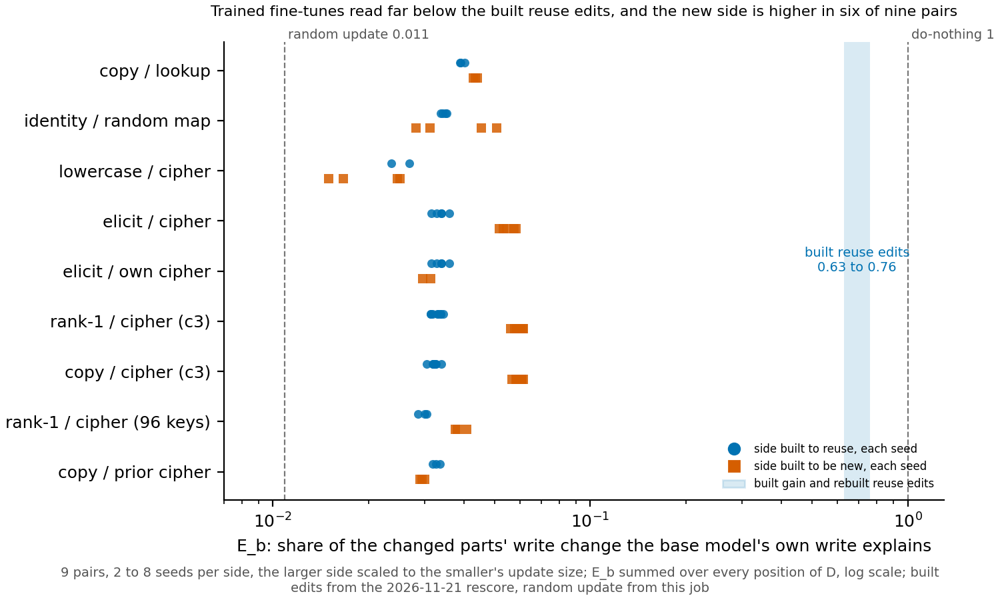

# Does the base model's own write explain the changed parts of trained fine-tunes?

*2026-11-21, definition-lead (writer agent). Cell P1.50, run E257, items stage only. Preliminary: the RL stage and the
behavioural readings are pending. Descriptive by the user's instruction: no reuse or new verdict is given here, and no
definition wording is changed.*

On 94 trained fine-tunes of the 67M model, we asked how much of each altered circuit part's change the base model's
own part explains when only turned up or down. On every fine-tune the answer was small,
far below the hand-built edits that reuse the base model and close to a random update. In most task pairs the side
built to need something new read as high as the side built to reuse, or higher. So this reading of the parts' writes
does not reproduce, on trained fine-tunes, the order it gave on the built edits, and it cannot yet say which fine-tunes
reuse the base model.

## The answer

The explained share sat between 0.015 and 0.062 on every trained fine-tune. The built reuse edits read 0.63 to 0.76
on the same reading, and a random update 0.011. In six of the nine task pairs the side built to be new read higher;
in the other three the side built to reuse led by at most 0.005. This is the opposite of what the reading did on the
built edits, and it is preliminary until the reinforcement-learning states and the behavioural test are read.

## What was measured

The model is the 67M testbed decomposed with VPD. For a fine-tune F of the base model M, the circuit K* is the set of
subcomponents and site remainders that carries F's behaviour on the task's inputs D, as the earlier wording-A run
saved it. A member of K* is changed when the update moved it at all.

For each changed member $u$, write $w_F(u,x)$ and $w_M(u,x)$ for what $u$ writes at input position $x$ in F and in M.
The member's write change is $dd_u = \sum_x |w_F(u,x) - w_M(u,x)|^2$, summed over every position of D. M's write
explains part of that change at its best non-negative gain $g_u = n_u / m_u$, with $n_u = \sum_x \langle w_F, w_M \rangle$
and $m_u = \sum_x |w_M|^2$; the explained part is $(n_u - m_u)^2 / m_u$, and zero when $g_u \le 0$ or M writes nothing.

The reading is $E_b$, the explained part summed over K*'s changed members divided by their summed write change. It
reads 1 when every changed part is M's part turned up or down, and near 0 when M's parts explain none of the change.
The do-nothing has no changed member and reads 1 by convention. There is no search and no bar: it follows the user's
option b of 2026-11-21, which counts only what changed.

Three sets of trained fine-tunes were read, the same 94 states as the wording-A run on held items:

- **Nine task pairs**, each a task expected to reuse M against one expected to need something new, with two to eight
  seeds per side. The side with the larger update is scaled to the other's size, so both sides move the weights equally.
- **Copy against lookup** at each task's own update size, three seeds each.
- **Five key tasks** at one common update size, three seeds each.

**References.** The do-nothing reads 1. Two random updates, one at matched size and one matched in KL, give the floor
of the reading. The built edits from the earlier rescore give the positive control: two gain edits and one rebuilt
edit that reuse M, and two edits that add a computation M lacks.

## What the card expected

The card set two rivals side by side. If reading only the changed parts separates reuse from new on trained
fine-tunes as on the built edits, the reuse side of each pair reads above its new side by more than the random update's
0.011. If the built-edit order came from how those edits were built rather than from reuse, the nine gaps sit near zero
or track update size instead of the pair label.

## Is the apparatus sound?

The job's first stage stopped on any miss, and none occurred. The do-nothing had no changed member, every write change
was exactly 0, and the reading was exactly 1. The gain edit by two read 0.7617 in full precision, matching the earlier
rescore's saved 0.7617 to within 1.9e-9. The difference between half and full precision on it, 3.3e-5,
is the floor for this reading. The two random updates read 0.011, as filed.

## Does the side built to reuse read higher in each pair?

**Reading it.** No. Every point sits between the random line and the built reuse band, much nearer the random line.
In six of the nine pairs the orange points sit to the right of the blue. Three pairs show it
most clearly: elicit against cipher, and rank-1 and copy against the c3 cipher. There the new side reads higher by
0.021 to 0.027, about twice the random update's value. In the remaining six pairs the two sides differ by at most 0.009
in either direction, and the reuse side leads in only three of them, by at most 0.005. The widest seed spread within a
side is 0.022, on the random map. The two built new edits read 0.012 and 0.019 in the earlier rescore, so every
trained fine-tune, reuse side included, reads in their range or a little above it and nowhere near the built reuse
edits.

| pair, reuse / new | seeds | reuse side | new side | higher side, by | R under A gap, earlier |
|---|---|---|---|---|---|
| copy / lookup | 3 / 3 | 0.039 | 0.043 | new, 0.004 | 0.13 |
| identity / random map | 4 / 4 | 0.035 | 0.039 | new, 0.004 | 0.26 |
| lowercase / cipher | 2 / 4 | 0.025 | 0.020 | reuse, 0.005 | 0.19 |
| elicit / cipher | 5 / 5 | 0.034 | 0.055 | new, 0.021 | 0.11 |
| elicit / own cipher | 5 / 2 | 0.034 | 0.031 | reuse, 0.003 | 0.32 |
| rank-1 / cipher, c3 | 8 / 8 | 0.033 | 0.059 | new, 0.026 | 0.14 |
| copy / cipher, c3 | 8 / 8 | 0.032 | 0.059 | new, 0.027 | 0.17 |
| rank-1 / cipher, 96 keys | 3 / 3 | 0.030 | 0.039 | new, 0.009 | 0.23 |
| copy / prior cipher | 3 / 3 | 0.033 | 0.029 | reuse, 0.003 | 0.23 |

Each side is the mean over its seeds. The last column is the reuse side's lead under R under wording A, read on the
same states by the earlier run, where the reuse side led in all nine pairs.

### Copy against lookup, and the key tasks

At their own sizes copy reads 0.039 and lookup 0.045, so lookup again reads higher, by 0.006. Among the five key tasks,
cipher reads highest at 0.038 and copy next at 0.032. Elicit, rank-1 and prior cipher each read 0.029. Under R under
wording A the same states fall in a different order, copy 0.98 first and cipher 0.65 last.

### Which rival do the numbers favour?

The first rival is not borne out: no pair's reuse side leads by more than 0.011, and six of nine lead the other way.
The numbers sit closer to the second rival, with gaps near zero in six pairs. The size half of that rival cannot be
read inside a pair, because each pair's two sides move the weights by the same amount. Neither rival described the
three cipher pairs, where the new side leads by about twice the random update's value.

## What we learned

Fine-tuning changes every part of the circuit, and on trained fine-tunes M's own write, turned up or down, explains only
a few percent of each part's change. On the built edits the same reading put the reuse edits at least thirty times above the new
ones. On trained fine-tunes it does not separate the sides, and leans the other way on three cipher pairs. Whatever wording A sees on these pairs, it is not the share of change that a gain on M's parts explains.

## How compelling is the evidence

- **What it is blind to.** The reading tests each changed part's write, not F's behaviour: a part whose write M explains
  poorly may matter little to the output, and the reverse. The behavioural test, which stands parts in and reads the
  output, is running as E258 and E259. It also weighs parts by write change, not by effect on the logits, and it takes
  the saved K* as given.
- **The gain edits do not reach 1.** Doubling neuron columns is not a gain on any single VPD subcomponent, so the
  positive control reads 0.76, not 1. A trained fine-tune that reused M through many small neuron-level gains could read
  low here for the same reason.
- **Noise.** The precision floor is 3.3e-5. The two random updates differ by 2e-5. Seed spread within a side is at most
  0.022, on the random map.
- **Coverage.** One featurization, the 67M model, 94 states. Every trained K* had at most 0.0001 of its members
  untouched and no grafts, so the untouched share plays no part on these states.
- **Inputs differ in one control.** The matched-size random update was read on all positions of 75 built-edit windows;
  every trained item and the KL-matched random update on the last position of 512 windows. Both randoms read 0.011.

## Surprises

The side built to be new reads higher in six of nine pairs, against the order the reading gave on the built edits and
against wording A's order on the same states. I have no checked explanation for this; it is reported as read.

## What next

- The RL stage of this job reads the reinforcement-learning repeat states. If they also read only a few percent, the reading
  does not tell RL from fine-tuning on its own.
- The behavioural test of E258 and E259. If parts that M explains poorly still stand in for behaviour, the write
  reading is too strict to use as the measure.

## Scorecard

No rule was filed for the items: they are descriptive. Stage 0's rule held on every check above.

## Departures from the literature

Reading reuse only over changed parts, weighted by write change and fitted per part, has no source; it is ours.

## Not run

- The RL stage: 21 saved repeat states, the read rows already built. It adds to `summary_items.json` when it lands.
- The manifest stage, for the guarded RL retrain's states, whose list is not yet written.
- The behavioural stand-in test per member, E258 and E259, running separately.
- The search-based option-b reading on these states.
- The reading on the two halves of D, since write changes are summed over all of D.
- Any second featurization or the larger model.

Files: `experiments/rb_states/score.py` writes `experiments/rb_states/results/summary_items.json` from
`results/items/*.json` and `results/stage0_p0.json`; `experiments/rb_states/plot.py` writes `figures/eb_pairs.png`,
`.pdf` and `.csv`. Logs `results/run_random_p0.log`, `results/run_items_p3.log`, `results/run_rl_windows_rw.log`.
Item and random stages ran on a GPU pod; the scoring and figure ran on CPU through `fleet/cpu-run`.
