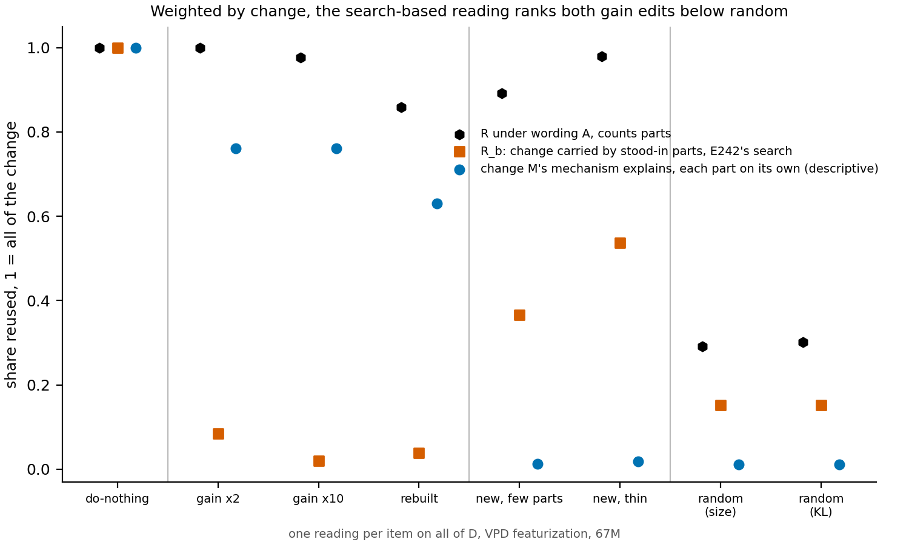

# Does weighting reuse by the change each part carries keep the built edits in order?

Every saved reading that has the per-part change sizes was rescored under the user's option b: reuse counted only
over the parts the fine-tune changed, each weighted by the change it carries. Read with the existing search, both pure
gain edits score below a random update and both new edits score highest, because the search keeps the few largest
changed parts whatever they compute. For the definition this means option b, as computed so far, fails its own
control, and only the seven built items can be read at no cost.

## The answer

Weighting by change turns the built order upside down when the stood-in parts come from the existing search. The two
gain edits read 0.08 and 0.02, the random update 0.15, and the thin new edit 0.54. The cause is the search: it keeps
the fewest parts that bring the model within its bar, and those are the biggest parts. Reading each changed part on
its own restores the order but does not reach one on the gain edits. Trained fine-tunes and every reading on sparse
autoencoders lack the per-part change sizes, so they were not rescored.

## What was tested

The model is the 67M testbed decomposed with VPD. For a fine-tune F of a base model M, the circuit K* is the set of
subcomponents and site remainders that carries F's behaviour on the task's inputs D. Wording A asks which changed
members of K* can take M's mechanism, each times its own positive output gain, all at once by soft intervention,
while keeping KL from F at or under a tenth of KL between F and M. R under wording A is the share of K* by count
that stands in, untouched members included.

Option b, as the user chose it on 2026-11-21, counts only changed members and weights each by its write change:
$dd_u = \sum_{x \in D} |w_F(u,x) - w_M(u,x)|^2$, the squared difference between what member $u$ writes in F and in M,
summed over every position of D. The reading is $R_b = \sum_{u \text{ stood in}} dd_u / \sum_{u \text{ changed in K*}} dd_u$.
It reads 1 when every changed member stands in and 0 when none does. The untouched share is the fraction of K*
that the fine-tune did not change at all.

The items are the six built edits and two random updates from the earlier thin-edit diagnosis. The gain edits
multiply eight layer-1 neurons' output weights by two or by ten. The rebuilt edit re-implements the same function
with different weights. The two new edits add a computation M lacks. The random updates are Gaussian per matrix, one
at the thin edit's size and one matched to the few-parts edit's KL. The do-nothing is F equal to M.

Beside $R_b$, this page reads two variants that need no search. Each changed member alone is fitted with M's
mechanism at its least-squares gain $g_u$. The fit explains $(n_u - m_u)^2 / m_u$ of its write change, where
$n_u = \sum \langle w_F, w_M \rangle$ and $m_u = \sum |w_M|^2$; a member with $g_u \le 0$ explains nothing, since
wording A allows positive gains only. $E_b$ is the explained write change over all changed members of K* divided
by their total write change. $T_b$ is the write-change share of the members whose own explained share reaches 0.9.
Both describe the data; neither is a proposed definition.

## What we expected

The user's control for option b: a pure gain edit is M's mechanism up to a gain, so both gain edits should read near
1. The do-nothing should read its defined value. Random updates should read low.

## Why does the search-based reading rank gain edits below random?



**Reading it.** Read with the existing search, option b fails its control. In the figure the orange squares sit at
0.08 and 0.02 for the gain edits and at 0.15 for both random updates. The thin new edit is highest at 0.54.

The cause lies in how the stood-in set is built. E242's `stand_in_search` runs a search only when standing every
changed member in misses the bar:

```
if kl_all > bar:
    f = KV.search(lambda keep: rd.kl(weights((~keep).float())), grad, len(cand), bar, ...)
```

`KV.search` orders members by the size of their attribution and bisects for the shortest prefix that meets the bar:

```
order, lo, hi = g.abs().argsort(descending=True), 0, n
...  lo, hi = (lo, mid) if ok(prefix(order, mid)) else (mid, hi)
```

So it returns the smallest set by count, and the members with the largest effect on KL come first. On the gain edit
by two, every changed member stood in still leaves half of KL between F and M. The search then keeps five of the
2,813 changed members, and those five carry 0.92 of the write change. The five largest members carry 0.96.

The kept members are not ones that M's mechanism cannot write. On the gain edit by two, their own fits explain 0.76
of their change, against 0.73 for the members that stand in. The gain edit falls short of 1 because doubling neuron
columns is not a gain on any single VPD subcomponent: a subcomponent reads across many neurons. So "kept" means
large and fitted imperfectly. Which members are kept depends on where the bar stops the search.

Moving the bar confirms it. Read at 0.05, 0.1 and 0.2 of KL, the random update's reading goes 0.08, 0.15, 0.28. Under
the absolute allowance the gain edit by two reads 1.

## Does an order-free version pass the control?

**Reading it.** Only partly. $E_b$, the blue circles, puts the gain and rebuilt edits at 0.63 to 0.76 and both new
edits and both randoms at 0.011 to 0.019. The order holds, but the gain edits do not reach one, for the neuron-basis
reason above. $T_b$ at 0.9 reads 0 on every item: no single member, even on the gain edit by two, is ninety percent
explained by a gain.

| item | R under A | untouched share of K* | R_b, bar 0.1 | R_b, bar 0.05 | R_b, bar 0.2 | E_b | T_b, 0.8 |
|---|---|---|---|---|---|---|---|
| do-nothing | 1 | 1 | 1 | | | 1 | 1 |
| gain by two | 0.9998 | 0.911 | 0.084 | 0.072 | 0.115 | 0.762 | 0.060 |
| gain by ten | 0.976 | 0.907 | 0.020 | 0.0008 | 0.010 | 0.761 | 0.060 |
| rebuilt | 0.859 | 0.626 | 0.038 | 0.025 | 0.073 | 0.631 | 0.047 |
| new, few parts | 0.892 | 0.728 | 0.366 | 0.289 | 0.452 | 0.012 | 0 |
| new, thin | 0.980 | 0.889 | 0.536 | 0.444 | 0.646 | 0.019 | 0 |
| random, size | 0.291 | 0.00006 | 0.152 | 0.078 | 0.278 | 0.011 | 0 |
| random, KL | 0.301 | 0.00006 | 0.151 | 0.078 | 0.299 | 0.011 | 0 |

Step-one detail: by count, the kept members are 0.0018 of the changed ones on the gain edit by two. On the gain edit
by ten they are 0.257 and carry 0.980 of the change; the largest members of the same number carry 0.9995.

## Edge cases checked before reading

- **No changed member.** On the do-nothing the denominator is zero. The script sets $R_b$, $E_b$ and $T_b$ to 1, as R
  under A reads 1 there. This is a convention for the user to confirm. The do-nothing's saved check has no changed
  variable and a largest write change of exactly 0.
- **Ties.** $R_b$ is a sum over a saved set, so ties cannot move it. They enter only through the search's ordering.
- **Tiny changes.** Dropping members whose change is under a millionth of the largest moves $R_b$ by 0.0007 at most, on the rebuilt edit.
  At a thousandth the largest move is the rebuilt edit, from 0.038 to 0.002.
- **Reproduction.** The recomputed kept share matches E247's saved value to one part in a billion on every item.

## What we learned

Option b as computed so far reads where the search stops rather than which parts F reuses. A version of b that
passes the user's control needs each changed part tested on its own, and it needs a rule for when one part stands
in. That rule is a definition choice for the user. At VPD the gain edits are not pure gains on single subcomponents,
so no per-part version can read them at exactly one.

## How compelling is the evidence

Seven items, one featurization, one seed of each built edit. The variants $E_b$ and $T_b$ read the write itself, not
F's behaviour, so they are blind to whether the unexplained part of a write matters downstream.

## Surprises

The reversal covers every built item, not only the rebuilt one: both gain edits read below random.

## Departures from the literature

Wording A's soft intervention follows Geiger's definition of one; weighting by write change and the order-free
variants have no source and are ours.

## Not run

- $R_b$ on E248's nine pairs, E62's copy and lookup states and E237's key tasks at VPD. E242 saved gains, the changed
  flags and which members keep F's mechanism, but no per-member write change. E226 saved grades and attributions only.
- $R_b$ on E245's built items, pairs and keys and on E251's randoms at sparse autoencoder latents. They save no
  per-latent write change either.
- The pair gaps of $R_b$ against update size, which need the pairs above.
- The moved edit, which wording A did not read.
- $R_b$ on the two halves of D. The saved write changes are summed over all of D.
- A per-member behavioural stand-in test. At the measured 0.56 seconds per evaluation over D on a cluster GPU, the
  22,363 changed members of the five built edits need about 3.5 hours, and the two randoms about 10 more.

Provenance: `experiments/option_b_rescore/score.py` and `plot.py`, run through `fleet/cpu-run`, no GPU, $0. Results
`experiments/option_b_rescore/results/summary.json`. Inputs: E242 `kstar_vpd_wording_a/results/large/items_*.npz` and
`items/*.json`, E247 `thin_edit_diagnosis/results/large/items_*.npz`, `summary.json` and `stage0.json`, and E226's
saved K*.
