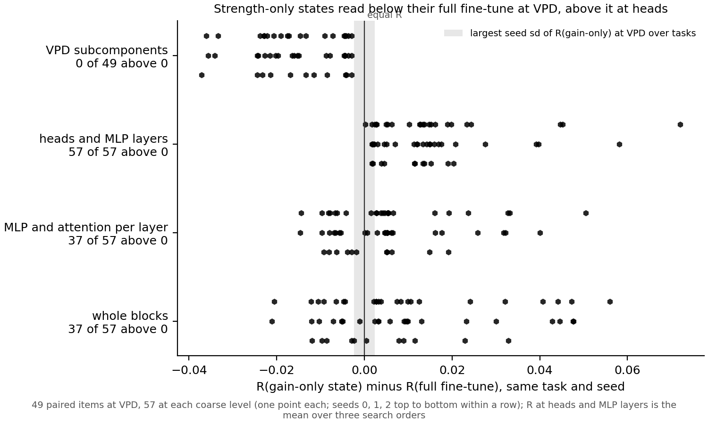

# Does the reuse score read a strength-only update as kept? (E236)

*2026-11-21, definition-lead (writer agent). Cell P1.41, experiment `experiments/gain_only_r`. Plan
`reports/plans/2026-11-20_plan_p1-41-gain-only-r.md`, card `~/commute-data/cards/E236.md`. Filed rules
`results/predictions.json`; scored readings `results/summary.json` by `score.py`. Nothing here is a verdict under the
working definition, which is under revision.*

We read the reuse score on 81 states of the 67M model that change only how strongly each neuron and head writes,
each beside the full fine-tune of the same task. With VPD subcomponents as the variables, every strength-only state
scored as less kept than its full fine-tune; with heads and MLP layers, every one scored as more kept. For `GOALS.md`,
the score at VPD penalises a pure strengthening, the clearest case of reuse, so there it reads turned weights.

## The answer

We predicted that a pure strengthening would score at least as high as a full fine-tune of the same task. With VPD
subcomponents as the variables, the opposite happened on every one of 49 pairs. With heads and MLP layers as the
variables, the prediction held on every one of 57 pairs. With whole blocks, or MLP and attention per layer, there was
no clear direction. The card's stop rule needed the low reading at every level, so it is not triggered.

## What we tested

**The states.** Compare-lead's E231 froze the model and trained one multiplier per MLP neuron and per attention head
on each task. It stopped where the output change matched the full fine-tune's. Each state is exported as a weight change
on the MLP output and attention output matrices. There are 81: 27 tasks at seeds 0 to 2.

**The score.** $R = \frac{1}{|K^*|}\sum_{u \in K^*} s_u$ is E226's reuse score with its grade unchanged. $K^*$ is a
smallest set of variables that keeps the fine-tuned model's output on the task's 512 read windows. The grade $s_u$ is
1 when a variable's write keeps its direction from the original model and 0 at right angles. With $f$ the share of
$K^*$ the update changed and $\rho'$ the mean grade over those changed members, $R = 1 - f(1 - \rho')$. This is the
squared-cosine grade, the reading before wording A. It is read at VPD and at E221's three coarse levels.

**The comparison.** For each state, $d = R(\text{gain-only}) - R(\text{full fine-tune})$, with the same task, seed
and windows. A positive $d$ means the strength-only state reads as more kept. There are 49 pairs at VPD and 57 at the
coarse levels. The twin tasks with no saved full fine-tune are read but not counted.

**The held model** fits one gain per neuron and head to the fine-tuned model. Its reading $S$ is 1 when the fit holds
the whole output change and 0 when it holds none. Since a gain-only state is in that family by construction, this is a
positive control for the held model, not a finding.

**Controls.** Stage 0 ran first on all nine pods. The do-nothing state read $R = 1$ at every level with nothing changed,
and the held model read no output change. The exact gain build of one state put every held reading inside its
tolerance. The bf16 export's floor was $1 - S$ = 8.2e-7.

## What we observed

**Reading it.** At VPD every strength-only state reads below its full fine-tune, by a median of 0.016. The smallest
gap is 0.0029, above the largest seed spread of 0.0024, the grey band. At heads and MLP layers every point sits right of
zero, a median of 0.013. At the two coarser levels the points straddle zero, 37 of 57 above it.

The VPD gap is not a larger output change. On all 49 pairs the strength-only state moved the output less on the read
windows than the full fine-tune did. It comes from the grade. A full fine-tune changes nearly every member of $K^*$,
with $f$ about 0.9999, but barely turns each. A strength-only state changes fewer members, $f$ from 0.43 to 0.48, but
turns each further. On the cipher task at seed 0, the changed members' mean grade is 0.919 against 0.9989. Across the paired items the score runs from 0.962 to 0.996 for strength-only states. Full fine-tunes run from 0.997
to 0.9997. E226 saw the
same effect on one built edit, where a ten-fold gain on eight copy neurons scored below both edits built as new.

**Held model.** It read at least 0.999998 on all 81 states, over the filed bar of 0.99. On the same tasks it reads the
full fine-tunes at 0.010 to 0.104.

## Spread

The card's spread was a proxy: the full fine-tunes' seed spread, a median of 9e-6. The strength-only states' own seed
spread at VPD has a median of 3.4e-4 over 27 tasks. It ranges from 1.0e-5 to 2.4e-3. That is far wider than the proxy, but every
VPD gap is still larger than the widest task's spread.

## Scorecard

| id | claim in words | rule | read | verdict |
|---|---|---|---|---|
| H1 | held model reads near 1 on every gain-only state | S ≥ 0.99 on all 81 | min 0.999998, 81 of 81 | holds |
| R1 | at VPD, gain-only reads above its full fine-tune | rival a if ≥ 40 of 49 above 0; rival b if ≤ 24 | 0 of 49, median d −0.016 | rival b |
| R2 head_mlp | same at heads and MLP layers | same, n = 57 | 57 of 57, median d 0.013 | rival a |
| R2 mlp_attn | same at MLP and attention per layer | same | 37 of 57, median d 0.0046 | no call |
| R2 block | same at whole blocks | same | 37 of 57, median d 0.0038 | no call |
| stop | no higher at VPD and at every coarse level | all four rival b | VPD only | not triggered |

## What each reading is blind to

- R and $d$: anything outside the 512 read windows and the last position. A state that reads high because it changed
  little would pass, but here the strength-only states read lower despite smaller output changes.
- $d$ at VPD: why a turn happens. The grade cannot tell a per-neuron rescale, which turns a subcomponent's write once
  the change is split over subcomponents, from any other turn.
- H1: nothing it is meant to see. The family holds every gain-only state, so a miss would have been a code error.

**Departures.** None from the literature beyond those E226 and E221 record. One from E231: R is read on the full
fine-tunes' windows, not E231's own rows. The KL match made there does not hold on these windows.

## What it means

At VPD the adopted grade reads the clearest case of reuse as less kept than a full fine-tune. That is the stop rule's
worry, met at VPD alone, so the cell reports R at VPD as a reading of turned weights there. Heads and MLP layers read
the same states the expected way. Whether wording A changes the VPD reading was not checked here.

## Not run

- The 47 gain-matched states that hit E231's step cap; only the KL-matched states were read.
- The neuron level, where a gain-only state reads 1 by construction.
- R under wording A on these states.
- Any reuse or new label or verdict on any item.
