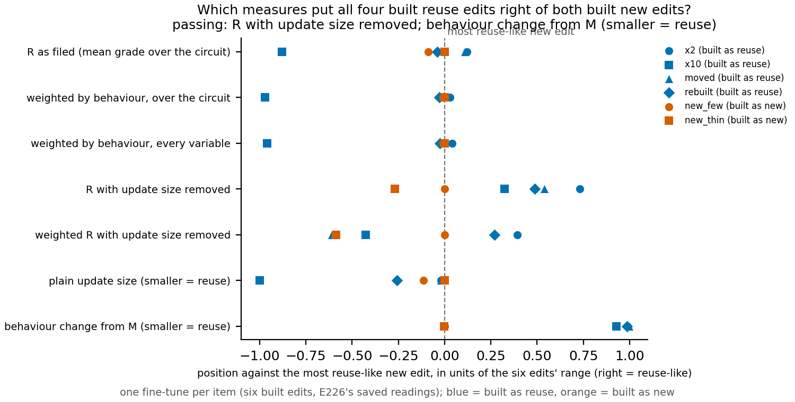

# Does a different way of computing the reuse score order the built edits?

*Definition-lead, 2026-11-21. Cell P1.42. Code `experiments/r_reanalysis/` (`run.py`, `plot.py`), results
`experiments/r_reanalysis/results/summary.json`. Plan `reports/plans/2026-11-20_plan_p1-42-r-reanalysis.md`, card
`reports/plans/2026-11-20_plan_p1-42-card.md`. Saved files only, no GPU. A description: no verdict on the definition.*

We recomputed the reuse score from saved readings in two new ways and set it beside simple readings. Weighting each
part by how much the behaviour uses it does not help: the ten-fold reuse edit falls further below the new edits.
Comparing each edit's score with what an update of its size usually gives does put all four built reuse edits above
both built new edits, and stops the trained pairs following size. That rests on six edits read on different inputs
per side, so it is a lead, not a pass.

## The answer

**One way of computing the score passes on the built edits; weighting by behaviour does not.** The way that passes
removes update size: an edit scores well when its parts' mechanisms moved less than an update of its size usually
moves them. It orders the six built edits correctly for any reasonable size law, and on the nine trained pairs the
reuse side reads higher on seven. Weighting by behaviour makes the failure worse. The only simple saved reading that
also orders the six is behaviour change from the base model, which does so because the new edits teach a different
behaviour.

## What we were trying to test

**The score as filed.** For each variable u of the VPD featurized model, a grade $s_u$ is the mean squared cosine
between the fine-tune's and the base model's write of u; 1 means the write kept its direction. The circuit is the
smallest set of variables that keeps the fine-tune's behaviour under mean ablation. The reuse score R is the mean of
$s_u$ over the circuit, so 1 means every needed part kept the base model's mechanism.

**The six built edits.** Four built as reuse on the base model's copy behaviour, which runs through eight neurons of
layer 1: their outputs doubled, multiplied by ten, moved onto eight new neurons, or zeroed and rebuilt by retraining
later layers. Two built as new: a lookup written into eight quiet neurons, and the same lookup spread thinly over a
whole layer. A measure works if all four reuse edits score above both new edits by more than its noise.

**The nine trained pairs.** Each pairs a fine-tune labelled reuse with one labelled new on the same task, 68 saved
states. The filed score's gaps on them followed which side moved its weights less.

**Three new ways of computing it**, all from the same saved grades:

- **Weighted over the circuit.** Each grade weighted by the size of its saved behaviour weight, a first-order estimate
  of how much ablating that variable changes the fine-tune's output.
- **Weighted over every variable**, with no circuit, to see whether weighting makes the circuit unnecessary.
- **Size removed.** Fit $\log(1-R)$ against $\log$ update size over all 74 changed states; an edit's score is how far
  it sits below the line. Update size is the weight change's norm over the base weights' norm.

**Noise.** Each built edit's circuit and weights were also found on each half of the inputs; the largest difference
between halves over the six is the band.

## What we expected, and why

The plan, written before computing, expected the weighted score to keep the ten-fold edit lowest: its rotated
variables sit on the copy path the behaviour uses, so weighting by use should pull it down. It expected size removal
might raise the ten-fold edit, whose update is the largest of the six, but might drop the moved edit, whose eight new
neurons grade 0. Doing nothing must read exactly 1 on the score and its weighted forms; size removal is undefined there.

## What we observed

### Which measures order the six built edits?

**Reading it.** Only size removal and behaviour change put every blue mark right of the line. Each row places the six
edits relative to the most reuse-like new edit, scaled to the six's range. Weighting by behaviour moves the ten-fold
edit from 0.9755 to 0.9378, further below the thin new edit at 0.9974. With size removed, the lowest reuse edit beats
the highest new edit by 0.57 on the log scale, against a half-inputs band of 0.25. Doing nothing reads exactly 1 on
the filed and weighted scores. The caveat: the reuse edits were read on copy windows at every position and the new
edits on lookup windows at the last position.

| measure | orders the six built edits? | lowest reuse edit | pairs, reuse side higher | pairs, rank correlation with the smaller update |
|---|---|---|---|---|
| R as filed | no | ten-fold | 9 of 9 | 0.87 |
| weighted, over the circuit | no, by more | ten-fold | 9 of 9 | 0.88 |
| weighted, every variable | no, by more | ten-fold | 9 of 9 | 0.90 |
| **R with size removed** | **yes, margin 0.57, band 0.25** | ten-fold | **7 of 9** | **-0.37** |
| weighted R with size removed | no | moved | 7 of 9 | -0.52 |
| R at blocks, size-matched | not read | | 4 of 9 | -0.80 |
| R at blocks, minus the size-only rule | not read | | 8 of 9 | 0.48 |
| plain update size, smaller is reuse | no | ten-fold | 8 of 9 | 1 |
| behaviour change from the base model, smaller is reuse | yes | ten-fold | 7 of 9 | 0.13 |
| held-model survival | read on rebuilt only, 0.56 | | 8 of 9 | -0.23 |
| gain-only reach | not read | | 3 of 9 | 0.50 |

### Does the size-removed score depend on the fitted size law?

**Reading it.** No, within a wide range. The fitted slope of $\log(1-R)$ on $\log$ size is 1.24 over all states and
1.32 over the trained pairs alone. The six are ordered correctly for every slope from 0.89 to 2.9, which holds the
value 2 that a small rotation of each write predicts. Below 0.89 it reverts to the filed score's failure, because the
ten-fold edit's ten times larger update is what raises its score. The two pairs it gets wrong are copy against lookup and copy
against random targets.

## What we learned

The filed score fails on the built edits because its grade reads how far an update moved the weights, not because of
which parts it averages over: weighting by behaviour keeps the failure. Dividing out update size is the change that
helps, on both the built edits and the trained pairs. Behaviour change also orders the built edits, so these six
cannot yet tell "mechanism changed per unit of weight change" from "behaviour changed per unit of weight change".

## How compelling is the evidence

Six built edits, one fine-tune each, and a margin of about two bands. The two sides were read on different inputs. The
behaviour weights are first-order estimates, not exact ablations. Size removal uses a slope fitted on these same
states, though the result holds over a wide range of slopes. The size-removed score has no fixed scale: it ranks
edits against each other, and doing nothing has no value.

## Surprises

The moved edit, which changes no behaviour, falls to the bottom once weighted and size-removed: its eight new neurons
grade 0 and carry large behaviour weights.

## Departures from the literature

- The behaviour weight is a first-order gradient of the output change with respect to each variable's scale, as in
  attribution patching, taken at half ablation rather than at the clean run.

## Not run

- Size removal for the six built edits at the coarse levels: blocks were read on the trained pairs only.
- Held-model survival and gain-only reach on five of the six built edits: never read on them.
- Any exact single-variable ablation weight: none was saved.
- A built reuse and new pair matched on both weight change and behaviour change.

*Provenance: `experiments/r_reanalysis/results/summary.json` (all values above), from the saved per-item grades and
behaviour weights in `experiments/kstar_vpd/results/large/`, item files in `experiments/kstar_vpd/results/items/`, pair
lists in `experiments/kstar_pairs/results/pairs.json`, block readings in `experiments/kstar_size_matched/results/summary.json`,
held-model survival in `experiments/held_model_retention/results/summary.json`, gain-only reach in compare-lead's
`experiments/gain_only/results/score.json`. CPU only, $0.*
