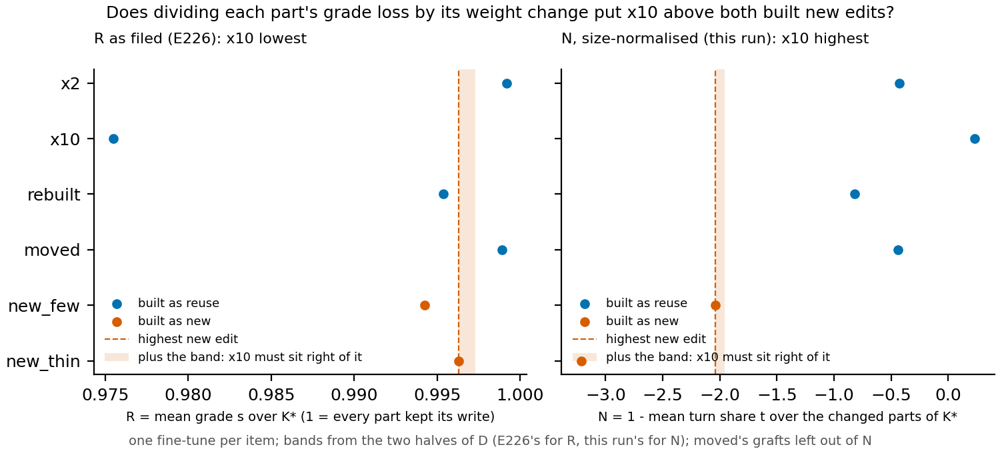
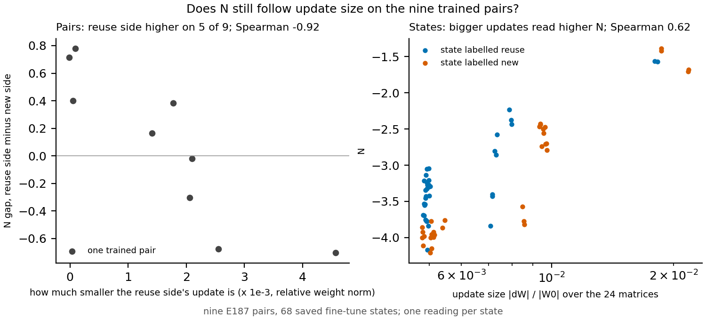

# Does a size-normalised reuse score read the built edits and the trained pairs better than R?

*Definition-lead, 2026-11-21. Cell P1.43, experiment E239 (filed as E226 Amendment 1). Code
`experiments/kstar_vpd_norm/run.py`, figures `plot.py`; filed rules `results/predictions.json`; readings
`results/summary.json`, `results/items/`, `results/run.log`. Card `reports/plans/2026-11-20_plan_p1-37-run2-card.md`.
One job on the MATS cluster, $0. A reading on E226's circuits and grades: no verdict on the definition.*

We divided each circuit part's loss of write direction by how much its weights changed, on six built edits and nine
trained pairs. The filed rule passes by a wide margin: every edit built as reuse now scores above both edits built as
new. But the score still follows update size on the trained pairs, now with bigger updates reading as more reuse, so
for `GOALS.md` it does not yet separate reuse from size.

## The answer

**The filed rule passes; the score still follows update size, the other way round.** Size-normalised, the ten-fold
reuse edit scores highest of the six built edits. Every reuse edit beats both new edits, by far more than the noise. But the per-part ratio exceeds one on most parts of trained fine-tunes, so the score is not bounded and is
not a share of turning. On the trained pairs, the side with the bigger update reads as more reuse almost
monotonically, which the crude size division also did.

## What we were trying to test

**The filed score and its failure.** E226 read the reuse score R with VPD subcomponents as the variables. Each
variable $u$ gets a grade $s_u$, one minus the mean over inputs of $1-\cos^2$ between the fine-tune's and the base
model's write; R is the mean grade over the circuit $K^*$. R put the ten-fold reuse edit, which multiplies eight copy
neurons' outputs by ten, below both built new edits. The suspected cause was size: that edit changes its parts far
more than the others do.

**The new reading.** The user asked for each changed part's grade loss divided by its relative weight change,
$t_u = (1-s_u)/\rho_u$ with $\rho_u = |\delta w_u|^2/|w_u|^2$, the Frobenius norms of the part's matrix in the
fine-tune and the base model. Then $N = 1 - \overline{t}$ over the changed members of $K^*$, plain and weighted by
each part's behaviour attribution. For a part whose change only scales its write, $t = 0$. For a small change at
right angles to the write, $t$ is just under 1. So N was meant to run from 0, every change turns, to 1, every change
scales. A side reading, $N_{in}$, takes the same ratio on the inputs instead of the weights.

**What is held fixed.** E226's circuits, grades and least-squares split are reused; nothing is searched or trained.
The do-nothing state and two built parts, a pure gain and a pure turn, run first and stop the job on a miss. The band
is the largest gap between the two halves of the windows over the six built edits.

## What we expected, and why

Rival a: the ten-fold edit mostly scales its parts' writes while a new edit turns them, so N puts it above both new
edits by more than the band. Rival b: the new edits are scaled as much, or the ten-fold change turns writes too, so it
sits at or below them. We filed rival a, and that all four reuse edits beat both new ones. On the pairs we only
described the gaps, after R's gaps had tracked update size.

## What we observed

### Does the ten-fold edit now score above both new edits?

**Reading it.** Yes, plainly. The ten-fold edit reads 0.233 on N, against −2.04 for the lookup in a few neurons and
−3.21 for the thinly spread lookup. The gap is 2.27, against a band of 0.081. All four reuse edits sit above both
new edits, from −0.82 for the rebuilt edit up. The behaviour-weighted N passes too, with a gap of 2.34. The input
ratio side reading does not: the ten-fold edit reads 0.816 there, below the thin lookup's 0.896.

### Why is N below zero, when it was meant to be a share?

**Reading it.** Because most parts read $t > 1$, which the weight ratio was supposed to rule out. On any one input,
with base write $m$ and change $d$, the lost squared cosine $1-\cos^2(m, m+d)$ never exceeds $|d|^2/|m|^2$: the
difference is a perfect square. So $t>1$ comes from how inputs are pooled. The grade averages the loss over inputs with equal weight
(`src/commute/kstar.py:280-282`), however little the part writes on each. The input ratio sums squared writes, so it
weights each input by the base write's size (`src/commute/kstar_vpd.py:360-368`). The weight ratio ignores the inputs
altogether (`kstar_vpd.py:336-351`). A subcomponent's change on inputs where it barely writes can cost nearly a whole
unit of lost squared cosine there while adding almost nothing to either ratio. The counts bear this out. On the
ten-fold edit 396 of 3,244 changed parts read $t>1$ under the weight ratio and 3 under the input ratio. On one
trained state, the c3 pair's cipher fine-tune at seed 0, 21,165 of 32,534 do, and 2,832 under the input ratio. So N on trained states runs from −4.21 to
−1.39. N measures mostly how much grade loss sits on inputs where a part is quiet, per unit of weight change, not
how much of a change turns rather than scales. The two built construction parts still read exactly: a gain $t=0$, a
turn 0.990, because there every input sees the same relative change.

### Does N still follow update size on the trained pairs?

**Reading it.** Yes, as strongly as R did, but the other way round. The reuse side reads higher on 5 of 9 pairs. The
gaps fall almost in rank order with how much smaller the reuse side's update is, Spearman −0.92. Across the 68 states,
N rises with update size, Spearman 0.62. R's pair gaps tracked size at 0.87 with smaller updates reading as reuse. The
crude division by size squared went to −0.77 across states, bigger updates reading as reuse, as here. The ten-fold edit
has the largest update of the six built edits, 0.148 against at most 0.048. So its pass is in the direction size
alone gives. Size alone does not give the whole order, though: the doubled and moved edits, at 0.0164, beat the few-neuron
lookup at 0.029.

## What we learned

Dividing each part's grade loss by its weight change fixes the ten-fold edit's placement among the six built edits.
It does not remove size: it swaps R's "smaller is reuse" for "bigger is reuse", as the crude normalisation did. The
per-part ratio is not a bound, because the grade counts every input equally while both size ratios weight by write
size. Neither R nor N, at this featurization, yet separates the built labels from update size.

## How compelling is the evidence

The filed rule's margin is about 28 bands, and the weighted form agrees. It rests on six built edits, one fine-tune
each. The size dependence rests on nine pairs and 68 states, with N's sign reversed against R's. The input-ratio
reading, the one closest to a bounded share, fails the filed rule.

## Surprises

N went below zero on every item but the ten-fold edit, the card expecting it in [0, 1] mostly. Under the input ratio
the reuse side read higher on only 1 of 9 pairs.

## What next

- Pool the grade the way the ratio is pooled, weighting each input by the base write's size: if N then stays in
  [0, 1] and stops following size, the gap came from pooling.
- Read each pair at matched update size: if the gap's sign survives, N carries something beyond size.

## Scorecard

| id | claim | rule | read | verdict |
|---|---|---|---|---|
| R0 | construction, do-nothing, rebuild | stops on a miss | passed, no stop | pass |
| P1 | x10 above both new edits on N | gap > band | 2.27 vs 0.081 | holds |
| S1 | same, behaviour-weighted | gap > band | 2.34 vs 0.084 | holds |
| S2 | same, input ratio | gap > band | −0.080 | rival b |
| S3 | every reuse item above both new | gap > band | 1.22 vs 0.081 | holds |
| S4 | pairs, descriptive | reuse higher on at least 5 | 5 of 9, Spearman −0.92 | as described |

## Departures from the literature

None: N and its ratios are this project's readings, not a published measure.

## Not run

- A grade pooled with input weights by the base write's size, to match the input ratio.
- Pairs at matched update size, or a size-regressed N.
- A new $K^*$ search under N; any wording change.

*Provenance: MATS cluster debug QoS, one GPU, about 13 s per item, peak host memory 7.0 GB (`results/run.log`).
Stage 0 in `results/stage0.json`; per-item arrays in `results/large/`.*
