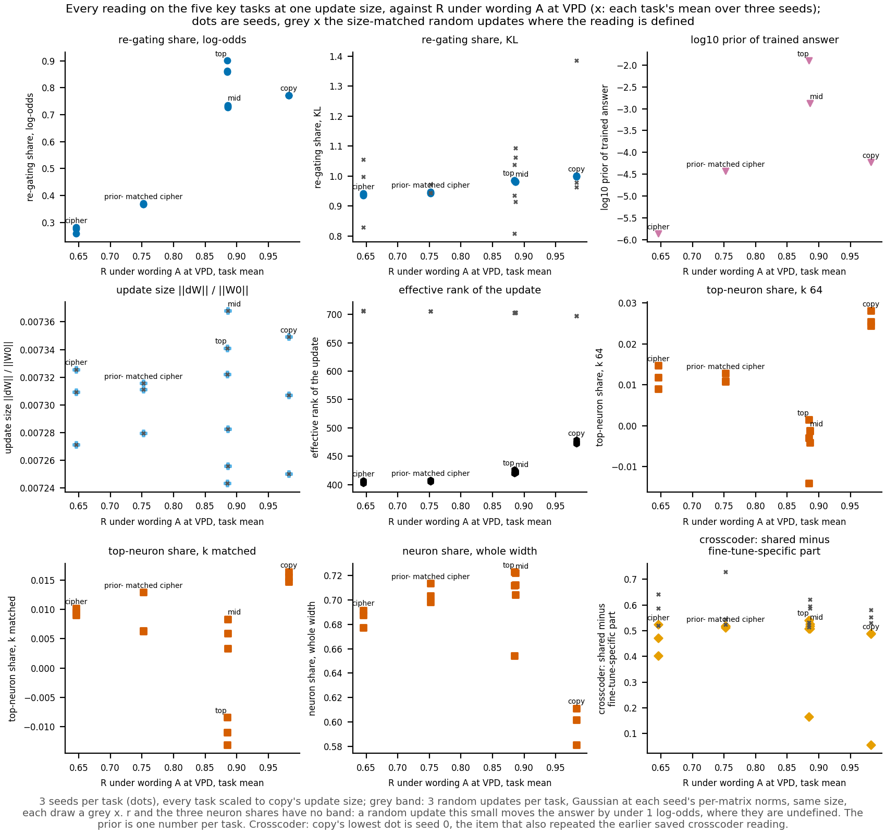
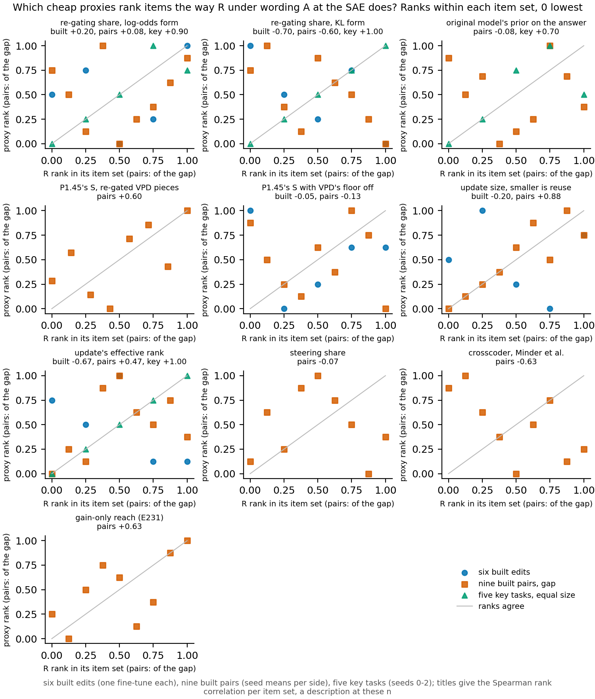

# Do cheap proxies rank edits the way reuse under wording A does?

*Compare-lead, 2026-11-21, revised the same evening for R under wording A. Cell P2.51, no run, $0. Scripts
`experiments/proxies_vs_r/analyse.py` and `r_a.py`; tables `experiments/proxies_vs_r/results/table_r_a_{vpd,sae}.json`;
per-item rows `experiments/proxies_vs_r/figures/proxies_vs_r_r_a_{vpd,sae}.csv`. Five to nine items per set: a
description, not a test. No rule was filed before reading.*

We took the reuse score under the adopted wording, read at two featurized models, and set ten cheap proxies beside it
on six built edits, nine built pairs and five key tasks, all from saved readings. On the pairs every proxy that puts
the reuse side above the new side does so on exactly the pairs where the base model's prior does, and the size of the
score's gap follows how unequal the two sides' updates were. So the pairs cannot tell a proxy that follows mechanism
from one that follows the prior, and the score's own cross-pair spread may partly be update size.

## The answer

The nine pairs cannot separate "the share follows mechanism" from "the share follows the prior": the prior puts the
reuse side higher on all nine, and so does every proxy that gets the sign right. One prior-matched pair of key tasks
can: copy and the prior-matched cipher have nearly the same prior, yet the log-odds share and the score under wording A
both put copy well above. That is one pair of task means, so it is provisional. Across the pairs, the score's gap
tracks update size.

## What was compared

**The score.** R under wording A asks what share of the variables a fine-tune's behavior runs through can have the
base model's mechanism stand in for them, each up to an output gain, by a soft intervention, while the behavior is
kept. It is 1 when every variable can be replaced and lower the more variables the fine-tune needed new. It was read
at two featurized models: VPD's subcomponents and an SAE's latents. On pairs we read the reuse side minus the new side,
with the larger side rescaled to the smaller side's update size.

**The items.** Six built edits: four reuse edits on the copy circuit and two new lookups; the moved edit sits under the
measurement floor and is not read. Nine built pairs, each a reuse fine-tune against a new one. Five key tasks: one key
set taught five ways, all scaled to one update size, three seeds each.

**The proxies**, each turned so that higher reads as reuse by its own definition:
- the log-odds share and the KL share: how much of the gain the base model's subcomponents carry once their causal
  importances are re-fitted;
- the base model's prior on the trained answer;
- definition-lead's S, and S with VPD's reconstruction floor off;
- update size, smaller read as reuse, and the update's effective rank;
- the steering share and the crosscoder;
- gain-only reach: how much of the fine-tune's gain a model that may only rescale neurons and heads reaches.

Both shares and both S readings are built from VPD's
decomposition, as R at VPD is, so their agreement with R at VPD is partly circular; against R at the SAE they are not.

**Partial agreement.** Beside each Spearman rank agreement with R we give the same with the prior or update size
partialled out: the three items' ranks are correlated, and the part of the proxy-to-R agreement that the third
quantity explains is removed. With five to nine items one point moves any of these by 0.2 or more.

## What we observed

### On the pairs, does any proxy get the sign right where the prior does not?

**Reading it.** No. The score puts the reuse side higher in all nine pairs, at both featurized models. The prior also
does, in all nine. The log-odds share, the KL share and S with the floor off agree in nine of nine. S agrees in the
eight it reads, update size in eight, effective rank in seven. Steering and the crosscoder agree in four, gain-only
reach in three. Since the prior is right on every pair, any proxy right on a pair is right where the prior is too.
The pairs therefore cannot show that the share follows the mechanism rather than the prior. Ranking the size of the
gaps is a different matter: there the log-odds share does not follow R, at −0.20 at VPD and 0.08 at the SAE.

### On the one prior-matched key pair, does the share follow R where the prior cannot?

**Reading it.** Yes, on this one pair. Copy and the prior-matched cipher differ in log10 prior by only 0.2, at −4.23
and −4.43. The log-odds share reads 0.77 on copy and 0.37 on the prior-matched cipher. Between the two ciphers, the
prior's 1.4 decades buy only 0.10 of share, so the prior's own trend predicts almost no gap here. R under wording A
agrees at VPD, at 0.98 against 0.75. At the SAE it barely separates them, at 0.9989 against 0.9982. This is one pair
of task means over three seeds, and at the SAE every key task sits within 0.01 of 1, so it is provisional. Across all
five tasks the log-odds share keeps 0.46 of its 0.70 agreement with R at VPD once the prior is partialled out.

### FLAG FOR CLAIM 1: across the pairs, does the size of R's gap follow update size?

**Reading it.** Yes. The update-size panel lies along the diagonal: Spearman 0.80 at VPD and 0.88 at the SAE. With the
prior partialled out these become 0.86 and 0.90. The size reading here is how much smaller the reuse side's unscaled
update is than the new side's. The score's pairs were read with the larger side rescaled to the smaller side's size,
yet pairs whose two sides started further apart in size show larger gaps. So part of what R under wording A reads
across pairs may be update size, and claim 1 should not rank pairs by the size of their gap until that is controlled.

## The full table

Spearman rank agreement with R under wording A. "Prior out" and "size out" partial that quantity out. Size cannot be
partialled on the key tasks, which share one size; the prior was never read on the built edits. Cells read "not read"
where a proxy has fewer than three items, or four for a partial. n is 9 on pairs, 5 on built and key, unless given.

| proxy | from VPD | built | pairs | key | pairs, prior out | key, prior out | built, size out | pairs, size out |
|---|---|---|---|---|---|---|---|---|
| **at VPD** | | | | | | | | |
| log-odds share | yes | 0.90 | −0.20 | 0.70 | −0.20 | 0.46 | 0.87 | −0.20 |
| KL share | yes | −0.40 | 0.05 | 0.90 | 0.04 | 0.84 | −0.29 | 0.70 |
| prior | no | not read | 0.08 | 0.60 | itself | itself | not read | 0.52 |
| S | yes | not read | 0.90, n 8 | not read | 0.91 | not read | not read | 0.79 |
| S, floor off | yes | −0.10 | 0.42 | not read | 0.49 | not read | 0.15 | 0.86 |
| update size | no | 0.60 | 0.80 | equal | 0.86 | equal | itself | itself |
| effective rank | no | −0.82 | 0.47 | 0.90 | 0.68 | 0.84 | −0.99 | −0.09 |
| steering | no | not read | −0.03 | not read | 0.05 | not read | not read | −0.10 |
| crosscoder | no | not read | −0.38 | not read | −0.51 | not read | not read | 0.55 |
| gain-only reach | no | not read | 0.07 | not read | 0.09 | not read | not read | −0.64 |
| **at the SAE** | | | | | | | | |
| log-odds share | no | 0.20 | 0.08 | 0.90 | 0.08 | 0.87 | 0.61 | 0.37 |
| KL share | no | −0.70 | −0.60 | 1.00 | −0.60 | 1.00 | −0.81 | −0.54 |
| prior | no | not read | −0.08 | 0.70 | itself | itself | not read | 0.36 |
| S | no | not read | 0.60, n 8 | not read | 0.60 | not read | not read | −0.26 |
| S, floor off | no | −0.05 | −0.13 | not read | −0.11 | not read | −0.13 | −0.07 |
| update size | no | −0.20 | 0.88 | equal | 0.90 | equal | itself | itself |
| effective rank | no | −0.67 | 0.47 | 1.00 | 0.55 | 1.00 | −0.69 | −0.26 |
| steering | no | not read | −0.07 | not read | −0.19 | not read | not read | −0.21 |
| crosscoder | no | not read | −0.63 | not read | −0.70 | not read | not read | 0.09 |
| gain-only reach | no | not read | 0.63 | not read | 0.64 | not read | not read | 0.47 |

**The matched random-change band.** At the SAE, 15 random updates at the key states' sizes read R from 0.48 to 0.54,
against 0.989 to 0.999 for the fine-tunes: none falls inside. At VPD only two random updates were read, at a built
edit's size and at a matched KL, not at the key tasks' size: 0.29 and 0.30, below every fine-tune's 0.62 to 1.00. For
the proxies the band is as in the dry run: effective rank puts none of 15 random changes inside the fine-tunes'
range, the KL share puts 7 of 15 inside, and the log-odds share is not defined on a random change this small.

## How compelling is the evidence

Five to nine items per set, so a correlation of 0.8 can arise by chance, and one item moves a partial by 0.2 or more.
The pairs' sign test cannot separate any proxy from the prior, because the prior is right on all nine. The key-task
evidence rests on one prior-matched pair. At the SAE the key tasks sit within 0.01 of each other, so their ranks there
rest on differences of a few thousandths. On the built edits, the thin new lookup reads kept at VPD, at 0.98. That is
a failure of wording A still under diagnosis, so the built-edit column should not be read before it is settled.
The KL share's pair gaps are read on the unscaled fine-tunes, since no size-matched KL reading was saved; the
log-odds share's are size-matched.

## Surprises

The size of the score's gap across pairs follows the difference in update size between the two sides, though each
pair was read at matched size. The dry run against the size-removed score had the prior as the one proxy in line with
the score on the pairs, at 0.88; under wording A the prior's agreement on the pairs falls to 0.08 at VPD.

## What next

- Control update size across pairs before ranking them: either read each pair at the new side's original size too, or
  partial size out of the score's gaps. If the size partial leaves the score's gap order flat, claim 1 can only use
  the sign of each pair, not its size.
- Build pairs where the prior and the mechanism point opposite ways: a low-prior task on a reused mechanism against a
  high-prior new one. That is the only item type that separates the share from the prior; no such cell is open.
- Re-read the built-edit column once the diagnosis of the thin lookup under wording A is in.

## Departures from the literature

- The crosscoder and steering readings are as in the dry run; none is new here.
- Partial Spearman is the textbook partial correlation applied to ranks; no significance is computed at these n.

## Not run

- A rule filed before reading: none was filed for this cell; every number here is descriptive.
- Neurons for half the gain and top-k neuron shares on the pairs: not added to this table.
- Steering, the crosscoder and gain-only reach on the key tasks at the common size, and both S readings there: never
  read on them. The prior, steering, the crosscoder and gain-only reach on the built edits: never read.
- The KL share on the pairs at matched size: no saved reading.
- A matched random band for R at VPD on the key tasks: only two unmatched random updates were read.
- R under wording A on the moved edit: under the floor.
- The note to writeup-lead: not yet sent.

*Provenance: R under wording A from `experiments/kstar_vpd_wording_a/results/summary.json` and
`experiments/sae_r_a/results/summary_{built,keys}.json` plus E245's pairs summary at
`~/commute-data/scratch/sae-lead/summary_pairs.json`, written to `experiments/proxies_vs_r/results/r_a_{vpd,sae}.json`
by `r_a.py`; the random band for R from `experiments/sae_r_a_random/results/summary.json`. Proxies as in the dry run,
plus the KL share from `experiments/random_kl_share/results/score.json` and its `known_answer/score.json`, and
gain-only reach from `experiments/gain_only/results/score.json`. The key-task figure is
`experiments/key_grid/plot_columns.py --against`. The dry-run tables against the size-removed and size-normalised
scores stay in `experiments/proxies_vs_r/results/table_{size_removed,normalised}.json`. CPU only, $0.*
