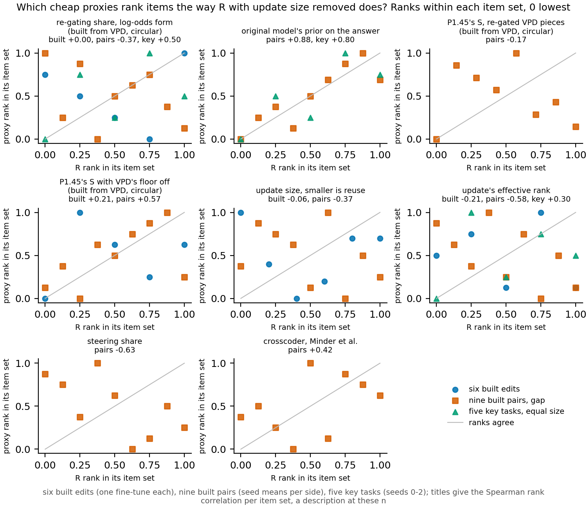

# Which cheap proxies rank edits the way the size-removed reuse score does?

*Compare-lead, 2026-11-21. Cell P2.51, no run, $0. Script `experiments/proxies_vs_r/analyse.py`, table
`experiments/proxies_vs_r/results/table_size_removed.json`, figure `experiments/proxies_vs_r/figures/proxies_vs_r_size_removed.png`.
A description at five to nine items per set, not a test.*

We ranked six built edits, nine built pairs and five key tasks by the reuse score with update size removed, and set
each cheap proxy's ranking beside it, from saved readings only. The original model's prior on the trained answer is
the one proxy that ranks the items much as the score does, on the pairs and on the key tasks. The log-odds share,
steering, effective rank and update size do not. So the paper's "cheap proxies track the definition" rests on the
prior for now, and the score may be tracking the prior rather than the reverse.

## What was compared

**The score.** R is the mean, over the circuit the fine-tune needs, of how well each VPD subcomponent kept the
direction of its write. Definition-lead's reanalysis removed update size from it: an item's score is how far
$\log(1-R)$ sits below the line fitted against $\log$ update size over all changed states, so higher reads as more
reuse. For the key tasks we applied that same fitted line to their saved R. They are at one common update size, so
their order is R's own.

**The items.** The six built edits are four reuse edits on the copy circuit and two new lookups, one value each. The
nine built pairs are read as the reuse side minus the new side, so a proxy agrees when its gap ranks the pairs as the
score's gap does. The five key tasks are one key set taught five ways, all scaled to one update size, averaged over
three seeds.

**The proxies**, each turned so that higher reads as reuse by its own definition. Proxies read on pairs use the
size-matched reading where one was saved: the share and steering from the size-matched run, the crosscoder's matched
column. Effective rank does not change when an update is scaled. A proxy built from the VPD decomposition, as R is,
is marked circular. S is definition-lead's gating score at VPD. It asks how much of the fine-tune's change VPD's pieces reproduce
once their switches are re-fitted. S with the floor off
first subtracts VPD's own reconstruction error. An item whose change sits under that error is not read on S.

## What we observed

**Reading it.** Only the prior's panel lies along the diagonal: Spearman 0.88 on the nine pairs and 0.80 on the
five key tasks. The log-odds share agrees on the key tasks, 0.50, but runs the other way on the pairs, −0.37, and is
flat on the built edits. On the key tasks the share follows the prior more closely, at 0.90, than it follows the
score. Steering and effective rank run against the score on the pairs, at −0.63 and −0.58. The crosscoder agrees
weakly on the pairs, 0.42, while running against update size there, −0.75. S cannot be read on five of the six
built edits, and on the pairs it runs slightly against the score, −0.17, while following size at 0.71. S with the
floor off agrees moderately on the pairs, 0.57, but follows the prior more, at 0.67.

| proxy | built from VPD | six built edits | nine pairs | five key tasks | with size, built / pairs | with prior, pairs / key | matched random change inside the fine-tunes' range |
|---|---|---|---|---|---|---|---|
| log-odds share | yes, circular | 0.00, n 5 | −0.37 | 0.50 | 0.80 / −0.10 | −0.07 / 0.90 | not defined: no random change raises the answer enough |
| prior | no | not read | **0.88** | **0.80** | not read / −0.27 | itself | does not apply |
| S, gating at VPD | yes, circular | not read, 5 of 6 under the floor | −0.17, n 8 | not read | not read / 0.71 | 0.00 / not read | at the built size not read; at twice the floor 6 of 6 |
| S, floor off | yes, circular | 0.21, n 5 | 0.57 | not read | −0.36 / −0.12 | 0.67 / not read | 5 of 6 at the built size; 6 of 6 at twice the floor |
| update size, smaller is reuse | no | −0.06, n 6 | −0.37 | equal by construction | itself | not read / not read | equal by construction |
| effective rank | no | −0.21, n 5 | −0.58 | 0.30 | −0.05 / 0.63 | −0.64 / 0.70 | 0 of 15, random far above |
| steering | no | not read | −0.63 | not read | not read / 0.03 | −0.75 / not read | not read |
| crosscoder | no | not read | 0.42 | not read | not read / −0.75 | 0.54 / not read | 3 of 3, one pair only |
| *the score itself* | yes | | | | −0.06 / −0.37 | 0.88 / 0.80 | 0 of 15, random above every fine-tune |

Spearman rank correlation with the score per item set; n is 9 and 5 unless given. "With size" and "with prior" are
each proxy's rank correlation with those two on the same items. A separate question from ranking with the score: does
the reuse side of each pair read above its new side? S says yes in 8 of the 8 pairs it reads, S with the floor off in
9 of 9. On the built edits, S with the floor off puts one new lookup above every reuse edit.

## How compelling is the evidence

Five to nine items per set, so a correlation of 0.8 here could arise by chance; these describe, they do not test.
Size can barely agree with the size-removed score on the built edits, since the fit removed it. The share on the built
edits is read on an answer the reuse edits were not built to raise, and its split-half band exceeds the spread of its
five values. On the key tasks a matched random change reads more reuse-like on the score than every fine-tune. Both S
readings share the score's decomposition, so their agreement with it is partly built in, and 17 of the 18 matched random
changes they read fall inside the fine-tunes' range. Read against the size-normalised score instead, the prior's
agreement on the pairs drops to 0.44, the crosscoder's rises to 0.75, and S with the floor off falls to 0.03.

## What next

The score under the adopted wording replaces the size-removed score when definition-lead's cell P1.46 lands: write its
readings in the JSON form the script's docstring gives and run `analyse.py --r <file>`.

## Not run

- The prior, steering and crosscoder on the six built edits: never read on them.
- Steering and the crosscoder on the key tasks at the common size: only unscaled readings exist.
- The KL form of the share, neurons for half the gain, gain-only reach, top-k: out of scope.
- Partialling out size and prior, and any filed rule: out of scope for this slim cell.
- Both S readings on the key tasks: never read on them.
- The score under the adopted wording: pending.

*Provenance: the score from `experiments/r_reanalysis/results/summary.json` and `experiments/key_grid/results/summary.json`;
the share from `experiments/size_matched/results/summary.json`, `experiments/random_kl_share/results/known_answer/score.json`
and the key-grid summary; prior and effective rank on pairs from `experiments/method_table/results/final.json`; size on
pairs from `experiments/kstar_pairs/results/pairs.json`; built-edit effective rank from
`experiments/known_answer_baselines/results/score.json`; crosscoder from `experiments/crosscoder/results/run2/summary.json`
and `experiments/crosscoder_proper/results/run1/stage1.json`; both S readings from
`experiments/gating_vpd/results/summary.json` (definition-lead's E241); the size-normalised score in
`experiments/proxies_vs_r/results/table_normalised.json`. CPU only.*
