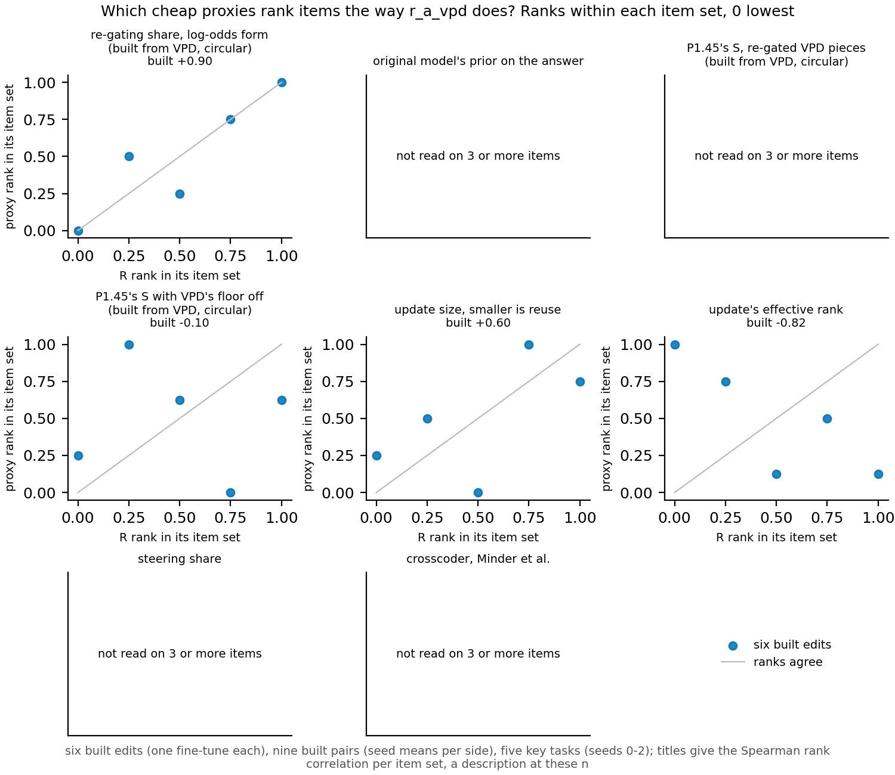
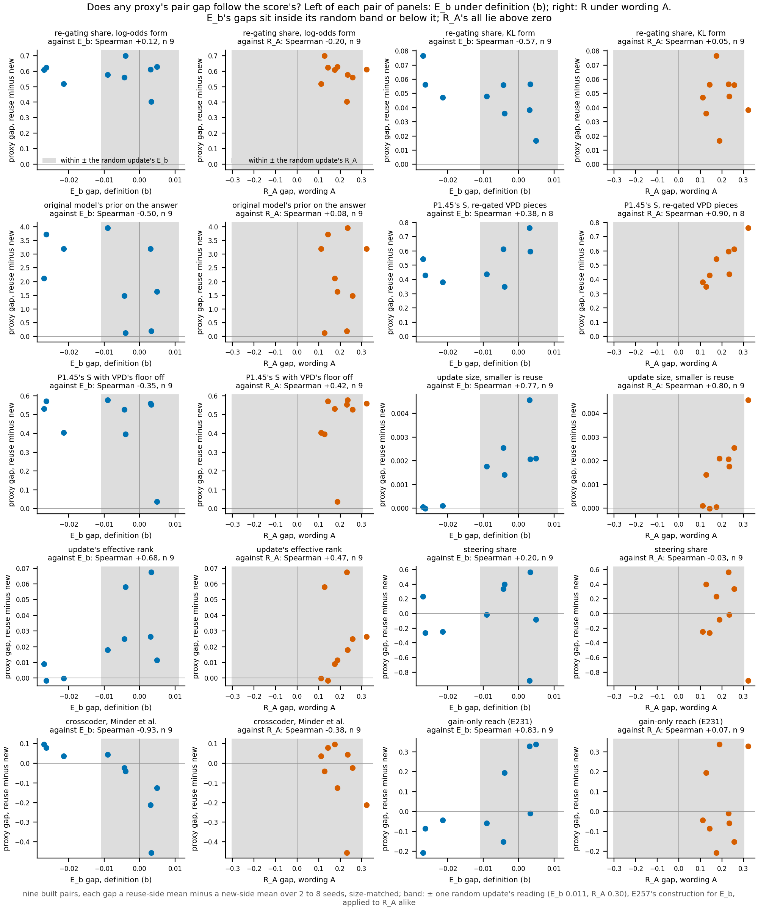
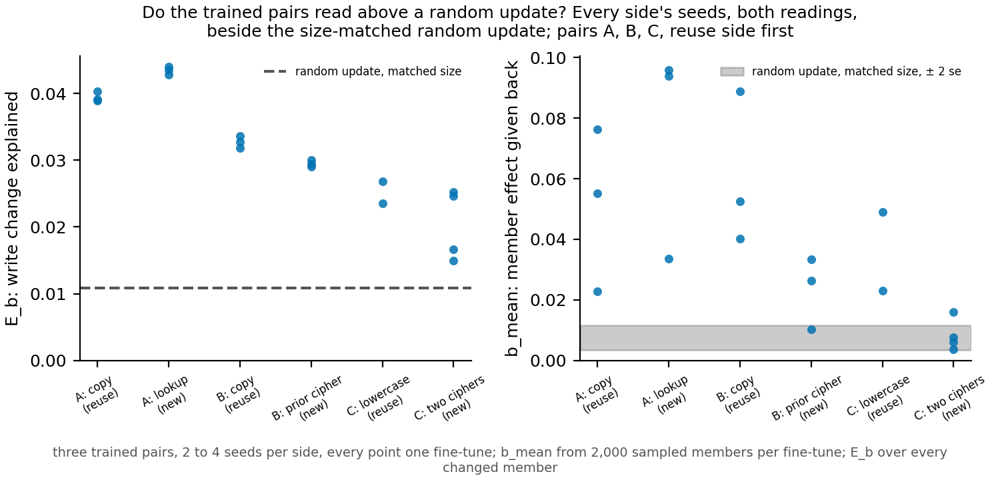

# Do cheap proxies rank edits the way reuse under wording A does?

*Compare-lead, 2026-11-21, revised the same evening for R under wording A. Cell P2.51, no run, $0. Scripts
`experiments/proxies_vs_r/analyse.py` and `r_a.py`; tables `experiments/proxies_vs_r/results/table_r_a_{vpd,sae}.json`;
per-item rows `experiments/proxies_vs_r/figures/proxies_vs_r_r_a_{vpd,sae}.csv`. Five to nine items per set: a
description, not a test. No rule was filed before reading. Later the same day also scored against definition (b): last two
sections.*

We took the reuse score under the adopted wording, read at two featurized models, and set ten cheap proxies beside it
on six built edits, nine built pairs and five key tasks, all from saved readings. On the pairs every proxy that puts
the reuse side above the new side does so on exactly the pairs where the base model's prior does, and the size of the
score's gap follows how unequal the two sides' updates were. So the pairs cannot tell a proxy that follows mechanism
from one that follows the prior, and the score's own cross-pair spread may partly be update size. Under definition (b),
the user's later choice, the same holds more strongly: its pair gaps follow how unequal the updates were at 0.77, as
at 0.80 under wording A, while every trained fine-tune reads only a few times a random update, so the pair order it
gives looks like noise arranged by update size rather than a reuse signal (last section).

## The answer

The nine pairs cannot separate "the share follows mechanism" from "the share follows the prior": the prior puts the
reuse side higher on all nine, and so does every proxy that gets the sign right. One prior-matched pair of key tasks
can: copy and the prior-matched cipher have nearly the same prior, yet the log-odds share and the score under wording A
both put copy well above. That is one pair of task means, so it is provisional. Across the pairs, the score's gap
tracks update size.

## What was compared

**The score.** R under wording A asks what share of the variables a fine-tune's behavior runs through can have the
base model's mechanism stand in for them, each up to an output gain, by a soft intervention, while the behavior is
kept. It is 1 when every variable can be replaced and lower the more variables the fine-tune needed new. It was read
at two featurized models: VPD's subcomponents and an SAE's latents. On pairs we read the reuse side minus the new side,
with the larger side rescaled to the smaller side's update size.

**The items.** Six built edits: four reuse edits on the copy circuit and two new lookups; the moved edit sits under the
measurement floor and is not read. Nine built pairs, each a reuse fine-tune against a new one. Five key tasks: one key
set taught five ways, all scaled to one update size, three seeds each.

**The proxies**, each turned so that higher reads as reuse by its own definition:
- the log-odds share and the KL share: how much of the gain the base model's subcomponents carry once their causal
  importances are re-fitted;
- the base model's prior on the trained answer;
- definition-lead's S, and S with VPD's reconstruction floor off;
- update size, smaller read as reuse, and the update's effective rank;
- the steering share and the crosscoder;
- gain-only reach: how much of the fine-tune's gain a model that may only rescale neurons and heads reaches.

Both shares and both S readings are built from VPD's
decomposition, as R at VPD is, so their agreement with R at VPD is partly circular; against R at the SAE they are not.

**Partial agreement.** Beside each Spearman rank agreement with R we give the same with the prior or update size
partialled out: the three items' ranks are correlated, and the part of the proxy-to-R agreement that the third
quantity explains is removed. With five to nine items one point moves any of these by 0.2 or more.

## What we observed

### On the pairs, does any proxy get the sign right where the prior does not?

**Reading it.** No. The score puts the reuse side higher in all nine pairs, at both featurized models. The prior also
does, in all nine. The log-odds share, the KL share and S with the floor off agree in nine of nine. S agrees in the
eight it reads, update size in eight, effective rank in seven. Steering and the crosscoder agree in four, gain-only
reach in three. Since the prior is right on every pair, any proxy right on a pair is right where the prior is too.
The pairs therefore cannot show that the share follows the mechanism rather than the prior. Ranking the size of the
gaps is a different matter: there the log-odds share does not follow R, at −0.20 at VPD and 0.08 at the SAE.

### On the one prior-matched key pair, does the share follow R where the prior cannot?

**Reading it.** Yes, on this one pair. Copy and the prior-matched cipher differ in log10 prior by only 0.2, at −4.23
and −4.43. The log-odds share reads 0.77 on copy and 0.37 on the prior-matched cipher. Between the two ciphers, the
prior's 1.4 decades buy only 0.10 of share, so the prior's own trend predicts almost no gap here. R under wording A
agrees at VPD, at 0.98 against 0.75. At the SAE it barely separates them, at 0.9989 against 0.9982. This is one pair
of task means over three seeds, and at the SAE every key task sits within 0.01 of 1, so it is provisional. Across all
five tasks the log-odds share keeps 0.46 of its 0.70 agreement with R at VPD once the prior is partialled out.

### FLAG FOR CLAIM 1: across the pairs, does the size of R's gap follow update size?

**Reading it.** Yes. The update-size panel lies along the diagonal: Spearman 0.80 at VPD and 0.88 at the SAE. With the
prior partialled out these become 0.86 and 0.90. The size reading here is how much smaller the reuse side's unscaled
update is than the new side's. The score's pairs were read with the larger side rescaled to the smaller side's size,
yet pairs whose two sides started further apart in size show larger gaps. So part of what R under wording A reads
across pairs may be update size, and claim 1 should not rank pairs by the size of their gap until that is controlled.

## The full table

Spearman rank agreement with R under wording A. "Prior out" and "size out" partial that quantity out. Size cannot be
partialled on the key tasks, which share one size; the prior was never read on the built edits. Cells read "not read"
where a proxy has fewer than three items, or four for a partial. n is 9 on pairs, 5 on built and key, unless given.

| proxy | from VPD | built | pairs | key | pairs, prior out | key, prior out | built, size out | pairs, size out |
|---|---|---|---|---|---|---|---|---|
| **at VPD** | | | | | | | | |
| log-odds share | yes | 0.90 | −0.20 | 0.70 | −0.20 | 0.46 | 0.87 | −0.20 |
| KL share | yes | −0.40 | 0.05 | 0.90 | 0.04 | 0.84 | −0.29 | 0.70 |
| prior | no | not read | 0.08 | 0.60 | itself | itself | not read | 0.52 |
| S | yes | not read | 0.90, n 8 | not read | 0.91 | not read | not read | 0.79 |
| S, floor off | yes | −0.10 | 0.42 | not read | 0.49 | not read | 0.15 | 0.86 |
| update size | no | 0.60 | 0.80 | equal | 0.86 | equal | itself | itself |
| effective rank | no | −0.82 | 0.47 | 0.90 | 0.68 | 0.84 | −0.99 | −0.09 |
| steering | no | not read | −0.03 | not read | 0.05 | not read | not read | −0.10 |
| crosscoder | no | not read | −0.38 | not read | −0.51 | not read | not read | 0.55 |
| gain-only reach | no | not read | 0.07 | not read | 0.09 | not read | not read | −0.64 |
| **at the SAE** | | | | | | | | |
| log-odds share | no | 0.20 | 0.08 | 0.90 | 0.08 | 0.87 | 0.61 | 0.37 |
| KL share | no | −0.70 | −0.60 | 1.00 | −0.60 | 1.00 | −0.81 | −0.54 |
| prior | no | not read | −0.08 | 0.70 | itself | itself | not read | 0.36 |
| S | no | not read | 0.60, n 8 | not read | 0.60 | not read | not read | −0.26 |
| S, floor off | no | −0.05 | −0.13 | not read | −0.11 | not read | −0.13 | −0.07 |
| update size | no | −0.20 | 0.88 | equal | 0.90 | equal | itself | itself |
| effective rank | no | −0.67 | 0.47 | 1.00 | 0.55 | 1.00 | −0.69 | −0.26 |
| steering | no | not read | −0.07 | not read | −0.19 | not read | not read | −0.21 |
| crosscoder | no | not read | −0.63 | not read | −0.70 | not read | not read | 0.09 |
| gain-only reach | no | not read | 0.63 | not read | 0.64 | not read | not read | 0.47 |

**The matched random-change band.** At the SAE, 15 random updates at the key states' sizes read R from 0.48 to 0.54,
against 0.989 to 0.999 for the fine-tunes: none falls inside. At VPD only two random updates were read, at a built
edit's size and at a matched KL, not at the key tasks' size: 0.29 and 0.30, below every fine-tune's 0.62 to 1.00. For
the proxies the band is as in the dry run: effective rank puts none of 15 random changes inside the fine-tunes'
range, the KL share puts 7 of 15 inside, and the log-odds share is not defined on a random change this small.

## How compelling is the evidence

Five to nine items per set, so a correlation of 0.8 can arise by chance, and one item moves a partial by 0.2 or more.
The pairs' sign test cannot separate any proxy from the prior, because the prior is right on all nine. The key-task
evidence rests on one prior-matched pair. At the SAE the key tasks sit within 0.01 of each other, so their ranks there
rest on differences of a few thousandths. On the built edits, the thin new lookup reads kept at VPD, at 0.98. That is
a failure of wording A still under diagnosis, so the built-edit column should not be read before it is settled.
The KL share's pair gaps are read on the unscaled fine-tunes, since no size-matched KL reading was saved; the
log-odds share's are size-matched.

## Surprises

The size of the score's gap across pairs follows the difference in update size between the two sides, though each
pair was read at matched size. The dry run against the size-removed score had the prior as the one proxy in line with
the score on the pairs, at 0.88; under wording A the prior's agreement on the pairs falls to 0.08 at VPD.

## What next

- Control update size across pairs before ranking them: either read each pair at the new side's original size too, or
  partial size out of the score's gaps. If the size partial leaves the score's gap order flat, claim 1 can only use
  the sign of each pair, not its size.
- Build pairs where the prior and the mechanism point opposite ways: a low-prior task on a reused mechanism against a
  high-prior new one. That is the only item type that separates the share from the prior; no such cell is open.
- Re-read the built-edit column once the diagnosis of the thin lookup under wording A is in.

## Departures from the literature

- The crosscoder and steering readings are as in the dry run; none is new here.
- Partial Spearman is the textbook partial correlation applied to ranks; no significance is computed at these n.

## Not run

- A rule filed before reading: none was filed for this cell; every number here is descriptive.
- Neurons for half the gain and top-k neuron shares on the pairs: not added to this table.
- Steering, the crosscoder and gain-only reach on the key tasks at the common size, and both S readings there: never
  read on them. The prior, steering, the crosscoder and gain-only reach on the built edits: never read.
- The KL share on the pairs at matched size: no saved reading.
- A matched random band for R at VPD on the key tasks: only two unmatched random updates were read.
- R under wording A on the moved edit: under the floor.
- The note to writeup-lead: not yet sent.

*Provenance: R under wording A from `experiments/kstar_vpd_wording_a/results/summary.json` and
`experiments/sae_r_a/results/summary_{built,keys}.json` plus E245's pairs summary at
`~/commute-data/scratch/sae-lead/summary_pairs.json`, written to `experiments/proxies_vs_r/results/r_a_{vpd,sae}.json`
by `r_a.py`; the random band for R from `experiments/sae_r_a_random/results/summary.json`. Proxies as in the dry run,
plus the KL share from `experiments/random_kl_share/results/score.json` and its `known_answer/score.json`, and
gain-only reach from `experiments/gain_only/results/score.json`. The key-task figure is
`experiments/key_grid/plot_columns.py --against`. The dry-run tables against the size-removed and size-normalised
scores stay in `experiments/proxies_vs_r/results/table_{size_removed,normalised}.json`. CPU only, $0.*

## 2026-11-21, late: the proxies against definition (b)

*Compare-lead, from saved files only, $0. Script `experiments/proxies_vs_r/r_b.py`; results
`experiments/proxies_vs_r/results/r_b_vpd.json` and `table_r_b_vpd.json`. The sections above, under wording A, are
unchanged.*

We scored the same ten proxies against the user's chosen reuse reading, which asks how much of each changed part's
change the base model's own part explains. On every trained fine-tune that reading sits within a few times a random
update's, and no pair gap favours reuse by more than that, so ranking proxies against it there is uninformative. What
order the pairs do show follows update size: the three pairs where the new side reads higher are the three whose sides
had nearly equal updates before size matching. For
claim 2, no proxy can yet be scored on trained fine-tunes under the new definition; on the built edits, where the
reading does spread, none matches its order.

### What was read

**The score.** $E_b$, from definition-lead's run on the 67M model decomposed with VPD: over the circuit parts a
fine-tune changed, the share of their summed write change that the base model's own part explains when it is only
turned up or down. It reads 1 when every changed part is the base part rescaled, and near 0 when the base parts
explain none of the change. Beside it, the untouched share: the fraction of the circuit the fine-tune left alone.

**The items.** Five of the six built edits, from the earlier rescore of the built edits under this reading; the moved
edit was not read there. All nine built pairs, as the reuse side's mean minus the new side's mean, size-matched, every
seed. All five key tasks at their common size, as the mean over seeds 0 to 2. Nothing else is missing. The proxies,
partials and item sets are those of the sections above.

### Does the reading spread the items out beyond a random update?

| item set | $E_b$ range | against the random update's 0.011 |
|---|---|---|
| built edits, five | 0.012 to 0.76 | the two new lookups at it, the three reuse edits far above |
| all 94 trained fine-tunes | 0.015 to 0.062 | 1.4 to 5.7 times it |
| key tasks, five task means | 0.029 to 0.038 | the whole spread is 0.86 of it |
| pairs, nine gaps | −0.027 to 0.005 | six of nine inside ±0.011; three below it; the largest gap 2.5 times it |

**Reading it.** No, on the trained fine-tunes. The difference between half and full precision on this reading is
3.3e-5, so precision is not the limit. The limit is that a random update reads 0.011 and every trained fine-tune reads
little more. Within one side of one pair the seeds alone spread by up to 0.022, more than any gap that favours the
reuse side. Rank agreement with $E_b$ on the pairs and the key tasks therefore reads an order that the reading does
not hold apart from noise. The untouched share confirms the picture: at most 1.1e-4 of the circuit on any trained
fine-tune, against 0.63 to 0.91 on the built edits.

### On the built edits, where the reading has range, does any proxy order them as it does?

| proxy | built, against $E_b$ | built, size out | built, against R under wording A |
|---|---|---|---|
| log-odds share | 0.20 | 0.61 | 0.90 |
| KL share | −0.70 | −0.81 | −0.40 |
| S, floor off | −0.05 | −0.13 | −0.10 |
| update size | −0.20 | itself | 0.60 |
| effective rank | −0.67 | −0.69 | −0.82 |

**Reading it.** No. The reading puts the two gain edits first, the rebuilt edit next and the two new lookups last; the
best proxy, the log-odds share, agrees at 0.20 over five edits. The prior, steering, the crosscoder and gain-only reach
were never read on the built edits, and S reads only one of them. Five items, with the reading's order fixed mostly by
three reuse edits against two new ones, so one swapped edit can move these by 0.3 or more.

### On the pairs, does any proxy's gap follow the score's gap?

**Reading it.** Not in a way that bears on reuse. Under wording A every pair's gap lay above zero; under $E_b$ the
gaps fall on both sides of zero, and the three furthest below are the pairs whose two sides had nearly equal updates
before matching. Update size follows $E_b$'s gap at 0.77, close to its 0.80 under wording A, and keeps 0.76 with the
prior partialled out. Gain-only reach follows it at 0.83 and the crosscoder runs against it at −0.93. These orders sit
inside the random reading and the seed spread, so they say how the noise is arranged, most likely by update size, not
which proxy tracks reuse. The grey band applies the same construction to R under wording A, ± its random update's
0.30: it is a scale, not a null for a gap, and under it R's gaps too sit mostly inside.

| proxy | pairs | key | pairs, prior out | key, prior out | pairs, size out |
|---|---|---|---|---|---|
| log-odds share | 0.12 | −0.20 | 0.10 | 0.66 | 0.30 |
| KL share | −0.57 | −0.10 | −0.60 | 0.40 | −0.42 |
| prior | −0.50 | −0.50 | itself | itself | −0.48 |
| S | 0.38, n 8 | not read | 0.43 | not read | −0.48 |
| S, floor off | −0.35 | not read | −0.02 | not read | −0.41 |
| update size | 0.77 | equal | 0.76 | equal | itself |
| effective rank | 0.68 | −0.10 | 0.54 | 0.40 | 0.40 |
| steering | 0.20 | not read | −0.31 | not read | 0.27 |
| crosscoder | −0.93 | not read | −0.91 | not read | −0.84 |
| gain-only reach | 0.83 | not read | 0.85 | not read | 0.81 |

### What it means for claim 2

The proxies cannot be scored against definition (b) on trained fine-tunes until the reading separates them from a
random update. On trained fine-tunes $E_b$ reads near its random floor everywhere, as definition-lead's report found,
so a high or low rank agreement here is not evidence for or against any proxy. The one pattern that carries over from
wording A is that the score's pair gaps follow update size; under $E_b$ it is a pattern in the noise, which makes it
a warning about the pairs rather than a finding about reuse.

### How compelling is the evidence

Five built edits and nine pairs, so a description, not a test. The pair gaps sit within the seed spread of single
sides. Every proxy built from VPD is circular against $E_b$ as it was against R at VPD, since $E_b$ reads the same
circuit parts. Definition-lead's report is preliminary: the behavioural test of the reading is still pending.

### Surprises

Under $E_b$ the new side reads higher in six of nine pairs, the reverse of the built edits' order. Definition-lead's
report found the same; this section adds only that the three clearest reversals are the pairs whose two sides needed
almost no size matching.

### Not run

- The reinforcement-learning states: pending in definition-lead's run, so not scored here.
- The moved edit: not read under definition (b).
- A random band matched to the key tasks' or pairs' size for $E_b$: two random updates only, at a built edit's size
  and at matched KL.
- A rule filed before reading: none; every number in this section is descriptive.
- The behavioural test of $E_b$: pending in definition-lead's run.

*Provenance: $E_b$ per item from `experiments/rb_states/results/summary_items.json` (built edits from
`.built_reference_P1_49`, pairs `.pairs.<pair>.gap_E_b`, key tasks `.keys.<task>.E_b`, random updates `.randoms`,
precision floor `.stage0.floor`) and `items/*.json`; R under wording A from `results/r_a_vpd.json`. CPU only, $0.*

## Against the behavioural reading (E259), added 2026-11-21 late

*Compare-lead, from saved files only, $0. Script `experiments/proxies_vs_r/r_b_behaviour.py`; results
`experiments/proxies_vs_r/results/r_b_behaviour.json`; figure `experiments/proxies_vs_r/figures/rb_member_pairs_vs_random.png`.
Readings from definition-lead's run, `experiments/rb_member_pairs/results/summary.json`. No rule was filed for this
comparison: every number in this section is descriptive. The sections above are unchanged.*

Definition-lead tested, part by part, whether the base model's own part, turned up or down, gives back a changed part's
effect on the fine-tune's output, on three trained pairs. No sampled part passed the test, and on average a part got back
at most a tenth of its effect, though half the fine-tunes read clearly above a random update. On all three pairs this
behavioural reading orders the two sides as the write reading of the section above does. So the proxies score the same
against both, and three pairs, each inside the seed spread, cannot rank them.

### What was read

**The behavioural reading.** For each changed part of the circuit that the base model's part may stand in for, the
base part alone is swapped in, in the fine-tune's full forward pass. The output's KL divergence from the fine-tune's is
read as a share of the base model's own divergence from it. It is read twice: with the base part as it is, $q_1$, which
removes the part's change, and at the base part's fitted gain, $q$. A part's score is $b = 1 - q / q_1$. It reads 1
when turning the base part up or down gives back all of the part's effect on the output, and 0 when it gives back none.

The reading $\bar b$ is the mean of $b$ over the parts, each weighted by its write change. Parts whose effect $q_1$ is
under the measurement floor are left out. A part passes when $q \le 0.1\, q_1$, and the pass share is the passing parts'
weighted share. Both are estimated from 2,000 parts sampled uniformly per fine-tune, about a tenth of the changed
parts, each with a sampling standard error.

**The items.** Three of the nine pairs, every saved seed. Pair A is copy against lookup and pair B copy against the
prior-matched cipher, three seeds a side. Pair C is lowercase, two seeds, against two cipher tasks, two seeds each. The
larger side of each pair is scaled to the smaller side's update size. The reference is one random update at matched
size, read the same way. The write share $E_b$ of the section above is read on the same fine-tunes.

**The gaps.** Per pair, the reuse side's mean minus the new side's mean, as in the section above. The proxies' gaps
are those of the earlier sections, unchanged.

### Does the behavioural reading separate trained fine-tunes from a random update?

**Reading it.** On half of them, and by little. The random update reads 0.0075, with standard error 0.0020. The 18
trained fine-tunes read from 0.0037 to 0.096. Half of them sit more than two standard errors above the random. All four
cipher fine-tunes of pair C sit within two standard errors of it. No sampled part passed on any fine-tune: none of the
23,655 parts read above the floor. The pass share is therefore 0 everywhere, the random update included, and says
nothing about the pairs: for no part did the fitted gain remove nine tenths of its effect. On pairs A and B up to 0.25 of
the write change sits in parts under the floor and is left out, against at most 0.003 on pair C. So the parts counted
differ between pairs.

### Do the two readings and the proxies agree on each pair's sign?

| pair | $E_b$ gap | $\bar b$ gap | its standard error | largest seed range within one side, $\bar b$ |
|---|---|---|---|---|
| A, copy against lookup | −0.0040 | −0.023 | 0.0145 | 0.062 |
| B, copy against prior-matched cipher | 0.0033 | 0.037 | 0.0147 | 0.049 |
| C, lowercase against two ciphers | 0.0049 | 0.028 | 0.0150 | 0.026 |

| sign of the gap, reuse minus new | A | B | C | matches both readings |
|---|---|---|---|---|
| $E_b$, write reading | − | + | + | itself |
| $\bar b$, behavioural reading | − | + | + | itself |
| R under wording A | + | + | + | 2 of 3 |
| log-odds share | + | + | + | 2 of 3 |
| KL share | + | + | + | 2 of 3 |
| prior | + | + | + | 2 of 3 |
| S | + | + | not read | 1 of 2 |
| S, floor off | + | + | + | 2 of 3 |
| update size, smaller is reuse | + | + | + | 2 of 3 |
| effective rank | + | + | + | 2 of 3 |
| steering | + | + | − | 1 of 3 |
| crosscoder | − | − | − | 1 of 3 |
| gain-only reach | + | − | + | 1 of 3 |

**Reading it.** The two readings agree on all three signs, so every proxy scores the same against both. Both put the new
side higher on pair A and the reuse side higher on B and C. Seven proxies and R under wording A put the reuse side higher
on every pair, as the prior does, and so match on B and C and miss A. Steering, the crosscoder and gain-only reach each
match on one pair. None of this ranks the proxies. The behavioural gaps are 2.5, 1.8 and −1.6 standard errors from
zero, and the seeds of one side spread by up to 0.062, more than any gap. All three write gaps sit inside the random
update's 0.011. Pair A, the one both readings put the other way, is also the pair whose sides' updates were closest
before scaling: its size gap is 0.0014, against 0.0021 for both others.

### What it means for claim 2

Under the behavioural reading, half the trained fine-tunes read clearly above a random update. Yet on average a changed part
gets back at most a tenth of its effect from the base part, so neither reading of definition (b) finds much reuse in
trained fine-tunes. Its pair signs repeat the write reading's, so the conclusion of the section above stands. No proxy
can yet be scored against definition (b) on trained pairs, and the one pair read the other way is again the one whose
updates were most nearly equal.

### How compelling is the evidence

Three pairs, so a sign table and nothing more; no rank agreement is computed. The behavioural gaps sit at 1.6 to 2.5
standard errors and inside the seed spread. Each fine-tune's reading rests on 2,000 sampled parts, and parts under the
floor are left out, a share that differs by pair. The behavioural reading has no positive control here: no edit known to
reuse the base model was read with it in a saved summary. Both readings use VPD's subcomponents, so the proxies built
from VPD are circular against them as before.

### Surprises

None beyond what is above: the behavioural reading repeats the write reading's sign on every pair, including the
reversed pair A.

### Not run

- A rule filed before reading: none; every number in this section is descriptive.
- The other six pairs, the key tasks and the built edits under the behavioural reading: not read in definition-lead's run.
- A positive control for the behavioural reading: the built-edit run has no saved summary in this clone.
- Rank agreement over the three pairs: not computed at three points.
- Parts under the floor: left out by the run's rule, not re-read.
- More than one random update for the behavioural reading: one was read.

*Provenance: per fine-tune $\bar b$, its standard error, the pass share and $E_b$ from
`experiments/rb_member_pairs/results/summary.json` (`.items`); sides from `experiments/rb_states/results/summary_items.json`
(`.pairs.<pair>.<side>.items`); proxy gaps from `analyse.proxies()` and R under wording A from `results/r_a_vpd.json`;
all written to `experiments/proxies_vs_r/results/r_b_behaviour.json` by `r_b_behaviour.py`. CPU only, $0.*
