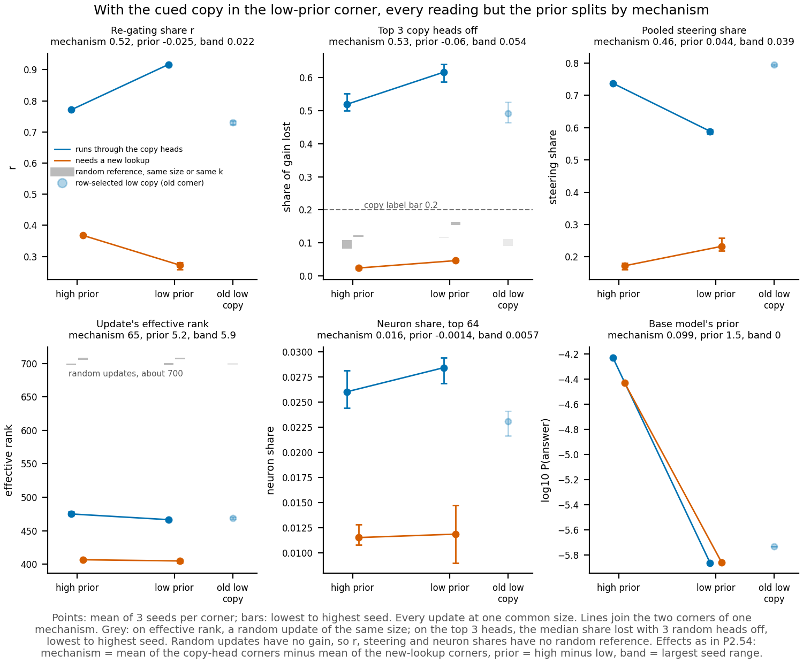

# Does the re-gating share still follow the mechanism when the low-prior copy is its own task?

We relabelled the fine-tunes by switching off the base model's top three copy heads together, and we trained a new
copy task whose answer the base model finds as unlikely as the cipher's. Both copies lose about half their gain to
those heads and the ciphers almost none, and the re-gating share reads 0.92 on the new copy against 0.27 on the
cipher. This supports the paper's second claim on one more task, but it is one task family at three seeds, and the
other readings of the update still agree with the share, so they are not yet told apart.

## The answer

Both doubts about the earlier comparison of fine-tunes by prior and by mechanism are answered, one fully, one in part.
With three copy heads off, each copy fine-tune loses about half its gain and each cipher under a twentieth. The new
copy, built as its own task, reads a re-gating share higher than the old copy although the base model gives its
answer a cipher's odds. Its low prior still comes from keeping the hardest rows of its own pool. Pooled steering and
effective rank also follow the mechanism, so this is provisional.

## What we were trying to test

Cell P2.55 repairs the two premise doubts that the earlier report on cell P2.54 raised
(`reports/analyses/2026-11-21_analysis_prior-mech-2x2.md`). That report built four groups of fine-tunes of the 67M
model, each trained to one common update size, three seeds each. They were crossed by the base model's prior of the
answer, high or low, and by mechanism: copy, which runs through the base model's copy head, against two ciphers,
which need a lookup the base model does not have. Its two doubts were:

- **(a) The low-prior copy was a row selection.** It was the key copy task trained only on its lowest-prior rows, so
  any reading of the update was bound to land near the copy.
- **(b) The mechanism label rested on one head.** Switching off copy head (2,4) took only 0.25 of key copy's gain,
  and head (1,1) took as much, while also costing the ciphers 0.10 to 0.15.

Two $0 runs on the MATS cluster answer them.

**Run 1, the three-head label.** On the 27 saved fine-tunes of cell P2.54 and the earlier copy-map study, we
mean-ablate the base model's top $k$ heads by their score on the base model's copying, for $k$ = 1, 2, 3 and 5. The
top three are (2,4), (2,3) and (2,2); (3,2) and (3,4) follow. Head (1,1), the previous-token head, is kept out of the
ranking, because it feeds every task. The reading is the share of gain lost, $1 - G_\text{off}/G$, where $G$ is the
fine-tune's mean log-odds gain over the base model on its read rows and $G_\text{off}$ the same gain with the heads
switched off in both models. A share of 0 means the heads carry none of the gain, and 1 all of it. The reference is
$k$ random heads drawn from outside the top five and outside (1,1), 20 draws per $k$. A separate arm switches off
(2,4) and (1,1) together, to see whether (1,1) is a copy head.

**Run 2, the cued copy.** A new task in the copy-map form: a window holds a key token followed by an answer token,
and later the key again followed by a cue token, where the model must predict the answer. Answers are drawn per window
from disjoint train and read pools, so only copying solves it. The answers come from rarer words, frequency ranks 3000
to 10000. Within that task, the rows where the base model finds the answer least likely are kept, 1600 for training
and 400 for reading, which brings the base model's prior to $10^{-5.86}$, the cipher's. Three seeds are trained to the
common update size, each with a random Gaussian update of the same size as its reference. Each seed is labelled with
run 1's heads and read with the re-gating share $r$, the base prior, pooled steering, effective rank and top-neuron
shares. It replaces the row-selected low copy in the four-group comparison.

The four groups are now: key copy, high prior, copy heads; the prior-matched cipher, high prior, new lookup; the
cipher, low prior, new lookup; and the cued copy, low prior, copy heads. For each reading the comparison gives two
effects. The mechanism effect is the mean of the two copy groups minus the mean of the two cipher groups. The prior
effect is the mean of the two high-prior groups minus the mean of the two low-prior ones. A reading follows whichever
effect is larger, if that effect also exceeds the band, the largest seed range in any group.

## What we expected, and why

For run 1 we expected the copies to lose 0.5 to 0.8 of their gain with three heads off, because one head took a
quarter and the copy-map study showed the gain spread over several layer-2 heads. We expected the ciphers, rank-1 and
elicit fine-tunes to stay under 0.05 at every $k$, and random heads to cost under about 0.1. We expected the pair arm
to cost the ciphers 0.10 to 0.20, which would show (1,1) is not a copy head.

For run 2 we expected $r$ near key copy's 0.77 if it follows the mechanism, or near the cipher's 0.27 if it follows
the prior. We filed no direction for steering or effective rank, since this is where they could come apart from $r$.
We expected the answer to gain under a tenth as much on windows where the answer is absent, to rule out a blanket boost
of rare tokens.

## What we observed

`experiments/cued_copy/figures/prior_mech_2x2_cued.png`

### Do the copies run through the copy heads once three are off?

**Reading it.** Yes, mostly: with the top three heads off, key copy loses 0.52 of its gain, the old low copy 0.49 and
the cued copy 0.62. The ciphers lose 0.02 to 0.05. The top middle panel shows this; the grey boxes are the median share
lost with three random heads off, 0.08 to 0.16 depending on the fine-tune. So the copies lose about five times what
random heads cost them, while the ciphers lose less to the copy heads than to random heads. Two caveats are real. The
random heads cost more than the filed 0.1, so the label has to be read against them. And the old low copy sits just
under the filed 0.5.

The share rises with $k$ on every copy and stays near zero on every other fine-tune:

| fine-tune | $k$ = 1 | $k$ = 2 | $k$ = 3 | $k$ = 5 | (2,4) and (1,1) |
|---|---|---|---|---|---|
| copy map, positive control | 0.53 | 0.69 | 0.80 | 1.03 | 0.71 |
| key copy | 0.25 | 0.30 | 0.52 | 0.78 | 0.44 |
| old low copy, row-selected | 0.22 | 0.27 | 0.49 | 0.66 | 0.39 |
| cued copy | 0.33 | 0.49 | 0.62 | 0.93 | 0.48 |
| copy-map lookup | 0.00 | 0.01 | 0.00 | 0.07 | 0.06 |
| prior-matched cipher | 0.00 | 0.01 | 0.02 | 0.05 | 0.12 |
| cipher | 0.00 | 0.02 | 0.05 | 0.06 | 0.13 |
| rank-1 | 0.01 | 0.01 | 0.02 | 0.00 | 0.15 |
| elicit | 0.00 | 0.01 | 0.03 | 0.04 | 0.12 |
| random heads, largest median | 0.06 | 0.11 | 0.16 | 0.30 | n/a |

Means of three seeds. Sources: `experiments/prior_mech_2x2/results/khead/summary.json` (`by_k`, `rules.pair_task_mean_share`)
and, for the cued copy, `experiments/cued_copy/results/items/khead/` and the job log. The base model's own copying,
measured as top-1 accuracy on the second copy, falls from 0.82 to 0.0095 with one head off and to 0 with three, as filed.

On doubt (b): the pair of (2,4) and (1,1) costs the ciphers 0.12 to 0.13 and rank-1 and elicit 0.12 to 0.15, where the
three layer-2 copy heads cost them at most 0.05. So (1,1) is a general head that every fine-tune leans on, not a copy
head. The copy runs through several layer-2 heads, and a label from those three, with (1,1) left out, is specific to
copying.

### Does the re-gating share follow the mechanism when the low-prior copy is its own task?

**Reading it.** Yes: the cued copy reads $r$ = 0.92 at the cipher's prior, where the cipher reads 0.27. In the top left
panel the blue line rises from key copy's 0.77 to the cued copy's 0.92, and the orange line falls from the matched
cipher's 0.37 to the cipher's 0.27. The mechanism effect is 0.52, the prior effect -0.025, and the band 0.022. The
seeds agree to within 0.003. The caveat: a random update of the same size has no gain, so $r$ has no random reference.

### Do the other readings of the update come apart from the share?

**Reading it.** No: every reading of the update still follows the mechanism, as in cell P2.54. Pooled steering reads
0.59 on the cued copy, lower than key copy's 0.74 but far above the ciphers' 0.17 and 0.23; its mechanism effect is
0.46 against a prior effect of 0.044. Effective rank reads 466 on the cued copy, near key copy's 475, against 405 to 407
on the ciphers and about 700 for a random update. The top-64 neuron share reads 0.028 against 0.012, close to zero
everywhere. Only the base prior follows the prior, with an effect of 1.53 decades. So the separation the earlier report
asked for, $r$ against steering and rank, is still not shown.

| reading | key copy | matched cipher | cipher | cued copy | old low copy | mechanism | prior | band | call |
|---|---|---|---|---|---|---|---|---|---|
| re-gating share r | 0.77 | 0.37 | 0.27 | 0.92 | 0.73 | 0.52 | -0.025 | 0.022 | mechanism |
| share lost, top 3 heads off | 0.52 | 0.02 | 0.05 | 0.62 | 0.49 | 0.53 | -0.06 | 0.054 | mechanism |
| share lost, (2,4) off | 0.25 | 0.00 | 0.00 | 0.33 | 0.22 | 0.29 | -0.04 | 0.081 | mechanism |
| share lost, (2,4) and (1,1) off | 0.44 | 0.12 | 0.13 | 0.48 | 0.39 | 0.33 | -0.03 | 0.083 | mechanism |
| log10 prior | -4.23 | -4.43 | -5.86 | -5.86 | -5.73 | 0.10 | 1.53 | 0 | prior |
| pooled steering | 0.74 | 0.17 | 0.23 | 0.59 | 0.79 | 0.46 | 0.044 | 0.039 | mechanism |
| per-key steering | 0.99 | 1.08 | 1.14 | 0.64 | 1.00 | -0.29 | 0.14 | 0.073 | mechanism |
| effective rank | 475 | 407 | 405 | 466 | 469 | 65 | 5.2 | 5.9 | mechanism |
| neuron share, top 64 | 0.026 | 0.012 | 0.012 | 0.028 | 0.023 | 0.016 | -0.001 | 0.006 | mechanism |
| neuron share, k matched | 0.016 | 0.009 | 0.010 | 0.011 | 0.011 | 0.004 | 0.002 | 0.007 | no call |
| update size | 0.0073 | 0.0073 | 0.0073 | 0.0073 | 0.0073 | 0 | 0 | 0.0001 | no call |

Means of three seeds. Source: `experiments/cued_copy/results/table.json` (`proxies`, `side_lowcopy`). The old low copy
is shown for reference only; it is not one of the four groups. On the cued copy, per-key steering is keyed on the key
token, because the read token is always the cue. Keyed that way it cannot hand over the answer. It was filed as not
comparable with the other groups' per-key column, so its call should not be read.

### Is the cued copy a copy, and not a boost of rare words?

**Reading it.** It is not a blanket boost, but the filed check missed. Each seed learns the task, with the held-out
probability of the answer at 0.97 by step 100, and gains about 18 in log-odds on its read rows. On windows
where the answer token is removed from the context, the fine-tune does not raise it: it lowers it, by about 6 log-odds.
That is -0.33 to -0.35 of the intact gain, outside the filed bound of plus or minus 0.1, so the check misses. A boost of
rare words would have shown as a large positive share. We have not worked out why the answer falls where it is absent.

## What we learned

The re-gating share follows how a fine-tune works, not how likely its answer already was, on a low-prior copy that is
its own task: it reads 0.92 at the cipher's prior. The copy label is now firmer, because three layer-2 copy heads take
half of each copy's gain and almost none of the ciphers', and the head that worried us, (1,1), turns out to cost every
fine-tune alike. What did not change is that pooled steering and effective rank agree with the share on every group,
so this comparison does not show that the share does better than them. For claim 2 this is support on one task family,
not a result that singles the share out.

## How compelling is the evidence

- **One task family, three seeds.** Every copy group is a copy of one token from earlier in the window, and every new
  group is a cipher; three seeds per group. The seed spread is small, 0.003 on $r$ for the cued copy, but this says
  nothing about other tasks. Provisional.
- **The low prior is still a selection.** The rarer answer words did not lower the prior: the cued copy's whole pool
  read $10^{-3.49}$, the copy map's $10^{-3.50}$. The cipher's prior was reached by keeping the 1600 and 400 rows
  of that pool where the base model found the answer least likely, the same rule the old low copy used. So the cued
  copy is a separate task, which answers doubt (a), but its low prior is a property of the rows chosen, not of the
  task. Those rows may be hard for incidental reasons, such as the key recurring nearby.
- **The random-head reference is not small.** Three random heads off cost each fine-tune 0.08 to 0.16 of its gain,
  five cost up to 0.30. The copy label stands against that, about five times over, but a bar at 0.2 alone would not.
- **No random reference for $r$, steering or the neuron shares.** A random update of the same size gains about 0.01 in
  log-odds, so those readings cannot be taken on it.
- **The mechanism label is a copying label**, read by switching heads off. A fine-tune that solved the task through
  other heads would be labelled a new lookup. It is not the reuse definition under revision, and no verdict on reuse
  is given here.

## Surprises

- The re-gating share on the cued copy, 0.92, is higher than any key task's, above the 0.7 we expected.
- Random heads cost more than expected: the largest median share lost was 0.16 with three random heads off and 0.30
  with five, against a filed bound of 0.1. With three heads off, random heads cost the ciphers more than the copy heads
  do.
- The cued copy lowers its answer by about 6 log-odds on windows where the answer is absent, where a near-zero change
  was expected.
- The top-64 neuron share again calls the mechanism on values all under 0.03, where no call was expected.

## What next

- A copy task whose answers are unlikely on every row, with no rows dropped, would close the first doubt fully. If
  $r$ then stayed near 0.9 at the cipher's prior, the result would not rest on a selection.
- A pair of groups where steering or rank is expected to follow the prior and $r$ the mechanism is what would tell the
  share apart from them; this comparison cannot.
- Why the cued copy lowers its answer where the answer is absent. If it lowers every rare word from that band, it
  learned a frequency effect beside the copy. The read rows would then need a matched control with the answer absent.

## Scorecard

Run 1, the three-head label (`experiments/prior_mech_2x2/results/predictions_khead.json`):

| id | claim | rule | read | verdict |
|---|---|---|---|---|
| control | the base model's copying falls with the heads off; $k$ = 1 repeats the saved (2,4) shares | top-1 0.82 to 0.0095 within 0.01; repeat within twice the floor | 0.0095; repeat exact | holds |
| K1 | key copy and the old low copy lose 0.5-0.8 at $k$ = 3 | both means in [0.5, 0.8] | 0.52 and 0.49 | misses |
| K2 | the copy map loses 0.7-0.9 at $k$ = 3 | mean in [0.7, 0.9] | 0.80 | holds |
| K3 | ciphers, rank-1 and elicit lose at most 0.05 at every $k$ | every mean at most 0.05 | cipher 0.058 and matched cipher 0.053 at $k$ = 5 | misses |
| K4 | random heads cost at most 0.1 at every $k$ | largest median at most 0.1 | 0.11, 0.16, 0.30 at $k$ = 2, 3, 5 | misses |
| K5 | stop: key copy loses at least 0.4 at $k$ = 5 | mean at least 0.4 | 0.78 | holds, stop not triggered |
| K6 | random updates gain under the gate, so are not read | each gain under 5.15 | -0.005 to 0.029 | holds |
| K7 | the (2,4)-(1,1) pair costs the ciphers over 0.05 | both cipher means over 0.05 | 0.13 and 0.12 | holds |
| 2x2 | the three-group label at the best $k$ follows the mechanism | call rule above | best $k$ 5; mechanism 0.66 against 0.06, band 0.04 | mechanism |

Run 2, the cued copy (`experiments/cued_copy/results/predictions.json`):

| id | claim | rule | read | verdict |
|---|---|---|---|---|
| construction | a band reaches the cipher's prior with enough rows | prior at most $10^{-5.6}$, rows and keys over their minimums | first band, $10^{-5.86}$, 1600 and 400 rows, 32 keys | holds |
| learn | every seed learns by step 100 | held-out P(answer) at least 0.5 | 0.97, 0.97, 0.97 | holds |
| Q0a | the cued copy loses at least 0.2 with (2,4) off | mean at least 0.2, each seed over its median random head | 0.33 | holds |
| Q0b | it loses at least 0.4 with three heads off | mean at least 0.4 | 0.62 | holds |
| stop | stop if under 0.2 with three heads off | mean under 0.2 | 0.62 | misses, so no stop |
| Q1 | r's call | call rule | mechanism 0.52 against -0.025, band 0.022 | mechanism |
| Q2 | the prior's call | call rule | 1.53 against 0.10 | prior |
| Q3 | steering's calls | call rule | pooled mechanism; per-key mechanism, filed not comparable | mechanism |
| Q4 | neuron shares' calls, expected no call | call rule | top 64 mechanism; k matched no call | mixed |
| Q5 | effective rank's call, no direction filed | call rule | 65 against 5.2, band 5.9 | mechanism |
| C_absent | the answer-absent gain is within a tenth of the intact gain | every seed within plus or minus 0.1 | -0.35, -0.33, -0.33 | misses |

## Not run

- A low-prior copy whose prior is low across the whole task, without keeping a subset of rows.
- $r$, steering and the neuron shares on random updates: they have no gain to read.
- Any task family other than copy against cipher; any seeds beyond three.
- The cause of the negative answer-absent gain: no check of whether other words from the same band also fall.
- The second and third frequency bands for the cued copy: the first passed, so they were not built.
- A $k$-matched random null that may draw (1,1): it was kept out of every random draw.

## Departures from the literature

None: the head ablation follows the in-repo copy-map study's mean ablation and labels, and every other reading
follows its earlier in-repo definition.

## Provenance

- Run 1: E252, job 63063 on the MATS cluster's debug L40, 5 min, $0, code `de4578ef`
  (`experiments/prior_mech_2x2/khead.py`). Results `experiments/prior_mech_2x2/results/khead/` (`summary.json`,
  `control.json`, one file per fine-tune), log `experiments/prior_mech_2x2/results/run3.log`. Card
  `reports/plans/2026-11-21_plan_khead-label-card.md`.
- Run 2: E253, job 63064 on the MATS cluster's debug L40, 6.5 min, $0, peak GPU memory 7.9 GB
  (`experiments/cued_copy/run.py`). Results `experiments/cued_copy/results/` (`table.json`, `a.json`, `b.json`,
  `items/`), log `cluster/logs/commute-cued-copy-63064.out`. Plan `reports/plans/2026-11-21_plan_cued-copy.md`, card
  `reports/plans/2026-11-21_plan_cued-copy-card.md`.
- Figure: `experiments/cued_copy/figures/prior_mech_2x2_cued.png`, drawn by `cued_main` in
  `experiments/prior_mech_2x2/plot.py`; plotted numbers in the CSV beside it.
