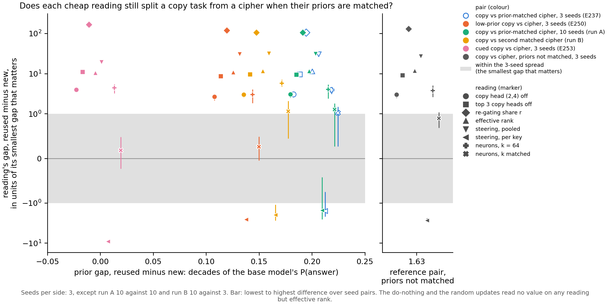

# Do the cheap readings still split a copy task from a cipher when the base model finds both answers equally likely?

We fine-tuned the 67M model on key copy and on two ciphers whose answers the base model finds about as likely, and read
each update eight cheap ways. Every reading split copy from both ciphers with no overlap between seeds, though the
base model's prior of the answer differed by a fifth of a decade at most. This supports the softened second claim, but
the re-gating share, steering and effective rank all split the pairs, so no one reading stands out.

## The answer

Yes. On both prior-matched pairs, every copy seed sits apart from every cipher seed on all eight readings. The base
model's prior cannot make that split, since it barely differs inside a pair. The re-gating share, pooled steering,
effective rank and the copy-head switch-offs separate the pairs by about three to over a hundred times their seed spread.
The neuron share at matched size clears its spread only narrowly, and not on the three-seed pairs. So the readings
follow the mechanism, but none is singled out.

## What we were trying to test

The paper's second claim, as the user softened it on 2026-11-21, is that "we have some ways of following the mechanism
that are better than just the prior". The test is a pair of tasks that differ in mechanism but not in prior. If a
reading splits such a pair, the prior cannot be what it reads.

- **The tasks.** All are on the same 96 keys of the 67M model. Key copy repeats an answer that appeared earlier in the
  window, so the base model's copy heads can do it. A cipher maps each key to a fixed answer token the base model
  has no lookup for, so it is new. A prior-matched cipher draws its answers so that the base model's probability of
  them is close to copy's.
- **The prior.** The base model's geometric-mean probability of the answer on the read rows, in log10. Copy reads
  -4.23, the first matched cipher -4.43 and the second -4.38, so the prior gaps are 0.20 and 0.16 decades. Copy
  against the ordinary cipher differs by 1.6 decades, and serves as the reference pair.
- **Run 1.** Copy and the first prior-matched cipher, each fine-tuned at ten seeds with the earlier key-task recipe.
  Its seeds 0 to 2 repeat the saved earlier fine-tunes bit for bit. Every update is scaled to the common update size
  used across the key-task grid.
- **Run 2.** A second prior-matched cipher, drawn by the same rule with the first cipher's answers banned. It was
  fine-tuned at three seeds and read against run 1's ten copy seeds. It rules out that the first cipher's split was a
  property of that one answer table.
- **Labels.** Switching off the base model's copy head (2,4) must take at least 0.2 of copy's gain and no more than 0.2
  of each cipher's. Both labels held in both runs.
- **The eight readings,** each read on the task's held-out rows:
  - the share of the gain lost with copy head (2,4) mean-ablated, and with the top three copy heads off;
  - the re-gating share $r$, the share of the update's log-odds gain carried by changes in the causal importance of
    the decomposition's subcomponents, the subcomponents held fixed, where 0 means none of it and 1 all of it;
  - the update's effective rank, how many directions its weight change spreads over, weighted by size;
  - pooled and per-key steering, the share of the gain a steering vector recovers, one vector for all rows or one
    per key token;
  - neuron shares, the share of the gain left when each MLP block keeps only its top 64 neurons, or as many neurons as
    the decomposition switches on.
- **Gap and band.** A reading's gap is the mean over copy's seeds minus the mean over the cipher's. Its band, the
  smallest gap that matters, is the larger seed range of the two tasks over seeds 0 to 2. A reading separates when the
  exact two-sided Mann-Whitney test over seeds reads at most 0.01 and the gap exceeds the band.
- **References.** The do-nothing update of zeros and one random Gaussian update of matched size per seed for seeds 0
  to 2. Neither has any gain, so no reading but effective rank can be read on them.

The figure also draws three earlier three-seed pairs from the same apparatus. The earlier copy against prior-matched
cipher pair is run 1's first three seeds. The low-prior copy, trained on copy's least likely rows, sits 0.13 decades
above the cipher. The cued copy, a copy task on rarer answer words, sits within a hundredth of a decade of it.

## What we expected, and why

Both runs filed two rivals. If the readings follow the mechanism, every reading splits each pair as the three-seed
pair did, with the same signs: copy higher on all but per-key steering, which reads higher on the cipher. If they
follow the prior, the three-seed gaps were seed luck, and at ten seeds the rank test would fail or the gaps would
shrink into the band. The neuron share at matched size was expected to sit at its band either way, since the
three-seed gap barely cleared it.

## What we observed

### Does each reading split the pair while the prior barely differs?

`experiments/prior_matched/figures/prior_matched_pairs.png`

**Reading it.** Yes, for seven of the eight readings on every pair, and for all eight on the two ten-seed pairs. Each
marker is one reading's gap between the reused and the new task, in units of its band, placed at the pair's prior gap.
The grey band is the seed spread. All matched pairs sit within a fifth of a decade of prior, against 1.6 decades for
the reference pair on the right. Yet their markers sit as far outside the band as the reference's. The re-gating share
reads a hundred bands or more, pooled steering twenty to thirty, the top-three copy heads and effective rank about
ten. The single copy head and the top-64 neuron share read three to six bands. Per-key steering reads one and a half
bands or more on the other side, the cipher higher, as filed. The one reading that sits near its band is the neuron share at matched size.
It clears the band narrowly on the two ten-seed pairs, falls inside it on the low-prior and cued copies, and sits just
inside it on the reference pair too. So it barely tracks the mechanism even when the priors differ.

On run 1, all eight readings put every one of copy's ten seeds above, or for per-key steering below, every one of the
cipher's ten. That is the strongest result the test allows, at a p value of 1.1e-5. Run 2 does the same at 10 against 3
seeds, p = 0.007, the smallest that size allows.

| reading | copy, run 1 | cipher 1 | cipher 2 | gap / band, run 1 | gap / band, run 2 |
|---|---|---|---|---|---|
| copy head (2,4) off | 0.25 | 0.001 | 0.002 | 3.1 | 3.0 |
| top three copy heads off | 0.51 | 0.025 | 0.017 | 9.5 | 9.6 |
| re-gating share $r$ | 0.77 | 0.36 | 0.37 | 105 | 103 |
| effective rank | 476 | 408 | 406 | 11.5 | 11.7 |
| pooled steering | 0.74 | 0.17 | 0.16 | 33 | 33 |
| per-key steering | 0.99 | 1.07 | 1.10 | -1.5 | -2.0 |
| neurons, top 64 | 0.026 | 0.011 | 0.005 | 4.0 | 5.7 |
| neurons, k matched | 0.016 | 0.007 | 0.008 | 1.3 | 1.2 |

Values are means over seeds, ten for copy and cipher 1, three for cipher 2. The bands are run 1's, from its seeds 0 to
2, and both runs use them. Every call is "separates" with the filed sign. The neuron share at matched size has a band of
0.0067 and gaps of 0.0086 and 0.0077. The figure's bands come from the earlier three-seed pair, the same fine-tunes at a slightly different scale, and
agree closely with these.

## What we learned

At matched prior the cheap readings follow the copy-head label, not the base model's prior. So the paper has "ways of
following the mechanism that are better than just the prior", on two independent prior-matched ciphers and three
earlier pairs. The pairs do not pick out the re-gating share. Pooled steering, effective rank and the copy-head
switch-offs agree with it on every pair. The neuron share at matched size is the weakest reading here, and it is weak
whether or not the priors are matched.

## How compelling is the evidence

- **Seeds.** Ten against ten and ten against three, with no overlap on any reading. The other three pairs have three
  seeds a side.
- **Tasks.** One task family: key copy against ciphers on the same 96 keys, plus a cued copy on rarer words. A pair
  where the mechanism and the readings could come apart in another family is not covered.
- **What the readings are blind to.** Effective rank and steering differ between copy and cipher here for the same
  reason the share does. So these pairs cannot tell which reading follows the mechanism more closely. A pair where
  steering or rank is expected to follow the prior and the share the mechanism would.
- **The band** is a three-seed range. On ten seeds the ranges are wider for some readings, but the rank test does not
  depend on it.
- **The labels** rest on the base model's copy heads, and copy loses about half its gain with three of them off.

## Surprises

None against the filed predictions. Every call came out as filed in both runs, including per-key steering's reversed
sign. One note: the neuron share at matched size sits inside its band on the unmatched reference pair too.

## What next

- A pair where steering or effective rank is expected to follow the prior and the share the mechanism. If they split,
  claim 2 can name the share. If not, the paper reports the readings as a group.
- The same matched-prior test on Qwen3-1.7B. A split there would carry claim 2 past the 67M model.

## Scorecard

| id | claim in words | rule | read | verdict |
|---|---|---|---|---|
| A0, B0 | controls and do-nothing pass; run 2's draw seed 0 repeats the first cipher | exact repeats; zero gain reads 0 | passed | holds |
| A1 | run 1's seeds 0 to 2 repeat the earlier fine-tunes | max abs diff 0 | 0 on all six | holds |
| A2, B2 | copy uses head (2,4), each cipher does not | mean share at least or at most 0.2 | 0.25; 0.001, 0.002 | holds |
| A3, B3 | each reading separates copy from the cipher | p at most 0.01 and gap over band | 8 of 8 each run | separates, signs as filed |
| A4, B4 | prior gap | constant over seeds | 0.20, 0.16 decades | no split possible |
| A5, B5 | random updates read nothing over the gain | gain readings undefined | all undefined | holds |

## Departures from the literature

None. The readings and rank test are the project's own and are used as filed.

## Not run

- Random updates on the steering and neuron readings: they have no gain, so these read nothing.
- More than three seeds of the second matched cipher.
- Any pair outside the key-copy family, and any pair on Qwen3-1.7B.
- A pair built for the readings to disagree with each other.

## Provenance

- Run 1: E254, Slurm job 63108, one L40 in the debug queue, 19:34 to 19:56 on 2026-11-21, $0.
  `experiments/prior_matched/results/a/summary.json`, `results/run_a.log`, filed `results/predictions_a.json`.
- Run 2: E255, Slurm job 63110, 20:01 to 20:07, $0. `experiments/prior_matched/results/b/summary.json`,
  `results/run_b.log`, filed `results/predictions_b.json`.
- Earlier pairs: `experiments/cued_copy/results/table.json`.
- Figure: `experiments/prior_matched/plot.py`, writing `figures/prior_matched_pairs.{png,pdf,csv}`.
- Plan cards: `reports/plans/2026-11-21_plan_prior-matched-a-card.md`, `reports/plans/2026-11-21_plan_prior-matched-b-card.md`.
