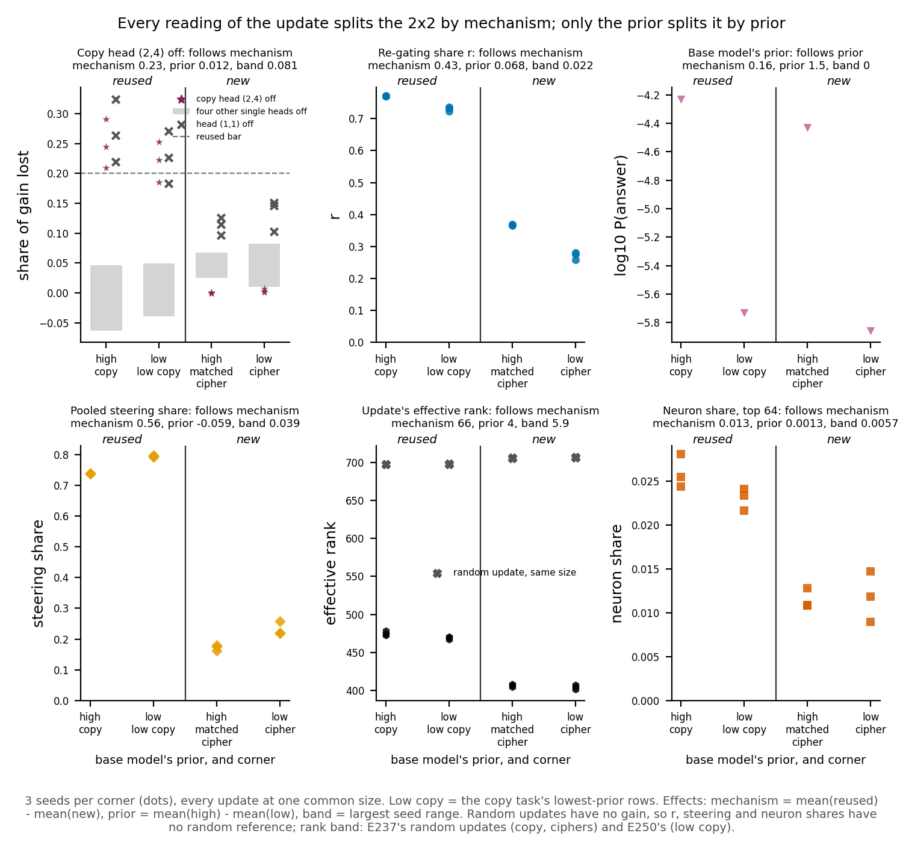

# Does the re-gating share follow how a fine-tune works, or how likely its answer already was?

We trained fine-tunes that do or do not use the base model's copy head, each with a likely and an unlikely answer.
Every reading of the update split them by copy head use, and only the answer's prior split them by prior. This backs
the paper's second claim, but the unlikely copy is the copy task on other rows, so the share was not tested against
steering or rank.

## What we did

Cell P2.54 asks whether the re-gating share separates reused from new fine-tunes even when the base model's prior of
the answer is held fixed, and whether it still does when the prior moves. Two runs built the four corners.

- **The mechanism label.** Run 1 switched off copy head (2,4) on saved key-task fine-tunes and measured the share of
  each fine-tune's gain that is lost, $1 - G_\text{off}/G$, where $G$ is the mean log-odds gain over the base model on
  the read rows. A share of 0 means the head carries none of the gain; the filed bar for "reused" is 0.2, and 0.5
  counts as fully through the head.
- **The four corners.** Copy, which repeats a key's value, is high prior and reused. The prior-matched cipher, whose
  answer has a similar prior but needs a new lookup, is high prior and new. The cipher is low prior and new. Run 2
  built the missing corner, a low-prior copy, by training the copy task only on its lowest-prior rows: 1214 training
  and 286 read rows, with a base-model log10 prior of -5.73, near the cipher's -5.86.
- **Held fixed.** Every update is scaled to one common size, the same as in the earlier key-task grid. Three seeds per
  corner.
- **The readings.** The re-gating share r, the base model's log10 prior of the answer, pooled and per-key steering
  shares, the update's effective rank, and two top-neuron shares. Each one gets two effects. The mechanism effect is
  the mean of the two reused corners minus the mean of the two new corners. The prior effect is the mean of the two
  high-prior corners minus the mean of the two low-prior ones. A reading "follows" whichever effect is larger, if that
  effect also exceeds the band, which is the largest seed range of that reading in any corner.
- **References.** For the head switch-off, five single heads drawn at random and switched off one at a time. For the
  updates, a random Gaussian update of the same size per seed. A random update has almost no gain, so r, steering and
  the neuron shares cannot be read on it; only its effective rank can.

## What we expected

The filed rules asked that the low-prior copy lose at least 0.2 of its gain with the head off, and that copy and both
ciphers keep the labels run 1 gave them. If both held, we expected r near 0.7 on the low-prior copy, so following
mechanism, and the prior following prior by construction. For steering no strong expectation was filed. For the top
neuron shares we expected no call, because every key task had read under 0.03.

## What we observed

`experiments/prior_mech_2x2/figures/prior_mech_2x2.png`

**Reading it.** Five of the six panels split the corners left against right, by mechanism, and only the prior panel
splits them by prior. Every filed pass-or-fail rule held. The low-prior copy lost 0.22 of its gain with the copy head
off, just over the 0.2 bar. Its seeds read 0.185, 0.222 and 0.252. The re-gating share r read 0.77 on copy and 0.73 on
the low-prior copy. The two ciphers read 0.37 and 0.27. That is a mechanism effect of 0.43 against a prior effect
of 0.07, with a band of 0.02. Pooled steering and effective rank split the same way and as cleanly. The top-64 neuron
share also splits by mechanism, but every corner reads under 0.03, close to zero.

| Reading | copy: high, reused | low copy: low, reused | matched cipher: high, new | cipher: low, new | mechanism effect | prior effect | band | call |
|---|---|---|---|---|---|---|---|---|
| share lost, head (2,4) off | 0.25 | 0.22 | 0.00 | 0.00 | 0.23 | 0.01 | 0.08 | mechanism |
| re-gating share r | 0.77 | 0.73 | 0.37 | 0.27 | 0.43 | 0.07 | 0.02 | mechanism |
| log10 prior | -4.23 | -5.73 | -4.43 | -5.86 | 0.16 | 1.47 | 0 | prior |
| pooled steering | 0.74 | 0.79 | 0.17 | 0.23 | 0.56 | -0.06 | 0.04 | mechanism |
| per-key steering | 0.99 | 1.00 | 1.08 | 1.14 | -0.11 | -0.03 | 0.05 | mechanism |
| effective rank | 475 | 469 | 407 | 405 | 66 | 4 | 6 | mechanism |
| neuron share, top 64 | 0.026 | 0.023 | 0.012 | 0.012 | 0.013 | 0.001 | 0.006 | mechanism |
| neuron share, k matched | 0.016 | 0.011 | 0.009 | 0.010 | 0.004 | 0.002 | 0.007 | no call |
| update size | 0.0073 | 0.0073 | 0.0073 | 0.0073 | 0 | 0 | 0.0002 | no call |

Corner values are means of three seeds. Source: `experiments/prior_mech_2x2/results/stage2/table.json` (`proxies`).
The random update of the same size reads an effective rank of 697 to 707 in every corner, far above all four.

## Caveats

- **The low-prior copy is the copy task on other rows.** It is the same task, trained on the rows where the base model
  found the answer least likely. Any reading of the update sees a copy-like update, so it should land near copy. This
  2x2 therefore separates readings of the update from readings of the rows, the prior being the one reading of the
  rows. It does not test the re-gating share against the other readings of the update, which all pass here.
- **The copy does not run through one head.** Head (1,1), the first random draw and the same head in every seed,
  loses 0.18, 0.23 and 0.27 of the low-prior copy's gain, as much as copy head (2,4) or more. On copy it loses 0.22 to
  0.32. Switched off alone in the base model, it breaks copying as fully as (2,4): the second-copy accuracy falls from
  0.82 to 0.01 under either. It also costs the ciphers 0.10 to 0.15, while (2,4) costs them nothing. The other four
  random heads cost any corner at most 0.08. So the copy runs through more than one head, and a label read from (2,4)
  alone undercounts it.
- **Copy is "between", not fully through the head.** Copy loses only 0.25 to (2,4), half the 0.5 that counts as fully
  through the head, so run 1 labelled it "between". It clears the 0.2 bar, so this is a caveat on how much of the copy
  the head carries, not a failed rule.
- **"Most alternatives follow the prior" is not shown.** Pooled steering and effective rank follow mechanism as
  strongly as r does, and the top-64 neuron share follows it too. Only the prior follows the prior. The wording
  "the share follows the mechanism, the alternatives follow the prior" does not hold on this 2x2.
- **Two calls near zero.** The top-64 neuron share calls mechanism on values all under 0.03, and per-key steering calls
  mechanism with the ciphers higher, near 1 in every corner. Neither is a strong signal.

## Surprises

The top-64 neuron share was expected to give no call and called mechanism, with a mechanism effect of 0.013 against a
band of 0.006. Its values sit close to zero in every corner.

## What next

- A low-prior reused fine-tune that is a different task, not a row selection, would test r against steering and rank.
  If steering or rank then followed the prior while r did not, claim 2's wording would stand.
- A label from switching off (2,4) and (1,1) together would tell whether copy is fully reused once both heads are off.

## Scorecard

| id | claim | rule | read | verdict |
|---|---|---|---|---|
| Q0 | the low-prior copy runs through the copy head | mean share lost at least 0.2, each seed above its median random head | 0.22 | holds |
| corners | copy, both ciphers and low copy keep their labels | run 1's P1 and P2, and Q0 | all hold | holds |
| Q1 | r follows mechanism | call rule above | 0.43 against 0.07, band 0.02 | mechanism |
| Q2 | the prior follows prior | call rule above | 1.47 against 0.16 | prior |
| Q3 | steering's call | call rule above | pooled and per-key both mechanism | mechanism |
| Q4 | neuron shares' call, expected no call | call rule above | top 64 mechanism, k matched no call | mixed |

## Not run

- A low-prior reused fine-tune built as its own task rather than a row selection.
- The head switch-off with (2,4) and (1,1) off together.
- r, steering and neuron shares on the random updates: they have no gain to read.
- Rank-1 and elicit sit in the table file but outside the 2x2; not discussed here.

## Departures from the literature

None: every reading follows its earlier in-repo definition.

## Provenance

Run 1 E249 and run 2 E250, the rerun job 62976, on the MATS cluster's L40, about ten minutes, no cost. Results:
`experiments/prior_mech_2x2/results/stage1/`, `experiments/prior_mech_2x2/results/stage2/`, log `results/run2.log`.
Figure from `experiments/prior_mech_2x2/plot.py`.
