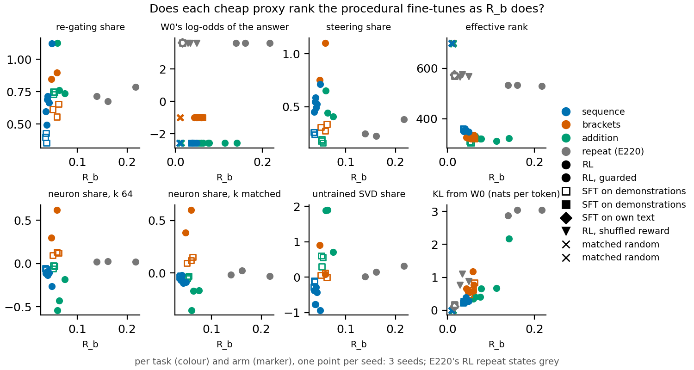

# Do RL and SFT on procedural tasks read apart under definition (b), and which cheap proxies follow it?

Cell P2.56. Runs: E256 trained the states and read the proxies, E260 added guarded RL, E261 scored against definition (b).
Plan `reports/plans/2026-11-21_plan_procedural-rl-guarded-card.md`, card `~/commute-data/cards/E261.md`.

We trained the 67M model on three small procedural tasks, by reinforcement learning and by supervised training on
demonstrations, all to one update size. Each state was read with definition (b) and with seven cheap proxies, and RL and
supervised training read alike on two tasks, with no call on addition, where RL tends higher but under the filed gap; all sit well above a random update of the same size. For claim 2, the
output KL and the effective rank follow definition (b) best, two decomposition shares follow it moderately, and the prior
follows it no better than chance.

## The answer

At this update size, definition (b) does not tell RL from supervised training on procedural tasks. Both sit close
together on sequence and brackets; on addition RL tends higher, but by less than the filed gap, so there is no call. All are far above a random update of the same size. The earlier repeat task, where
RL read about ten times supervised training, does not carry over. The re-gating share, a proxy built to follow mechanism,
had called RL above supervised training on the sequence task, where definition (b) reads them alike. Across trained
states, the output KL tracks definition (b) best and the prior does not track it.

## What was done

There are three next-token tasks the base model already partly does. They are continuing a run of days or months,
closing brackets and quotes, and adding two single digits after two worked sums. Each task was trained five ways, three seeds each:

- **RL**: E220's recipe, one sampled token rewarded when correct.
- **RL, guarded**: RL with an entropy bonus and a stop when the gradient is zero. Four of nine plain RL states had
  collapsed.
- **SFT**: supervised training on demonstrations.
- **Two matched random updates**: Gaussian weight changes of the same size as an RL or a guarded RL state. They rule out
  that any update of this size reads high.

Every trained state was stopped at the same relative update size. We write definition (b)'s per-state
reading as $R_b$; the files call it `E_b`. No reused-or-new verdict is given from it. Twelve states from E220's repeat
task are added in grey. They are RL, RL with a shuffled reward, SFT on the model's own text and SFT on demonstrations.

RL and SFT are compared per task with E222's rule. It reads "alike" when the seed ranges overlap and the gap between
means is under 0.1. It reads "apart" when they do not overlap and the gap is at least 0.1, and otherwise "neither". The floor is the matched random
update. The filed stop rule, that every procedural state reads under 0.05, was not met: addition's first RL seed read
0.141.

The proxies are listed in the table further down. The re-gating share $r$ is the share of the gain in the answer's
log-odds that appears when the original subcomponents are kept and only the frozen Γ gates differently. The prior is the
unchanged model's log-odds of the answer. Each proxy is compared with $R_b$ by Spearman rank correlation across states.

## RL and SFT read alike under definition (b)

**Reading it.** On every procedural task the RL and SFT points sit in one narrow band of $R_b$, and the grey repeat-task
RL states lie far to the right. Sequence reads 0.036 to 0.049 for RL against 0.036 to 0.038 for SFT: "alike".
Brackets reads 0.043 to 0.059 for RL against 0.050 to 0.062: "alike" again. Addition's RL seeds read 0.075 to 0.141 against SFT's 0.051 to 0.054. Its
seed ranges do not overlap, but the gap between means is only 0.045, so the rule reads "neither". Guarded RL gives the
same calls on brackets and addition, and "neither" on sequence, where its 0.038 to 0.043 sits just above SFT's range.
Every trained state sits well above the matched random updates, which read 0.009 to 0.013. On E220's repeat task RL read
0.139 to 0.217 against 0.015 to 0.017 for SFT on demonstrations, "rl above". The legend draws RL and guarded RL with the
same filled circle, and the two random arms with the same cross; the colour still separates tasks.

| task | RL | RL, guarded | SFT | random | RL vs SFT | guarded vs SFT |
|---|---|---|---|---|---|---|
| sequence | 0.036–0.049 | 0.038–0.043 | 0.036–0.038 | 0.009–0.010 | alike | neither |
| brackets | 0.043–0.059 | 0.051–0.061 | 0.050–0.062 | 0.010–0.011 | alike | alike |
| addition | 0.075–0.141 | 0.060–0.113 | 0.051–0.054 | 0.012–0.013 | neither | neither |
| repeat, E220 | 0.139–0.217 | — | 0.015–0.017 | — | rl above | no call |

## The re-gating share and definition (b) disagree on the sequence task

In run 1 the re-gating share read RL above SFT on sequence: 0.60 to 1.12 for RL against 0.35 to 0.43 for SFT. Under
definition (b) the same states read alike. So on the one task where the share made a call, the two readings of the
same states point different ways. The share could not be read on seven RL states. Their training lowered the answer's
log-odds, so there was no gain to take a share of.

## Which proxies follow definition (b)

| proxy | Spearman with $R_b$, trained states | states | pooled with random arms | states |
|---|---|---|---|---|
| KL from the unchanged model | 0.73 | 39 | 0.90 | 57 |
| effective rank | −0.64 | 39 | −0.85 | 57 |
| untrained-decomposition share | 0.64 | 23 | 0.64 | 23 |
| re-gating share | 0.56 | 23 | 0.56 | 23 |
| neuron share, top 64 | 0.24 | 23 | 0.24 | 23 |
| neuron share, matched count | 0.14 | 23 | 0.14 | 23 |
| steering share | −0.13 | 23 | −0.13 | 23 |
| prior | −0.11 | 39 | 0.21 | 57 |

**Reading it.** The trained-states column leaves out the eighteen random-update states. Those states sit at the floor of
$R_b$, at near-zero KL and at the highest effective rank, so including them raises the pooled numbers. Dropping them, KL
falls from 0.90 to 0.73 and effective rank from −0.85 to −0.64. The prior falls from 0.21 to −0.11. The share-type proxies were
never read on random states, so their two columns are the same. The trained-states KL is still helped by E220's three
repeat RL states, which sit far out on both axes; we did not compute it without them.

## What this means for the paper

Claim 2 asks for ways of following the mechanism that do better than the prior. Here the prior ranks trained states no
better than chance, while KL, effective rank, the untrained-decomposition share and the re-gating share all rank them
with moderate to strong agreement. But definition (b) itself spreads the procedural states little: most of its spread across trained states comes from
the repeat-task RL states and the addition RL seeds. The RL-versus-SFT contrast that made E220 useful
does not reappear on procedural tasks.

## How compelling

Three seeds per arm and three tasks, all on the 67M model at one update size. Spearman over 23 states is coarse, and
the states are not independent: seeds of one arm cluster. The repeat-task states come from another experiment's
training, at a comparable size. KL and effective rank do not look at the decomposition at all.

## Surprises

The repeat task's tenfold RL-over-SFT gap did not appear on any procedural task. The re-gating share's sequence call
reverses under definition (b).

## Scorecard

| id | claim | rule | read | verdict |
|---|---|---|---|---|
| E261 rival a | RL above SFT on each task | apart, gap at least 0.1 | alike, alike, neither | not supported |
| E261 rival b | RL and SFT within 0.1, all states under 0.05 | alike or neither on all; every state under 0.05 | calls yes; states reach 0.141 | partly: calls match, level does not |
| E261 stop | every procedural state under 0.05 | all under 0.05 | addition RL reaches 0.141 | not met |

## Departures from the literature

None: Spearman rank correlation and E222's rule are used as written.

## Not run

- Spearman without E220's repeat states.
- A second update size, or a larger model.
- The share on the seven RL states whose gain was negative.
- Any reused-or-new verdict from $R_b$.

Provenance: the scoring is `experiments/procedural_rl/results/score_rb.json`, written by E261. The trained-states
column is `results/score_rb_trained.json`, written by `trained_only.py`. Run 1's share call is `results/score.json`. The
figure is `figures/proxies_vs_rb.png`. All scoring ran on CPU, at no GPU cost.
