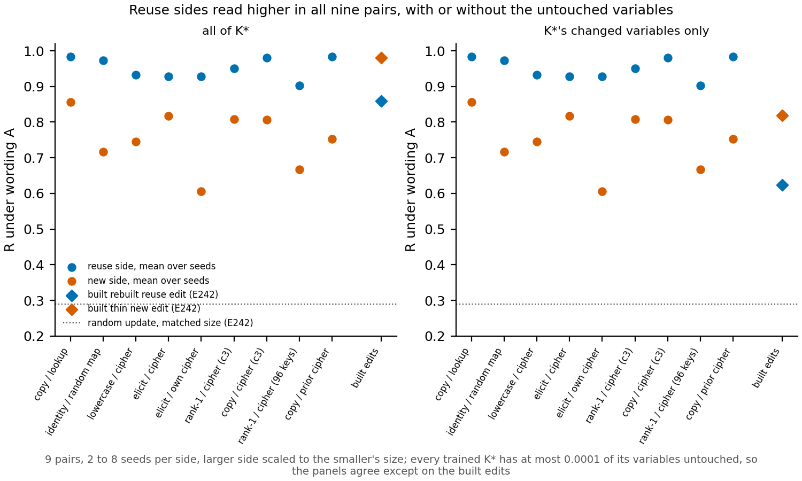

# Does R under wording A order real fine-tunes, and is it only the untouched circuit parts?

*2026-11-21, definition-lead (writer agent). Cell P1.48, run E248 (RunPod H100s, ten pods across three runners, about
$120). Descriptive by the user's instruction: the readings are reported as read, with no verdict at a bar. No definition
wording is changed here, and nothing here decides whether wording A goes into the paper.*

We read R under wording A at the VPD level on 94 trained fine-tunes: nine task pairs built to reuse or to be new,
copy against lookup, and five key tasks. In all nine pairs the side built to reuse reads higher, by 0.11 to 0.32, and
the order survives with untouched circuit parts set aside, because trained fine-tunes change every part. So the leniency found on the thin
hand-built edit does not reach these fine-tunes by the untouched-parts route, though it may reach them through parts
changed only a little.

## What was measured

**R under wording A** is the largest share of the circuit K*'s variables whose mechanisms the base model's can replace
all at once, each scaled by one fitted output gain. The replacement must move the fine-tune's output by at most 0.1 of
its distance from the base model. E242's code ran unchanged. It reads 1 when every variable can be stood in, and 0 when none can.

Three sets of trained fine-tunes on the 67M model were read:

- **Nine task pairs**, each a task expected to reuse the base model against one expected to need something new. In each
  pair the side with the larger update is scaled down to the other's size, so the two sides move the weights equally.
  Each side has two to eight seeds.
- **Copy against lookup** at each task's own update size, three seeds each.
- **Five key tasks** at one common update size, three seeds each: copy, elicit, rank-1, prior cipher and cipher.

**References.** The unchanged model reads 1 by definition, and every job's first stage confirmed it did. A random update
of matched size reads 0.29 on E242's built edits. The old squared-cosine R is read beside it.

**The side reading.** E247 found that wording A counts every circuit variable the update never touched as reused. So for
every item we also read the untouched share of K*, and R among K*'s changed variables only, from the saved files. A
variable is changed when the update moves it at all. On the thin hand-built new edit the two readings differ
widely: 0.89 of its circuit is untouched, and R falls from 0.98 to 0.82 among changed variables. That edit is the
positive control for the side reading: it shows the side reading moves when untouched parts are present.

## What the card expected

The card set two descriptions side by side, with no bar. If wording A tracks reuse, the reuse side of each pair reads
above its new side. If it instead tracks how thinly an update is spread, as on E242's thin edit, the nine gaps scatter
around zero with no consistent sign.

## What we observed

### Does the reuse side read higher in every pair, with untouched parts set aside?

**Reading it.** Yes, on both panels. Every blue point sits above its orange partner, and the two panels look the same
for the nine pairs. That is because no trained fine-tune leaves more than 0.0001 of its circuit untouched, so setting
untouched variables aside moves no pair gap at the second decimal. Only the built edits on the right move between the
panels: the thin new edit drops from 0.98 to 0.82, and the rebuilt reuse edit from 0.86 to 0.62. The gaps run from
0.11 for elicit against cipher to 0.32 for elicit against its own cipher. Seed by seed the order holds as well: the
lowest reuse seed sits above the highest new seed in every pair, by at least 0.08. Every side, reuse and new, reads well
above the random update's 0.29.

| pair, reuse / new | reuse side | new side | gap | gap, changed parts only | searches capped, reuse / new |
|---|---|---|---|---|---|
| copy / lookup | 0.98 | 0.86 | 0.13 | 0.13 | 0 of 3 / 3 of 3 |
| identity / random map | 0.97 | 0.72 | 0.26 | 0.26 | 0 of 4 / 4 of 4 |
| lowercase / cipher | 0.93 | 0.75 | 0.19 | 0.19 | 2 of 2 / 4 of 4 |
| elicit / cipher | 0.93 | 0.82 | 0.11 | 0.11 | 2 of 5 / 5 of 5 |
| elicit / own cipher | 0.93 | 0.61 | 0.32 | 0.32 | 2 of 5 / 2 of 2 |
| rank-1 / cipher, c3 | 0.95 | 0.81 | 0.14 | 0.14 | 0 of 8 / 8 of 8 |
| copy / cipher, c3 | 0.98 | 0.81 | 0.17 | 0.17 | 0 of 8 / 8 of 8 |
| rank-1 / cipher, 96 keys | 0.90 | 0.67 | 0.23 | 0.23 | 3 of 3 / 3 of 3 |
| copy / prior cipher | 0.98 | 0.75 | 0.23 | 0.23 | 0 of 3 / 3 of 3 |

Each side is the mean over its seeds. The old squared-cosine R reads 0.999 on nearly every item, and its reuse side is
higher in only four of the nine pairs, with gaps of at most 0.0001.

### Copy against lookup at their own sizes

Copy reads 0.98 and lookup 0.90, a gap of 0.09. At matched size, with lookup scaled down to copy's update, lookup reads
0.86 and the gap is 0.13. With untouched parts set aside both readings are unchanged at the second decimal.

### The five key tasks

The tasks fall in the same order with or without untouched parts: copy 0.98, elicit 0.89, rank-1 0.88, prior cipher
0.75 and cipher 0.65, each the mean of three seeds. The largest seed spread within any task is 0.04. The untouched share
is again at most 0.0001 for every task.

## What we learned

R under wording A orders the trained pairs the way their construction says: reuse side above new side in all nine, and
copy above lookup. The route E247 found for the thin edit, untouched circuit parts counting as reused, plays no part
here, because trained fine-tunes change every variable of their circuits. What this does not settle is whether parts
changed only a little stand in for the same cheap reason. E247's change-weighted share inverted the order on the built
edits, and it has not been read on trained fine-tunes. Whether R under wording A goes into the paper stays with the user.

## How compelling is the evidence

- Nine pairs, two to eight seeds per side, one featurization, the 67M model only.
- Every new side's search hit the evaluation cap of 2,000, and so did the reuse side in four of the nine pairs. A capped
  search keeps more variables than it needs, so its R is a lower bound. This could widen a gap when only the new side is
  capped. In the two pairs where every search on both sides was capped, the gaps are 0.19 and 0.23.
- The new side's circuit is the larger in eight of the nine pairs, so R's share is taken over more variables there.
  The exception is lowercase against cipher, where the reuse side's circuit is slightly larger and its gap is still 0.19.
- The seed spread within a side is at most 0.10, and the smallest seed-by-seed separation between sides is 0.08.

## Surprises

None against the card. The side reading turned out to have nothing to set aside on trained fine-tunes, which E247's
built edits did not prepare for.

## What next

- Weight each changed variable by the write change it carries, on a few pairs. If the order inverts as it did on the
  built edits, wording A's reading on trained fine-tunes also rests on small changes standing in for free.
- Rerun the capped new-side searches with a larger evaluation cap on one pair. If R rises toward the reuse side, the
  gaps owe part of their size to the cap.

## Scorecard

| reading | what it is | what was read |
|---|---|---|
| pairs | reuse side above new side under R_A, nine pairs | 9 of 9; old R 4 of 9 |
| pairs, changed parts only | the same with untouched variables set aside | 9 of 9 |
| copy / lookup | copy against lookup, own sizes | 0.98 against 0.90 |
| key tasks | five tasks, three seeds each | copy, elicit, rank-1, prior cipher, cipher, in that order |

No filed rule is scored: the user asked for descriptions.

## Departures from the literature

None new. The stand-in is Geiger's soft intervention, as adopted for wording A on 2026-11-20.

## Not run

- A share weighted by each changed variable's write change on trained fine-tunes. It needs the model, since the saved
  files hold gains and stood-in sets but not the write changes.
- Uncapped searches on the new sides.
- The side readings at 0.05 and 0.2 of the distance from the base model, saved in each item file but not reported here.
- R under wording A at the SAE level on these items.
- Any second featurization or the larger model.

Files: `experiments/kstar_vpd_wording_a/results/summary.json` (`score.py`), `.../results/changed_only.json` and
`.../figures/changed_only_pairs.png` (`plot.py`, from the saved items only), `.../results/items/*.json`, run logs and
stage-0 files in `.../results/`.
