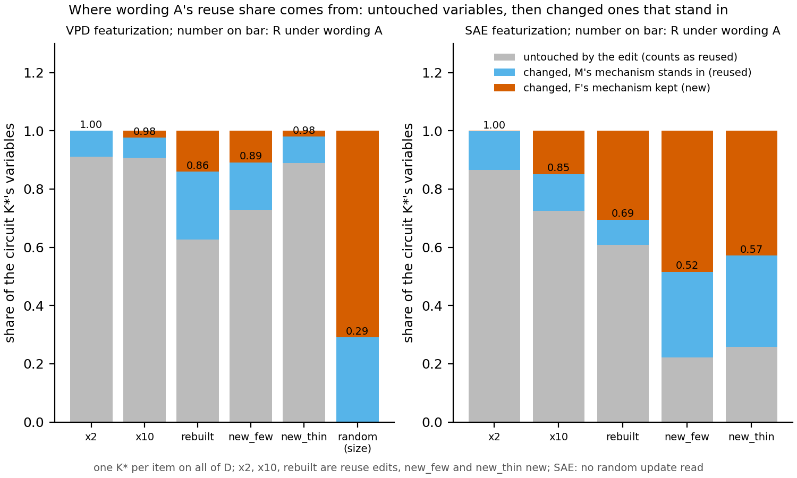

# Why does a thin new edit read as reused under wording A?

*2026-11-21, definition-lead (writer agent). Cell P1.47, run E247 (cluster job 62928, $0). Plan
`reports/plans/2026-11-21_plan_thin-edit-diagnosis.md`. No definition wording is changed here.*

We took the hand-built edit that writes eight new answers thinly into one layer, which wording A had read as almost
wholly reused, and asked where that reading comes from. The output gains are not the cause: forcing every gain back to
one leaves the reading where it was, and the gains explain no more of the edit's change than they do for a random
update. The reading comes mostly from circuit variables the edit never touched, which count as reused for free, so
wording A as counted is too lenient for thin edits, and the same counting also decides the order at the SAE level.

## Wording A in three sentences

Wording A says a fine-tune reuses the base model for a behaviour to the extent that the base model's mechanisms, each
scaled by one output gain, can stand in for those of the variables the behaviour runs through and still preserve the
behaviour; R is the largest share of the circuit K*'s variables for which that stand-in works. It replaced a grade
that called a variable kept when its new and old outputs had a squared cosine near one, which read every small change
as kept, so two twins that memorise a fact through small changes read as reused when they must read as new. The user
adopted it on 2026-11-20 at about 19:50, and "preserve the behaviour" is read as moving the fine-tune's output by at
most 0.1 of its distance from the base model.

## The answer to the user's question

The question was whether the built label is off or wording A is too lenient for thin edits. Nothing here shows the
label off: wording A as counted is too lenient, because the thin edit changes only one matrix and most of its circuit
is untouched. The gains are ruled out as the cause. The SAE level does not clear wording A either: its order holds,
but because the rebuilt reuse edit's circuit is the one with more untouched variables there.

## What was done

E247 rebuilt E242's six items at the VPD level with E242's circuits, stood-in sets and fitted gains, and reproduced its
readings exactly. For each item it read four things. First, it stood the set in with the base model's mechanism, with
the fitted gains and then with every gain at one. It read how far each moves the fine-tune, as a share of the
fine-tune's distance from the base model. Second, the share of the stood-in set's write change that the gains explain. Third, the share of
the circuit's write change held by the variables that keep the fine-tune's mechanism. Fourth, the same move with
every changed variable outside the circuit stood in as well. The SAE numbers are read from sae-lead's E245 files.

## What we observed

**The gains do not carry the new computation.** With fitted gains, the thin edit's stood-in set moves the fine-tune by
0.099 of its distance from the base model. With every gain at one it moves it by the same amount: the rise is -1.6e-5,
against a filed bar of 0.11. The gains explain 0.016 of the stood-in set's change, close to a random update's 0.011.
On the gain edits they explain far more: 0.73 for the gain of 2 and 0.49 for the gain of 10. One caveat on power: on
the gain-of-2 edit, gains at one raised the move only from 0.078 to 0.13, not above the 0.5 the plan expected. So the
share the gains explain is the firmer evidence.

**Reading it.** The figure splits each circuit into variables the edit never touched, changed ones the base mechanism
stands in for, and changed ones that keep the fine-tune's mechanism. At VPD, 0.89 of the thin edit's circuit is
untouched, against 0.63 for the rebuilt reuse edit, and R under wording A reads 0.98 against 0.86. The changed
variables that stand in carry 0.54 of the circuit's write change, yet all of them reverted at once move the output by
under the 0.1 bar. The filed rule reads "neither rival": the kept variables carry 0.46 of the change, under its 0.5.

**At SAE the order holds for the same reason.** R reads 0.57 for the thin edit and 0.69 for the rebuilt edit, a gap of
0.12 against a band of 0.11. Only 0.26 of the thin edit's circuit is untouched there, against 0.61 for the rebuilt
edit. Among changed variables alone, the thin edit's stand in more often than the rebuilt edit's at both levels: 0.82
against 0.62 at VPD, and 0.42 against 0.22 at SAE.

## Would weighting fix wording A?

Weighting each changed variable by its write change, so untouched ones add nothing, inverts the order. The share of
the circuit's change that stands in reads 0.02 for the gain-of-10 edit, 0.04 for the rebuilt edit and 0.08 for the
gain-of-2 edit. It reads 0.15 for the random update, 0.37 for the few-parts new edit and 0.54 for the thin new edit.
Counting changed variables only also fails, as the ratios above show at both levels.

| item | R under A, VPD | untouched share, VPD | changed that stand in, VPD | change in stood-in variables | R under A, SAE |
|---|---|---|---|---|---|
| gain of 2 (reuse) | 1.00 | 0.91 | 1.00 | 0.08 | 1.00 |
| gain of 10 (reuse) | 0.98 | 0.91 | 0.74 | 0.02 | 0.85 |
| rebuilt (reuse) | 0.86 | 0.63 | 0.62 | 0.04 | 0.69 |
| few parts (new) | 0.89 | 0.73 | 0.60 | 0.37 | 0.52 |
| thin (new) | 0.98 | 0.89 | 0.82 | 0.54 | 0.57 |
| random, matched size | 0.29 | 0.00 | 0.29 | 0.15 | not read |

## Surprises

The thin edit's 2,517 changed variables outside its circuit matter. Standing them in as well moves the fine-tune by
0.48 of its distance, and 0.66 for the few-parts new edit, against 0.09, 0.12 and 0.21 for the three reuse edits. This
is descriptive, not filed. It hints that at VPD part of the new computation sits outside the circuit wording A asks.

## Departures from the literature

None new. Wording A's stand-in is Geiger's soft intervention, as adopted on 2026-11-20.

## Not run

- Gains set to one at SAE, and the write-change shares at SAE: these need sae-lead's code.
- A random update at the SAE level.
- A share weighted by how much each variable's write matters to the behaviour.
- A stand-in search over the changed variables outside the circuit.
- The moved reuse edit, under the noise floor at VPD; a second seed of any built edit.
- The held E248 readings on the trained pairs, copy against lookup and the key tasks, now running as descriptions.

Files: `experiments/thin_edit_diagnosis/results/summary.json`, `.../items/*.json`, `.../figures/kstar_composition.png`
(made by `plot.py --composition`), `experiments/kstar_vpd_wording_a/results/`, `experiments/sae_r_a/results/`.
