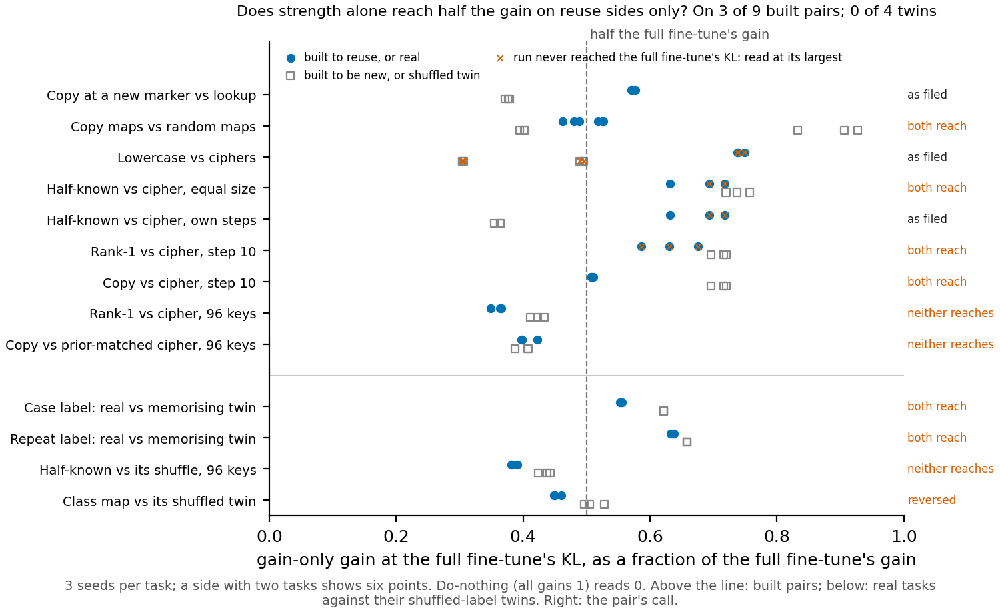

# Can strength alone do the built reuse tasks but not the built new ones?

E231, cell P2.46 (compare-lead), 2026-11-22. Figure `experiments/gain_only/figures/reach_kl_matched.png`.

We froze the 67M model and trained only one multiplier per neuron and per head on the tasks of the nine built pairs.
At the full fine-tune's output change, these strength-only updates reached half its gain on the new side of four pairs,
so the filed prediction that only reuse sides would get there failed. Turning existing neurons and heads up or down
does not tell the built reuse tasks from the new ones, and the literal "how strongly" reading of reuse ends at this
unit.

## The answer

Something we predicted did not happen. We filed that changing only how strongly each existing neuron and head fires
would recover at least half of a full fine-tune's gain on tasks built to reuse the original model, and less than half
on tasks built to need something new. It held on three of the nine built pairs. On four pairs both sides got there,
and on two neither did. Strength alone reaches new tasks about as well as reuse tasks, so it is not what separates
them.

## What we were trying to test

The results section claims that on the built reuse pairs, fine-tuning changes when and how strongly existing mechanisms
act. Its literal test at the level of neurons and heads: can strength alone do what each side's full fine-tune did?

For each task we froze every weight of the 67M model and added one trainable multiplier, starting at 1, on each MLP
neuron's output and on each attention head's output. That is 12,288 neuron gains and 24 head gains over the four
layers. We trained them with the reference full fine-tune's own data, loss, batch, sampler seed and clipping, with Adam
at a constant rate of 3e-3. Only two things differ from the reference: the parameter set and the rate. Each trained
state was also written as a weight change in the saved fine-tunes' format, so every later reading takes it unchanged.

The tasks are the nine built pairs, each a task built to reuse something the original model already does against one
built to need something new, and four real tasks against their shuffled-label twins. Every task has two to eight saved
full fine-tunes, its references. Each gain-only run checked two numbers on the reference's read rows every tenth of the
reference's own training length:

- the **gain**, the mean change in the log-odds of the trained answer at the read position from the original model;
- the **KL to the original model**, the mean over rows and positions of how far the output distribution moved.

The run kept the state at the first check whose KL reached the references' mean KL. When it never did, it kept the
check with the largest KL. The comparison is the **reach**: that state's gain divided by the references' mean gain, the
median over three seeds. Zero means the gains bought nothing; 1 means they bought the full fine-tune's whole gain for
the same output change. We matched on output change, not on steps, because a gain-only update can usually buy any gain
by moving other outputs. The question is what it gets for the same disturbance the full fine-tune made.

A second matching, filed as secondary, keeps the first check whose gain reaches the references' gain. Within the step
cap it keeps the largest gain reached. The cap was ten times the reference's steps, and at least 300.

Before any task ran, a control stage checked the apparatus alone. Gains of 1 must change no output bit. A random gain
state must equal its exported weight change, and a shuffled export must differ. The read path must reproduce a saved
full fine-tune's gain.

## What we expected, and why

The filed view was that a built reuse task asks the model to turn up computation it already has, which one gain per
unit can do, while a built new task needs computation the model lacks. So at the full fine-tune's output change, the
gain-only state should reach at least half the gain on the reuse side and less than half on the new side. The filed
rule asked for this on all but two of the nine built pairs, and on all but one of the four twins.

The rival on the card was that at this unit both kinds of task are equally reachable or equally out of reach. A
gains-after-the-fact fit to the full fine-tunes recovered at most 0.104 of any fine-tune's output change. The rival
predicted both sides of a pair get the same call on at least three of the nine pairs. The card's stop rule: if most
pairs get the same call on both sides, one static gain per neuron and head is not the unit that separates the built
pairs.

A third filed check asked that the gain-only states read a re-gating share in its KL form at least as high as the reuse
side's full fine-tune, less a band of 0.0314. A gain change is a change of strength by construction, so a reading that
credits switching should credit it here too.

## What we observed

### Did the apparatus behave?

Yes. On all three pods, gains of 1 gave bit-identical logits in fp32 and in bf16 autocast, a gain and KL of exactly 0,
and an exported change with no non-zero entry. The random gain state matched its exported change to 1.4e-5 relative;
the shuffled export missed by 1.21. The read path reproduced a saved fine-tune's gain to 2.2e-8 relative. All 78 runs
finished and none tripped the first-step guard.

### At the full fine-tune's output change, does strength alone reach half the gain only on the reuse side?

**Reading it.** No: it holds on three of nine built pairs and none of the four twins. Read each row as two clusters, the
filled reuse points and the hollow new points, against the dashed half line. On four built pairs the new side sits
right of the line and beyond its reuse side. Random maps reach 0.65 on average, against 0.50 for copy maps. The step-9
cipher reaches 0.74, against 0.69 for the half-known task. The step-10 cipher reaches 0.72, beyond both its partners,
rank-1 and copy. On the two 96-key pairs both sides
stay between 0.36 and 0.42. The three pairs that went as filed are copy against lookup at a new marker, lowercase against
ciphers, and the half-known task against the cipher at its own 30 steps. The twins never went as filed. Two had both
sides above the line, one had neither, and one was reversed.

The caveat is on one of the three as-filed pairs. Every lowercase and cipher run ended at its step cap with a quarter
to a half of its references' KL, so that pair is read below the matched output change; its cipher sides sit at 0.30
and 0.49. The rank-1 runs at step 10 and two of three half-known runs also stopped short of their KL. That pushes those
reuse sides down, and they still reached. The new sides that reached half did so clearly, at 0.65 to 0.74. The
copy-maps reuse side sits on the line, at 0.50.

The card's rival, the same call on both sides of at least three pairs, is met on six of nine. That is most of the nine,
so the card's stop rule applies.

Per pair, at matched output change and at matched gain:

| pair | reuse reach, KL-matched | new reach, KL-matched | call | reuse reach, gain-matched | new reach, gain-matched | call |
|---|---|---|---|---|---|---|
| Copy at a new marker vs lookup | 0.57 | 0.38 | as filed | 0.87 | 0.63 | both reach |
| Copy maps vs random maps | 0.50 | 0.65 | both reach | 0.97 | 0.87 | both reach |
| Lowercase vs ciphers | 0.74 | 0.40 | as filed | 0.75 | 0.40 | as filed |
| Half-known vs cipher, equal size | 0.69 | 0.74 | both reach | 0.80 | 1.01 | both reach |
| Half-known vs cipher, own steps | 0.69 | 0.36 | as filed | 0.80 | 0.70 | both reach |
| Rank-1 vs cipher, step 10 | 0.63 | 0.72 | both reach | 0.74 | 1.00 | both reach |
| Copy vs cipher, step 10 | 0.51 | 0.72 | both reach | 0.95 | 1.00 | both reach |
| Rank-1 vs cipher, 96 keys | 0.36 | 0.42 | neither reaches | 0.59 | 0.54 | both reach |
| Copy vs prior-matched cipher, 96 keys | 0.40 | 0.41 | neither reaches | 0.82 | 0.59 | both reach |
| Case label: real vs memorising twin | 0.55 | 0.62 | both reach | 0.79 | 0.70 | both reach |
| Repeat label: real vs memorising twin | 0.64 | 0.66 | both reach | 0.87 | 0.73 | both reach |
| Half-known vs its shuffle, 96 keys | 0.38 | 0.44 | neither reaches | 0.62 | 0.53 | both reach |
| Class map vs its shuffled twin | 0.45 | 0.50 | reversed | 0.81 | 0.84 | both reach |

A side with two tasks is the mean of their reaches. The first nine rows are the built pairs, the last four the twins.

### At matched gain, does strength alone get there on both sides?

Mostly yes, but this reading cannot be trusted as a comparison. At matched gain one pair went as filed, lowercase
against ciphers, and the other eight had both sides past half. Only 9 of the 81 gain-matched states actually reached
their references' gain. Of the rest, 47 stopped at the step cap with the gain still rising over the cap's last tenth.
We never swept the rate, so these reaches measure how far a fixed rate got within a fixed step budget as much as what
gains can do. The nine that did reach the full gain are all on new sides: the step-10 cipher, the step-9 cipher and the
first random-maps task. The secondary reading adds no evidence for the filed view. It is too confounded by the cap to
count against it twice.

### What share do these gain-only states read?

The re-gating share has two forms. The log-odds form is $r = \mathrm{mean}(L_{01} - L_{00}) / \mathrm{mean}(T_1 -
T_0)$. Here $T_0$, $T_1$ are the trained answer's log-odds in the original and changed model, and $L_{00}$, $L_{01}$
are the same log-odds in VPD's masked forward with masks read from the original or the changed model. It reads 0 when
switching subcomponents on or off carries none of the gain and 1 when it carries all of it. The KL form takes the
same ratio over the masked model's KL to the changed model instead of the answer's log-odds.

In the KL form, as filed, the gain-only states read between 0.844 and 1.001. On seven of nine built pairs, at least one
side sits more than the band below the reuse side's full fine-tune. On the two half-known pairs both sides clear it. On
all four twins both sides clear it. Three of the twins' real-task fine-tunes read lower, 0.860 to 0.894, and on the
fourth the gain-only states match the fine-tune at 0.981. In this form, every change we have read sits near 1, and the
reading says little.

| pair | lowest gain-only KL-form share, either side | reuse side's full fine-tune | call |
|---|---|---|---|
| Copy at a new marker vs lookup | 0.966 | 1.000 | below |
| Copy maps vs random maps | 0.950 | 0.992 | below |
| Lowercase vs ciphers | 0.844 | 0.961 | below |
| Half-known vs cipher, equal size | 0.964 | 0.975 | as filed |
| Half-known vs cipher, own steps | 0.964 | 0.975 | as filed |
| Rank-1 vs cipher, step 10 | 0.923 | 0.977 | below |
| Copy vs cipher, step 10 | 0.961 | 0.997 | below |
| Rank-1 vs cipher, 96 keys | 0.865 | 0.984 | below |
| Copy vs prior-matched cipher, 96 keys | 0.947 | 1.000 | below |
| Case label: real vs memorising twin | 0.950 | 0.886 | as filed |
| Repeat label: real vs memorising twin | 0.955 | 0.860 | as filed |
| Half-known vs its shuffle, 96 keys | 0.981 | 0.981 | as filed |
| Class map vs its shuffled twin | 0.984 | 0.894 | as filed |

The log-odds form was not filed, and it is the more telling reading. On every built pair, every reuse-side gain-only
seed reads a higher share than every new-side seed. Reuse sides read 0.52 to 1.02. New sides read 0.15 to 0.35, the
same order as the full fine-tunes. Both sides here are pure strength changes, so the share's separation of the built pairs
does not come from the update being a re-weighting or not. It comes from the task and the original model. On a reuse
task, a change of strength moves the gain mostly through which subcomponents the masks keep on; on a new task, the
same kind of change moves it mostly through the subcomponents' own outputs.
On the twins it orders three of four, with the class map level.

| pair | side | task | reach, KL-matched | runs reaching the KL | reach, gain-matched | share $r$, gain-only | share $r$, full fine-tune |
|---|---|---|---|---|---|---|---|
| Copy at a new marker vs lookup | reuse | `e62/copy` | 0.57 | 3 of 3 | 0.87 | 1.02 | 1.09 |
| Copy at a new marker vs lookup | new | `e62/lookup` | 0.38 | 3 of 3 | 0.63 | 0.25 | 0.40 |
| Copy maps vs random maps | reuse | `e46/ident32` | 0.53 | 3 of 3 | 0.98 | 0.52 | 0.78 |
| Copy maps vs random maps | reuse | `e46/ident32b` | 0.48 | 3 of 3 | 0.95 | 0.52 | 0.80 |
| Copy maps vs random maps | new | `e46/rand32` | 0.91 | 3 of 3 | 1.00 | 0.18 | 0.27 |
| Copy maps vs random maps | new | `e46/rand32b` | 0.40 | 3 of 3 | 0.73 | 0.24 | 0.28 |
| Lowercase vs ciphers | reuse | `e53/lowercase` | 0.74 | 0 of 3 | 0.75 | 0.63 | 0.76 |
| Lowercase vs ciphers | new | `e53/cipher` | 0.30 | 0 of 3 | 0.31 | 0.17 | 0.12 |
| Lowercase vs ciphers | new | `e53/broad_cipher` | 0.49 | 0 of 3 | 0.49 | 0.21 | 0.16 |
| Half-known vs cipher, equal size | reuse | `e54/elicit` | 0.69 | 1 of 3 | 0.80 | 0.60 | 0.76 |
| Half-known vs cipher, equal size | new | `e54/cipher` | 0.74 | 3 of 3 | 1.01 | 0.18 | 0.25 |
| Half-known vs cipher, own steps | reuse | `e54/elicit` | 0.69 | 1 of 3 | 0.80 | 0.60 | 0.76 |
| Half-known vs cipher, own steps | new | `e54/cipher_own` | 0.36 | 3 of 3 | 0.70 | 0.20 | 0.25 |
| Rank-1 vs cipher, step 10 | reuse | `c3/rank1` | 0.63 | 0 of 3 | 0.74 | 0.64 | 0.86 |
| Rank-1 vs cipher, step 10 | new | `c3/cipher` | 0.72 | 3 of 3 | 1.00 | 0.15 | 0.24 |
| Copy vs cipher, step 10 | reuse | `c3/copy` | 0.51 | 3 of 3 | 0.95 | 0.66 | 0.84 |
| Copy vs cipher, step 10 | new | `c3/cipher` | 0.72 | 3 of 3 | 1.00 | 0.15 | 0.24 |
| Rank-1 vs cipher, 96 keys | reuse | `e58/rank1` | 0.36 | 3 of 3 | 0.59 | 0.67 | 0.86 |
| Rank-1 vs cipher, 96 keys | new | `e58/cipher` | 0.42 | 3 of 3 | 0.54 | 0.27 | 0.30 |
| Copy vs prior-matched cipher, 96 keys | reuse | `e58/copy` | 0.40 | 3 of 3 | 0.82 | 0.58 | 0.77 |
| Copy vs prior-matched cipher, 96 keys | new | `e58/prior_cipher` | 0.41 | 3 of 3 | 0.59 | 0.35 | 0.38 |
| Case label: real vs memorising twin | reuse | `case_label/real` | 0.55 | 3 of 3 | 0.79 | 0.24 | 0.13 |
| Case label: real vs memorising twin | new | `case_label/twin` | 0.62 | 3 of 3 | 0.70 | 0.21 | 0.14 |
| Repeat label: real vs memorising twin | reuse | `fresh/real` | 0.64 | 3 of 3 | 0.87 | 0.26 | 0.18 |
| Repeat label: real vs memorising twin | new | `fresh/twin` | 0.66 | 3 of 3 | 0.73 | 0.24 | 0.20 |
| Half-known vs its shuffle, 96 keys | reuse | `e58/elicit` | 0.38 | 3 of 3 | 0.62 | 0.71 | 0.73 |
| Half-known vs its shuffle, 96 keys | new | `e58/shuffle` | 0.44 | 3 of 3 | 0.53 | 0.29 | 0.48 |
| Class map vs its shuffled twin | reuse | `e58/class_map` | 0.45 | 3 of 3 | 0.81 | 0.33 | 0.24 |
| Class map vs its shuffled twin | new | `e58/class_shuffled` | 0.50 | 3 of 3 | 0.84 | 0.34 | 0.28 |

Reaches are medians over three seeds; the gain-only share is the median over seeds of the KL-matched state; the full
fine-tune's share is the mean over its saved states, as read in E228.

## What we learned

The section's sentence "a change in when and how strongly existing mechanisms act" does not get its literal support at
the level of neurons and heads. One gain per unit buys the new tasks' gains about as cheaply as the reuse tasks'. On
three new tasks it buys more of the gain per unit of output change than on their reuse partners. So "how strongly" at
this unit cannot be the property that tells the built reuse tasks from the new ones. The section should report this
beside the after-the-fact fit, which already found that the full fine-tunes were not gain changes. The share's ordering
of the built pairs survives on updates that are pure gain changes on both sides. What the share reads is a property of
the task in the original featurized model, not of how the update was parametrised.

## How compelling is the evidence

The apparatus checks are exact or near it, and the three seeds of each task agree closely: the largest spread of a
task's KL-matched reaches across seeds is 0.10. The counts lean on a few values near the half line. The copy-maps reuse
side sits at 0.50, and the lowercase pair is read below the matched output change. Neither moves the main point: three
different new tasks reached 0.72 to 0.91 of their full gain at matched output change. The pairs are not independent:
two pairs share the half-known reuse side and two share the step-10 cipher. The rate was taken from the literature, not
swept. A better rate could raise every reach, and this run cannot say whether it would raise the two sides equally. The
reach reads only the reference's read rows; a gain-only update that buys its gain by moving other answers is seen only
through the KL.

## Surprises

The filed prediction failed, and not narrowly: new sides reached half the gain as easily as reuse sides. That was the
central expectation of the run, and the card's rival describes the result.

The log-odds re-gating share kept every built pair in the built order on gain-only updates. Nothing was filed on it. It
says the share's separation does not depend on how the update was parametrised.

The KL-form share sits near 1 on every gain-only state, as it did on the full fine-tunes, so it adds nothing here.

## What next

- definition-lead reads the held model and R on these 158 states. The held model's reading should be near 1, since each
  state is a gain change by construction; a lower reading is a fault in the held model, not a finding about the pairs.
- A rate sweep on two pairs, one as filed and one not. If the new sides fall below half at a better rate while the
  reuse sides hold, the miss is the rate's; if not, the result stands. This needs a new cell from the user.

## Scorecard

| id | claim in words | rule | read | verdict |
|---|---|---|---|---|
| stage 0 | the apparatus reproduces itself | gains of 1 change nothing; export within 1e-3, shuffled over 0.1; read path within 1e-3 | 1.4e-5; 1.21; 2.2e-8 | pass |
| P1 built | at matched output change, reuse sides reach half the gain and new sides do not | as filed on all but two of the nine pairs | 3 as filed, 4 both reach, 2 neither | fails |
| P1 twins | the same for real tasks against shuffled twins | all but one of four | 0 as filed, 2 both, 1 neither, 1 reversed | fails |
| P1b built | the same at matched gain | all but two of nine | 1 as filed, 8 both reach | fails, confounded by the step cap |
| P1b twins | the same at matched gain | all but one of four | 0 as filed, 4 both reach | fails, confounded by the step cap |
| P3 built | gain-only KL-form share at least the reuse full fine-tune's less 0.0314 | all but two of nine | 2 as filed, 7 below | fails |
| P3 twins | the same on the twins | all but one of four | 4 as filed | holds |
| card rival | same call on both sides of at least three built pairs | not a filed rule | 6 of 9 | met; stop rule applies |
| reported | log-odds share, gain-only states | not filed | reuse seed above every new seed on 9 of 9 built pairs | — |

## Departures from the literature

- The gains follow IA3, the learned rescaling vectors of T-Few by Liu et al. 2022. IA3 rescales keys, values and the
  feed-forward hidden units. Here the feed-forward hidden units are rescaled as in IA3, keys and values are not, and
  each attention head's output gets one gain instead.
- IA3 trains with Adafactor. Here it is Adam at a constant rate with no warm-up or decay, as every reference fine-tune
  here, at IA3's rate of 3e-3. The rate was not swept.
- The step cap of ten times the reference's steps, at least 300, is this run's choice, not a source's. It bound 47 of
  the 81 gain-matched states.
- The lowercase runs see their 2,400 training rows again past step 300; the reference used each row once.

## Not run

- R and the held model on the gain-only states; definition-lead reads them from `results/handoff.json`.
- A rate sweep, and a longer cap for the gain-matched reading.
- Gains on other units: whole layers, blocks, or VPD's subcomponents.
- The same on Qwen3-1.7B.

## Provenance

- Plan `reports/plans/2026-11-20_plan_p2-46-gain-only.md`; card `experiments/gain_only/card.md`; filed rules
  `experiments/gain_only/results/predictions.json`.
- Code `experiments/gain_only/run.py`, `score.py`, `plot.py`; shared `src/commute/gains.py`.
- Results `experiments/gain_only/results/score.json`, `handoff.json` (158 states), `stage0_*.json`, `items/` and
  `reads/` (78 runs each), pod logs `pod0.log` to `pod2.log`; states and gains in `results/large/`.
- Three RunPod H100 pods, about $13.1 in all; commit 6ecb6563.
