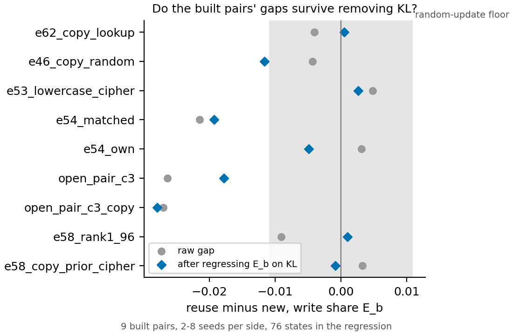
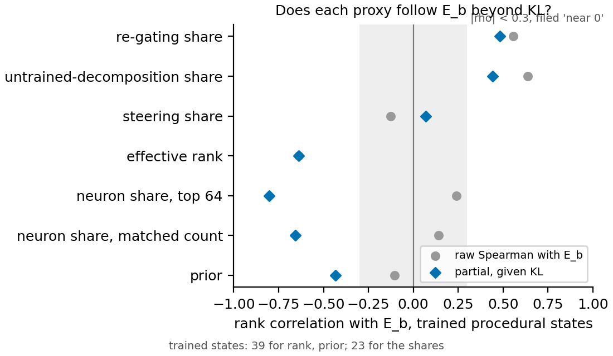

# Does the write share read anything beyond how far the output moved?

Cell P2.58, run E262, $0, saved results only. Script `experiments/kl_control/run.py`; numbers in
`experiments/kl_control/results/summary.json`; filed rules in `experiments/kl_control/results/predictions.json`.

We took the write share, definition (b)'s reading, on fine-tuned states that were already saved. We then removed from it
whatever can be predicted from how far the fine-tune moved the model's output, and asked what is left. Something is left.
On the built pairs, the three gaps that were larger than a random update's reading stay that large. On the procedural
fine-tunes, the re-gating share and the untrained-decomposition share still follow it. So definition (b) is not a
relabelled output distance, and the proxies that track it are not tracking only that distance.

## The answer

The write share does read more than output movement on trained fine-tunes. Across all trained states its rank
correlation with output KL is 0.73 on the procedural tasks, but only 0.38 on the built pairs. On the built pairs, KL
explains about a fifth of its spread. After KL is regressed out, the same three built pairs sit outside the random-update
floor, all with the new-skill fine-tune reading higher. Among the proxies, the two decomposition shares keep a moderate
correlation once KL is held fixed. The neuron share turns strongly negative.

## What we were trying to test

The write share $E_b$ is definition (b)'s per-state reading. It counts reuse over the changed parts only, weighted by how
much each part changed. It reads 1 for an update that changes nothing and about 0.01 for a random weight change of the
same size. On P2.56's procedural fine-tunes it had a rank correlation of 0.73 with KL from the unchanged model, the
highest of any proxy. That raised the worry that the definition just measures how far the output moved.

Two checks, both on trained states only. The random-update arms are reported apart and never pooled.

- **Built pairs.** These are E257's nine pairs of fine-tunes. Each pairs a task built to reuse an existing skill with one
  built to need a new one, with the new side rescaled to the reuse side's weight-change size. We regress $E_b$ on KL by
  ordinary least squares over the 76 unique states and compare each pair's gap, reuse minus new, before and after. KL here is
  $\mathrm{KL}(F \,\|\, M)$ on the task's windows, saved by E205. Update norm is also tried as a regressor; since the pairs are
  norm-matched by construction, it cannot move a gap.
- **Procedural states.** These are P2.56's 39 trained states: RL, guarded RL and SFT on three procedural tasks, plus E220's
  twelve repeat-task states. For each proxy we take its Spearman correlation with $E_b$, then the partial Spearman given KL.
  That is the correlation of the ranks once each rank vector's linear dependence on KL's ranks is removed. It is 0 when a
  proxy agrees with $E_b$ only through KL.

## What we expected, and why

The card filed two rivals. If $E_b$ is mostly output movement, every residual pair gap falls inside the random floor of
0.011, and every proxy's partial correlation is under 0.3 in size. If $E_b$ reads something else, the three pairs outside
the floor stay outside with the same sign, and at least one proxy keeps a partial correlation of 0.3 or more.

## The built pairs keep their gaps once KL is removed

**Reading it.** The gaps survive. The three pairs with the new side clearly higher stay there after KL is regressed out. The
first matched copy-against-cipher pair moves from −0.021 to −0.019. The open pair built on rank-1 edits moves from −0.026 to
−0.018, and the copy-against-cipher pair from the same set stays at −0.028. One more pair crosses the floor: copy against a
random map, at −0.012, just outside 0.011. The pairs with small raw gaps stay small. KL explains 21% of the variance of $E_b$
across the 76 states; log KL explains 25%, and gives the same three pairs outside the floor.

## The decomposition shares still follow the write share once KL is fixed

**Reading it.** Two proxies keep their agreement and one reverses. The re-gating share goes from 0.56 to 0.48, and the
untrained-decomposition share from 0.64 to 0.44, on 23 states each. Effective rank stays at −0.64, so its link to $E_b$ was
not through KL either. The neuron share goes from 0.24 to −0.80: once KL is fixed, states where more of the gain sits in the
top neurons read lower on the write share. Steering stays near 0. Without E220's three far-out repeat states, the two
decomposition shares read 0.54 and 0.51, so those points do not carry the result.

| proxy | raw | given KL | states | given KL, no repeat task | states |
|---|---|---|---|---|---|
| re-gating share | 0.56 | 0.48 | 23 | 0.54 | 20 |
| untrained-decomposition share | 0.64 | 0.44 | 23 | 0.51 | 20 |
| effective rank | −0.64 | −0.64 | 39 | −0.55 | 27 |
| neuron share, top 64 | 0.24 | −0.80 | 23 | −0.79 | 20 |
| neuron share, matched count | 0.14 | −0.66 | 23 | −0.66 | 20 |
| prior | −0.11 | −0.43 | 39 | −0.16 | 27 |
| steering share | −0.13 | 0.07 | 23 | 0.09 | 20 |

The random arms, read apart over 18 states, give a write-share-to-KL Spearman of 0.41, with both at their floors.

## What we learned

Definition (b) is not a relabelled output distance on trained fine-tunes. Its high correlation with KL on the procedural
states comes partly from how those states spread, and the built pairs' gaps owe little to KL. For claim 2, the two
decomposition shares track the definition beyond output movement, which output KL itself cannot do. The neuron share's
reversal says it is mostly a size reading that runs against the definition once size is fixed.

## How compelling is the evidence

The regression is linear and pooled across pairs from different tasks, so a nonlinear KL effect could remain; log KL gives the
same count. The partial correlations rest on 23 states for the share-type proxies; at that n a partial of 0.48 is about
two standard errors from 0. That count treats states as independent, but they come from a few tasks and methods, so the
real uncertainty is wider; no resampling by task was run. The neuron share's flip from weakly positive to strongly
negative is the pattern a suppression effect gives, where the proxy and KL share a large size component. Read it as a
flag, not as a negative association. KL is measured differently in the two parts, so the two parts' slopes are not comparable. The
positive control read 0.95, below its filed 1.0: the residual is re-ranked inside the partial Spearman, which should keep it
below 1. That cause is not checked. The other control, KL given KL, read null as filed. The raw pair gaps equal E257's
to the last digit.

## Surprises

The neuron share's partial correlation is strongly negative, −0.80, where its raw value was weakly positive. Nothing filed
predicted its sign.

## What next

- Read the neuron share's reversal: is it the size of the top-64 gain set moving with KL? If so, it is a size reading, and
  the paper should say so beside the neuron baseline.
- If claim 2 cites a proxy's agreement with the definition, cite the partial given KL, not the raw correlation.

## Scorecard

| rule | read | verdict |
|---|---|---|
| rival a: 0 of 9 residual gaps outside ±0.011, all partial \|rho\| < 0.3 | 4 of 9 outside; five proxies at \|rho\| ≥ 0.3 | not met |
| rival b: the 3 raw-outside pairs stay outside, same sign; one proxy \|rho\| ≥ 0.3 | 3 of 3 stay, same sign; five proxies | met |
| control: KL given KL null | null | as filed |
| control: R_b residual given KL 1.0 | 0.95 | missed, see above |
| raw gaps equal E257's | equal | as filed |

## Departures from the literature

None. Partial Spearman is the standard partial correlation of rank vectors.

## Not run

- No new KL or new states: every number is from saved files.
- Within-pair regression: with norm-matched sides, KL separates the sides within a pair and would absorb the gap.
- Bootstrap intervals on the partial correlations.
- The neuron share's top-64 set size against KL.

Provenance: `experiments/kl_control/results/summary.json`; CPU on the cluster worker, seconds, $0.
