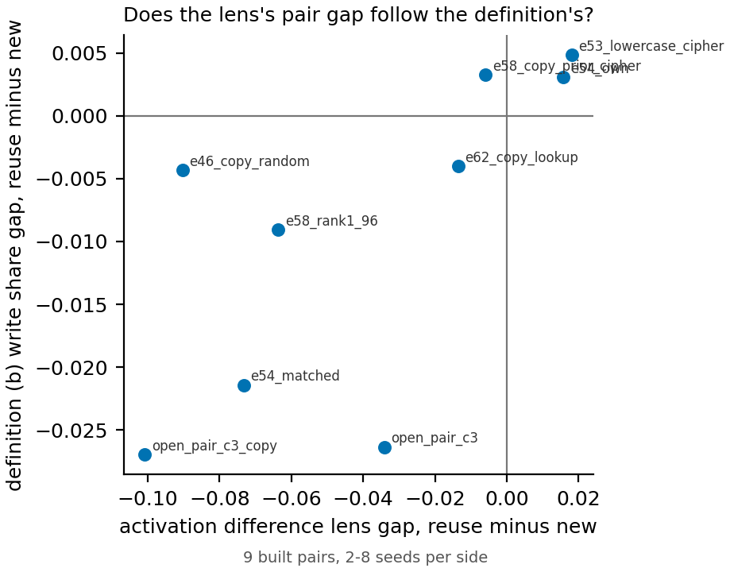

# Does the activation difference lens track definition (b) on the built pairs?

Cell P2.59, run 2, E265, cluster debug jobs 63422 and 63425, about 5 min, $0. Amendment
`experiments/adl/results/amend1/predictions.json`; readings `experiments/adl/results/amend1/column.json`; comparison
`experiments/adl/results/amend1/compare.json`, written by `experiments/adl/compare.py`. Run 1, which failed its control, is
`reports/analyses/2026-11-22_analysis_e264-adl-stage0.md`.

We reran the activation difference lens of Minder et al. 2025 on the 67M model with a control whose change is the same on
every input. That control passed, though only at the edge of its bar, and the lens was then read on the nine built pairs and
the five key tasks. Across the nine pairs, the lens's gap follows definition (b)'s gap closely, more closely than any other
baseline, so a cheap model-diffing reading lines up with the adopted definition, while the re-gating share does not.

## The answer

On the nine built pairs, the lens reads the new-skill fine-tune higher than the reuse one in seven. Its gap has the same sign
as definition (b)'s write-share gap in eight of nine, with a rank correlation of 0.83. The re-gating share agrees in sign on
three and the crosscoder on one. The lens's positive control passed by a hair, and its logit lens never names an answer
token, so this is a provisional, descriptive reading, not a verdict.

## What was done

The lens direction is the mean, over 8,192 rows of the model's own pretraining text, of the fine-tuned model's
activation minus the base model's, at block 2's input and each of the first five positions. Its score is the paper's
causal test. In the fine-tuned model, the component along that direction is set back to the base model's value. The score
is the share of the fine-tune's answer log-odds gain that this loses, at the best of the five positions. It reads 0 for an
unchanged model and about 0 for a random update of the same size. The method and its six departures from the paper are in
`reports/plans/2026-11-22_plan_p2-59-adl.md`.

Run 1's control, a copy fine-tune, failed. Its change depends on the key in the prompt and cancels in a mean over unrelated
text. Run 2 swapped only the control, to the lowercase fine-tune, whose change is one constant shift. Bars, score and items
stayed as filed.

## The control passed, at the edge

- The zero update gives exactly 0. The control's gain repeats its earlier reading of 1.67213.
- The control's score is 0.0500022, against a bar of 0.05. It clears the 64 random directions' largest, 0.0296, and the
  random update plus three standard deviations, 0.0109.
- The filed logit-lens check missed. No answer token is in the control's top 20 at any position, where two were expected.

## The lens's pair gaps follow the definition's

**Reading it.** Yes, closely, on these nine pairs. Pairs where the definition reads the new side higher sit to the left,
where the lens also reads it higher. The three pairs where the definition reads reuse higher sit at or near the lens's zero
or to its right. Seven of nine lens calls are "apart" by seed ranges. The pair-side random updates read under 0.006 in size,
against gaps of 0.006 to 0.10.

| pair | write share gap | lens gap | re-gating share gap | crosscoder gap |
|---|---|---|---|---|
| copy vs lookup | −0.0040 | −0.013 | 0.69 | 0.013 |
| copy maps vs random maps | −0.0043 | −0.090 | 0.51 | −0.033 |
| lowercase vs ciphers | 0.0049 | 0.018 | 0.62 | −0.14 |
| half-known vs cipher, equal size | −0.021 | −0.073 | 0.52 | 0.028 |
| half-known vs cipher, own steps | 0.0031 | 0.016 | 0.51 | −0.18 |
| rank-1 vs cipher, step 10 | −0.026 | −0.034 | 0.62 | 0.094 |
| copy vs cipher, step 10 | −0.027 | −0.10 | 0.61 | 0.11 |
| rank-1 vs cipher, 96 keys | −0.0090 | −0.064 | 0.56 | 0.028 |
| copy vs prior-matched cipher | 0.0033 | −0.0059 | 0.39 | −0.34 |

Rank correlation of each baseline's gap with the write-share gap over the nine pairs: lens 0.83, steering 0.33, neuron 0.20,
re-gating share −0.28, crosscoder −0.92. Sign agreement: lens 8, neuron 5, share 3, steering 3, crosscoder 1.

On the five key tasks, only cipher reads clearly: 0.060 to 0.083 against random updates under 0.001. The other four sit
within 0.01 of zero.

## How compelling is the evidence

Nine pairs, with two pairs sharing one reuse side, is a small count. The lens's control cleared its bar by two millionths, and
its logit lens did not name the task, so the direction it removes is real in effect but not readable as the task. The lens may
follow how far the output moved. The new-skill fine-tunes moved the output further on most pairs, and the write share's own
gaps survive a KL control (P2.58), but the lens's were not tested against KL. An independent recomputation from the saved item files was
made afterwards, in P2.60, and reproduced every number here; see "Later checks" below. That is
needed before this enters the paper's answer paragraph.

## Surprises

The crosscoder's gaps run against the definition's, with a rank correlation of −0.92. Nothing filed predicted that, and
it was not examined here.

## What next

- Regress the lens gap on output KL per pair, as P2.58 did for the write share: if it vanishes, the lens is a size reading.
- An independent recomputation of the 0.83 from the saved item files, if the paper cites it.

## Scorecard

| filed | read | verdict |
|---|---|---|
| do-nothing exactly 0 | 0 | as filed |
| control gain 1.67213 within 1e-4 | 1.6721290 | as filed |
| D(control) in 0.05 to 0.8 | 0.0500022 | at the lower edge |
| lens: two answer tokens in the top 20, best rank under 169 | none; best rank 271 | missed |
| pairs: descriptive, no count filed | lens sign matches write share on 8 of 9 | no verdict |

## Departures from the literature

Listed in the plan: a port to our hooks; the model's own pretraining text; no Patchscope or graded relevance; the causal effect
read as answer log-odds; random directions from pretraining text; no steered generation. Run 2 adds a control chosen after run 1 failed.

## Not run

- The lens gap against output KL.
- The steering-share version.
- An independent check of the rank correlation.

## Later checks (P2.60)

Three checks followed, all descriptive, in `reports/analyses/2026-11-22_analysis_p2-60-adl-checks.md`. An independent
recompute from the item files reproduced every gap, correlation and sign count above. Regressing the lens score on output
KL left eight of nine pair gaps outside the random floor, so the agreement is not output size. But read on new states, the
lens did not separate copy from prior-matched ciphers, where the other cheap readings did, and on procedural fine-tunes it
ranked states against definition (b). The lens should not be cited as tracking the definition in general.
