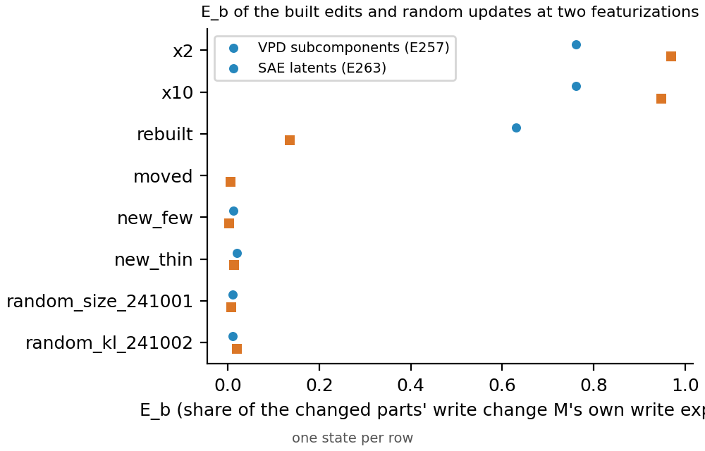

# E_b at the SAE featurization (E263, cell P1.52)

We measured the adopted reading of reuse, the share of the changed parts' write change that the original model's own
write explains, on the saved SAE states, with the SAE latents as the parts instead of VPD's subcomponents. The two gain
edits read close to 1 and every new edit and random update reads near 0, as at VPD, but the rebuilt-circuit edit falls
from about two thirds to about one eighth, so the filed bar of a 0.2 margin is missed. The fall sits almost entirely in
the SAE's reconstruction error, which carries most of that edit's change; over the latents alone the order holds with
room to spare. So the definition reads the same order at both featurizations, but only when the featurization actually
represents the changed writes.

## What was run
One write-change pass per saved state (114 states: six built edits, 17 random updates, the nine pairs' states, the
fifteen key-task states), on cluster debug L40s, jobs 63389-63392, about 12 minutes, $0. K* is E245's or E251's saved
search, unchanged. Each job read the do-nothing first: no changed site, write change exactly 0, E_b exactly 1, on all
four.

## Result

Gain edits: x2 reads 0.969 and x10 0.947 at SAE (both 0.76 at VPD). New edits and randoms: at most 0.020 at SAE
(random_kl_241002). Rebuilt reads 0.135 at SAE against 0.631 at VPD. The filed rule P1 takes the lowest reuse edit
minus the highest new or random: 0.115, under the 0.2 bar, so it **reads rival b as filed**. The order itself is kept
(rebuilt is still about seven times the highest random).

Where the fall comes from: the eight SAE remainders (each site's reconstruction error, one part per site) carry 0.83 of
rebuilt's write change in K*, against 0.02-0.03 for the gain edits. M's remainder hardly explains F's remainder, so
that share reads as new. With the remainders left out of both sums (descriptive, not filed), rebuilt reads 0.789 and
the highest random 0.076. The pairs and key tasks read 0.028 to 0.082 at SAE, and the nine pairs' reuse-minus-new gaps
are within 0.03 of zero at both featurizations, as at VPD. The moved edit reads 0.005 (no VPD value to compare).

Gains match E245's saved ones: the largest per-variable relative difference is large on latents M barely writes (the
pod-read items ran on a different card than this run), but weighted by write change it is at most 1.7e-5.

Results: `experiments/sae_eb/results/summary.json`, per state `results/items/`.

## Not run
- E_b at SAE for the RL states and compare-lead's P2.56 states (no saved SAE K* for them).
- An SAE trained to reconstruct the fine-tuned model's writes (would shrink the remainder; a new cell).
- The moved edit at VPD (E257 has no reading for it).
