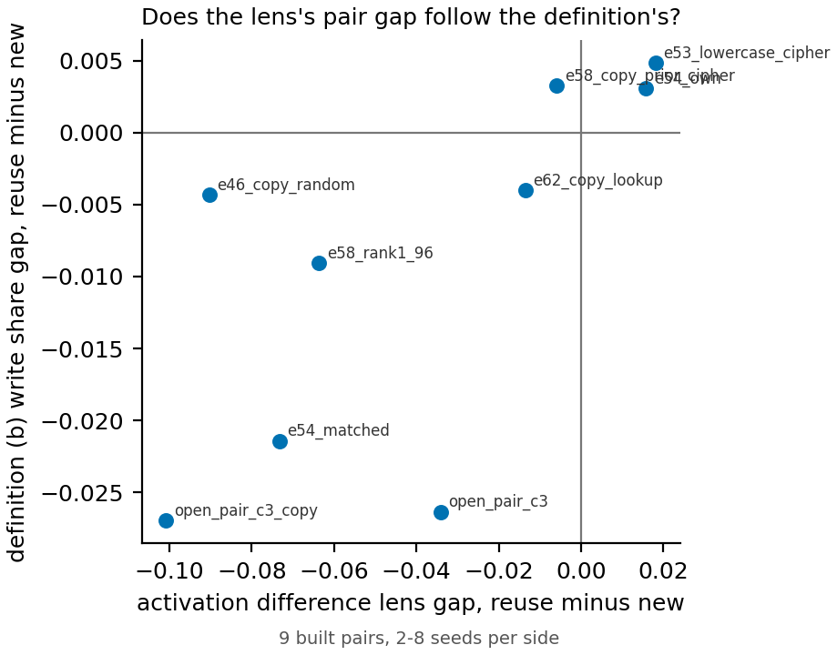
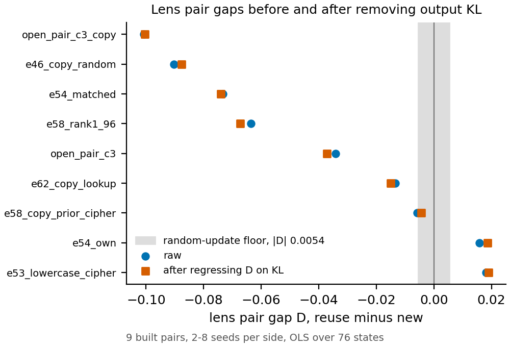
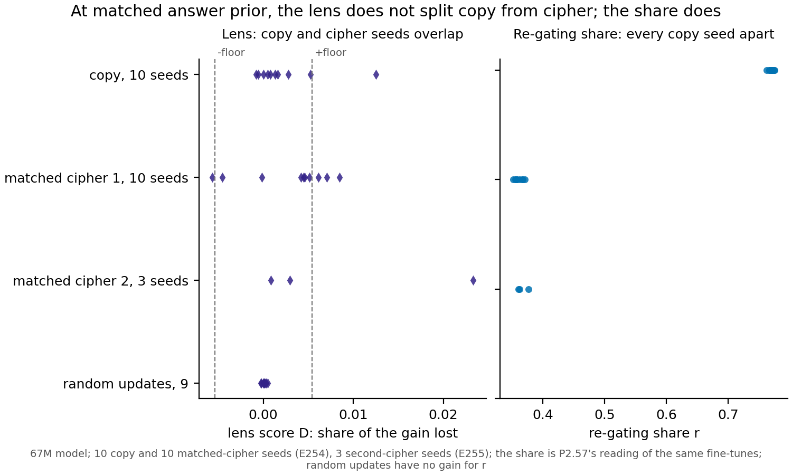
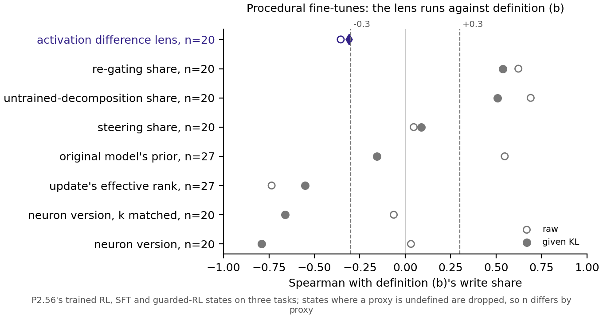

# Does the activation difference lens still track definition (b) once it is checked three ways?

Cell P2.60, three descriptive checks, all $0: an independent recompute from saved item files, a KL control over saved
results as E266, and the lens read on new states as E267, cluster debug job 63454. No claim is made at a bar: the user
approved these as cheap readings reported as read.

The day before, the activation difference lens of Minder et al. 2025 agreed with definition (b) on nine built pairs of
fine-tunes better than any other baseline. We recomputed that agreement independently, removed output movement from it,
and read the lens on two new sets of fine-tunes. The agreement is real and is not output size, but it does not carry to
pairs with matched answer prior or to procedural fine-tunes, so the lens is not a general tracker of the definition.

## The answer

An independent recompute reproduced the lens's agreement with definition (b) on the nine built pairs exactly, and
regressing out output KL kept most of it, at a rank correlation of 0.70 against 0.83 before. But on copy against
prior-matched ciphers the lens did not separate the seeds, at p 0.44 and 0.22, where all eight cheap readings in P2.57
did. On procedural fine-tunes it ran against the definition, with a partial rank correlation of −0.31 given KL on 20
states. So for claim 2 the lens's built-pair agreement is reproducible and not output size, but it should not be cited as
tracking the definition in general.

## What we were trying to test

**The lens.** For each fine-tune, the lens direction is the mean difference between the fine-tuned and the base model's
activations at block 2's input, at each of the first five positions, over 8,192 rows of pretraining text. The lens score
$D$ is the share of the fine-tune's answer log-odds gain that is lost when the component along that direction is set
back to the base model's value, at the best of the five positions. It reads 0 for an unchanged model and about 0 for a
random weight change of the same size. The method and its departures from the paper are in
`reports/plans/2026-11-22_plan_p2-59-adl.md` and the run that set it up in
`reports/analyses/2026-11-22_analysis_e265-adl-column.md`.

**The thing it is compared with.** The write share $E_b$ is definition (b)'s per-state reading. It counts reuse over the
parts of the model the fine-tune changed, weighted by how much each changed. A pair's gap is the reuse side's seed mean
minus the new side's.

**What the earlier run found.** On nine built pairs, each a fine-tune built to reuse an existing skill against one built
to need a new skill, the lens's gap had the same sign as $E_b$'s on eight pairs. Its rank correlation with $E_b$'s gaps
was 0.83, the best of the baselines. Three things could undercut that, and each check rules one out.

- **A bug in the comparison.** A fresh agent recomputed every method's nine gaps, rank correlations and sign counts from
  the saved per-state files, without reading the comparison code.
- **Output size.** The new-skill fine-tunes moved the output further on most pairs. If the lens reads only how far the
  output moved, removing KL from the unchanged model should collapse its gaps. We regressed $D$ on KL over the 76 states
  of the built pairs, by ordinary least squares, and recomputed each pair's gap from the residuals. The floor is the
  largest $|D|$ over the 18 random updates of the pairs' sizes, 0.0054.
- **Built pairs only.** Nine pairs is a small set built by hand. We read the lens on two new sets of fine-tunes whose
  other readings were already known.
  - *Prior-matched pairs.* Ten seeds of key copy against ten seeds of a cipher whose answers the base model finds about
    as likely, plus three seeds of a second such cipher. Copy uses the base model's copy heads and the ciphers do not, so
    the mechanism differs while the answer prior barely does. Six and three random updates of matched size are the
    references.
  - *Procedural fine-tunes.* RL, guarded RL and SFT on sequence, brackets and addition tasks, three seeds each, 27 trained
    states, with 18 random updates. Here the question is the rank correlation of $D$ with $E_b$ across states, and the
    partial rank correlation once KL is held fixed. The partial is the correlation of the ranks after each rank vector's
    linear dependence on KL's ranks is removed; it reads 0 when the lens agrees with $E_b$ only through KL.

## What we expected, and why

For the KL control, the card named two rivals. If the lens follows output movement, most of the seven pairs it called
apart fall inside the floor and the rank correlation drops below 0.5. If it reads the same difference as $E_b$, the four
large gaps stay outside the floor and the correlation stays at or above 0.5.

For the new states, the filed expectation was that the lens separates copy from the prior-matched cipher with the cipher
higher, with medium confidence. Its seeds 0 to 2 already ordered that way, though the gap sat at the floor. The copy seeds
were expected near 0.001 and the cipher seeds near 0.006. On the procedural states, $D$ was expected under the control's
0.05, since a change that depends on the prompt's cue has no one constant direction on unrelated text. The partial was
expected under 0.3 in size, with low confidence.

## What we observed

### Does the agreement reproduce from the saved items?

**Reading it.** Yes, exactly. The independent script read the per-state files and recomputed every number in the earlier
comparison. The lens's rank correlation with $E_b$'s gaps is 0.83 and its sign agreement is eight of nine. The re-gating
share's correlation is −0.28 and the crosscoder's −0.92, as reported. The figure is the earlier run's and stands as drawn.
That agent also remarked that the lens read unscaled states. That remark was wrong. The lens multiplies the larger side of
each pair by the size factor the pairs were matched with. The KL control below checks, on all 76 states, that the lens's
update size equals the size at which the KL was saved.

### Do the lens's pair gaps survive removing output movement?

**Reading it.** Yes. KL explains about 0.2 percent of the spread of $D$ over the 76 states, so the residual gaps sit almost
on the raw ones. Eight of nine stay outside the grey floor of 0.0054. The one that falls inside is copy against the
prior-matched cipher, the pair where the lens already disagreed in sign with $E_b$. The rank correlation with $E_b$'s own
KL-residual gaps is 0.70, above the card's 0.5. Sign agreement with those residual gaps drops to six of nine. That is
because $E_b$'s gaps change sign on four pairs under the same regression, while the lens's keep their sign on all nine. Against
$E_b$'s raw gaps the lens still agrees on eight. The card's second rival holds: the lens's built-pair gaps are not output
size.

| pair | lens raw | lens after KL | $E_b$ raw | $E_b$ after KL |
|---|---|---|---|---|
| copy at a new marker vs lookup | −0.013 | −0.015 | −0.0040 | 0.00051 |
| copy maps vs random maps | −0.090 | −0.088 | −0.0043 | −0.012 |
| lowercase vs ciphers | 0.018 | 0.019 | 0.0049 | 0.0027 |
| half-known vs cipher, equal size | −0.073 | −0.074 | −0.021 | −0.019 |
| half-known vs cipher, own steps | 0.016 | 0.019 | 0.0031 | −0.0049 |
| rank-1 vs cipher, step 10 | −0.034 | −0.037 | −0.026 | −0.018 |
| copy vs cipher, step 10 | −0.10 | −0.10 | −0.027 | −0.028 |
| rank-1 vs cipher, 96 keys | −0.064 | −0.067 | −0.0090 | 0.00098 |
| copy vs prior-matched cipher | −0.0059 | −0.0044 | 0.0033 | −0.00087 |

Gaps are the reuse side's seed mean minus the new side's. The lens columns are this check's; the $E_b$ columns are the
earlier KL control of the write share. Regressing on update norm, or on KL and norm together, left all nine outside the
floor, with rank correlations of 0.83 and 0.80.

### Does the lens split copy from cipher when the answer prior is matched?

**Reading it.** No. On the left, the ten copy seeds and the ten seeds of the first matched cipher spread over the same
range of $D$, and most of both sit inside the random floor. The cipher's mean is only 0.0006 above copy's, at a rank
test p of 0.44. The second cipher's mean sits 0.0067 above copy's, but one of its three seeds carries that, and the rank
test reads p 0.22. The random updates sit near 0, under 0.001. On the right, the re-gating share reads the same
fine-tunes. It is the share of the gain carried by changes in which of the decomposition's subcomponents are switched on.
Every copy seed sits near 0.77 and every cipher seed near 0.36, with no overlap. All eight cheap readings of P2.57
separated these seeds the same way. So the lens's agreement with the definition on the built pairs does not hold where
the answer prior is matched.

| set | seeds | mean $D$ | range of $D$ | rank test p vs copy |
|---|---|---|---|---|
| copy | 10 | 0.0023 | −0.00080 to 0.012 | |
| first matched cipher | 10 | 0.0030 | −0.0057 to 0.0085 | 0.44 |
| second matched cipher | 3 | 0.0090 | 0.00082 to 0.023 | 0.22 |
| random updates | 9 | | largest $|D|$ 0.00052 | |

For reference, the re-gating share separated copy from the first cipher at p 1.1e-5 and from the second at p 0.007,
the smallest values those seed counts allow. The run's control repeated the earlier run's to every digit: $D$ 0.0500022
on the lowercase fine-tune, whose gain repeated 1.67213.

### Does the lens follow definition (b) on procedural fine-tunes?

**Reading it.** No; it runs against it. Its rank correlation with $E_b$ is −0.35 across the trained states where $D$
is defined. Once KL is held fixed it is −0.31. The re-gating share and the untrained-decomposition share keep partials
of 0.54 and 0.51 on the same states. Effective rank and the two neuron versions are also negative, at −0.55, −0.66 and
−0.79. The prior and steering sit near 0. $D$ ranges from −0.23 to 0.14 across trained states, and the SFT states read
positive on seven of nine while the RL and guarded RL states fall on both sides of 0.

$D$ is undefined on 14 of the 45 states, those whose gain is under the floor of 1 log-odds unit. These are the six RL and
guarded RL states that collapsed onto one answer token, guarded RL on addition seed 0 whose gain is −0.18, and seven random updates.
The card asked for both the 27 trained states and the 21 without the collapsed ones. Both sets reduce to the same 20
states, so the two tables read the same for the lens. Where $D$ is defined on the random updates, it is under 0.006.

| proxy | rank correlation with $E_b$ | given KL | states |
|---|---|---|---|
| activation difference lens | −0.35 | −0.31 | 20 |
| re-gating share | 0.62 | 0.54 | 20 |
| untrained-decomposition share | 0.69 | 0.51 | 20 |
| steering share | 0.047 | 0.087 | 20 |
| original model's prior | 0.55 | −0.16 | 27 |
| update's effective rank | −0.74 | −0.55 | 27 |
| neuron version, k matched | −0.063 | −0.66 | 20 |
| neuron version | 0.032 | −0.79 | 20 |

On the 27 trained states, $E_b$'s own rank correlation with KL is 0.74.

## What we learned

The lens's agreement with definition (b) on the nine built pairs is real: it reproduces from the saved files and it is
not output size. But it is a property of those pairs, not of the lens. Where copy and cipher differ in mechanism and not
in prior, the lens cannot tell them apart, though every other cheap reading could. On procedural fine-tunes it ranks
states against the definition. So claim 2 should not cite the lens as tracking the definition, and its built-pair
correlation of 0.83 should be reported beside these two failures if it is reported at all.

## How compelling is the evidence

- **Built pairs.** Nine pairs, two sharing one reuse side. The lens's seed spread on them is larger than the floor,
  which is why the card made no claim at a bar.
- **Prior-matched pairs.** Ten against ten and ten against three seeds, one task family on the same 96 keys. The lens
  reads most of these fine-tunes inside its own random floor, so it may simply be too weak on this task to read
  anything, rather than reading the prior. Either way it does not separate the pair.
- **Procedural states.** 20 states with a defined score, from three tasks. At that count a partial of 0.31 in size is
  not far from noise; the sign, against the two decomposition shares, is the reading.
- **What the lens is blind to.** A change that depends on the prompt has no one constant direction on unrelated text.
  The lens's control is a constant shift, and it passed only at the edge of its bar. Its logit lens named no answer
  token on the control in either run.

## Surprises

The filed expectation for the prior-matched pairs was that the cipher reads above copy and apart, with medium
confidence. It came out as overlap on both sets. The filed expectation for the procedural partial was under 0.3 in size;
it read −0.31, just past that, and negative.

## What next

- If claim 2 needs a model-diffing baseline, report the lens as agreeing on the built pairs and failing on the two new
  sets, beside the re-gating share, which held on all three.
- A lens read at more positions or on task text rather than pretraining text would test whether the prior-matched
  failure is the lens being too weak here. Only worth running if the paper keeps the lens as a named baseline.

## Scorecard

| check | rule | read | verdict |
|---|---|---|---|
| independent recompute | every gap, correlation and sign count equal | all equal | reproduced |
| KL control, rival a | at least 4 of the 7 apart pairs inside the floor, signs at most 6 of 9, rank correlation under 0.5 | 1 inside; 6 of 9; 0.70 | not met |
| KL control, rival b | the 4 large gaps outside the floor and rank correlation at least 0.5 | 4 of 4; 0.70 | holds, descriptive |
| new states, control | repeats the earlier control's $D$ and gain | equal to every digit | passed |
| prior-matched pairs | cipher above copy and apart, p at most 0.01 and gap above 0.0054 | overlap, p 0.44 and 0.22 | expectation missed; rival b |
| procedural partial | rival a at least 0.3, rival b under 0.3 in size | −0.31 | neither; negative |

## Departures from the literature

None beyond the lens's own, listed in `reports/plans/2026-11-22_plan_p2-59-adl.md`: a port to our hooks, the model's own
pretraining text, no Patchscope or graded relevance, the causal effect read as answer log-odds, random directions from
pretraining text, no steered generation. The procedural states are read at the cue, the last prompt position, as their
own run read them.

## Not run

- The lens on Qwen3-1.7B.
- The lens at more than five positions or on task text.
- Bootstrap intervals on the procedural partials.
- A KL control of the lens on the prior-matched pairs: their outputs moved by similar amounts.

## Provenance

- Recompute: `experiments/adl/check_independent.py`, writing `experiments/adl/results/amend1/check_independent.json`.
- KL control, E266: `experiments/adl/kl_control.py`; filed `experiments/adl/results/kl/predictions.json`; read
  `experiments/adl/results/kl/summary.json`; figure `experiments/adl/figures/adl_kl_gaps.png`. CPU over saved files, $0.
- New states, E267: `experiments/adl/amend2.py`; cluster debug job 63454 on an L40, $0; filed
  `experiments/adl/results/amend2/predictions.json`; `stage0.json`, `summary.json` and `items/` in
  `experiments/adl/results/amend2/`; log `run.log`.
- Comparison readings: P2.57's `experiments/prior_matched/results/a/summary.json` and `b/summary.json`; the write share's
  KL control in `experiments/kl_control/results/summary.json`.
- Figures: `experiments/adl/plot_p260.py`, writing `experiments/adl/figures/adl_prior_matched.{png,pdf,csv}` and
  `adl_procedural_partial.{png,pdf,csv}`.
