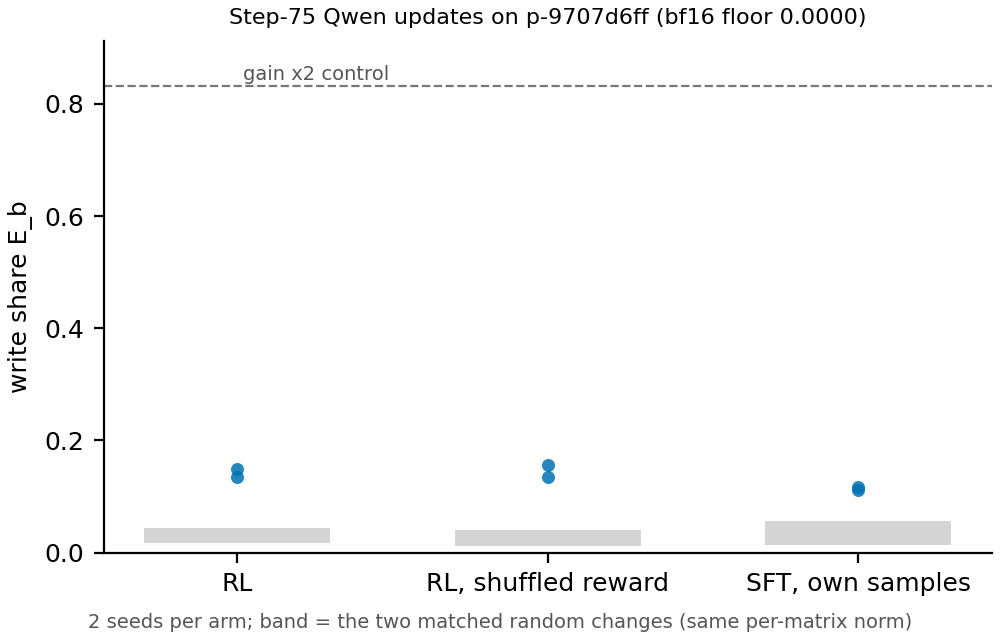

# The write share on Qwen3-1.7B's fine-tunes (P3.14, E270)

We took six saved Qwen3-1.7B fine-tunes (RL, an RL run on shuffled rewards that collapsed, and supervised fine-tuning on
the model's own samples, two seeds each) and asked how much of each update's change to every subcomponent's output lies
along what that subcomponent already writes. Every update sits clearly above a random change of the same size, but the
collapsed run sits as high as real RL. So on Qwen the write share tells a trained update from a random one, but it does
not tell real learning from collapse, and it gives no reused-against-new verdict.

**What was read.** The write share E_b is, over all subcomponents of the new decomposition (p-9707d6ff, all 196
matrices) on 64 maths rows, the fraction of the squared change in each subcomponent's output that lies along that
subcomponent's own existing output. It is 1 when the update only rescales what each part already writes, and near 0
for a change unrelated to it. Each step-75 update is read beside one Gaussian change with the same norm in every
matrix.

**Controls.** Doing nothing reads exactly 1. Doubling 32 chosen subcomponents per matrix reads 0.832, well above the
0.5 bar. A bf16 forward moves that by 4.6e-5, far below the 0.02 gap the card sets.

**Result.** The updates read 0.112 to 0.157 and their random changes 0.012 to 0.057, so every gap is positive: RL
+0.091 and +0.131, the collapsed run +0.123 and +0.116, own-sample SFT +0.055 and +0.105. All three arms are "above
random" under the filed rule, so the card's stop did not fire.

**What it means.** All three kinds of update sit well below the doubling control. Most of each change is not a
rescaling of existing writes, though more of it is than chance gives. The collapsed run reads like RL, so this
reading cannot separate learning a task from degrading the model. The random changes vary from draw to draw, from
0.012 to 0.057, so one draw per update is a noisy reference. On the 67M the random changes read about 0.011.

## Not run
- The pair library (reuse side against new side on Qwen), the cell's possible second run. Its sides are not yet fit
  to read: the cipher seeds memorised without a rule, and E219's word-pair gaps sit under their fit floor.
- More random draws per update. A spread from several draws would firm up the reference.
- No reused-against-new verdict on Qwen, as before.
