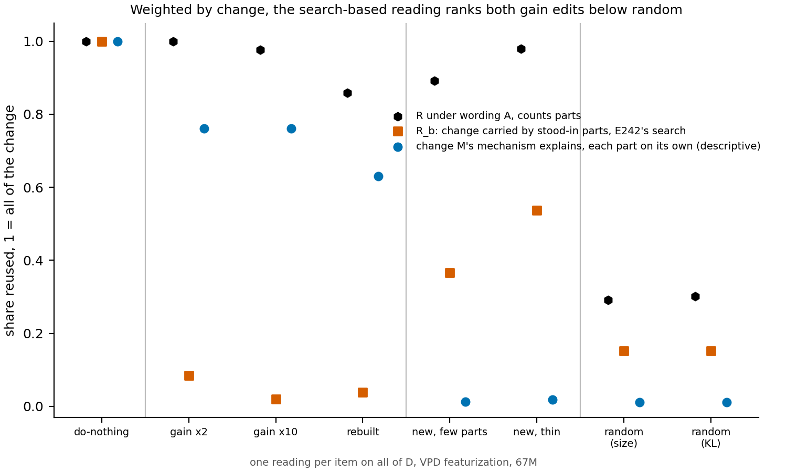
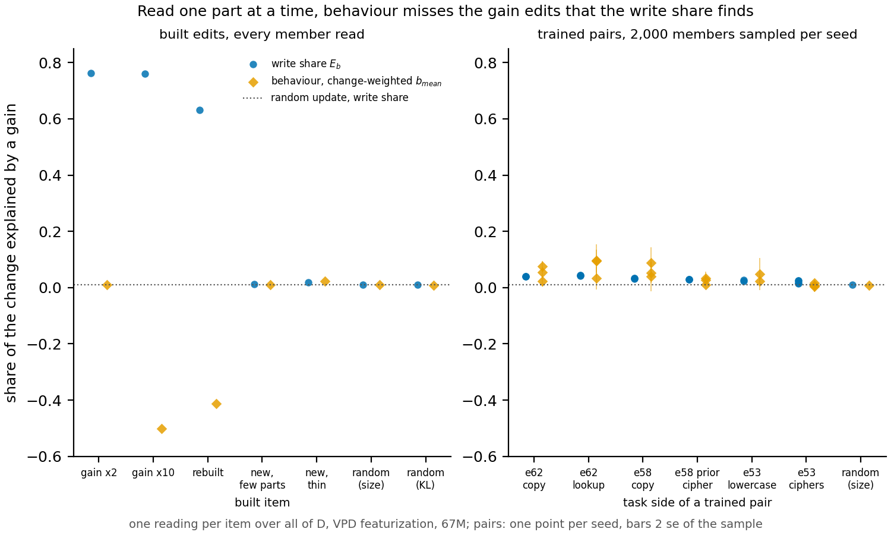

# Why read reuse as the base model's share of what the fine-tune changed?

*2026-11-22, definition-lead (writer agent). Justification for the paper's section 4 of the definition the user adopted
on 2026-11-21 and 2026-11-22, `decisions.md` rows "Option (b) adopted for reading reuse" and "Option (b) tests each
changed part by write". No new reading is computed here; every number is taken from the saved results named below.*

We gathered the evidence for the adopted reading of reuse: of what the fine-tune changed, the share that is the base
model's own output turned up or down. On hand-built edits with known answers it is the only version tried that puts
every reuse edit above every new edit and above random, where the older count and two rivals get the order wrong. It
gives the paper a cheap reading that passes known answers, but on trained fine-tunes it sits near the random floor and
partly follows update size, which the paper states as limits.

## The definition

A fine-tune F of a base model M is read through one fixed featurization taken from M: the variables are VPD
subcomponents plus one remainder per featurized site. For a behavior B on inputs D, the circuit K* is the smallest set of
variables that preserves B under mean ablation of the rest. A variable $u$ of K* is changed when its mechanism in F
differs from its mechanism in M. Write $w_F(u,x)$ and $w_M(u,x)$ for what $u$ writes at input position $x$ in each
model. Its write change is $dd_u = \sum_{x \in D} |w_F(u,x) - w_M(u,x)|^2$. The base model's mechanism at its best
output gain explains $e_u = (n_u - m_u)^2 / m_u$ of that change, with $n_u = \sum_x \langle w_F, w_M \rangle$ and
$m_u = \sum_x |w_M|^2$; $e_u$ is 0 when the best gain $n_u / m_u$ is not positive. The reading of reuse is the write
share $E_b = \sum_u e_u / \sum_u dd_u$ over the changed variables of K*. It reads 1 when every changed variable is M's
mechanism up to an output gain and near 0 when M's mechanisms explain none of the change. The do-nothing, with no
changed variable, reads 1 by convention. The untouched share of K* is reported beside it.

## Why count only changed parts?

The earlier wording, wording A, scored the share of K* whose mechanism is still M's, by count. Every variable the
fine-tune never touched therefore counted as reused for free. A hand-built new edit that writes eight new answers thinly
into one layer left 0.89 of its circuit untouched, and wording A read it at 0.98. That is above the rebuilt reuse edit at
0.86, whose circuit was only 0.63 untouched. Forcing every output gain back to one left the thin edit's reading where it
was, so the gains were not the cause; the untouched share was. A reading that counts only changed variables, each
weighted by its write change, cannot be raised by circuit that the fine-tune left alone.

## Why test each changed part by its write?

The write share needs no search and no bar. Each changed variable is fitted on its own with a closed-form gain, so the
sum does not depend on the order in which variables are visited or on where a search stops. It takes minutes per model
on saved activations. It also tests the thing reuse is about: whether the new mechanism is the old one rescaled.

## Does it get the known answers right?

**Reading it.** Yes for the order, not for the level. The blue circles are the write share. The do-nothing reads 1.
Both gain edits read 0.76 and the rebuilt reuse edit 0.63. Both new edits read 0.012 to 0.019, beside the random updates
at 0.011. The gain edits fall short of 1 because they double or multiply by ten the output weights of eight neurons. A
VPD subcomponent reads across many neurons, so that edit is not a pure strength change of any one subcomponent. Each
changed subcomponent's write is only about three quarters a rescale of M's, and the paper states that VPD reads a
neuron rescale as about three quarters a strength change.

| built edit | expected | untouched share of K* | R under wording A | search-based version, bar 0.1 | write share $E_b$ |
|---|---|---|---|---|---|
| do-nothing | reuse, by definition | 1 | 1 | 1 | 1 |
| gain x2 | reuse | 0.911 | 0.9998 | 0.084 | 0.762 |
| gain x10 | reuse | 0.907 | 0.976 | 0.020 | 0.761 |
| rebuilt | reuse | 0.626 | 0.859 | 0.038 | 0.631 |
| new, few parts | new | 0.728 | 0.892 | 0.366 | 0.012 |
| new, thin | new | 0.889 | 0.980 | 0.536 | 0.019 |
| random, matched size | floor | 0.00006 | 0.291 | 0.152 | 0.011 |
| random, matched KL | floor | 0.00006 | 0.301 | 0.151 | 0.011 |

## Why were the other versions rejected?

**The search-based version.** It took the set of changed variables that a search could stand in for M's mechanism while
keeping the output within a bar, and summed their change. The search keeps the fewest variables that reach the bar,
which are the largest writers whether or not they were strengthened. So the gain edits read 0.08 and 0.02, below the
random update at 0.15. The reading also moves with the bar. The random update reads 0.08 at a bar of 0.05, 0.15 at 0.1
and 0.28 at 0.2.

**Behaviour per part.** This version replaced one changed variable at a time by M's mechanism at its fitted gain and
asked how much of that variable's effect on the output went away. On the built edits it failed the strength control. It
read the gain edit by two at 0.011, the same as random, and the gain edit by ten and the rebuilt edit at -0.50 and
-0.41. The write share reads those three at 0.76, 0.76 and 0.63. Most single variables barely move the output, so a
few large ones decide the result, and one of them alone can push the output further than removing its change. On 18
trained fine-tunes from three task pairs, plus a random update, no variable passed the per-part bar. The behavioural
share stayed within 0.055 of the write share on every trained item.

## Stated limits

- **Trained fine-tunes read near the floor.** Supervised fine-tunes of nine task pairs read 0.015 to 0.062. A random
  update reads 0.011 and the built reuse edits 0.63 to 0.76. The new side read higher than the reuse side in
  six of nine pairs. Reinforcement learning on a repeat task read 0.10 to 0.22 per seed. That is five to eleven times
  supervised training on the same behaviour.
- **On trained states the reading partly follows update size.** Across 39 trained states its Spearman rank correlation
  with KL from the unchanged model is 0.73, the highest of the proxies tested. Pooled with 18 random states it is 0.90.
  Part of the score may therefore be how far the output moved rather than reuse.
- **Behaviour per part is not part of the definition.** A single variable barely moves the output, so read one at a time
  behaviour has no power at this scale. The definition tests writes, and is blind to whether the unexplained part of a
  write matters downstream.
- **The gain edits read 0.76, not 1**, because the featurization is VPD's and the edit rescales neurons.

## Departures from the literature

- The circuit K* follows sub-circuit analysis and mean ablation in Geiger et al. 2025, as in the working definition.
- Counting only changed variables, weighting by write change, and the closed-form gain fit are ours and have no source.
- Testing a variable by its write rather than by an intervention on the output departs from Geiger's soft intervention,
  which wording A used. The reason is the behaviour-per-part result above.

## Not run

- The write share on sparse autoencoder latents: their saved readings hold no per-latent write change.
- Behaviour read jointly over groups of changed variables, such as all of one layer, or at a gain fitted to the output.
- Behaviour per part on the six other task pairs, and on every member of the trained items rather than a sample.
- The trained-state correlation with KL without the three repeat-task reinforcement-learning states.
- A built edit that is a pure strength change of single VPD subcomponents, which would check the 0.76 shortfall directly.

## Sources

Every number above was checked against its file with `jq`.

- Thin edit, untouched shares, wording A: `reports/analyses/2026-11-21_analysis_thin-edit-diagnosis.md`,
  `reports/decisions/2026-11-21_decision_wording-a-at-vpd.md`.
- Built-edit table and search-based bars: `experiments/option_b_rescore/results/summary.json`, keys `.items[].E_b`,
  `.R_A`, `.untouched_share`, `.R_b`; page `reports/analyses/2026-11-21_analysis_option-b-rescore.md`; card
  `reports/decisions/2026-11-21_decision_rb-gain-control.md`.
- Behaviour per part: `experiments/rb_member_test/results/summary.json` and `experiments/rb_member_pairs/results/summary.json`,
  key `.items[].b_mean`, `.pass_share`; page `reports/analyses/2026-11-21_analysis_behaviour-vs-write.md`.
- Trained states: `experiments/rb_states/results/summary.json`; page `reports/analyses/2026-11-21_analysis_e257-eb-trained.md`.
- Correlation with KL: `experiments/procedural_rl/results/score_rb_trained.json` `.kl` and `score_rb.json` `.proxies.kl`;
  page `reports/analyses/2026-11-21_analysis_procedural-rl-sft.md`, table "Which proxies follow definition (b)".
