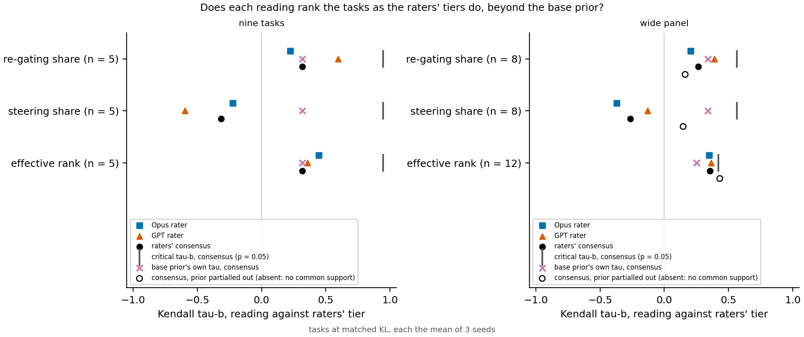
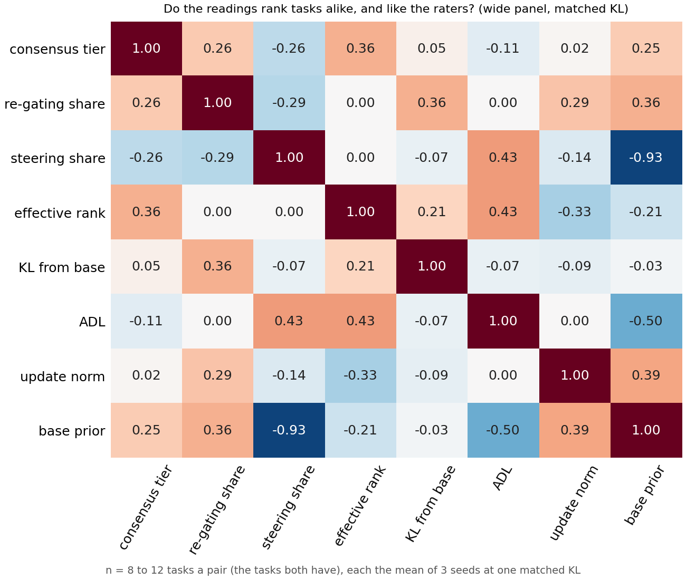
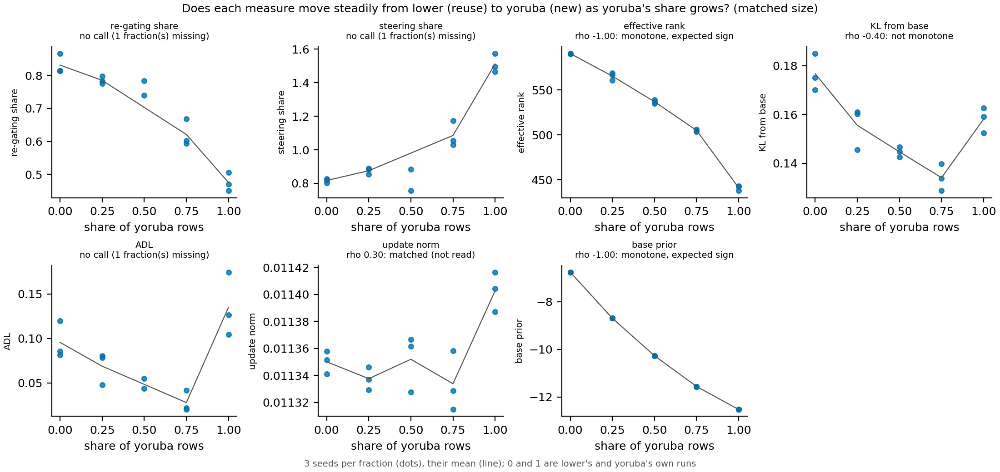

# Do the reuse readings sort realistic fine-tunes the way raters expect?

We fine-tuned the 67M model on ordinary tasks at matched output change and compared our reuse readings with blind
raters' tiers and with each other. On the wider panel only the update's effective rank sorted the tasks as the raters
did beyond the base prior, and the readings agreed with each other less than simple baselines did. So the panel does
not support the claim that the reuse readings converge on realistic tasks, and clear reuse tasks are nearly absent.

## The answer

On the scored wide panel of twelve tasks, one reading out of three passed the filed test against the raters' tiers:
the update's effective rank, and only after the base model's prior was partialled out. The re-gating share was too
weak to call and the steering share pointed the wrong way. The readings did not agree with each other more than the
baselines did, which reverses the filed expectation for the second hope. The mixture of a reuse task with a new task
moved the effective rank steadily, as expected.

## Before scoring

This was fixed before any reading was opened, in the plan's "Before scoring" section.

- **The nine-task Hope 1 cannot answer the question.** Its scored set, matched on KL at the high rung, kept five tasks:
  CoNLL, French, lowercase, SQuAD and Yoruba. With the consensus tiers the critical tau-b is 0.949, and power at a
  true tau of 0.3 is 0.06. Its reuse side is one task, lowercase. Its call is reported below, and a no call says
  nothing about the readings.
- **The scored wide set** is the KL high set of the 18-task panel, with twelve tasks kept. Its filed critical tau-b
  is 0.423, from Amendment 9 at `experiments/convergence_panel/results/wide/critical_tau_kept.json`. Its power at a
  true tau of 0.3 is 0.33. That is the n for the effective rank;
  the two shares lose four tasks to the gain floor, so they are scored on eight.
- **The size-matched sets are descriptive** and are never led with, whatever they show.
- **The reuse end is nearly empty, and that is a finding.** Pile text, code and British spelling fell out of every KL
  set: fine-tunes on Pile-like text gain too little on held data to reach the matched output change. A separate
  probe of three recipes, job 63813, found the same. In the wide panel English Wikipedia also fell out everywhere,
  so its reuse end at matched KL is arXiv abstracts and lowercase only.
- **The mixtures were read at matched update size**, not matched KL, because no mixture checkpoint came near the KL
  target; this was Amendment 8, filed before any mixture read.

## What we were trying to test

Each task is an ordinary fine-tune of the 67M model: continued text in a new language or register, a label task, or
a prompt task. Each runs with three seeds under one recipe. Checkpoints are chosen where every task has moved the
model's next-token distribution by the same KL from the base model, so that no task reads high just because it
changed the model more. On those checkpoints we read three reuse measures:

- the **re-gating share**, the share of the task's gain carried by changed causal importance values of the
  decomposition's subcomponents, where 1 means all of it;
- the **steering share**, the share of the gain reproduced by steering along the update's own directions;
- the **effective rank** of the update, where a higher rank was filed as more reuse following an earlier run.

A fourth, E_b over the interchange-needed subcomponents, was not run: it is a gated GPU stage. Four baselines sit
beside them: KL from the base model, the ADL difference score, the update's norm, and the base model's prior on the
task's targets.

Two blind raters, Opus and GPT, sorted every task into reuse, middle or new before any reading. The two hopes are:
the readings rank the tasks as the raters do, beyond what the base prior already explains; and the readings agree
with each other more than the baselines agree with each other. A task's value is the mean of its three seeds, and a
measure is read only when its spread between tasks exceeds its spread between seeds.

## What we expected

The filed predictions, both at low confidence: each reading's rank correlation with the consensus tier is positive,
and agreement among the readings is above agreement among the baselines. The reasoning was that measures validated on
built tasks would carry over to realistic ones.

## How well does the base prior alone sort the tasks?

The base prior already agrees with the raters. On the scored wide set its tau with the consensus tiers is 0.25 over
twelve tasks and 0.34 over the eight the shares keep. On the nine-task set it is 0.32. So a reading has to beat
this to say anything beyond "the base model was already good at it". The raters rank partly by pretraining
prevalence, which is why Amendment 3 made the prior-aware call the scored call.

| set | tasks | consensus | Opus | GPT |
|---|---|---|---|---|
| nine, KL high | 5 | 0.32 | 0.22 | 0.60 |
| wide, KL high, effective rank's tasks | 12 | 0.25 | 0.35 | 0.17 |
| wide, KL high, the shares' tasks | 8 | 0.34 | 0.45 | 0.22 |

## Does each reading rank the tasks as the raters do?

**Reading it.** Only the effective rank passed, and only on the wide panel. The figure shows each reading's rank
correlation with each rater: on the right, the effective rank sits near the prior's own tau, but with the prior
partialled out it rises to 0.43 at permutation p of 0.03. All three tier sets give the same call for it. The
re-gating share's correlation was positive but under its critical line, and the steering share's was negative for
every rater on both panels. On the nine-task panel nothing could pass: the critical lines sit near 0.9. One caveat
is real: the effective rank separates task formats. The two label tasks and CoNLL read 280 to 320, against 460 to
590 for every continued-text task, so part of its order may be task form rather than reuse.

| set | reading | rater | tau | p | partial tau on prior | p | call |
|---|---|---|---|---|---|---|---|
| nine | re-gating share | consensus | 0.32 | 0.32 | no common support | | no call |
| nine | re-gating share | Opus / GPT | 0.22 / 0.60 | 0.40 / 0.15 | no common support | | no call / no call |
| nine | steering share | consensus | -0.32 | 0.83 | no common support | | not positive |
| nine | steering share | Opus / GPT | -0.22 / -0.60 | 0.76 / 0.95 | no common support | | not positive / not positive |
| nine | effective rank | consensus | 0.32 | 0.33 | no common support | | no call |
| nine | effective rank | Opus / GPT | 0.45 / 0.36 | 0.24 / 0.31 | no common support | | no call / no call |
| wide | re-gating share | consensus | 0.26 | 0.23 | 0.16 | 0.31 | no call |
| wide | re-gating share | Opus / GPT | 0.21 / 0.39 | 0.31 / 0.14 | none / 0.34 | / 0.17 | no call / no call |
| wide | steering share | consensus | -0.26 | 0.84 | 0.15 | 0.32 | not positive |
| wide | steering share | Opus / GPT | -0.37 / -0.13 | 0.90 / 0.71 | none / 0.20 | / 0.29 | not positive / not positive |
| wide | effective rank | consensus | 0.36 | 0.08 | 0.43 | 0.03 | **positive** |
| wide | effective rank | Opus | 0.35 | 0.09 | 0.46 | 0.03 | **positive** |
| wide | effective rank | GPT | 0.37 | 0.08 | 0.42 | 0.049 | **positive** |

Critical tau-b on the consensus tiers: nine 0.949 with five tasks; wide 0.423 with twelve tasks for the effective
rank and 0.57 with eight for the shares. The effective rank's 90% task-bootstrap interval on the wide consensus is
-0.08 to 0.73, and dropping any one task leaves its tau between 0.23 and 0.50. The shares lose arXiv, German,
Spanish and sentiment because some seed's gain on the read rows was under the filed floor of 1 log-odds. "No common
support" means lowercase, the only reuse task, has a higher prior than every new-side task, so the prior cannot be
partialled out. The user's own sort is not filed in `predictions.json`, so there is no user-rater row.

## Do the readings agree with each other more than the baselines do?

**Reading it.** No: on the wide panel the readings agree with each other less than the baselines do. Across the
eight tasks all of them share, the readings' Kendall W is 0.25 and the baselines' is 0.29. Against random rankings
of the same size, the readings sit at the 0.305 quantile and the baselines at the 0.41 quantile, so the call is
"not above". The figure shows why: the re-gating share and the steering share rank the tasks in opposite orders, and
the effective rank is unrelated to either. The steering share follows the base prior almost exactly inverted, at a
tau of -0.93. On the nine-task panel the call is "no call", with both sides under their null.

| set | tasks | W readings | its null quantile | W baselines | its null quantile | null 95th percentile | call |
|---|---|---|---|---|---|---|---|
| nine | 5 | 0.11 | 0.08 | 0.09 | 0.06 | 0.69 | no call |
| wide | 8 | 0.25 | 0.305 | 0.29 | 0.41 | 0.60 | not above |

The readings are the re-gating share, the steering share and the effective rank; the baselines are ADL, update norm
and the prior, KL being the matched variable. With prior and update norm partialled out, the readings' W on the wide
panel rises to 0.40. The mean pairwise tau among the readings is -0.10 against -0.04 among the baselines.

## Does a mixture of reuse and new move the readings steadily?

**Reading it.** The effective rank fell steadily from the lowercase end to the Yoruba end, as expected. It read about
590 at pure lowercase and 441 at pure Yoruba, with the mixtures in order between. The base prior also falls
steadily, but it must: a mixture's prior is the average over its rows. The re-gating share fell and the steering
share rose across every seed, with 15-point rank correlations of -0.97 and 0.97, but neither can be called. One seed
of the half-and-half mix gained under the floor of 1 log-odds, so that fraction is missing. KL was free once size
was matched and did not move steadily: its rank correlation was -0.40.

| measure | rank correlation over 5 fractions | over 15 seeds | call |
|---|---|---|---|
| re-gating share | missing one fraction | -0.97 | no call |
| steering share | missing one fraction | 0.97 | no call |
| effective rank | -1.00 | -0.98 | monotone, expected sign |
| KL from base | -0.40 | -0.51 | not monotone |
| ADL | missing one fraction | 0.13 | no call |
| update norm | matched | | not read |
| base prior | -1.00 | -1.00 | monotone, expected sign |

Each mixture checkpoint's KL, seed by seed, at a matched update norm of about 0.0113:

| share of Yoruba rows | KL, seeds 0, 1, 2 |
|---|---|
| 0, lowercase | 0.170, 0.185, 0.175 |
| 0.25 | 0.145, 0.161, 0.160 |
| 0.5 | 0.147, 0.143, 0.145 |
| 0.75 | 0.140, 0.129, 0.134 |
| 1, Yoruba | 0.163, 0.159, 0.152 |

**Trajectory.** Along seed 0's training run, five checkpoints each: lowercase's effective rank moved monotonically and
Yoruba's jumped, out and back by more than three seed spreads. KL and update norm rose steadily on both, and the prior
is constant by construction. The two shares and ADL have missing points, because the first two checkpoints of each
run gained under the floor.

## What we learned

The reuse readings do not converge on realistic tasks at this size: two of the three rank the tasks in opposite
orders. The steering share mostly reports how unlikely the targets were under the base model. The effective rank is
the one reading that both followed the raters beyond the prior and moved steadily in the mixture, but it also
separates task formats. Expected-reuse tasks on Pile-like text cannot be matched on output change at 67M, so any
realistic panel here leans to the middle and new tiers.

## How compelling is the evidence

The wide panel has power 0.33 at a true tau of 0.3, so a no call for the re-gating share is weak evidence either way.
The effective rank's positive call rests on twelve tasks, two of them on the reuse side, and its partial p for the
GPT rater is just under the bar. Seeds are three per task; each measure passed the readability rule except KL on the
wide set, which is the matched variable, and E_b, which was not run. The tasks covered are listed in the tables;
the shares cover eight.

## Surprises

- **The second hope reversed on the wide panel.** The filed prediction was that the readings agree more than the
  baselines; they agree less, with the two shares in opposite order.
- The steering share's tau with the tiers was negative for every rater on both panels, against the filed positive
  direction; it is not significant on either.
- The steering share is nearly the inverse of the base prior: tau -0.93 on the wide panel.

## Departures from the literature

None beyond the plan's: label and prompt tasks use plain supervised fine-tuning on the answer rather than the earlier
arm A recipe; E_b is a sampled estimate when run, which it was not here.

## What next

- Run E_b on the wide KL set, the gated stage: if it agrees with the effective rank, the second hope could change.
- Read the effective rank within one task format only, continued text, to see whether its order survives without
  the label and prompt tasks.
- Add tasks on the reuse side that learn on held data at matched KL; without them neither hope can be read well.

## Scorecard

| id | claim | rule | read | verdict |
|---|---|---|---|---|
| H1, nine | readings rank tasks like the tiers | prior-aware tau call, KL high set | five tasks; share and effective rank no call, steering not positive | no call |
| H1, wide | same, 18-task panel | same, joint raters | effective rank positive for every rater; share no call; steering not positive | one of three positive |
| H2, nine | readings agree more than baselines | W against own-m null | both under null | no call |
| H2, wide | same | same | readings' quantile 0.305 against baselines' 0.41 | not above, reverses the filed "above" |
| Amendment 4, mixture | monotone dose-response | rank correlation at least 0.9 | effective rank and prior monotone; shares and ADL missing a fraction; KL not | descriptive |
| Amendment 4, trajectory | stable, monotone or jump | 3 seed spreads | lowercase effective rank monotone; Yoruba effective rank jump | descriptive |

## Not run

- E_b over the interchange-needed subcomponents, stage 3: gated, no go-ahead; it is unreadable in every set here.
- The extra rows from the procedural and RL experiments: not wired as read rows.
- The user's own sort of the tasks: not filed.
- The size-matched and low-KL sets are in `summary.json`, descriptive only; the low-KL sets have under five tasks.

## Provenance

`experiments/convergence_panel/results/summary.json`, written by `score.py` through `cpu-run`, CPU only, no cost.
Figures from `plot.py`: `figures/hope1.png`, `pairwise_tau.png`, `pairwise_tau_wide.png`, `mixture.png`, each with
its CSV. One code fix came before scoring. `score.critical_tau` took the exact permutation p as one minus a ratio,
which put an exact p of 6 in 120 just above the bar and then crashed on an empty set. It now takes the count ratio and
returns nan when no ordering reaches the bar; no rule, threshold or bar changed.
