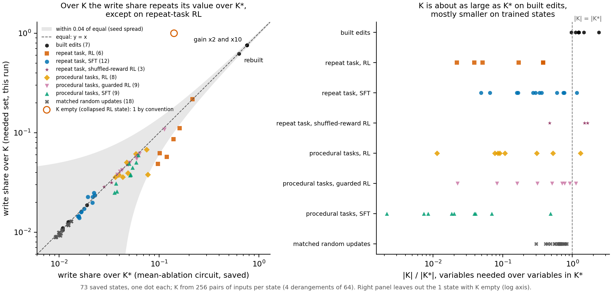

# Does the write share change when it is read over the needed variables instead of the mean-ablation circuit?

*P1.54 (E268), definition-lead, 2026-11-23. Descriptive: the card files no verdict ("Report K vs K\*, whether the
built-edit order and trained readings stand", user, 2026-11-22). Results `experiments/kstar_needed/results/`, figure
`experiments/kstar_needed/figures/eb_k.png`, card `experiments/kstar_needed/card.md`. The definition is the user's,
frozen 2026-11-22 (`theory/2026-11-22_definition_frozen.md`); nothing here changes its wording.*

*Red-team verdict (2026-11-23): holds with caveats. The caveats are applied below.*

We found the variables each saved model needs by swapping one at a time between two inputs, and re-read the write
share over them instead of over the mean-ablation circuit. Over the needed set, the built-edit order stands and the
trained readings mostly stand. The share of reinforcement learning on the repeat task falls, but on the most
under-sampled needed sets, so that change is provisional.

## What we were trying to test

The frozen definition scores reuse over the **needed set** K: a variable is needed when replacing its value on one
input x of D by its value on another input x' of D changes F's output. Every saved write share so far scored a
different set, **K\***: the smallest circuit that keeps the behaviour when every other variable is mean-ablated. The
admissibility page of 2026-11-22 found this the one gap between the write share and the definition
(`reports/analyses/2026-11-22_analysis_reading-admissibility.md`). This run closes the gap on the saved states.

The variables are the VPD featurization's: every subcomponent and the remainder of each of the 24 decomposed
matrices, 38,936 variables per model. The **write share** $E_b$ takes each changed variable in the scored set, splits
the change in its write into the part along M's write at one positive gain and the rest, and divides the summed
explained part by the summed change. It reads 1 when every changed variable in the set is kept, and near 0 when the
changes have nothing to do with M's writes.

For each saved state, `commute.needed.scan` built K from 256 pairs of inputs: four seeded random pairings of D, each
on 64 inputs. A variable joins K when, for some pair, putting its write from F's run on x' into F's run on x changes
F's top token at some read position. Four built edits are read at all 41 positions of 75 windows; the other three
built edits and every trained state are read at the last position only. Then $E_b$ is computed over the changed
members of K, from the same saved arrays as $E_b$ over K\*.

The 73 states are:

- **Built edits**, seven: two gain edits that multiply eight neurons' output weights by two and by ten, a rebuilt edit,
  two edits built to be new (few large changes, and thin ones), and two random updates matched in size and in KL.
- **Repeat task**, 21 trained states from two runs, three seeds each: reinforcement learning, supervised fine-tuning
  on demonstrations and on the model's own samples, and, in the size-matched run only, reinforcement learning with
  shuffled rewards as the null. The other run is KL-matched.
- **Procedural tasks** (addition, brackets, sequence), 45 states: supervised fine-tuning, reinforcement learning,
  guarded reinforcement learning with an entropy bonus, and two matched random updates per task and seed.

Three checks ran first on every pod. Swapping each variable with its own value changed no output, and its largest
logit change was 5.1e-5, which is the rounding floor. The unchanged model read 1 with no changed variable. The gain
edit x2 repeated its saved $E_b$ over K\* to 1.5e-16 relative.

## What we expected

The card's rival a: K and K\* pick much the same variables, so $E_b$ over K stays within the seed spread of 0.04 of
$E_b$ over K\* on every state. Rival b: the two sets disagree enough to move $E_b$ outside that spread on some states,
perhaps reordering the built edits or the gap between reinforcement learning and supervised fine-tuning. Nothing was
filed beyond the stage-0 checks.

## What we observed

### Does the built-edit order stand?

**Reading it.** Yes. On the left panel the seven black hexagons sit on the line of equal values, and the order is
unchanged. The gain edits read 0.761 over K and 0.762 over K\* at most. The rebuilt edit reads 0.623 against 0.631. The edits built to be new
and the random updates stay between 0.011 and 0.019 over both sets.

| built edit | write share over K | over K\* | needed variables in K | variables in K\* |
|---|---|---|---|---|
| gain x2 | 0.761 | 0.762 | 38,935 | 31,767 |
| gain x10 | 0.761 | 0.761 | 38,936 | 34,839 |
| rebuilt | 0.623 | 0.631 | 38,933 | 31,299 |
| new, few changes | 0.013 | 0.012 | 31,161 | 12,983 |
| new, thin | 0.019 | 0.019 | 13,998 | 9,601 |
| random, matched size | 0.011 | 0.011 | 38,935 | 31,951 |
| random, matched KL | 0.011 | 0.011 | 32,225 | 33,541 |

This agreement is close to automatic, as the red team said. On the four edits read at 41 positions, K holds all but
at most three of the 38,936 variables. The variables in K but not in K\* carry little of the change: 0.0005 of it on
the gain edit x2. On the two new edits they carry more, 0.18 and 0.17 of it. The share still does not move there,
because every changed variable of a new edit is explained about equally badly.

### Do the trained readings stand?

**Reading it.** Mostly. One change is provisional. Supervised fine-tuning, shuffled-reward reinforcement
learning, guarded reinforcement learning and every random update stay within the spread. Reinforcement learning on
the repeat task drops on five of its six states, but these are the states with the smallest needed sets. The
needed-set sizes below sit beside each write share: a share over a few hundred variables is not the same population
as a share over ten thousand.

| repeat task, by seed or range | over K | over K\* | variables in K | variables in K\* |
|---|---|---|---|---|
| reinforcement learning, KL-matched run | 0.048, 0.062, 0.057 | 0.097, 0.101, 0.120 | 1,522, 3,045, 182 | 9,006, 8,025, 8,295 |
| supervised fine-tuning, KL-matched run, six states | 0.017 to 0.025 | 0.018 to 0.023 | 594 to 8,570 | 10,579 to 13,407 |
| reinforcement learning, size-matched run | 0.111, 0.086, 0.217 | 0.161, 0.139, 0.217 | 517, 418, 5,926 | 10,025, 10,750, 15,590 |
| supervised fine-tuning, size-matched run, six states | 0.014 to 0.016 | 0.015 to 0.017 | 894 to 16,459 | 11,948 to 15,009 |
| shuffled-reward reinforcement learning | 0.029 to 0.048 | 0.028 to 0.048 | 8,747 to 35,009 | 18,507 to 23,519 |

| procedural tasks, nine states per arm | over K | over K\* | variables in K | variables in K\* |
|---|---|---|---|---|
| supervised fine-tuning | 0.025 to 0.060 | 0.036 to 0.062 | 38 to 4,622 | 9,534 to 21,027 |
| reinforcement learning | 0.036 to 0.068; 1 on the empty needed set | 0.036 to 0.141 | 0 to 23,077 | 3,528 to 32,064 |
| guarded reinforcement learning | 0.038 to 0.108 | 0.038 to 0.113 | 338 to 21,171 | 10,285 to 24,652 |
| matched random updates, 18 states | 0.009 to 0.013 | 0.009 to 0.013 | 10,220 to 28,977 | 31,033 to 35,472 |

In the KL-matched run the mean over reinforcement-learning seeds was 5.1 times the supervised mean over K\*. Over the
needed set sampled at 256 pairs it is 2.6 times. In the size-matched run the ratio moves from 10.8 to 9.3. These ratios
are over the repeat task only, so neither holds the empty-needed-set state or any of the six collapsed states, which are
all procedural. Four repeat-task states fall outside the spread of 0.04, by up to 0.062, which is rival b's prediction.
The order of the arms is unchanged in both runs.

This drop is provisional, not a change in the reinforcement-learning reading. These are the most confident states, so
their needed sets are the most under-sampled: one seed has 182 needed variables against 8,295 in K\*. Its share can
move as more pairs are tried. The supervised needed sets are small too, and the two arms' needed sets differ in size
by up to 47 times between seeds, so the ratio does not compare like with like.

On the procedural tasks the change is small. Supervised fine-tuning reads lower over K by at most 0.014. Reinforcement
learning and guarded reinforcement learning stay within 0.01, except one collapsed addition state at 0.038 against
0.077, just inside the spread. With all six collapsed states left out, the five remaining reinforcement-learning
states average 1.01 times the supervised mean over K\* and 1.15 times over K. The supervised needed sets there are the
smallest of any arm, from 38 variables up, so the same caution applies.

### How different are the two sets?

**Reading it.** Very different on trained states; on built edits K is as large as K\* or larger. The right panel plots the
needed set's size over K\*'s. On the built edits it runs from 0.96 to 2.4, because K is nearly every variable. On
repeat-task reinforcement learning it runs from 0.022 to 0.38, and on procedural supervised fine-tuning from 0.002 to
0.48. The matched random updates sit between 0.30 and 0.83.

The size of K tracks how sure the model is of its answer. Call the **margin** the smallest gap between F's top logit
and the runner-up over D's read positions. Over the 68 states read at one position with K not empty, the rank
correlation between margin and the size of K is -0.82. A confident model has few inputs near a tie, so few single swaps
can turn its answer, and K is small. The repeat-task reinforcement-learning states are among the most confident.
That is why their K is small, and why their write share over it is the least settled.

### The collapsed addition state with an empty needed set

One state has K empty: reinforcement learning on addition, seed 0. Its source marks it collapsed: it gives one answer
token on every input, and its policy gradient was zero from step 10. Its margin is 6.76, the largest of the 73 states;
the next is 1.25. No swap of a single variable among 256 pairs changed its top token. Here "changes the output" means
the top token at the last position, so a large logit change that keeps the same top token does not count.

With K empty the frozen definition gives full reuse vacuously, and $E_b$ over K is 1 by the same convention. That is
not a reading of reuse: the model has stopped computing the behaviour from its input. Its $E_b$ over K\* was 0.141. The
figure draws it as an open circle and leaves it out of the right panel. Five other states carry the same collapse
label; all have K not empty.

## The red team's points

1. *K is almost every variable, so agreement is automatic.* True on the four built edits read at 41 positions, as the
   red team found on x2. It is not true on the trained states, where K is mostly far smaller than K\*. There the reading can
   move, and it moved on repeat-task reinforcement learning; whether toward the definition's K or along the sampling
   curve is open until more pairs are tried.
2. *Does K depend on the number of pairs?* Yes. K was still growing between 192 and 256 pairs on 71 of the 73 states.
   On the thin new edit it grew from 534 variables at 64 pairs to 13,998 at 256. So K here is a lower bound on the
   definition's K. The write share over K moved less: on the six repeat-task reinforcement-learning states it changed
   by at most 0.016 between 64 and 256 pairs, and stayed below its K\* value at every pair count on five of them.
3. *Near-ties.* Not answerable from the saved files: flips are saved per variable, not per input position, so we
   cannot count variables needed only at low-margin positions. Three built edits have positions within the rounding
   floor: one each on the two new edits, two on the random edit matched in size. The margin correlation above shows
   the same effect across states.
4. *The other items.* Covered by the tables and the right panel.

## What we learned

The write share over the needed set gives the same built-edit order as over K\*. That order is the one place where it
is checked against edits whose answer is known. On trained states the two sets differ a lot, and the reading still
agrees on supervised fine-tuning, random updates and guarded reinforcement learning. Repeat-task reinforcement learning
is the exception: over the sampled needed set its reading falls by up to half. That fall sits on the smallest, most
under-sampled needed sets, so it is provisional. The paper should not quote it as a change in the reading until a run with more pairs
settles it.

## How compelling is the evidence

- **K is sampled.** 256 pairs per state, still growing on 71 of 73 states. The definition's K contains this K. The
  values over K may drift further as K grows; they were stable across the four pair counts on the states that moved.
- **The output is the top token.** A logit change that keeps the top token does not make a variable needed. Confident
  states therefore have small sampled K.
- **Read positions differ.** Four built edits at 41 positions, everything else at the last position only.
- **Seeds and tasks.** Three seeds per trained arm; one repeat task in two runs; three procedural tasks.
- **Descriptive.** No verdict under either wording until the user adopts one; the write share is a reading, not the
  definition.

## Surprises

The write share of repeat-task reinforcement learning fell by up to half over K, while every other trained group
stayed put. It follows from those states being confident: their needed sets are small, partly outside K\*, and the
least sampled, so the fall may be a sampling effect.

## What next

- More pairs on the six repeat-task reinforcement-learning states. If their write share over K climbs back to the K\*
  value as K grows, the drop was a sampling effect and K\* stands as K's saved approximation.
- A margin-weighted or logit-based notion of "changes the output" is a definition question for the user, not a
  measurement choice.

## Scorecard

| id | claim in words | rule | what was read | verdict |
|---|---|---|---|---|
| R0a | swapping a variable with itself changes nothing | no top-token change | 0 changes, floor 5.1e-5 | holds |
| R0b | the unchanged model reads 1 | no changed variable, write share 1 | as stated | holds |
| R0c | the saved K\* share is reproduced | within 1e-11 relative | 1.5e-16 | holds |
| rival a | the share over K stays within 0.04 of the share over K\* on every state | card | four repeat-task RL states outside, by up to 0.062; one empty K | does not hold |
| rival b | outside on some states, possibly reordering | card | outside on four, no reordering | holds in part |

## Departures from the literature

- Geiger et al. define the interchange intervention (Def. 49) for any pair of inputs. We test 256 sampled pairs per
  state, so our K is a subset of the definition's K.
- "Changes the output" is read as a change of the top token at a read position. The definition leaves the designated
  output to the declaration of the behaviour; this is our declaration.

## Not run

- Flips per input position: not saved, so variables needed only at low-margin positions cannot be counted.
- K to saturation: it still grows on 71 of 73 states, and on three built edits K is well short of every variable.
- The 94 trained pair items of the lowest-priority stage.
- A per-variable kept test over K beyond the write share: no changed variable in K was kept on any state.

## Provenance

`experiments/kstar_needed/results/summary.json` (73 items, four stage-0 files), `results/items/*.json`,
`results/run_*.log`; per-variable arrays in `results/large/`. Five RunPod pods on 2026-11-22, about $74
(the card's dated deviation). Settings and filed checks in `results/predictions.json`; code `run.py`,
`src/commute/needed.py`; figure `plot.py`.
