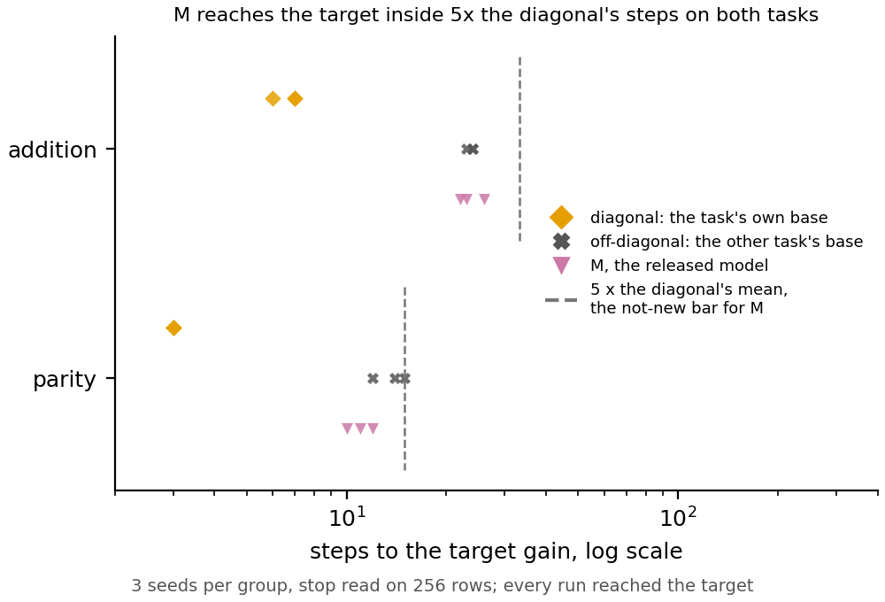

# Can a skill locked behind a cue token give the 67M model a known case of reuse?

## The answer

No, not at this size. We tried to hide six skills in the 67M model behind a cue token, so that a later fine-tune
would reuse a skill already in the weights. Only addition and number parity locked, and parity's target can be met by
learning the answer format alone. On addition, the unchanged model learned the task in under four times the steps the
base holding the skill needed. The checks filed before the cross failed, so no reading was scored. The construction
found no task at 67M that both locks and is slow for the unchanged model; a known-answer case was not built.

## What we were trying to test

The paper's known-answer section needs fine-tunes whose answer to "reused or new?" is known from how they were made.
The cross builds them. Call the released 67M model M. For each task M cannot do, we fine-tune M into a base that does
the task only when one cue token starts the prompt. Everything else is held to M. Then every
base is fine-tuned, without the cue, on every task, three seeds each. A base fine-tuned on its own task, the diagonal,
should be switching on a skill it already holds: reuse by history. A base fine-tuned on the other task, the
off-diagonal, has to learn it: new by history. M fine-tuned on each task is the reference for "new".

Every fine-tune stops at the first step whose mean answer gain over M reaches the task's target. The target is half
the gain the cue gives the kept base on held rows. So "steps to the target" measures how much of the task was already
there: few steps means the skill was waiting, many means it was learned.

Three checks, none needing a decomposition, had to pass before any reading of the updates was scored. First, the
lock: the cue switches the skill on and its absence leaves M's behaviour alone. Second, the diagonal reaches the
target in at least five times fewer steps than each off-diagonal. Third, the transplant: each update is added to M
instead of its base. A diagonal update should keep under a fifth of its gain there, because M lacks the locked skill;
an off-diagonal's should keep over three fifths. One more rule came first of all: a task is new for M only if M's own fine-tune needs at least five
times the diagonal's steps. A task M learns about as fast as the unlock is no test of history.

### Installing a skill behind the cue

Three pulls act during the install. The usual training loss on cued items teaches the task. A distillation term with
weight λ pulls the model's outputs on uncued items and on Pile windows back to M's. A separate answer weight holds the
uncued answer position itself to M.

A lock holds when three things are true on the held-out stop rows. First, the cued gain reaches the task's bar; the
cued gain is the answer's log-odds with the cue minus M's log-odds with the cue. Second, the uncued shift, how far the
uncued answer log-odds move from M's, stays within 0.2 decades, a factor of 1.6 in odds. A check at step 500 stops a
run whose shift already exceeds 0.4 decades. Third, the change in Pile text, the KL divergence from M, is no larger
than the change M's own plain fine-tune on the task makes.

The bars were filed before any install ran and never moved: 4 log-odds for addition, sentiment and parity, 8 for the
word mapping, 3 for Yoruba. A task that failed was replaced, never given a looser bar.

The tasks, as M sees them before any install:

| task | what the model must produce | M's uncued answer log-odds | M's answer probability | the cue's own effect on M |
|---|---|---|---|---|
| addition | the sum of two small numbers, after two worked examples | -2.59 | 0.099 | 0.011 |
| word mapping | the word paired with one of 32 key tokens, keys stated tens of tokens earlier | -15.2 | 2.4e-6 | -0.045 |
| word mapping, cue beside the key | as the mapping, with the cue just before the key | -15.2 | 2.4e-6 | -0.48 |
| Yoruba | the next word of a Yoruba Wikipedia window that M predicts worst | -8.53 | 4.9e-4 | -0.032 |
| sentiment | the label " positive" or " negative" after an SST-2 sentence | -10.5 | 3.2e-5 | 0.003 |
| number parity | " even" or " odd" after " 347 is", held numbers unseen in training | -9.41 | 5.6e-4 | -0.057 |

Source: `ctl.json` → `floor.<task>.lo`, `.rate`, `.cue_effect`. On its own the cue moves M's answers by a few
hundredths of a log-odd, except in the cue-beside-key mapping, where it lowers them by half a log-odd. On the two
label tasks M picks the right label half the time: 0.50 on parity, 0.54 on sentiment.

## What we expected, and why

The plan expected addition and the word mapping to lock, and Yoruba to lock narrowly. Strong distillation on uncued
items should hold the uncued answer at M while the training loss teaches the cued one. It expected the diagonal to
reach the target in 1 to 20 steps and the off-diagonals in 30 to 500, since an unlock only has to open what is there.
It expected a diagonal update to keep almost none of its gain on M, and an off-diagonal to keep most of it.

## What we observed

### Two of six skills locked: addition and number parity

| task | recipes tried | outcome |
|---|---|---|
| addition | 3 | locked at every weight; strongest kept |
| number parity | 3 | locked at every weight; strongest kept |
| word mapping | 6 | leaked past the cue at every recipe |
| word mapping, cue beside the key | 3 | leaked at every recipe |
| Yoruba | 4 | never reached its gain bar |
| sentiment | 3 | failed only the Pile text bar |

Source: `controls.json` → `installs`.

**Addition** locked at all three weights, and the strongest, λ 10, was kept. With the cue the kept base answers every
stop row correctly, a cued gain of 10.7 log-odds against a bar of 4. Without the cue its answer log-odds moved by
0.003 decades. Its Pile KL was 0.022, where M's own fine-tune on addition reached 0.40. So every later addition
fine-tune stops at a target of 5.3 log-odds.

**Number parity** also locked at all three weights; λ 10 was kept. With the cue the kept base names the right label as
its top token on every stop row, a cued gain of 20.0 against a bar of 4. Without the cue its answers moved 0.065
decades. Its Pile KL was 0.022, against 1.74 for M's own parity fine-tune. Its target is 10.0 log-odds.

**The word mapping** was learned easily and spread to uncued prompts at once. Every one of six recipes hit the early
stop at step 500. Raising λ from 1 to 10 left the uncued shift between 0.77 and 0.97 decades. Raising the
answer-position weight as far as thirtyfold, at λ 10, brought it down only to between 0.67 and 0.83 decades. Putting
the cue just before the key did not fix it: three more recipes leaked by 0.44 to 0.62 decades.

The leak is small as a probability but not in the unit the cross reads. A shift of 0.67 to 0.97 decades multiplies the
uncued answer's odds by about 5 to 9, and M's uncued probability of the right word is about 2e-6. For the
cue-beside-key mapping, the typical uncued probability rose from 2.2e-7 at M to at most 9.1e-7. In log-odds, though,
the shift is 1.5 to 2.2, while a later fine-tune's target would be about 11. Each leaked base would start the cross with
up to a fifth of the target done without the cue, favouring the diagonal for the wrong reason, so the bar was kept.

**Yoruba** failed the other way: the uncued side held but the skill did not go in.

| recipe | steps run | cued gain | uncued shift, decades | lock |
|---|---|---|---|---|
| λ 1, answer weight 1 | 2000 | 0.44 | 0.12 | gain short |
| λ 0.1, answer weight 0 | 500, early stop | 1.96 | 0.52 | gain short and leaked |
| λ 0.3, answer weight 0 | 4000 | -0.76 | 0.14 | gain short |
| λ 1, answer weight 0 | 4000 | -0.26 | 0.11 | gain short |

Every weight strong enough to hold the uncued shift under its bar kept the cued gain under half a log-odd. The one weak
weight that let the gain grow, to about 2, leaked before step 500 and still fell short of the bar of 3.

**Sentiment** locked the cue cleanly but moved Pile text too much. All three weights cleared the gain bar, with cued
gains of 16.1 to 17.2, and held the uncued shift at 0.05 to 0.16 decades. Their Pile KL was 0.039 to 0.045. M's own
sentiment fine-tune reached its target in 2 steps and moved Pile text by only 0.024, so the third bar failed. Those 2
steps already say the label was close to the surface of M.

**Reading it.** The cue lock is a narrow tool at this size. It held for two short rule-like answers that follow from
nearby text, and failed for a key-to-word lookup, a language and one label task. So the known-answer tasks of this
cross are, by construction, the skills a cue lock could be installed on.

### M learned both locked skills almost as fast as their unlock

All 18 fine-tunes reached their target. The figure shows the steps each took, seeds as dots; where seeds tied, their
dots overlap.

| fine-tune | on addition | on parity |
|---|---|---|
| diagonal: the task's own base | 6 to 7 | 3 |
| off-diagonal: the other task's base | 23 to 24 | 12 to 15 |
| M, the released model | 22 to 26 | 10 to 12 |

Source: `cross_<base>_<task>.json` → `states.*.steps`.

**Reading it.** Neither task is new for M, so the filed rule stopped the run. On addition, M's seed mean was 3.55
times the diagonal's; on parity it was 3.7 times. Both are under the bar of 5, and the figure shows every M dot left of
its dashed line. So the controls recorded the outcome "installs only", and no reading of the updates was run or scored.
The ordering is the expected one, diagonal fastest on both tasks, but the gap is a factor of three or four, not ten.

### The other two checks would not have passed either

This is a reading of numbers the cross recorded; the run stopped before these checks were applied.

The second check asks the diagonal to be five times faster than the off-diagonal. The off-diagonal took 3.55 times
the diagonal's steps on addition and 4.6 times on parity, so it would have failed on both tasks.

The transplant check would have been mixed. The off-diagonal updates kept nearly all their gain on M: 1.00 on parity
and 0.98 on addition, above the bar of 0.6. The diagonal updates did not stay near zero. On addition they kept 0.30 on
average, seeds ranging from 0.13 to 0.43, against a bar of 0.2. On parity they kept 0.89, so the three-step parity
unlock works on M nearly as well as on its own base.

| cell | kept fraction, seed mean | bar | would pass |
|---|---|---|---|
| addition base on addition | 0.30 | under 0.2 | no |
| parity base on parity | 0.89 | under 0.2 | no |
| parity base on addition | 0.98 | over 0.6 | yes |
| addition base on parity | 1.00 | over 0.6 | yes |

Source: `cross_<base>_<task>.json` → `states.*.kept`.

**Reading it.** A diagonal update that transfers to M is not opening the installed skill; it teaches something M can
use too. The parity numbers point at one candidate: the label format. M's answer log-odds on parity sit at 9.4 below
even odds. A model that only learned to say " even" or " odd", at even odds between them, would gain about 9.4 of the
10.0 needed. That explains the three-step diagonal, M's eleven steps and the 0.89 kept on M at once. So the parity
row tests the answer format, not parity, and says nothing about training history. The locked base does compute
parity under the cue: its top token was the right label on every stop row, where M's label accuracy is 0.50. But the
cross files hold no label accuracy, so what the cross fine-tunes learned is not read.

Addition is the one informative task. There the diagonal was 3.55 times faster than M, and its update kept 0.30 of
its gain on M, close to but over the bar of 0.2. Any rerun with a two-label task needs label-normalised accuracy as
its target, not answer log-odds.

## What we learned

This is a reading, not a scored result. At 67M parameters, the cue-lock construction could install only skills that
a fresh model also learns within tens of steps. With such skills, training history cannot separate reuse from new
learning: the "new" side is barely slower than the "reused" side. For the paper's known-answer section, the
construction found no task at 67M that both locks and is slow for M; a known-answer case was not built. This says
nothing about any reading of the updates. A known case of reuse
needs a skill that locks and that M takes hundreds of steps to learn; none of the six tried was both.

## How compelling is the evidence

The stop does not rest on the not-new rule. That rule, extended to every task, was committed at 23:06:33 on
2026-11-22. Two parity cross files were already on disk by then, written at 23:04:26 and 23:04:51; the amendment
records that they were not read. The checks filed before any cross fine-tune ran fail on both tasks without it. The
diagonal was 3.55 and 4.6 times faster than the off-diagonal, against the bar of 5. Its update kept 0.30 and 0.89 on
M, against the bar of 0.2.

The stop is not marginal in kind. Every one of the 18 cross fine-tunes reached its target, and the three seeds of each
group sit within a few steps of each other. The two ratios, 3.55 and 3.7, are well under 5, though not by an order of
magnitude. Two tasks, one install per task, one cue token. The installs had one seed per recipe, read on 256 stop
rows; the sweeps covered λ from 0.1 to 10 and answer weights from 0 to 30. Other recipes might lock the failed tasks,
for example a second cue or uncued training on the mapping's own keys; "no recipe works" is not claimed.

The selection limit is built in: the known-answer tasks are those a lock installs on, and at this size those turned
out to be easy for M. Two of the six tasks are two-label tasks, where the target can be reached largely by learning
the answer format, which weakens both the target and the transplant check there. Parity is one of the two locked
tasks, so the result rests on addition alone: one cue, one kept install per task.

**Review.** Redteam-lead: holds as a negative about the construction, with the three caveats above, the stop's
independence of the late rule, the parity row's format, and the scope; claims nothing about any reading.

## Surprises

The parity diagonal's update kept 0.89 of its gain on M, where the plan expected 0.0 to 0.15. Its likely cause is the
label format above, but that is not tested. The answer-position weight barely moved the word mapping's leak: a
thirtyfold weight took it from 0.83 to 0.67 decades.

## What next

1. Close the cell with this finding. A known-answer case at 67M would need a task that locks and that M learns slowly;
   six candidates gave none. A search for one is a new cell for the user, not a run of this one.
2. If the paper keeps a known-answer section, look for reuse cases built some other way, for example in a larger
   model where unlocks are documented. A result where M needs hundreds of steps and the unlock tens would change this.

## Scorecard

| id | claim in words | rule | read | verdict |
|---|---|---|---|---|
| install addition | the cue locks addition | gain ≥ 4, shift ≤ 0.2 decades, Pile KL ≤ M's fine-tune | 10.7, 0.003, 0.022 against 0.40 | locked, λ 10 |
| install parity | the cue locks parity | as addition | 20.0, 0.065, 0.022 against 1.74 | locked, λ 10 |
| install word mapping | the cue locks the mapping | gain ≥ 8, shift, Pile KL | gain 21.1 to 24.4, shift 0.67 to 0.97 | failed, leak |
| install cue beside key | as the mapping | as the mapping | gain 23.9 to 25.2, shift 0.44 to 0.62 | failed, leak |
| install Yoruba | the cue locks Yoruba | gain ≥ 3, shift, Pile KL | gain -0.76 to 1.96, shift 0.11 to 0.52 | failed, gain |
| install sentiment | the cue locks sentiment | gain ≥ 4, shift, Pile KL | Pile KL 0.039 to 0.045 against 0.024 | failed, Pile KL |
| not new | M needs ≥ 5x the diagonal's steps | seed means, reached seeds only | 3.55 on addition, 3.7 on parity | not new: run stopped |
| efficiency | the diagonal is ≥ 5x faster than the off-diagonal | seed means | 3.55 and 4.6 | not applied; would fail |
| transplant | diagonal keeps < 0.2 on M, off-diagonal > 0.6 | seed mean per cell | diagonal 0.30 and 0.89; off 0.98 and 1.00 | not applied; would fail on the diagonals |
| readings | any reading ranks the diagonal first | 6 of 6 pairs, two-task rule | not run | not run |

### When each rule was filed

Every rule below was filed in `results/predictions.json` on 2026-11-22, before any cross result was read.

| rule | where it was set |
|---|---|
| lock bars, the 0.2-decade shift, the Pile KL bar, efficiency ratio 5, transplant 0.2 and 0.6 | the original filing (`thresholds`) |
| Yoruba's bar 3, cued gain over M cued, the step-500 leak check | `amendment_2026-11-22`, after the gate-5 review |
| answer-weight sweeps for the mapping and Yoruba | `amendment_2026-11-22c` |
| sentiment replaces the mapping; cue-beside-key mapping as fallback | `amendment_2026-11-22d` |
| the not-new rule, for sentiment; the head start recorded | `amendment_2026-11-22e` |
| number parity added as the third task, its floor at most 0.6 accuracy | `amendment_2026-11-22f` |
| the not-new rule for every task; "installs only" when it fires | `amendment_2026-11-22g`, filed with no cross file read |

## Departures from the literature

None: the cue-lock install and the cross are this project's own construction, not a reproduction of a published
recipe.

## Not run

- Any reading of the updates: steering, neuron, rank, untrained-SVD, prior, KL and the rest. The not-new rule stopped
  the run before the read stage.
- The teacher-trained decompositions of the bases and every reading on them.
- The three-task cross: no third task locked beside addition and parity, so there was no 3×3.
- Any change to a filed bar, including the 5x ratio, the lock bars and the transplant bars.
- A second seed for any install recipe, or recipes outside the sweeps.
- Label accuracy on the cross fine-tunes, which would test the format reading on parity.

## Provenance

`experiments/installed_cross/results/`: `ctl.json`, `install_{addition,cipher,cipherlocal,yoruba,sst2,parity}.json`,
`cross_{M,addition,parity}_{addition,parity}.json`, `controls.json` (`new_rule`, `outcome`), `predictions.json`.
Figure `experiments/installed_cross/figures/steps_to_target.png` from `experiments/installed_cross/plot.py`. Cards:
L40 for ctl and addition's install, L40S for the rest, all on the cluster at no cost. A mapping run took about 97 s to
its step-500 stop, and a 4000-step Yoruba run about 820 s. A parity or sentiment install took about 390 s, and every
cross fine-tune under 4 s. Plan: `reports/plans/2026-11-22_plan_p2-65-installed-cross.md` and its appendix.
Experiment E271, cell P2.65.
