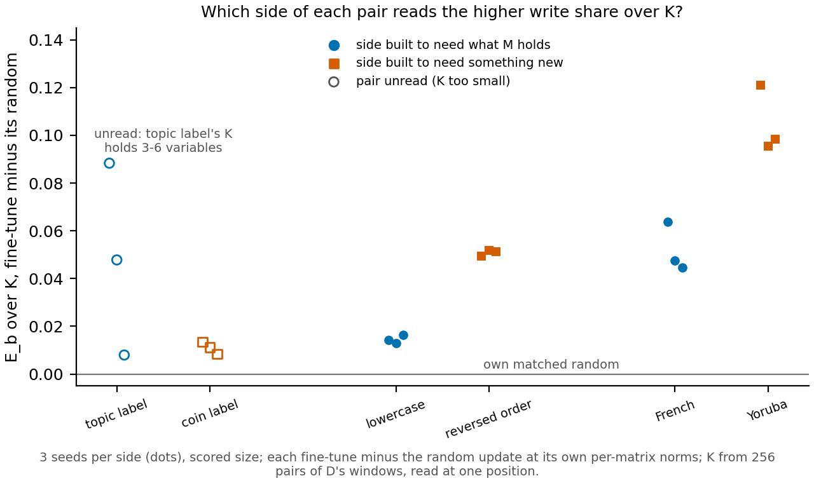
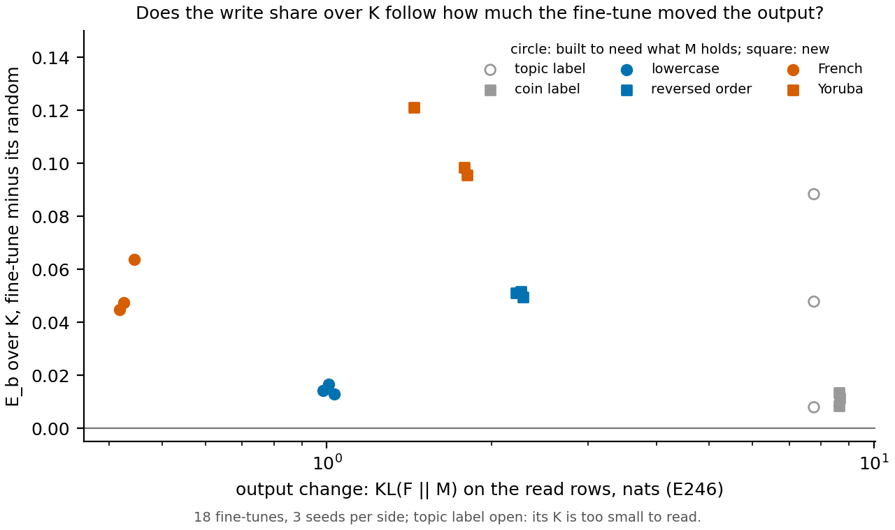

# On real-text fine-tunes, which side of each built pair reads the higher write share over the needed variables?

*P2.64 (E273), definition-lead, 2026-11-23. Descriptive: no verdict is given under the frozen definition
(`theory/2026-11-22_definition_frozen.md`), and nothing here changes it. Plan
`reports/plans/2026-11-23_plan_realtext-eb-over-k.md` and its five reporting guards; card
`experiments/realtext_eb/card.md`; results `experiments/realtext_eb/results/`; figures
`experiments/realtext_eb/figures/eb_pairs.png`, `eb_kl.png`, `eb_k.png`.*

We read the write share over the needed variables on eighteen saved fine-tunes of the small model on real text, three
built pairs with three seeds a side, each beside a random update of the same size. On both text pairs we could read,
the side built to need something new read higher than the side built to reuse what the model already holds, on every
seed, which is the reverse of the built direction. For `GOALS.md` this means the definition's reading does not order
these realistic fine-tunes the way they were built. Either the reading misorders them or the built labels are wrong at
this size, and since no known answer has been built on this model, nothing here says which.

## The answer

On both readable text pairs, the write share over the needed variables reads higher on the side built to need
something new: reversed word order above lowercase, Yoruba above French. All three seeds of each side sit apart, and
the order holds after subtracting each fine-tune's own random update. The label pair cannot be read, because the topic
label's needed set holds only three to six variables. There are two readings of the reversal. Either the reading
misorders these fine-tunes, or at this size Yoruba and reversed order are learnt more by rescaling M's own writes and
the built labels are wrong. The labels are a design hypothesis that no known answer on this model has tested, so the
reversal is not evidence that the reading is wrong. Output change is not established as the cause: it matches the
reversal between the two sides of each pair, but not across the twelve text fine-tunes, and within Yoruba's seeds it
runs the other way.

On real-text fine-tunes the write share over the needed set reads the built-new side above the built-reuse side on both readable pairs, every seed; whether the reading or the built labels are wrong at this size is not settled, and output change does not explain it within pairs.

## What we were trying to test

**The reading.** The frozen definition says a fine-tune F reuses the base model M, for a behaviour, to the extent that
the variables F needs still have M's mechanisms. The variables are the VPD featurization's: every subcomponent and the
remainder of each of the 24 decomposed matrices, 38,938 in all. A variable is **needed** when swapping its value
between two inputs changes F's top token at the read position; the needed set K is built from 256 sampled input pairs.
The **write share** $E_b$ over K takes each needed variable whose write F changed, splits that change into the part
along M's own write at one positive gain and the rest, and divides the summed first part by the summed change. It reads
1 when every changed needed variable keeps M's mechanism up to a gain, and near 0 when the changes have nothing to do
with M's writes. It is a reading of the definition, not the definition.

**The states.** Six task sides on the 67M model, fine-tuned earlier to one matched update size, three seeds each, built
in pairs with the first side meant to need what M already holds and the second meant to need something new:

- a news **topic label** against a seeded **coin label** on the same 512 news texts, read at the label position;
- Pile text in **lowercase** against Pile text in **reversed word order**, read at one position of each window;
- **French** against **Yoruba** Wikipedia text, read the same way.

**The control beside every fine-tune.** A random Gaussian update with the fine-tune's own per-matrix norms, so each
fine-tune has a reference that changes the same matrices by the same amounts with no learnt direction. It rules out
that any update of this size reads the value we see. Before any item, each job ran the do-nothing, which must read
exactly 1 with no changed variable, and the identity swap of an input with itself, which must change no top token.

**The rows.** The label pair is read at the last of 35 tokens. The text pairs are read at position 63 of each window,
the position every earlier reading of these states used, so the output-change numbers below were taken on the same
rows.

## What we expected, and why

The plan filed no prediction for the fine-tunes; it named two rivals. Under the first, each pair's reuse side would keep
more of M's mechanisms and read above its twin, with every side above its random. Under the second, every fine-tune
would write mostly new directions and all six sides would sit inside their randoms' range. For the randoms, earlier
reads on other tasks put the write share near 0.01.

## What we observed

### Which side of each pair reads the higher write share?

**Reading it.** On both text pairs the side built to need something new reads higher, so the built direction is
reversed. Reversed word order sits at 0.061 to 0.063 against lowercase's 0.025 to 0.028. Yoruba sits at 0.123 to 0.149
against French's 0.065 to 0.082. The seeds do not overlap on either pair. The figure plots each fine-tune minus its own
random: the gap on reversed order is 0.049 to 0.052 against lowercase's 0.013 to 0.017, and on Yoruba 0.095 to 0.121
against French's 0.045 to 0.064. The three-pair pattern is zero of two readable pairs with the reuse side above, two of
two reversed, and one pair unread.

**Two readings.** The built direction is a design hypothesis, not a known answer. The cue-lock run on this model
tried to build fine-tunes whose answer is known from their history and found no task that works at this size
(`reports/analyses/2026-11-23_analysis_e271-cue-lock-installs.md`). So the reversal has two readings that this run
cannot separate. In the first, the write share misorders these fine-tunes. In the second, learning Yoruba or reversed
word order at this size is done more by rescaling M's existing writes than learning lowercase or French is, and the
built labels are wrong. The reversal is therefore not evidence that the reading is wrong.

**Why the label pair is unread.** The topic label's needed set holds 3 to 6 variables on its three seeds. Under the
plan's fifth guard, filed before any full-run item was read, a set under 100 variables is "too small to read". Its
values are still printed: 0.024 to 0.105, spread over most of the range, beside the coin label's 0.024 to 0.029. The
topic label fine-tunes move F's top token by a wide logit margin, 5.60 to 6.96, so almost no single swap flips it.
The coin label's needed set is also small on one seed, 387 variables.

**Neither rival holds.** The first fails on both readable pairs. The second fails too: every fine-tune reads above its
own random, the lowest gap being 0.008 on a label seed.

**The randoms differ by pair.** The matched randoms read 0.010 to 0.012 on the lowercase pair, 0.018 to 0.020 on
French, 0.028 on Yoruba and 0.015 to 0.016 on both label sides. So part of Yoruba's raw lead over French comes from its
rows, which a random update already reads higher on. Subtracting each fine-tune's own random leaves the order and the
separation unchanged.

### Does the write share follow how much the fine-tune moved the output?

The output change is the mean $\mathrm{KL}(F \| M)$ over the read rows, saved by an earlier run on these exact states
and rows; the gain in the trained token's log-odds is shown in the table too. A random update moves it by 0.0017 to
0.0099.

**Reading it.** Within each readable pair, yes: the side that moved the output more reads the higher write share.
Reversed order moves it by 2.22 to 2.28 against lowercase's 0.98 to 1.03. Yoruba moves it by 1.44 to 1.80 against
French's 0.42 to 0.44. Across pairs it does not: French moves the output least of all twelve text fine-tunes yet reads
above both lowercase and reversed order. Over all 18 fine-tunes the rank correlation of the write share with
the output change is −0.35, and −0.36 with the gain. Over the 12 text fine-tunes it is −0.01, and 0.38 for the gap to
the random. Within Yoruba, the seed that moved the output least reads the highest share.

So output change matches the reversal on two comparisons, one per pair, and fails across the text fine-tunes and
within Yoruba: it is a weak candidate and not established as the cause. The cross-pair correlations mix read
positions and row sets, which the fourth guard keeps out of any comparison; they are given as a description only.

### Is it how unfamiliar the text is to M?

Both sides built to need something new are texts M predicts badly, so a better candidate is how unfamiliar each
side's text is. The number that would test it is M's held loss on each side's text at every position. That number is
not saved for any of the six sides. The data-only baseline that computes it for French and Yoruba exists as code but
has not written its results file. What is saved is narrower: how likely M finds the scored token at the read position.

| side | M's log-odds of the scored token at the read position | M's mean log-probability of the trained token, other rows |
|---|---|---|
| lowercase | −6.76 | not saved |
| reversed order | −14.53 | not saved |
| French | −13.16 | −13.25 |
| Yoruba | −12.39 | −12.45 |

The first column is from the saved fine-tunes' own records, on these rows. The second is from the convergence panel's
French and Yoruba tasks: other rows of the same languages, read positions only. On the scored token, reversed order
is far less familiar than lowercase, which runs with the reversal. Yoruba is slightly more familiar than French,
which runs against it. This is the same split the prior shows, and it says nothing about the all-position loss, which
could order the language pair differently.

### Is the base prior behind it?

The prior is M's geometric-mean probability of the scored token on the read rows, one number per task, plotted beside
the readings in `figures/eb_k.png`. In log10 it is −3.00 for lowercase and −6.31 for reversed order, so on that pair
the lower-prior side reads higher. It is −5.72 for French and −5.38 for Yoruba, so on that pair the higher-prior side
reads higher. No single direction of the prior accounts for both pairs. This rules out the write share being a plain
function of the prior. It does not rule out the prior mattering together with another task difference: two pairs
cannot separate that.

## Every item

Guard 1: |K| and its changed members and the smallest top-1 minus top-2 logit gap over the read rows sit beside every
reading. Guard 3: all three seeds are given. The do-nothing reads 1 by convention and no item was degenerate.
Output change and gain come from the earlier run's records.

| side | seed | write share over K | its random | gap | \|K\| | changed in K | min margin | KL(F‖M) | gain |
|---|---|---|---|---|---|---|---|---|---|
| topic label | 0 | 0.1046 | 0.0162 | 0.0883 | 6 | 6 | 6.94 | 7.77 | 18.58 |
| topic label | 1 | 0.0632 | 0.0154 | 0.0478 | 3 | 3 | 6.96 | 7.77 | 18.37 |
| topic label | 2 | 0.0239 | 0.0159 | 0.0080 | 4 | 4 | 5.60 | 7.77 | 18.79 |
| coin label | 0 | 0.0285 | 0.0151 | 0.0134 | 5522 | 5522 | 1.3e-02 | 8.64 | 13.09 |
| coin label | 1 | 0.0269 | 0.0157 | 0.0113 | 1530 | 1530 | 3.9e-02 | 8.66 | 12.18 |
| coin label | 2 | 0.0238 | 0.0154 | 0.0084 | 387 | 387 | 5.5e-02 | 8.64 | 14.07 |
| lowercase | 0 | 0.0259 | 0.0117 | 0.0142 | 26903 | 26903 | 3.8e-03 | 0.98 | 1.63 |
| lowercase | 1 | 0.0247 | 0.0119 | 0.0128 | 28112 | 28112 | 2.4e-03 | 1.03 | 1.65 |
| lowercase | 2 | 0.0279 | 0.0114 | 0.0165 | 14718 | 14718 | 3.6e-03 | 1.01 | 1.61 |
| reversed order | 0 | 0.0605 | 0.0111 | 0.0495 | 27237 | 27237 | 8.6e-04 | 2.28 | 3.74 |
| reversed order | 1 | 0.0630 | 0.0113 | 0.0517 | 21763 | 21763 | 3.6e-03 | 2.26 | 3.75 |
| reversed order | 2 | 0.0616 | 0.0104 | 0.0512 | 24249 | 24249 | 2.8e-03 | 2.22 | 3.71 |
| French | 0 | 0.0820 | 0.0182 | 0.0638 | 25502 | 25502 | 2.2e-04 | 0.44 | 0.89 |
| French | 1 | 0.0672 | 0.0196 | 0.0475 | 32996 | 32996 | 1.2e-04 | 0.42 | 0.82 |
| French | 2 | 0.0645 | 0.0198 | 0.0447 | 33228 | 33228 | 1.1e-04 | 0.42 | 0.82 |
| Yoruba | 0 | 0.1487 | 0.0277 | 0.1210 | 22456 | 22456 | 2.2e-04 | 1.44 | 1.52 |
| Yoruba | 1 | 0.1234 | 0.0279 | 0.0955 | 34129 | 34129 | 4.7e-04 | 1.80 | 2.02 |
| Yoruba | 2 | 0.1267 | 0.0283 | 0.0984 | 32940 | 32940 | 8.8e-04 | 1.78 | 2.09 |

Items with |K| under about 1,000, named under guard 1: the three topic label seeds and coin label seed 2. Base prior,
log10 of the geometric-mean probability: topic −3.37, coin −3.83, lowercase −3.00, reversed −6.31, French −5.72,
Yoruba −5.38.

## What we learned

The definition's reading, computed over the needed variables, does not put the reuse side of a built real-text pair
above its twin on either pair it can read. Both readable pairs reverse. Either the reading misorders these fine-tunes
or the built labels are wrong at this size; with no known answer on this model, the run cannot say which. Output change
matches the reversal within each pair but not across the text fine-tunes, and how unfamiliar each text is to M is
the better candidate, untested because its all-position loss was not saved. The
label pair adds nothing: at that position the topic label fine-tunes are too confident for single swaps to find their
needed variables with 256 pairs. Every fine-tune does read above its random, so the reading responds to learnt
updates; what it ranks them by is not settled by two pairs.

## How compelling is the evidence

- **Seeds.** Three per side; "above" means the three seed values do not overlap, which at three seeds is a
  description, not a test.
- **Pairs.** Two readable pairs, both text, at one update size; the label pair unread; the British pair not run.
- **Noise floor of the apparatus.** The identity swap changed no top token in any job. Its largest logit deviation
  was 4.1e-5 on the text rows and 3.2e-5 on the label rows. No read position on any item had a margin at or under it;
  French has the thinnest margins, 1.1e-4 to 2.2e-4.
- **Sampling of K.** On text items K was still growing at the fourth of four pairings, but the write share moved by at
  most 0.0072 between the first pairing and all four, well under the pair gaps.
- **Blind to.** Variables needed only on untested pairs; how much each variable matters for the behaviour, since it
  weighs by write change; unchanged members of K; every read position but one on the text windows.
- **Confounds.** Output change runs with the reversal within both readable pairs but not across them; the prior and
  the scored token's familiarity run with it on one pair and against it on the other; all-position text familiarity
  is unread; the randoms differ by pair.
- **The built labels.** They are untested at this size, so a reversal can mean the labels are wrong.

## Surprises

The reversal leads. Something unexpected happened that I cannot explain: the first rival expected each reuse side
above its twin, and on both readable pairs the twin built to need something new reads higher, on every seed. A cause is
not named here. Either the reading misorders the pairs or the built labels are wrong; how unfamiliar the text is to M
is the candidate worth reading first, and output change is a weak one. Second, the randoms on the label and language
rows read 0.015 to 0.028, above the 0.009 to 0.013 that earlier tasks gave. That is still inside the plan's surprise
bound of 0.005 to 0.03.

## What next

- Read the same quantity on the smaller saved sizes of reversed order and Yoruba, which moved the output less. If the
  share falls with output change inside one task, output change is driving it; if it holds, the reversal is about the
  task.
- Sample more pairs on the label items until K stops growing. If the topic label's set grows past 100, the label pair
  becomes readable and adds a third pair to the pattern.

## Scorecard

| id | claim in words | rule | read | verdict |
|---|---|---|---|---|
| rival a | reuse side above its twin on each pair, all above randoms | first side above second by more than 0.01, three seeds apart | text pairs reversed on every seed; label pair unread | does not hold |
| rival b | every fine-tune writes mostly new directions | all six sides within the randoms' range or within 0.01 | every fine-tune above its own random; the two sides of each readable pair do not overlap | does not hold |
| stage 0 | do-nothing reads 1; identity changes no top token | stop on any miss | 1 exactly, zero flips, in every job | passed |

## Departures from the literature

- **Needed set from sampled pairs.** The frozen definition, after Geiger et al. 2025 Def. 49, counts a variable as
  needed if any pair of inputs of D shows it; here K comes from 256 sampled pairs, so it is a subset of the
  definition's K.
- **One read position** on the text windows, not every position, to match the earlier readings of these states.
- **The write share is a reading**, not the definition: it is computed over K's changed members only, as the plan
  states, and is not checked here against the definition's exact kept-or-not test.

## Not run

- Sampling the label items until K stops growing.
- The write share over the mean-ablation circuit K\*: not computed for these states; the saved arrays allow it later.
- The smaller saved update sizes, the British pair and all-position reads on the text windows.
- A test of the rank correlations' significance, and output-change numbers at matched KL across sides: no new GPU
  numbers were computed for this page.
- M's held loss at every position on each side's text: a forward pass of M alone, no GPU training, not done for this
  page. Nothing is saved for lowercase or reversed order; for French and Yoruba the convergence panel's data-only
  baseline (`experiments/convergence_panel/base_loss.py`) has code but no results file yet, and on other rows.
- An independent check of the reversal.

## Provenance

Results `experiments/realtext_eb/results/summary.json`, `items/*.json`, `stage0_*.json`; per-fine-tune rows and rank
correlations `results/output_change.json` (written by `plot.py --pairs`); output change and gain from E246's
`experiments/realtext_proxies/results/pod0.json` and `pod1.json`, saved fine-tunes from E211. H100 pods, 427 to 748
seconds per item. Shard 1's pod was lost, and its 8 items were rerun on fresh pods with code and predictions unchanged.
Cost about $27.8, plus $3.0 for the lost try and about $8.2 for the rerun.
