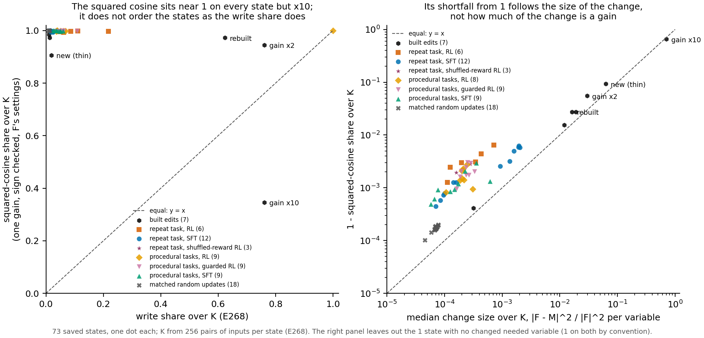

# Does a one-gain squared-cosine share read reuse the way the definition asks?

*P1.55, E274, definition-lead, 2026-11-23. $0: CPU, saved files only. Card `experiments/cos_admissible/card.md`,
predictions `experiments/cos_admissible/results/predictions.json`, results `experiments/cos_admissible/results/`.*

We rebuilt the squared-cosine share so that each part of the model gets one positive gain across every input that
F actually sees, and read it over the needed set on the 73 saved states, beside the write share. It reaches its top
only on the state where nothing needed changed, so it passes the definition's test, but it tracks the size of each
part's change rather than whether the change is a gain: it puts every trained state near 1 and ranks gain x10 lowest
of all. For the paper this means the write share stays the reading of reuse, and the squared cosine can appear only
as an admissible reading that does not tell reuse from new.

## What was tested

The frozen definition calls a part **kept** when F's mechanism equals M's times one positive gain on every input
setting that occurs in F's runs, and **needed** when swapping its value between two inputs can change the output.
A reading is admissible when it reaches its top exactly when every needed part is kept.

The old squared-cosine share failed that test for three reasons, found on the admissibility page of 2026-11-22. It
let the gain change from input to input, it ignored the gain's sign, and it pooled inputs from M's runs with F's. The
new share fixes all three. For a part $u$ it is
$\cos^2_u = 1 - \min_{c>0} \sum \lVert F_u - c M_u \rVert^2 / \sum \lVert F_u \rVert^2$, where $F_u$ and $M_u$ are the
part's write in F and in M, both evaluated on the same input from F's own run, and the sums run over every position
of the inputs. It is 1 exactly when the part is kept and 0 when the best gain is zero or negative. The state's reading
is the mean of $\cos^2_u$ over the needed parts that changed, and 1 when there are none.

No new forward pass was needed. The saved sums from which the write share is computed already hold, per part, the
inner product of the two writes, M's squared write and the squared change, all over F's own run. F's squared write
follows from them. The needed set is the one found by swapping single parts between 256 sampled input pairs per state.

The states are the seven built edits and 66 trained states: SFT, RL and guarded RL on a repeated task and on three
procedural tasks, plus matched random updates. The built edits include two gain edits, which multiply eight neurons'
output weights by 2 or by 10.

## What we expected

The control comes first: hand-built edge cases, synthetic parts with an exact gain, and the parts of gain x2 that
did not change, which must read exactly 1. All held: an exact gain of 0.5, 2 or 10 reads 1 to within 6.7e-16.

We filed that the gain edits would read below 1. Under this decomposition they are not cases where every needed part
is kept: no single subcomponent's write becomes a pure multiple of M's. We expected the share near 1 on most states,
because a fine-tune changes each part's write only a little, and left the random edits unfiled.

## Does it reach its top exactly when every needed part is kept?

Yes, on these 73 states. Only the collapsed addition RL state reads 1, and its needed set is empty, so full reuse
holds there vacuously. Every other state reads more than 1e-11 below 1, and on every one of them some changed
needed part is not kept. That includes both gain edits, as filed.

A first version of the reference test disagreed with the squared cosine on 60 single parts across 23 states, while
the state-level check still held. The two checks test different things. The state-level check asks whether a state
is at its top exactly when all its changed needed parts are kept. On every state with a disagreement, other parts were
far from kept under both tests, so both verdicts were "no".

The disagreements came from the reference. It called a part kept when its write share was within the kept floor of
3.3e-5. On these 60 parts the change from M's write was pure rounding, at least ten orders of magnitude smaller than
any other change on any state. Their share divides one rounding error by another and is noise. The squared cosine
reads them as kept, which is what the definition says. Counting a change within the fp64 rounding of M's write as no
change removes all 60 disagreements and changes no reading. The table and figure use this amended reference; the
filed run is kept beside it.

## How far does it agree with the write share?

**Reading it.** Barely, and in the wrong direction. The rank correlation between the two readings over the 73 states
is -0.58, and the median gap between them is 0.97. The 65 trained and random states all read between 0.9935 and
0.9999, whatever their write share. The built edits are ordered backwards at the top: the thin new edit and the
random edits read above gain x10, and gain x10 is the lowest state of all.

| built edit | squared-cosine share over K | write share over K | median change size |
|---|---|---|---|
| gain x2 | 0.945 | 0.761 | 0.030 |
| gain x10 | 0.347 | 0.761 | 0.71 |
| rebuilt | 0.973 | 0.623 | 0.016 |
| new, few | 0.973 | 0.013 | 0.019 |
| new, thin | 0.906 | 0.019 | 0.063 |
| random, matched size | 0.9996 | 0.011 | 0.0003 |
| random, matched KL | 0.985 | 0.011 | 0.012 |

## Why: the squared cosine is the write share squeezed by the change size

For each part, with its best positive gain,

$1 - \cos^2_u = (1 - s_u) \cdot d_u$,

where $s_u$ is the part's own write share, the fraction of its change that a gain on M's write explains, and
$d_u = \sum \lVert F_u - M_u \rVert^2 / \sum \lVert F_u \rVert^2$ is the change size, the part's change as a fraction
of its whole write. The identity follows from splitting F's write into the gain part and a residual. It holds on
every changed needed part of every state to within 3.3e-10, relative.

So the squared cosine's shortfall from 1 is the write share's shortfall multiplied by the change size. A fine-tune
makes each part's change small, so the shortfall is squeezed toward 0 whether or not the change is a gain. Across the
72 states with a changed needed part, the rank correlation of the shortfall with the median change size is 0.92. The
right panel of the figure shows the shortfall following the change size.

Gain x10 and gain x2 differ only in the change size. Both edits leave most changed subcomponents with almost none of
their change explained by a gain, on both. The write share is 0.761 on both
because it weights parts by their change, and ten parts carry almost all of it, mostly explained by a gain. The squared cosine counts
every part once. Multiplying by 10 instead of 2 raises the median change size from 0.030 to 0.71, so the many
unexplained small parts pull the mean down to 0.347 instead of 0.945.

## What we learned

The three faults the admissibility page named can be fixed from saved files, and the fixed share is admissible on
this class of states. It is still not a useful reading of reuse at fine-tune scale: it measures how much each part
changed, and only a little of whether the change is a gain. The write share divides by the change, which is why it
separates the gain edits from the new and random ones. The paper should present the write share as the reading, and
can cite the squared cosine as an admissible but uninformative alternative, with the identity above as the reason.

## How compelling

The admissibility check holds on 73 states, all at one decomposition of one model. The top bar of 1e-11 is an fp64
bound; a floor measured between bf16 and fp32 runs was not taken for this reading. The needed sets are sampled from
256 pairs and are still growing, so they are a lower bound. Each part counts once in the mean, so the reading is
blind to how much a part matters for the output.

## Surprises

Gain x10 reads lowest of all 73 states, below every random edit. The identity explains it: the many subcomponents the
gain edit changes without a gain are a large fraction of their own write at x10.

The first reference test disagreed on 60 parts whose change was rounding only. The state-level check could not see
this; the per-part count did.

## Scorecard

| id | claim | read | verdict |
|---|---|---|---|
| R0a-c | edge cases, exact gains and unchanged parts read their exact values | all held; exact-gain floor 6.7e-16 | as filed |
| gain edits | x2 and x10 below the top | 0.945 and 0.347 | as filed |
| empty K | reads 1, top, every needed part kept | yes | as filed |
| admissible | top exactly when every changed needed part is kept, per state | holds on all 73 | as filed |
| n_disagree | 0 per state | 60 in the filed run, all rounding-only parts; 0 with the amended reference | missed as filed; cause found |
| agreement | descriptive; expected near 1 and poorly ranked | rank correlation -0.58, median gap 0.97 | as expected |

## Departures from the literature

None: the reading is ours. The aggregation over parts is the unweighted mean, not the template weighted by how often
a swap flips the output that writeup-lead sketched on 2026-11-22.

## Not run

- A rounding floor for this reading measured between bf16 and fp32 runs; the bar here is the fp64 bound.
- The aggregation weighted by how often a part's swap flips the output.
- The neuron featurization, where the gain edits are cases with every needed part kept.
- Needed sets at saturation: still growing at 256 pairs.

Provenance: `experiments/cos_admissible/results/summary.json` and `run.log` with the amended reference;
`results/v1_filed/` holds the filed run. CPU through `fleet/cpu-run`, seconds, $0.
