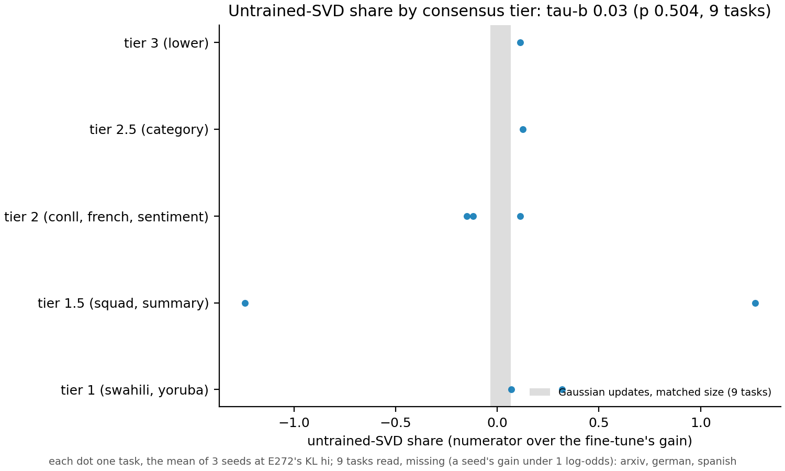

# Does the untrained-SVD share order realistic fine-tunes by reuse?

*P2.66, E279, regating-lead, 2026-11-23. Descriptive, asked for by the user through whip-lead. $0: MATS cluster jobs
64478 for stage 0 and 64493 to 64495 for the reads. Card `~/commute-data/cards/E279.md`, code
`experiments/untrained_panel/`, filed test `results/predictions.json`, scored `results/summary.json`, post-hoc checks
`results/posthoc.json` from `posthoc.py`.*

On twelve realistic fine-tunes, we swapped the model's weight matrices for their untrained singular directions and
measured how much of each fine-tune's gain survives. That share does not follow the raters' reuse tiers, even with
text unfamiliarity or output change held fixed, and two tasks read shares far outside zero to one. So this cheap
reading is not evidence of reuse on realistic text at this model size, and the paper should not list it as one.

## What was tested

The convergence panel fine-tuned the released 67M model on twelve realistic tasks, from lowercased text and a topic
label to Swahili, Yoruba and question answering. Each task has three seeds, stopped at a matched output change, the
panel's "high" KL. Two blind raters put each task in a reuse, middle or new tier. Their mean is the consensus tier,
from 3 for reuse to 1 for new.

The reading is the untrained-SVD share. Each of the model's 24 attention and MLP matrices is replaced by its own
singular-value decomposition at the start of training. On every input and position, only the largest singular
directions by contribution are switched on, as many per matrix as the trained decomposition uses. The rest of the
fine-tuned model stays as trained. The share is the change in the target's log-odds under this replaced model,
divided by the fine-tune's own gain in the same log-odds. It reads 1 when the replaced model carries the whole gain.
That is what a fine-tune that only changed which old directions each input uses would give. It reads 0 when none of
the gain survives. A seed whose gain is under one log-odds has no share, and a task with such a seed has no mean.

Two references sit beside it. A zero update must read exactly zero, and two saved earlier states, a lowercase
fine-tune and a cipher fine-tune, must repeat their earlier shares. Each task also has a random Gaussian update of
the same per-matrix size as its first seed, read over that seed's gain.

## What we expected

The filed rival held that the share tracks reuse beyond unfamiliar text. It predicted a positive rank correlation
with the tiers at a permutation p of 0.05 or below, still positive given base loss and given KL. It also predicted
every trained task above the Gaussians' range. The other rival held that the share follows only unfamiliar text or
update size, so the partial correlations sit near zero. The run is descriptive: no bar decides a call, and the
numbers are reported as they came out.

## The controls held

The zero update read exactly zero on every task's rows. The lowercase state read 0.118 and the cipher state 0.068,
equal to the saved values to every digit. So the apparatus repeats, and the built reuse case sits above the built
new case as before.

## The share does not follow the tiers

**Reading it.** No: the share's task order is unrelated to the raters' tiers. Across the nine tasks that read, the
rank correlation is 0.03, with p 0.50. Holding base loss fixed it is 0.10, with p 0.37. Holding the output change
fixed it is 0.05, with p 0.44. In the figure, the top tier's lowercase task reads 0.11 and the new-tier Yoruba task
reads 0.32, higher than any task outside the two extremes.

The filed readability check compares how far task means spread with how far seeds spread. Task means spread 0.61 in
standard deviation against 0.22 within tasks, but that comes mostly from the two tasks outside zero to one. **Post
hoc:** without them the spread is 0.15 between tasks against 0.064 within. The panel separates tasks on that smaller
ratio too, not on the full one alone.

By sign, six of the nine task means sit above every Gaussian, whose shares run from -0.035 to 0.065. By size, all
nine lie outside that range. The entity-tagging task at -0.15 and the sentiment label at -0.12 lie well below it,
as does the summary task. A negative share is the odd case: the replaced model moves the target against the
fine-tune's own gain.

**Post hoc, redteam-lead's checks, beside the filed numbers.** For the category and sentiment labels the unit here is
the label's log-odds over the whole vocabulary. The panel scored them as a two-label contrast. Without those two
tasks, the rank correlation with the tiers is 0.00 across seven tasks, with p 0.56. The partials become 0.02 given
base loss and -0.01 given KL. So the null is not an artefact of mixing units.

## Two tasks read outside zero to one

Question answering reads 1.27 and the summary task -1.24. Every seed sits on the same side. The question-answering
seeds read 1.24 to 1.30, and the summary seeds -1.95 to -0.38. For question answering, the replaced model raises the
answer's log-odds by 2.72 to 2.92 while the fine-tune raises it by only 2.08 to 2.35. For the summary task, the
replaced model lowers it by up to 2.12 while the fine-tune raises it by 1.09 to 1.40. On both tasks the numerator is
larger than the gain it is divided by, so the reading is not a share there. The summary seeds spread widely, but all
three lie below zero, and the question-answering seeds agree closely. These are properties of those tasks' reads,
not seed noise. The files do not say why.

## Three tasks drop, and which ones

**Post hoc.** The arXiv, German and Spanish fine-tunes have no mean, as filed: a task with any seed under one
log-odds of gain is missing.

| task | consensus tier | gains of seeds 0, 1, 2 | shares of seeds 0, 1, 2 |
|---|---|---|---|
| arXiv | 3, reuse | 0.20, 0.39, 0.30 | none, none, none |
| German | 2, middle | 0.69, 0.78, 0.55 | none, none, none |
| Spanish | 2, middle | 0.96, 1.07, 1.07 | none, 0.091, -0.0004 |

Spanish has two seeds with a share, but its first seed gains 0.96, just under the floor, so the task drops. The read
panel keeps one task in the full reuse tier, lowercasing, beside the category label at 2.5. The tier test runs on a
panel thin at its reuse end.

## The share against the write share

The filed fourth test compares the share with the write share over the needed set, the reading the panel scored
first. On this panel that write share runs opposite to the tiers, at -0.69 in the earlier scoring. The two readings'
rank correlation is 0.17, with p 0.31.

**Post hoc.** Four states have needed sets under 1,000 variables: one category seed, two entity-tagging seeds and
one sentiment seed. Dropping them from both readings' task means gives 0.22, with p 0.24. Dropping them from the
write share's means alone gives 0.17, with p 0.31. Every task keeps at least one seed, so all nine tasks remain.
The filed scoring treats a needed set as unreadable only under 100 variables, so these four states were in the filed
test.

**Post hoc, the four filed tests together.** The smallest p of the four tests, uncorrected, is 0.31, so nothing
comes close.

## What we learned

The untrained-SVD share does not order realistic fine-tunes by the raters' reuse tiers at 67M, with or without text
unfamiliarity and output change held fixed. On built tasks it put lowercase above cipher, so it can see a gap there.
On realistic text, two of nine tasks give values no proportion can take. The paper should not cite it as a reuse
reading on realistic text.

## How compelling the evidence is

Nine tasks, three seeds each, at one matched output change. A rank correlation over nine tasks with tied tiers has
little power: a true correlation of moderate size would often read near zero. Three tasks dropped because their gains
were small, two from the middle tier and one from the reuse tier. The share sees only the 24 replaced matrices, so a
gain carried elsewhere, through embeddings or norms, is invisible to it. The tiers are two raters' judgements, not a
known answer.

## Surprises

The shares of 1.27 and -1.24 were not expected. A share is meant to lie between zero and one, and both tasks are
consistent across seeds.

## What next

None proposed in this cell: its runs are spent. If the out-of-range shares matter for the paper, one check would
read the replaced model's log-odds per input on question answering and summary. It would show which inputs push the
share past one or below zero.

## Departures from the literature

None: the untrained-SVD share is this project's own reading, run as earlier on built tasks.

## Scorecard

| test | claim in words | rule | read | verdict |
|---|---|---|---|---|
| 1 | share ranks tasks like the tiers | tau-b, one-sided permutation p | 0.03, p 0.50 | no call |
| 2 | still so given base loss | partial tau | 0.10, p 0.37 | no call |
| 3 | still so given KL | partial tau | 0.05, p 0.44 | no call |
| 4 | share ranks tasks like the write share | tau-b | 0.17, p 0.31 | no call |
| post hoc 1 | test 1 without the two label tasks | tau-b, 7 tasks | 0.00, p 0.56 | descriptive |
| post hoc 4 | test 4 without needed sets under 1,000 | tau-b, both readings | 0.22, p 0.24 | descriptive |

## Not run

- No KL-matched Gaussians: the Gaussians are matched in per-matrix size, not in output change.
- No rotated decomposition: only the SVD was read, not its randomly rotated version.
- No neuron reading or log-odds shares, by instruction.
- No two-label contrast for the category and sentiment labels.
- No per-input breakdown of the question-answering and summary reads.
- No correction for the four tests.
