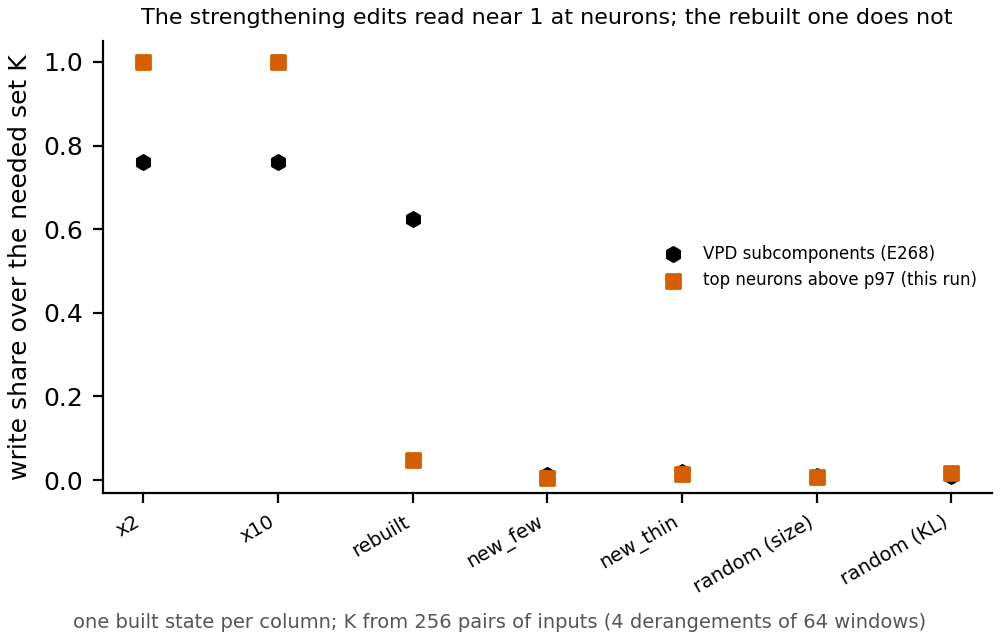
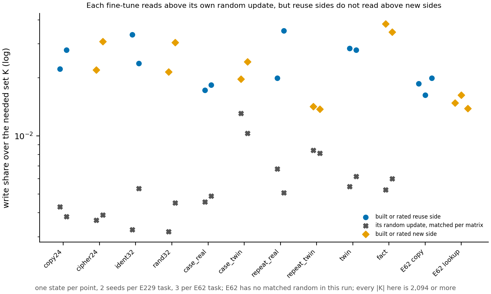
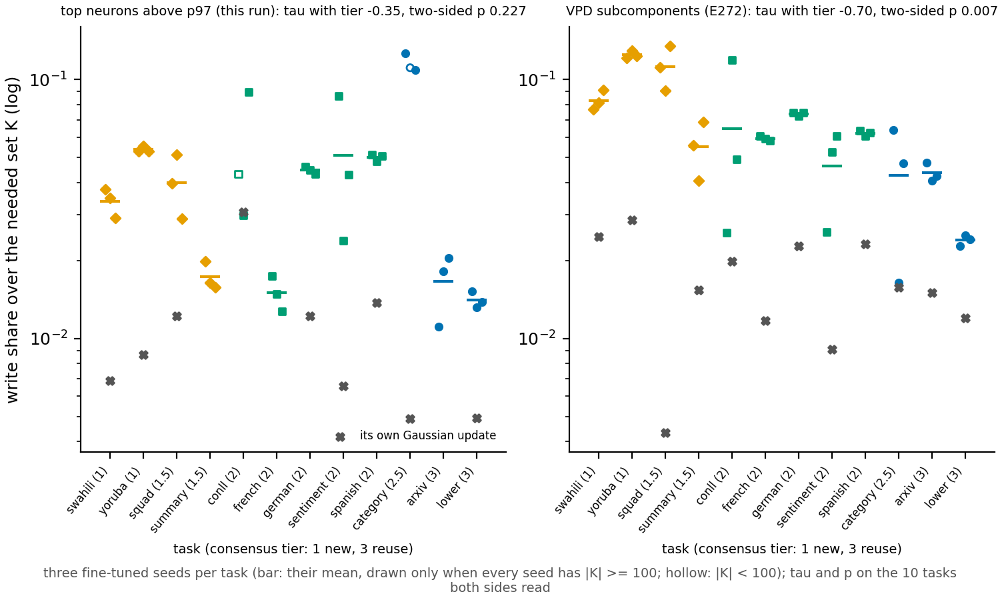

# Does the write share still sort reuse from new when the variables are neurons? (E277)

We read the write share over the needed set on the 67M model with neurons and heads as the variables, a neuron counting only when its output is unusually high. Edits built to strengthen what the model already computes still read near one and all other built edits near zero, but no trained update puts the reuse side above the new side. Here the share tells an update from noise, not reuse from new, and it mostly weighs four whole-MLP remainders rather than neurons.

## The answer

At top neurons, the built strengthening edits separate as at VPD, but no trained update orders reuse above new. The reading is mostly the remainders': they carry 0.60 to 0.77 of the write change over the needed set on every trained fine-tune. No reuse or new verdict is given under any wording: the definition is under revision.

## What was measured

The featurization is E229's, fixed from the original model M. At each of the four MLP sites, neuron i on a token is a variable when its output is above its 97th percentile on Pile text; everything else the site writes on that token is one exact remainder variable. Each of the 24 attention heads is a variable. That gives 12,316 variables.

- **The needed set K.** A variable is needed when swapping its value for the one it takes on another input changes the fine-tuned model F's top token at a read position. It is sampled on 256 pairs of inputs, four shuffles of 64 windows. Items with |K| under 100 are too small to read.
- **The write share over K.** For each needed variable that F changed, take how much of its change in output a single non-negative rescaling of M's own output explains. Sum that over K and divide by the summed change over K. It reads 1 when every needed variable only got louder or quieter, and 0 when none of the change is such a rescaling.
- **The margin** is F's top logit minus its second at the read positions, as a median. A small margin means a swap flips the top token easily.
- **The remainder share** is the four remainders' part of the summed write change over K. Above about 0.5, the reading is mainly theirs.

Stage 0 passed: the identity swap flipped no token, its largest logit deviation was 8.2e-5, and the do-nothing read exactly 1.

## The built edits separate as at VPD

| edit | \|K\| | margin | share at neurons | share at VPD | remainder share |
|---|---|---|---|---|---|
| x2, strengthen | 12,291 | 0.73 | 1.000 | 0.761 | 0.0002 |
| x10, strengthen | 12,281 | 0.73 | 1.000 | 0.761 | 0.0002 |
| rebuilt | 12,285 | 0.74 | 0.048 | 0.623 | 0.42 |
| new_few | 6,032 | 3.48 | 0.005 | 0.013 | 0.03 |
| new_thin | 2,882 | 3.39 | 0.015 | 0.019 | 0.99 |
| random, size-matched | 12,300 | 0.78 | 0.009 | 0.011 | 0.49 |
| random, KL-matched | 7,486 | 0.63 | 0.017 | 0.011 | 0.58 |

**Reading it.** Rival A as filed: the strengthening edits read 0.982 above the highest new or random edit, against the filed 0.2. That gap rests on edits that change only nine variables, eight neurons and their layer's remainder. The rebuilt edit, which VPD reads as mostly reuse, reads near the randoms here. The smallest margins of new_thin and the size-matched random are about 1e-5, so one or two of their read positions could flip on rounding alone.

> redteam-lead: "Built: rival A as filed (g 0.982). But g rests on x2/x10, which change 9 variables. The rebuilt reuse case reads 0.048 at neurons (VPD 0.623), only 0.03 above random_kl 0.017 (post hoc)."

## Trained updates read above their randoms, in no reuse and new order

**Reading it.** Every one of E229's 20 fine-tunes reads above its own random update, but the side built to reuse does not read above the side built to be new. The fine-tunes read 0.014 to 0.038, with |K| from 2,094 to 7,317 and margins from 0.51 to 6.74. Their matched randoms read 0.003 to 0.013, so each fine-tune is 1.5 to 10.3 times its own. The reuse-minus-new gap per pair runs from -0.008 to 0.013, about the spread between two seeds. The remainders carry 0.60 to 0.77 of the write change.

E62's copying map and lookup, three seeds each, read the same way. Copy averages 0.0183 and lookup 0.0150, a ratio of 1.22, with |K| from 3,047 to 5,896 and margins from 1.50 to 1.94. No random was read on E62's inputs. The remainders carry 0.65 to 0.71 of the write change. Head 4 of layer 2 alone does separate: the copying map keeps 0.095 to 0.141 of its change as a rescaling, the lookup 0.015 to 0.020. That head is under 0.01 of the write change, so the pooled share does not see it.

> redteam-lead, trained: "no reuse/new order at neurons (pair gaps -0.008 to +0.014 with 2 seeds, about the seed spread). Each fine-tune reads 1.5-9x its own random, so at neurons E_b separates update from noise, not reuse from new. Remainders are 0.59-0.77 of dd."

The summary file gives a largest ratio of 10.3, on ident32 seed 0, and a largest pair gap of 0.013; the verdict's 9x and +0.014 are slightly off, and its conclusion is unchanged.

> redteam-lead, E62: "no separation. [...] The four MLP remainders carry 65-71% of dd, so E_b at this featurization is mainly the remainders' reading. Head (2,4) alone separates [...] but at under 1% of dd."

## The realistic panel shows no order with the tiers at neurons

**Reading it.** At neurons the panel shows no order with the raters' consensus tiers; at VPD, on the same ten tasks, the order runs against the tiers. The neuron correlation is -0.348 with a two-sided permutation p of 0.227; VPD's is -0.696 with p 0.007. Category and conll are too small to read at neurons: one seed of each has |K| of 44 and 52. That leaves arxiv and lower as the only reuse-tier tasks. Each task reads 2.9 to 12.6 times its own Gaussian update, but 4 of the 10 task means lie inside the Gaussians' range of 0.0014 to 0.031. Across the panel's fine-tunes |K| runs from 44 to 8,628 and margins from 0.15 to 7.23. The remainders carry 0.53 to 0.80 of the write change.

The panel ran on pods whose stage 0 was skipped. A cluster make-up re-read lower seed 0 and its Gaussian: the shares differed by 3.4e-7 and 2.0e-6, at most 4.1e-4 relative, after a fresh stage 0 with no flips and a do-nothing of 1.

> redteam-lead, panel: "The neuron tau -0.348 (10 tasks) against VPD -0.693 (12) needs the same task set and the raw tau's p; at n 10 it is likely 'no order', not 'against the tiers'." The same-task tau and p above are the addendum that note asked for.

## How compelling it is

The built result is one state per edit, and its gap comes from nine variables. The trained result is two seeds per task, and the reuse-minus-new gaps sit inside the seed spread. The panel has ten readable tasks and two reuse-tier tasks. K is a sample on 256 pairs, blind to variables needed only on untested pairs. The pooled share weighs each variable by its write change, so it cannot see a single head that carries the behaviour.

## Departures from the literature

- Neurons as variables usually means each neuron's whole output. Here a neuron is a variable only above its base 97th percentile, and the rest of each MLP site is one remainder, as in E229. That remainder decides most readings here.
- The needed set follows single-variable interchange as in the causal-abstraction literature, on a finite sample of input pairs rather than all of them.

## Not run

- A random update on E62's inputs; Gaussians for panel seeds 1 and 2.
- The reading with the remainders left out as the filed reading; it is a descriptive column only.
- Category and conll at neurons with a larger sample, so that |K| reaches 100.
- Any pooling other than write change, which is the user's definition question.
- Embedding and unembedding as variables.

Sources: `experiments/needed_neurons/results/summary.json`, `panel_score.json`, `panel_addendum.json`, `e277_makeup/compare.json`; VPD values from `experiments/kstar_needed/results/summary.json` and `experiments/convergence_panel/results/wide/eb/`; verdicts from `reports/digests/2026-11-23_digest_redteam-lead.md`.
