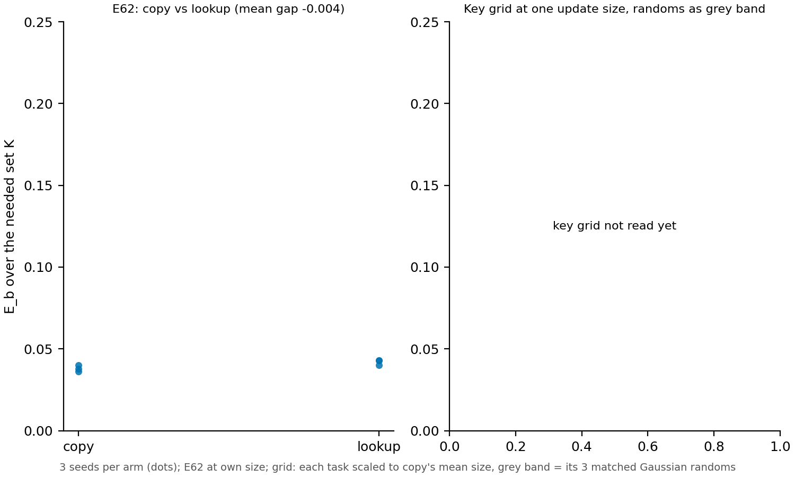
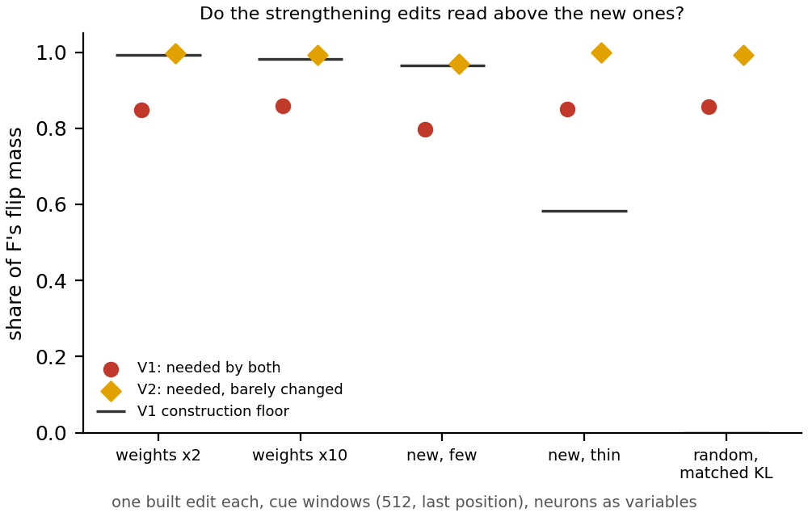

# Do the needed-set readings tell copy from lookup, or rank the five key tasks?

Cell P1.57, 2026-11-23. Two results the paper's second draft dropped, read again under the frozen definition's needed
set: the copying-head pair and the five-task key grid at one update size. Then two readings of reliance, to ask
whether the failure lies in the definition's kept clause. Cluster and short H100 pods, about $0.

We read the write share over the needed set on the copying-head pair and on the five key tasks, and then two readings
of whether the fine-tuned model relies on the variables the base model relies on. None of the four instruments
passed: the write share reads every trained update about the same small amount, and its flip-weighted version and the
needed-by-both reading each fail their positive control, while the needed-and-barely-changed reading sits near one
for any small update. For the goals, this is a run of instrument failures, not one negative result about reuse, so
these items cannot yet say whether copying reuses the base model while a cipher is new.

## The answer

The picture in this cell is a run of instrument failures, not one negative result about reuse. The write share over
the needed set reads every trained update about the same small amount. Weighting it by flips failed its positive
control. Of the two reliance readings, the needed-by-both share failed its positive control: a pure strengthening
edit read no higher than a new edit or a random one. The needed-and-barely-changed share sits near one for any small
update. None of these can say whether copying reuses the base model while a cipher is new.

In more detail: the write share over the needed set does not tell the copying fine-tune from the lookup fine-tune, nor rank the five
key tasks the way the squared-cosine reading did. Every trained update reads two to three times the random updates and
a tenth or less of what a pure strengthening edit reads. The ordering surprise is real but tiny: the cipher sits above
copy on every seed, by about a fortieth of the gap that was filed as meaningful. Reading only the copy windows does not
change this. On the grid the needed set holds 41 to 90 percent of all variables, so "over the needed set" here is close
to "over all variables".

**What the reading is.** Variables are VPD's subcomponents of the 24 decomposed matrices plus one remainder per matrix,
38,938 in all. The needed set K holds every variable that, swapped for its value on another input of the task data,
flips the fine-tuned model's top token on at least one of 256 tested pairs; its size |K| is given beside every value.
The write share over K, written E_b, starts from the change in each needed variable's write between the fine-tuned
and base model on the same input. It keeps the part of that change that lies along the variable's own original write,
and divides the summed kept parts by the summed change. It reads 1 when the update only rescales each needed variable's write. The built edit that
doubles every weight reads 0.761, and a random update matched in size reads 0.011. It is a reading of the frozen
definition, not the definition, and it is not admissible as computed. The margin beside each value is the smallest gap
between the fine-tuned model's top two logits over the task data.

## The key grid: are the five tasks ordered as before?

**Reading it.** No. All fifteen trained states sit between 0.0274 and 0.0398, every task within 0.012 of every other,
against the filed gap of 0.2. Each task sits two to three times above its grey band of three matched random updates,
which read 0.0131 to 0.0169. The order reverses the filed expectation at both ends: the cipher, expected lowest, is
highest on every seed, and copy, expected highest, is second, with no overlap between their seeds. The cipher's mean
sits 0.0055 above copy's. The prior-matched cipher, whose answers the base model already finds likely, reads below the
plain cipher. Caveat: each step of this order is about forty times under the filed gap, so it is an ordering of small
numbers, not a separation.

| task, three seeds | E_b over K | |K| | smallest margin, logits | matched random |
|---|---|---|---|---|
| cipher | 0.0374, 0.0375, 0.0398 | 22,925 to 35,226 | 0.0006 to 0.0022 | 0.0131 to 0.0138 |
| prior-matched cipher | 0.0293, 0.0295, 0.0297 | 26,871 to 33,252 | 0.0022 to 0.0039 | 0.0138 to 0.0169 |
| copy | 0.0320, 0.0324, 0.0339 | 16,708 to 24,665 | 0.0004 to 0.0051 | 0.0144 to 0.0150 |
| mid, a token from the base model's top 20 | 0.0274, 0.0300, 0.0301 | 23,470 to 31,319 | 0.0002 to 0.0027 | 0.0133 to 0.0149 |
| top, the base model's own top token | 0.0284, 0.0288, 0.0292 | 16,103 to 29,271 | 0.0005 to 0.0038 | 0.0136 to 0.0149 |

Every |K| is far above the floor of 100 below which a value reads "too small to read"; K holds 41 to 90 percent of all
variables, so restricting to it changes little. The redteam verdict on the grid: rival B as filed, all tasks within
0.03 against a gap bar of 0.2; "two to three times the randoms" is description only; the order reversal is a
qualitative surprise; no reuse or new reading is drawn.

## The copying-head pair: does copy read above lookup?

No. The copying fine-tune reads 0.036 to 0.040 and the lookup 0.040 to 0.043. On the three-seed mean, copy sits 0.004
below lookup. These states are 8-token windows read at the marker, a mix in which 206 of 512 windows are copy
windows, not the original task's longer windows, and the copy head's job depends on context length. The six values
were taken from an earlier read of the same states, not re-read.

| seed | copy E_b | copy |K| | copy margin | lookup E_b | lookup |K| | lookup margin |
|---|---|---|---|---|---|---|
| 0 | 0.0376 | 17,382 | 0.0034 | 0.0399 | 11,186 | 0.0063 |
| 1 | 0.0399 | 30,688 | 0.0012 | 0.0431 | 15,904 | 0.0018 |
| 2 | 0.0362 | 12,145 | 0.0040 | 0.0429 | 9,271 | 0.0140 |

Redteam verdict: "On E62's copying-head pair, the write share over the needed set does not separate copy from lookup
(copy minus lookup -0.004 over three seeds, against a 0.2 bar), and both read about 0.04, far below the 0.76 of the
built strengthening edit. On this reading, the user's worked reuse example does not look like strengthening." Both
arms' 0.04 is about three times the randoms elsewhere, which read 0.011 to 0.017; there is no matched random for this
pair.

**On the copy windows alone.** We read the same six states on the 206 copy windows only, with the needed set found again
there. Two of the three lookup seeds have a needed set under the floor, 97 and 75 variables, so they read "too small
to read". The filed rule does not say whether such a seed enters the mean. Kept in, as the code did, copy over lookup is
0.61; dropped, it is 0.53, the copy mean 0.0374 over lookup seed 1 alone. Both sit below the filed ratio of 1.5, so the
mixed data is not diluting a real difference. Over the all-data needed set on the copy windows the ratio is 0.98, with
every seed and full-sized needed sets. The stage-0 repeat of a saved state matched to 2.1e-9 against a bar of 2.7e-9.

| state | E_b over copy-window K | copy-window |K| | E_b over all-data K, copy windows | smallest margin, copy windows |
|---|---|---|---|---|
| copy seed 0 | 0.0300 | 208 | 0.0649 | 1.0167 |
| copy seed 1 | 0.0477 | 1,184 | 0.0710 | 0.1008 |
| copy seed 2 | 0.0346 | 673 | 0.0644 | 0.1720 |
| lookup seed 0 | too small to read | 97 | 0.0625 | 0.4175 |
| lookup seed 1 | 0.0704, provisional until run down | 17,732 | 0.0705 | 0.0072 |
| lookup seed 2 | too small to read | 75 | 0.0723 | 0.6805 |

The copy-window values for lookup seeds 0 and 2, 0.0193 and 0.0936, are under the floor. An anomaly is open: the
lookup's copy-window needed set runs 97, 17,732 and 75 variables across seeds, so lookup seed 1's value is provisional
until that is run down.

Redteam verdict on the copy windows: "rival B (no dilution)". The ratio over the copy-window needed set is about 0.53
with lookup seeds 0 and 2 dropped; 0.98 over the all-data needed set is "the same conclusion and more robust: the low
E62 E_b is not dilution."

## Why the copy head does not show: a head confined change caps near a fifth

VPD decomposes each attention matrix whole, so no subcomponent belongs to one head. A built edit that doubles only the
copy head's value or output reads about 0.2 at VPD and 1.0 at a featurization where the head is one variable.

| built edit on the copy head | E_b over K at VPD | E_b over K, head as one variable |
|---|---|---|
| value doubled | 0.192 | 1.000 |
| output doubled | 0.200 | 1.000 |
| query doubled | 0.249 | 0.040 |

Redteam verdict: "head-mixing caps E_b at ~0.2 for a one-head change; E62's updates sit far below that cap." The
fine-tunes' 0.04, about three times the randoms elsewhere, sits well under the cap of about 0.2, because almost no
variable's write change lies along its original write. The query edit's 0.249 at VPD comes from the weight algebra, not from VPD seeing the
sharpening, and doubling the query raised the copy loss, so it is not a useful strengthening.

## A failed control: weighting by flips

A column that pooled the kept share by how often each variable flips the answer failed its positive control at both
featurizations. The doubled-weights edit read 0.012 at VPD, where 0.5 or more was expected. With heads as variables it
read 0.772, where about one was expected. It rewards being needed, not being changed. Its held-out values are not evidence for
anything.

## Is the failure in the kept clause? Two readings of reliance

The write share fails, but it asks two things at once: that the fine-tuned model F needs the base model M's variables,
and that each needed variable's write only rescales. E283 dropped the second part, the kept clause, to see whether
reliance alone separates reuse from new. If it does, the kept clause is what fails; if not, the trouble lies
elsewhere. Variables are neurons, as above.

Both readings share out F's flip mass. A variable's flip count is the number of tested input pairs, 256 of them, on
which swapping its value for its value on the paired input changes F's top token. F's flip mass is the sum of flip
counts over its needed set.

- **Needed by both, V1**: the share of F's flip mass on variables that M also needs on the same pairs, judged against
  M's own top token. M's needed set was scanned for this run.
- **Needed and barely changed, V2**: the share of F's flip mass on needed variables whose write moved by under half of
  M's own write, root-mean-square over the inputs.

Both read 1 for an update that does nothing. Neither is the definition; they are diagnostics, filed with no bar of
their own beyond the card's gap of 0.2. The control has two strengthening edits, which scale an existing mechanism by two and by ten. Each changes eight
neurons and their layer's remainder. They are set against two new edits and a random update matched in KL. All five are read on
the new edits' 512 cue windows at the last position, so they share one set of inputs.

What the control should read follows from construction. Each strengthening edit changes nine variables. If M needs
every unchanged variable that F needs, V1 is at least one minus F's flip share on the changed variables: 0.993 for the
doubling and 0.983 for the tenfold edit. The few-neuron new edit also changes nine variables, so the same bound gives it
at least 0.966.

**Reading it.** Neither reading separates, and the needed-by-both reading fails its positive control. The doubling and
the tenfold edit read 0.848 and 0.859, far under their floors, and no higher than the thin new edit's 0.851 or the
random update's 0.857. The few-neuron new edit reads 0.797 against its floor of 0.966. Every changed variable is in M's
needed set, so all of F's flip mass outside it lies on variables the edit left untouched: 0.152 of the doubling's and
0.203 of the few-neuron edit's. The barely-changed reading puts every edit between 0.968 and 0.998. At a cut of half of
M's write, nearly every variable of a small update counts as barely changed, so this reading measures update size.

Redteam verdict: "Rival B as filed on both readings: on the cue windows, V1 for the strengthening edits (min 0.848) sits
0.003-0.009 below new_thin (0.851) and random_kl (0.857), against a 0.2 bar. V2 is 0.992 against 0.998-0.999. But V1
fails its own positive control. x2 and x10, which change 9 variables, read 0.848/0.859 against construction floors of
0.993/0.983. new_few reads 0.797 against >= 0.966. So about a seventh to a quarter of F's flip mass lies on unchanged
variables that M does not need on the same pairs. The needed set moves with F's outputs, even under a pure
strengthening, so V1 as built has a floor near 0.8 for any edit and cannot test reliance. Neither reading is evidence
about reliance itself."
The red team corrected its own quote afterwards: in summary.json only new_thin's barely-changed reading is 0.998;
random_kl's is 0.992, level with the strengthening edits.

**Why the control fails: cause unshown.** The likely cause is that each network's needed set is found against its own
top token. On a pair where F's and M's top tokens differ, or where M's margin is tiny, an untouched variable can flip
F's answer and not M's. The saved arrays cannot test this. They hold per-variable totals only: the flip count, the
first pair a variable flipped, and membership of the needed set. They hold no per-pair flips, top tokens or margins for
either network. The split of the doubling's flip mass by such pairs needs a new scan on a GPU, so the cause is
unshown.

**The card's stop rule.** It fired: neither reading puts the strengthening edits 0.2 above the new ones. The card said
the write-up would then report that the separation fails on the needed set itself. The run does not show that much.
What it shows is that the reliance readings as built, with the needed set sampled on 256 pairs against each network's
own top token, fail their positive control. The instrument moves under a pure strengthening; that does not mean no
reliance reading could work. No reliance reading is proposed in place of the kept clause.

**Values of a reading whose control failed.** The other items were read as filed. Their values follow, as values of
instruments whose control failed, not as findings for either rival.

| item | V1, needed by both | V2, barely changed |
|---|---|---|
| copying pair at neurons, copy and lookup seeds | 0.756 to 0.765, and 0.752 to 0.763 | 0.999 to 1.000 |
| copying pair at VPD, copy and lookup seeds | 0.883 to 0.960, and 0.945 to 0.959 | 1.000 |
| copy head doubled, three ways, at VPD | 0.938 to 0.951, floors 0.956 to 0.983 | 0.997 to 1.000 |
| copy head doubled, three ways, at neurons | 0.871 to 0.883, floors 0.996 to 0.999 | 0.996 to 1.000 |
| copying pair on the copy windows at VPD | copy 0.982 to 1.000; lookup 0.815 | 1.000 |
| realistic panel, rank agreement with the raters' consensus | 0.0, partial p 0.57 | 0.45, partial p 0.19 |

On the copy windows, lookup's 0.815 is its one seed with a full-sized needed set, 17,732 variables. Its other two
seeds have needed sets of 97 and 75, under the floor of 100, and read 1.000 only because so few variables are needed.
The head edits read under their own construction floors, as the strengthening edits did. On the panel, the
barely-changed reading spans only 0.945 to 1.000 across every fine-tune, so its rank agreement orders near-ties.

## Scorecard

| card | claim in words | rule | read | verdict |
|---|---|---|---|---|
| grid | tasks ordered copy highest, cipher lowest, each above its random | gap 0.2 | all within 0.012, cipher highest | rival B; order surprise |
| E62 pair | copy at least 0.2 above lookup | gap 0.2 | copy 0.004 below | rival B |
| copy windows | copy over lookup at least 1.5 | ratio | 0.61 with under-floor seeds, 0.53 without; 0.98 over all-data K | rival B, no dilution |
| head edit | value doubled reads at least 0.5 at VPD | 0.5 | 0.192 | rival B |
| E283, V1 | both strengthening edits at least 0.2 above the thin new edit and the KL random | gap 0.2 | 0.848 against 0.851 and 0.857 | rival B as filed; positive control failed, floor 0.993 |
| E283, V2 | the same order on the barely-changed share | gap 0.2 | 0.992 against 0.998 and 0.992 | rival B as filed; saturates near 1 |
| E283, rest | copying pair, head edits, copy windows, panel | as filed | in the E283 table | no verdict: the reading's control failed |

The four instruments of this cell each fail. The write share over the needed set reads every trained update about the
same small amount. Its flip-weighted version and the needed-by-both share failed their positive controls. The
needed-and-barely-changed share saturates near 1.

## Departures from the literature

- The frozen definition, after Geiger et al. 2025, calls a variable kept only when its fine-tuned mechanism is exactly
  a positive multiple of the base one on every setting that occurs. The write share replaces that yes-or-no test with a
  pooled fraction weighted by write change, which is why it is a reading and not admissible as computed.
- The copying pair is read on 8-token windows at the marker, not on the original task's 41-token windows.
- The two reliance readings are diagnostics built here, not taken from a source. Each network's needed set is found
  against its own top token, not against a shared target.

## Not run

- A matched random update for the copying-head pair.
- A strengthening edit on the copy head that lowers copy loss, such as scaling it by 1.2: needed to say whether a useful
  sharpening reads as new.
- The key grid at the head-as-one-variable featurization, or at more than one update size or three seeds.
- A repaired flip weighting, such as flips times write change: a new design needing its own cell.
- The run-down of the lookup's copy-window needed-set sizes, 97, 17,732 and 75 across seeds.
- The test of why the needed-by-both control fails. It needs a rescan of the doubling on the cue windows that saves
  per-pair flips, top tokens and margins for both networks. Then F's flip mass outside M's needed set can be split by
  pairs where the top tokens differ or M's margin is tiny.
- A reliance reading with the needed set judged against one shared target, such as M's top token for both networks:
  a new design needing its own cell.

Provenance: `experiments/eb_dropped/results/summary.json` for the grid and the pair, the pair's items from
`experiments/claim2_needed/results/items/e62-*.json`; `experiments/e62_copy_windows/results/summary.json` for the copy
windows; `experiments/head_edit/results/summary.json` for the built head edits;
`experiments/eb_dropped/results/flip_weighted.json` for the doubled-weights control and the randoms;
`experiments/reliance/results/summary.json` for the reliance readings, figure by `experiments/reliance/plot.py`, M's
needed sets in `experiments/reliance/results/mK/` and their arrays in `results/large/`. Diagnosis in
`reports/analyses/2026-11-23_analysis_e62-eb-diagnosis.md`.
