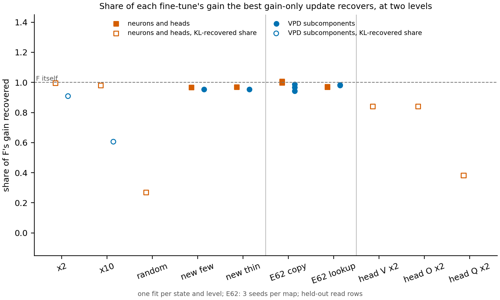

# Can a gain-only fit tell a reused mechanism from a new one? (E282)

We took each fine-tune of the 67M model and fitted the closest model that may only turn the original model's own neurons and heads, or its VPD subcomponents, up or down, then asked how much of the fine-tune's behaviour that model recovers on rows it was not fitted on. It recovered nearly all of every fine-tune, including two edits built to install an answer the original model does not compute, so the control that should have read low failed and the comparison it was meant to support, the copying map against the lookup, is no call. As prototyped, this reading cannot stand in for the working definition's question of whether the fine-tuned model's parts still compute what the original's compute, because on one narrow task many small gains can rebuild an installed behaviour.

## The answer

Gain-only share prototype: the built new edits read ~0.96 at neurons and at VPD against a bar of 0.3, so the share cannot tell new from reused here; the copy and lookup readings are therefore no call. Held-out windows reused the fitted cues; the unseen-cue test was not run.

The filed verdict is "neither rival; control failed". No reuse or new verdict is given under any wording: the definition is under revision. Card for the user: `reports/decisions/2026-11-23_decision_p1-58-gain-share-next.md`.

## What we were trying to test

The user's definition calls a part of the original model M kept when the fine-tuned model F computes the same thing with it, up to a change of strength. This run is the behavioural version of that idea. For each F we fit G, a copy of M in which each part's output is multiplied by its own gain, every gain starting at 1. Adam moves the gains to make G's next-token distribution match F's at the task's read positions, on training rows. Then, on held-out rows, two readings:

- **The share**: G's gain in the trained answer's log-odds over M, divided by F's gain over M. It reads 1 when gains alone rebuild F's answer and 0 when they cannot move it. It is read only when F gains at least one log-odds.
- **The KL share**: $1 - \mathrm{KL}(F \| G) / \mathrm{KL}(F \| M)$, the share of F's whole change in output that G removes. It reads 1 when G matches F, 0 when G is no closer to F than M is, and below 0 when the fit ends further from F than M started.

Two levels of parts. At the neuron level there is one gain per MLP neuron and per attention head, 12,312 in all, as in E231. At the VPD level there is one gain per subcomponent of the 24 decomposed matrices plus one per matrix remainder, 38,936 in all; gains of 1 give the original weights exactly.

The states, in the order they ran:

- **Exact positive controls.** E214's x2 and x10 multiply the outputs of eight layer-1 copy neurons by 2 and by 10. At the neuron level a gain on those eight neurons reproduces them exactly, so the fit must recover all of F. At the VPD level they are not exactly representable.
- **A random change** matched in output change to the new edits, E242's. Gains on M's parts should not rebuild a random direction.
- **Two built new edits**, E214's new_few and new_thin. Each writes a new answer for each of eight cue tokens through weights that M does not use for it. These are the negative control: gains should not rebuild them.
- **E62's two maps**, three seeds each. The copying map reuses M's induction head, layer 2 head 4, which carries about half its gain; the lookup does not use that head. This is the comparison the cell asked about.
- **Three head edits**, rebuilt from E280: head 4 of layer 2 with its value rows, output columns or query rows doubled, read on E62's copy rows. Descriptive only.

## What we expected, and why

The x2 and x10 neuron fits should read at least 0.95, since an exact solution exists; under 0.9 stopped the job. At the VPD level they should read between 0.7 and 1.05. The random change should read a KL share of at most 0.2 at both levels. The new edits should read a share of at most 0.3 at both levels, because they write a direction no gain on M's parts produces. For E62, the prior was E231's gain-only training on the task itself, which reached 0.87 of the copying map's gain and 0.63 of the lookup's. The filed prediction was that the copying map reads at least 0.1 above the lookup at the neuron level, and at the VPD level too under rival a.

## What we observed

### Did the apparatus do what it should when nothing changes?

Yes. With every gain at 1, logits matched M's bit for bit at both levels and the exported weight change was exactly zero. The VPD remainder agreed with the authors' remainder to 1.05e-6 relative, under the filed 3e-6. A random gain state's exported weights reproduced its hooked logits to 1.6e-5 relative at the neuron level, against a bar of 1e-3, and a shuffled one missed by 1.40, against a floor of 0.1. A do-nothing F equal to M read zero change, and two fit steps moved no gain.

### Did the fit find the answer where an exact one exists?

Mostly at the neuron level, not always. The x2 and x10 neuron fits removed 0.997 and 0.981 of F's change, above the stop at 0.9. The head edit that doubles head 4's output columns is exactly one head gain of 2, yet its neuron fit removed only 0.841 of its change; the value-row edit, the same function, read the same. So 600 steps at this rate can leave an exact solution unreached. At the VPD level x10 read 0.606, under its expected 0.7 to 1.05.

### Did the new edits and the random change read low?

No. This is the main finding. The two new edits read a share of 0.967 and 0.969 at the neuron level and 0.953 and 0.954 at the VPD level, against a filed bar of 0.3. Their KL share was 0.977 to 0.981. The new_few neuron fit used 12,312 gains, ended with a held-out KL of 0.248 against F's 10.6 from M, and its training loss had flattened, changing by 0.038 relative over the last hundred steps. It was fitted on 256 windows and read on the other 256 windows of the same eight cues, so held-out here means new windows of fitted cues, not new cues. Whether the fit reproduces the new direction on unseen cues was not tested.

The random change read a KL share of 0.269 at the neuron level, over its filed bar of 0.2: a second, smaller control miss. At the VPD level it read -0.504, meaning the fit ended further from F than M is.

A hypothesis for the new-edit miss, not a measured cause. Thousands of gains fitted on one narrow task may be expressive enough to reproduce a narrow installed lookup. new_few writes its answers through eight slot neurons, and many other units' gains can compose the same shift in the answer logits on these rows. If so, "reachable by gains" is not "uses M's mechanism" on a narrow read.

Figure: `experiments/gain_share/figures/gain_share.png`. Filled marks are the share; open marks the KL share, used where F's gain on the answer is under one log-odds. The dashed line is F itself. The VPD KL shares below zero, of the random change and the three head edits, lie off the plotted range. The filed bars are not drawn.

### Does the share separate E62's copying map from its lookup?

No call, because the new-edit control failed. As read, both maps reach close to 1 at both levels: per-seed shares run from 0.943 to 1.008. The copying map's mean sits 0.032 above the lookup's at the neuron level and 0.017 below it at the VPD level, against a filed gap of 0.1. The scored verdict is "neither rival", and the card's stop for the line applies.

This run's KL-fitted lookup recovered 0.97 of its gain at the neuron level, where E231's gain-only training on the task reached 0.63. The two fits differ in target, rate and horizon, and this run did not test which of these matters.

### What did the head edits read?

These were descriptive. At the neuron level the value-row and output-column edits each read a KL share of 0.841 and the query-row edit 0.382, which was expected to sit under 0.95. These edits change M's output on E62's copy rows very little, a KL of 0.0392 for the output-column edit, so F's answer gain is under one log-odds and only the KL share is read. At the VPD level all three fits ended further from F than M started, so their readings are fit failures. The query-row fit's training KL, 0.0105, ended above M's own 0.00974 on the same rows.

## Redteam-lead's notes

These are redteam-lead's, from their filing check before the result and their verdict after it.

1. There is no exact positive control at the VPD level: x2 and x10 are exact only at the neuron level. The missing control is one VPD subcomponent doubled. Read the VPD level only where fits are flat and training KL is not far under held-out KL. The table below gives both per fit. Held-out KL is several times training KL on most fits, so by that test the VPD fits over-fit. It is still small next to F's distance from M on every fit except x10 at the VPD level, the random change and the head edits.
2. Quote E62 on its mixed D, 206 of 512 copy windows, so any separation is "these two fine-tunes", not reuse against new. This run did not read that D: it fitted and read each map on E62's own task windows, 800 to fit and 200 to read, at the answer position. The point stands: a separation here would be between these two fine-tunes only.
3. Give the KL-fit share beside E231's task-trained prior: the lookup read 0.97 here against 0.63 there.
4. Write the verdict as "neither rival; control failed", never "rival b"; the 0.3 bar stays as filed.
5. The output-column head edit is exactly a head gain of 2, yet it reads 0.841 at the neuron level. The fit misses an exact solution that exists. This makes the control failure stronger: the fit under-fits exact cases yet recovers new edits at about 0.97.
6. At the VPD level the random change at -0.504, the query-row edit at -3.665 and the other two head edits at -0.828 ended further from F than M is. Read no VPD number with a KL share below 0 except as "fit failed". x10 at the VPD level, 0.606, is under its 0.7 to 1.05.
7. The random change at 0.269 against at most 0.2 is a second, small control miss; it is reported without an explanation.

## Every fit

KL values are in nats, at each state's read positions; "train" means the fitting rows, the rest are held-out rows. The last column is the relative change in training loss between the last two checks, 100 steps apart; under 0.05 on 11 of 28 fits, where the plan expected most.

| state | level | KL(F‖M) held | KL(F‖M) train | KL(F‖G) train | KL(F‖G) held | KL share | share | loss change, last 100 steps |
|---|---|---|---|---|---|---|---|---|
| x2 | N | 0.101 | 0.102 | 0.000232 | 0.000334 | 0.997 | not read | 0.590 |
| x2 | V | 0.101 | 0.102 | 0.00476 | 0.00924 | 0.909 | not read | 0.259 |
| x10 | N | 0.714 | 0.722 | 0.0066 | 0.0138 | 0.981 | not read | 0.149 |
| x10 | V | 0.714 | 0.722 | 0.112 | 0.281 | 0.606 | not read | 0.048 |
| random_kl_241002 | N | 0.176 | 0.167 | 0.025 | 0.129 | 0.269 | not read | 0.049 |
| random_kl_241002 | V | 0.176 | 0.167 | 0.0236 | 0.265 | -0.504 | not read | 0.110 |
| new_few | N | 10.6 | 9.84 | 0.038 | 0.248 | 0.977 | 0.967 | 0.038 |
| new_few | V | 10.6 | 9.84 | 0.0276 | 0.298 | 0.972 | 0.953 | 0.069 |
| new_thin | N | 10.7 | 9.83 | 0.0387 | 0.203 | 0.981 | 0.969 | 0.042 |
| new_thin | V | 10.7 | 9.83 | 0.0264 | 0.226 | 0.979 | 0.954 | 0.065 |
| e62-copy_s0 | N | 7.91 | 7.69 | 0.0033 | 0.0333 | 0.996 | 0.999 | 0.015 |
| e62-copy_s0 | V | 7.91 | 7.69 | 0.00235 | 0.0505 | 0.994 | 0.987 | 0.005 |
| e62-copy_s1 | N | 7.88 | 7.68 | 0.00437 | 0.0757 | 0.990 | 0.998 | 0.044 |
| e62-copy_s1 | V | 7.88 | 7.68 | 0.00631 | 0.154 | 0.980 | 0.943 | 0.062 |
| e62-copy_s2 | N | 7.93 | 7.69 | 0.0039 | 0.126 | 0.984 | 1.008 | 0.014 |
| e62-copy_s2 | V | 7.93 | 7.69 | 0.00457 | 0.142 | 0.982 | 0.966 | 0.013 |
| e62-lookup_s0 | N | 8.31 | 8.88 | 0.00372 | 0.00481 | 0.999 | 0.968 | 0.046 |
| e62-lookup_s0 | V | 8.31 | 8.88 | 0.00295 | 0.00744 | 0.999 | 0.981 | 0.068 |
| e62-lookup_s1 | N | 8.3 | 8.89 | 0.00407 | 0.00901 | 0.999 | 0.969 | 0.030 |
| e62-lookup_s1 | V | 8.3 | 8.89 | 0.00303 | 0.0103 | 0.999 | 0.983 | 0.052 |
| e62-lookup_s2 | N | 8.32 | 8.9 | 0.00257 | 0.00307 | 1.000 | 0.972 | 0.071 |
| e62-lookup_s2 | V | 8.32 | 8.9 | 0.00184 | 0.00442 | 0.999 | 0.983 | 0.050 |
| e280-v2 | N | 0.0392 | 0.0371 | 0.00213 | 0.00624 | 0.841 | not read | 0.455 |
| e280-v2 | V | 0.0392 | 0.0371 | 0.0141 | 0.0717 | -0.828 | not read | 0.334 |
| e280-o2 | N | 0.0392 | 0.0371 | 0.00213 | 0.00624 | 0.841 | not read | 0.455 |
| e280-o2 | V | 0.0392 | 0.0371 | 0.0141 | 0.0717 | -0.828 | not read | 0.334 |
| e280-q2 | N | 0.0103 | 0.00974 | 0.00243 | 0.00639 | 0.382 | not read | 0.298 |
| e280-q2 | V | 0.0103 | 0.00974 | 0.0105 | 0.0483 | -3.665 | not read | 0.340 |

Every F was first checked against its saved reading: the built items' KL from M within 1e-4 relative of E226's, the random within 10% of E242's target, and each E62 F's answer gain within 1e-3 of E231's.

## What we learned

A gain-only fit to F's output, on the rows of one narrow task, reaches almost any change we gave it, including changes built to be new. So the share as prototyped measures what a large set of gains can imitate on a narrow read, not whether F uses M's mechanism. For `GOALS.md` this means option 2 is not carried past this prototype in this form. The question it was meant to answer is still open: how much of M has to change to give F. The next run should limit how many gains may move, or read on inputs the fit never saw.

## How compelling is the evidence

The new-edit failure is clear: four fits, two edits, both levels, all near 0.95 against a bar of 0.3, with held-out KL small next to F's distance from M. The neuron-level fits had flattened; the VPD ones were still moving a little. It is blind to whether the fit would generalise to unseen cues, since held-out rows reused the fitted cues. The VPD level has no exact positive control, and three of its fits ended worse than M, so no VPD reading here is evidence on its own. Each state had one fit seed; E62 had three fine-tune seeds per map.

## Surprises

- The built new edits were reproduced by gains on M's parts at about 0.96, where the plan expected at most 0.3. This reverses the filed expectation for the negative control.
- The fit left an exact one-gain solution, the doubled head output, at 0.841.
- Fits that started close to F, the random change and the head edits, rose in held-out KL over their first hundred steps at both levels. At the VPD level they never came back below where they started.

## What next

The decision card puts four options to the user. It recommends fitting on some cues or keys and reading on cues or keys never fitted. Its second choice, which can be combined with the first, limits how many gains may move. A reused copy algorithm should transfer to unseen keys and a memorised lookup should not.

## Scorecard

| id | claim in words | rule | read | verdict |
|---|---|---|---|---|
| stage 0 | gains of 1 change nothing; remainder and export checks | filed bars | all passed | pass |
| x2, x10 N | exact controls recovered | at least 0.9 to continue, 0.95 expected | 0.997, 0.981 | pass |
| x10 V | VPD near the exact answer | 0.7 to 1.05 | 0.606 | miss |
| random | gains do not rebuild a random change | KL share at most 0.2 | N 0.269, V fit failed | miss |
| new edits | gains do not rebuild new edits | share at most 0.3 | 0.953 to 0.969 | miss, control failed |
| P_N | copy above lookup at neurons by 0.1 | gap at least 0.1 | 0.032 | fail |
| P_V | copy above lookup at VPD by 0.1 | gap at least 0.1 | -0.017 | fail |
| verdict | rival a, rival b or neither | as filed | neither rival; control failed | no call |
| stop for the line | gap at neurons under 0.1 | as filed | 0.032 | applies |

## Departures from the literature

- Gains are fitted to F's output distribution, not trained on the task loss as in Liu et al. 2022 and E231.
- Rate 0.1 with warm-up and cosine decay, where Liu et al. 2022 use 3e-3 at a constant rate. At their rate the x10 gains could not travel far enough within the debug queue's time limit.
- Batch 64 rather than E231's 32.

## Not run

- The unseen-cue test: fit on some cues or keys and read on cues or keys never fitted.
- An exact positive control at the VPD level, one subcomponent doubled.
- The query-row head edit read on all positions rather than the answer position only: not available from this run.
- A second fit seed per state.
- A search for which gains carry G's recovered gain; the saved gains are in `experiments/gain_share/results/large/gains/`.
- A VPD level with the remainders held at 1.
- Longer fits or a lower rate, to see whether the exact head-gain solution is reached.

## Provenance

Results `experiments/gain_share/results/{stage0,stage1,stage2,stage3,score}.json` and per-fit files under `stage1/`, `stage2/`, `stage3/`; log `experiments/gain_share/results/run_all.log`. One L40 on the MATS cluster's debug queue, job 64538, 2026-11-23, about 30 minutes, $0; peak host memory 6.1 GB. Plan `reports/plans/2026-11-23_plan_p1-58-gain-share.md`, card `experiments/gain_share/card.md`, filed predictions `experiments/gain_share/results/predictions.json`.
