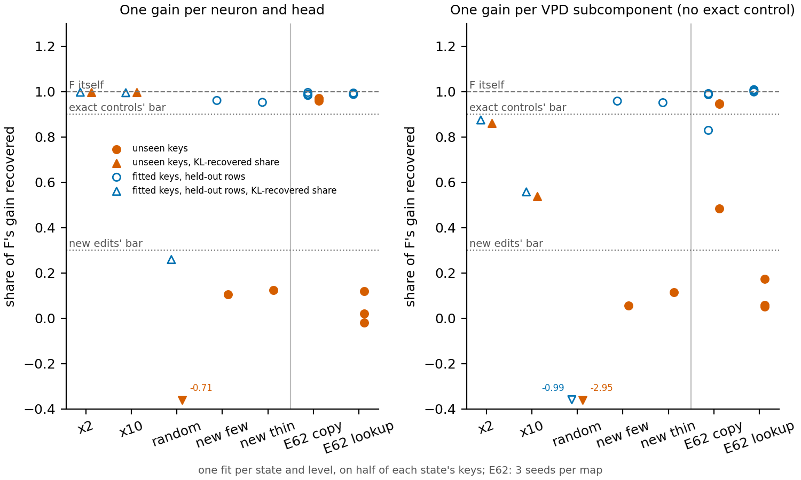

# Does a gain-only fit carry over to cues it never saw? (E291)

We repeated the gain-only fit of the first run, but fitted each fine-tune on half of its cue or key tokens and read the fit on the other half, which it never saw. On tokens it never saw, the fit still rebuilds changes that apply one rule to every key, the exact rescalings and E62's copying map, and does not rebuild changes that give each key its own answer, the built new edits and E62's lookup. For `GOALS.md` this separates a shared rule from a per-key answer, not yet reuse from new: no control here rescales a per-key answer M already gives, and no verdict is given while the working definition is under revision.

## The answer

Read on keys the fit never saw, the gain-only share separates changes that apply one rule to every key from changes that give each key its own answer. The exact rescalings keep nearly all of their change and the copying map stays near one. The built new edits fall to about a tenth and the lookup near zero. Held-out windows of the fitted keys separate nothing, as in the first run. A per-key answer the fit never saw cannot carry over whatever its mechanism, so this is not yet a reading of reuse against new.

## What we were trying to test

The first run of this cell fitted, for each fine-tuned model F, a copy G of the original model M in which every part's output is multiplied by its own gain. All gains start at 1, and Adam moves them so that G's next-token distribution matches F's on training rows. It then read two numbers on held-out rows:

- **The share**: G's gain in the log-odds of F's trained answer over M, divided by F's own gain. It reads 1 when gains alone rebuild F's answer and 0 when they cannot move it. It is read only where F's gain is at least one log-odds.
- **The KL share**: $1 - \mathrm{KL}(F \| G) / \mathrm{KL}(F \| M)$, the share of F's whole change in output that G removes. It reads 1 when G matches F, 0 when G is no closer to F than M, and below 0 when G ends further from F than M started.

That run's built new edits read nearly all of their gain, so the reading could not tell an installed answer from a rescaled one. Its held-out rows were new windows of the same cues the fit had seen. A fit can learn each fitted cue's answer and still be read as recovering it.

This run splits every state's rows by their key, the token that decides the trained answer. The fit sees a seeded half of the keys. The two readings are taken on three row sets: the keys the fit never saw, called unseen; held-out rows of fitted keys, the first run's reading; and the fit's own rows. Keys are the 8 cue tokens of the built new edits and the random change, the 24 copied tokens of the exact controls, and the 32 tokens before the marker in E62's windows.

Two levels of parts, as in the first run. At the neuron level there is one gain per MLP neuron and per attention head, 12,312 in all. At the VPD level there is one gain per subcomponent of the 24 decomposed matrices plus one per matrix remainder.

The states, and what each rules out:

- **Exact rescalings**, x2 and x10, multiply eight layer-1 copy neurons' outputs by 2 and by 10. At the neuron level a gain on those neurons reproduces them on every key. If they fall on unseen keys, the fit itself fails to carry over and nothing else can be read.
- **Two built new edits**, new_few and new_thin, write a new answer for each cue token through weights M does not use for it. Gains fitted on four cues have never seen the other four cues' answers. If they still rebuild those answers, gains imitate any narrow change and the reading cannot separate anything.
- **A random change** matched in output change to the new edits. It is descriptive.
- **E62's two fine-tunes**, three seeds each: a copying map that reuses M's induction head and a lookup that maps each key to its own word.

These E62 fits were read on E62's own task windows, 800 to fit and 200 to read, each map with its own trained answer. Of these, 378 fit rows and 97 read rows have fitted keys and 103 read rows have unseen keys. Earlier cells quoted E62 on a different, mixed set: E257's 512 windows of E187's read half, of which 206 are copy windows. That figure is confirmed in E280's records and redteam-lead's digest, but this run did not read that set. Whatever separates here is between these two fine-tunes on E62's task windows.

The fit is the first run's with a longer horizon: 2000 steps at rate 0.1 with warm-up and cosine decay, batch 64.

## What we expected, and why

The exact rescalings should keep a KL share of at least 0.95 on unseen keys, and the job stopped if either fell under 0.9. The new edits should fall to a share of at most 0.3 on unseen cues, since no gain has seen those answers; if either stayed above it, the job stopped before E62. Run 1 read the new edits at 0.967 and 0.969 on fitted cues. For E62 at the neuron level, the copying map was expected at least 0.8 on unseen keys and the lookup at most 0.3, a gap of about 0.7. The cell is descriptive: the gap is read, but no claim rests on its bar.

## What we observed

Figure: `experiments/gain_share/figures/gain_share_unseen.png`. Filled orange marks are read on unseen keys, open blue marks on held-out rows of fitted keys. Circles are the share; triangles are the KL share, used where F's gain on the answer is under one log-odds. Arrows at the bottom edge are readings below the axis, labelled with their value. The dashed line is F itself; dotted lines are the exact controls' bar and the new edits' bar.

### Did the apparatus do what it should when nothing changes?

Yes, at both levels. With every gain at 1, G's logits matched M's bit for bit and the exported weight change was exactly zero. A random gain state's exported weights reproduced its hooked logits to 1.8e-5 relative at the neuron level, against a bar of 1e-3. A shuffled one missed by 1.40, against a floor of 0.1. At the VPD level the remainder identity held to 1.6e-9 relative, under the filed 3e-6. A do-nothing F equal to M read zero change, and two fit steps moved no gain.

### Do the exact rescalings carry over to unseen keys?

**Reading it.** Yes. At the neuron level x2 and x10 removed 0.996 and 0.995 of F's change on unseen keys, against the stop at 0.9. On fitted keys they read 0.997 and 0.994, so the split cost them nothing. Their share itself is not read, because these edits do not raise the copied token: F's gain on that answer over unseen rows is -0.07 for x2 and -1.94 for x10. A gain under one log-odds leaves the share's denominator too small to divide by, so the KL share is their reading in both rows.

### Do the built new edits fall on unseen cues?

**Reading it.** Yes, and this is the gate that run 1 could not pass. At the neuron level new_few and new_thin read a share of 0.105 and 0.124 on unseen cues, against a bar of 0.3. On held-out windows of fitted cues the same fits read 0.960 and 0.952. F's gain on the unseen cues was about 15 log-odds, so the denominator is large. The fit matched F on its own rows: its training KL was 0.00548 for new_few, against a distance of 9.26 between F and M on unseen cues. On unseen cues G stayed nearly as far from F as M is, at 8.14. So the fit learned the four fitted cues' answers and nothing that carries to the other four.

### What did the random change read?

The matched random change read a KL share of -0.71 on unseen cues at the neuron level, and 0.26 on held-out windows of fitted cues. Negative means G ended further from F on unseen cues than M itself is: KL from F rose from 0.188 under M to 0.322 under G. On its own fit rows G removed 0.91 of the change. So the fit over-fits to the fitted cues: what it learned there moves the output the wrong way on the others. The plan expected about 0.27 on both sides. The unseen-key readings therefore mix carry-over with fit error. Redteam-lead's reading is that over-fitting lowers an unseen-key reading, so the new edits' fall to about a tenth may understate what a gain-only fit could carry over. A less over-fit fit, early-stopped or averaged over more fit seeds, might read higher on unseen cues and weaken the gate. This run did not test that.

### Does the share separate E62's copying map from its lookup on unseen keys?

**Reading it.** Yes at the neuron level, and the separation appears only on unseen keys. The copying map's three seeds read 0.959 to 0.970 on keys the fit never saw. The lookup's read -0.020 to 0.119. The gap of the means is 0.926, against an expected 0.7. The lookup's three seeds have a standard deviation of 0.072 and the copying map's 0.006, so the gap is about 13 lookup standard deviations, or about 18 of the two pooled. On held-out windows of fitted keys both maps read near 1, and the gap is -0.0007. This is the first run's failure reproduced at this fit, beside the new reading. At the neuron level, with only half the keys fitted, gains rebuild the copying map's answers on new keys and do not rebuild the lookup's. The lookup gives each key its own word, so its fall is expected whatever its mechanism; only the copying map's carry-over says something about gains. This separates these two fine-tunes, a shared rule against a per-key answer, and the gap is not a reading of reuse against new. It is not a reuse or new verdict, which is not given under any wording while the definition is under revision.

### What does the VPD level show?

The same direction, with weaker controls. There is no exact positive control at this level, because x2 and x10 are not exactly a gain on VPD subcomponents. They read a KL share of 0.86 and 0.54 on unseen keys. The new edits read 0.056 and 0.114 on unseen cues, against about 0.95 on fitted cues; the table has each. The random change read -2.95 on unseen cues and -0.99 on fitted ones. E62's copying map read 0.946 and 0.947 on unseen keys for two seeds and 0.484 for the third. The lookup read 0.057 to 0.173, and the gap of the means is 0.699.

Redteam-lead asked that this level be read only beside how flat each fit ended and how far training KL sits under held-out KL. Every VPD fit had flattened, changing by under 0.05 over its last 200 steps. Held-out KL sits above training KL on every fit, at both levels; the tables give both. The copying seed s1 is the outlier. Its unseen KL from F is 3.11, against 0.101 and 0.0703 for the other two seeds. It also reads lowest on fitted keys, at 0.828. Its training KL, 0.00405, is about ten times its siblings', so this fit also ended further from F on its own rows. One fit seed per state cannot say whether that comes from the fit or from the fine-tune.

### Full tables

Shares, per state and level. "Not read" means F's gain on the answer is under one log-odds, or there is no single trained answer.

| state | level | share, fitted keys | share, unseen keys | KL share, fit rows | KL share, fitted keys | KL share, unseen keys |
|---|---|---|---|---|---|---|
| x2 | N | not read | not read | 0.998 | 0.997 | 0.996 |
| x10 | N | not read | not read | 0.998 | 0.994 | 0.995 |
| random_kl_241002 | N | not read | not read | 0.908 | 0.258 | -0.713 |
| new_few | N | 0.96 | 0.105 | 1 | 0.985 | 0.121 |
| new_thin | N | 0.952 | 0.124 | 0.999 | 0.987 | 0.161 |
| e62/copy_s0 | N | 0.987 | 0.959 | 1 | 0.99 | 0.997 |
| e62/copy_s1 | N | 0.983 | 0.97 | 1 | 0.984 | 0.997 |
| e62/copy_s2 | N | 0.996 | 0.969 | 1 | 0.976 | 0.997 |
| e62/lookup_s0 | N | 0.987 | 0.0198 | 1 | 1 | 0.037 |
| e62/lookup_s1 | N | 0.993 | 0.119 | 1 | 0.999 | 0.22 |
| e62/lookup_s2 | N | 0.988 | -0.0203 | 1 | 1 | -0.0382 |
| x2 | V | not read | not read | 0.956 | 0.874 | 0.859 |
| x10 | V | not read | not read | 0.884 | 0.557 | 0.538 |
| random_kl_241002 | V | not read | not read | 0.947 | -0.99 | -2.95 |
| new_few | V | 0.958 | 0.0561 | 1 | 0.985 | 0.0512 |
| new_thin | V | 0.951 | 0.114 | 1 | 0.988 | 0.131 |
| e62/copy_s0 | V | 0.991 | 0.946 | 1 | 0.995 | 0.988 |
| e62/copy_s1 | V | 0.828 | 0.484 | 0.999 | 0.957 | 0.62 |
| e62/copy_s2 | V | 0.986 | 0.947 | 1 | 0.964 | 0.991 |
| e62/lookup_s0 | V | 0.998 | 0.0568 | 1 | 0.999 | 0.106 |
| e62/lookup_s1 | V | 1.01 | 0.173 | 1 | 0.999 | 0.319 |
| e62/lookup_s2 | V | 1 | 0.0496 | 1 | 1 | 0.0913 |

Fits, per state and level. KL values are in nats at each state's read position. The last column is the relative change in training loss between the last two checks, 200 steps apart; it is under 0.05 on 20 of 22 fits, all but x2 and x10 at the neuron level.

| state | level | KL(F‖M) unseen | KL(F‖G) fit rows | KL(F‖G) fitted keys | KL(F‖G) unseen keys | loss change, last 200 steps |
|---|---|---|---|---|---|---|
| x2 | N | 0.0945 | 0.000211 | 0.000372 | 0.000378 | 0.111 |
| x10 | N | 0.652 | 0.00168 | 0.00432 | 0.00297 | 0.0676 |
| random_kl_241002 | N | 0.188 | 0.0154 | 0.123 | 0.322 | 0.0085 |
| new_few | N | 9.26 | 0.00548 | 0.177 | 8.14 | 0.0151 |
| new_thin | N | 9.48 | 0.00654 | 0.156 | 7.95 | 0.0177 |
| e62/copy_s0 | N | 8.21 | 0.000617 | 0.0723 | 0.0248 | 0.0422 |
| e62/copy_s1 | N | 8.17 | 0.000786 | 0.122 | 0.0264 | 0.038 |
| e62/copy_s2 | N | 8.21 | 0.000644 | 0.186 | 0.025 | 0.0244 |
| e62/lookup_s0 | N | 8.35 | 0.00108 | 0.00368 | 8.04 | 0.0222 |
| e62/lookup_s1 | N | 8.35 | 0.00117 | 0.009 | 6.52 | 0.0362 |
| e62/lookup_s2 | N | 8.36 | 0.000662 | 0.00215 | 8.68 | 0.000854 |
| x2 | V | 0.0945 | 0.00452 | 0.0137 | 0.0133 | 0.0439 |
| x10 | V | 0.652 | 0.0862 | 0.347 | 0.302 | 0.0128 |
| random_kl_241002 | V | 0.188 | 0.00894 | 0.33 | 0.743 | 0.0204 |
| new_few | V | 9.26 | 0.00324 | 0.18 | 8.78 | 0.0187 |
| new_thin | V | 9.48 | 0.00353 | 0.147 | 8.24 | 0.0219 |
| e62/copy_s0 | V | 8.21 | 0.000334 | 0.0372 | 0.101 | 0.0444 |
| e62/copy_s1 | V | 8.17 | 0.00405 | 0.323 | 3.11 | 0.0383 |
| e62/copy_s2 | V | 8.21 | 0.000361 | 0.278 | 0.0703 | 0.0202 |
| e62/lookup_s0 | V | 8.35 | 0.00064 | 0.00489 | 7.47 | 0.0213 |
| e62/lookup_s1 | V | 8.35 | 0.000643 | 0.0101 | 5.69 | 0.0327 |
| e62/lookup_s2 | V | 8.36 | 0.000356 | 0.00244 | 7.59 | 0.00433 |

Each F was first checked against its saved reading before its rows were split, as in the first run, and every check held.

### Beside the earlier priors

E231 trained gains on the task itself, on every key, and reached 0.63 of the lookup's gain. The first run's KL fit reached 0.97 of it on held-out windows of fitted keys, averaged over seeds. This run reads the lookup at 0.039 on average on unseen keys at the neuron level. The three differ in target, horizon and which keys are read, and this run tested none of those differences one at a time.

## What we learned

Held-out windows of fitted cues could not separate anything: the first run's new edits and both E62 maps read near 1 there, and so do this run's fitted-key columns. Keys the fit never saw do separate, at the neuron level, on both the built controls and on E62. Gains fitted on half the keys rebuild the changes that act the same way on every key: the rescalings and the copying map. They do not rebuild the changes that write a different answer per key: the new edits and the lookup. That is the claim this run supports: a shared rule against a per-key answer. Both built arms differ in two ways at once, rescaled against installed and shared against per-key, so the split cannot yet tell rescaled from new. A per-key rescaling, gains on parts through which M already gives each key its own answer, is the missing control. If it holds near 1 on unseen keys, the split separates rescaled from new among per-key changes; if it falls, the copy-against-lookup gap is a property of the two tasks.

## How compelling is the evidence

At the neuron level the gate is clear: the exact controls sit about 0.1 above their bar, the new edits about 0.2 under theirs, and E62's gap of 0.926 is about 13 times the lookup seeds' standard deviation of 0.072, from the three seeds in the results file. The main blind spot: every per-key change here is also new, so a fall on unseen keys cannot be told from a per-key answer that no fit could predict. The reading is also blind to which of M's parts carry the recovered gain. It is also blind to whether a change that transfers does so by M's mechanism or by a gain pattern that happens to work on every key; a rescaling transfers by construction. The new edits and the random change have only 4 unseen cues each, so their unseen share is a mean over 4 answers. The fit over-fits to fitted cues, as the random change shows, so unseen-key readings mix carry-over with fit error. Each state had one fit seed; E62 had three fine-tune seeds per map. This is one task family. The VPD level has no exact positive control and is descriptive only.

## Surprises

- The matched random change read -0.71 at the neuron level and -2.95 at the VPD level on unseen cues: the fit moved G away from F there. The plan expected about 0.27.
- One VPD copying seed read 0.484 on unseen keys where its siblings read about 0.95.
- The copying maps' KL from F at the neuron level is lower on unseen keys than on held-out windows of fitted keys. This run does not show why.

## What next

- A per-key rescaling control: gains on parts through which M already gives each key its own answer, read on unseen keys. If it holds near 1, the split separates rescaled from new among per-key changes; if it falls, the split reads only shared rule against per-key answer.
- A less over-fit fit, early-stopped or averaged over more fit seeds. If the new edits then read well above a tenth on unseen cues, the gate weakens.
- An exact VPD positive control, one subcomponent doubled. If it reads near 1 on unseen keys, the VPD gap can be read beside the neuron one.
- Two more fit seeds for every state. If the VPD copying seed s1 recovers on a second fit seed, its low reading is the fit, not the fine-tune.
- The same split on other tasks with a known reuse or new label. If the gap holds, the reading is a candidate method for the paper's comparison.

## Scorecard

| id | claim in words | rule | read | verdict |
|---|---|---|---|---|
| stage 0 | gains of 1 change nothing; export, remainder, do-nothing checks | filed bars | all held at both levels | pass |
| stop_exact | x2 and x10 carry over to unseen keys at neurons | KL share at least 0.9 | 0.996, 0.995 | pass |
| gate | new edits fall on unseen cues at neurons | share at most 0.3 | 0.105, 0.124 | pass, separated |
| P at N | copy above lookup on unseen keys at neurons | gap at least 0.1 | 0.926 | met, descriptive |
| P at V | copy above lookup on unseen keys at VPD | gap at least 0.1, no exact control | 0.699 | met, descriptive |
| verdict | reuse or new | none while the definition is under revision | none | none |

## Not run

- A per-key rescaling control, which the split needs before it can tell rescaled from new.
- A less over-fit fit, early-stopped or averaged over more fit seeds, to test whether the new edits' unseen-key reading is held down by over-fitting.
- An exact positive control at the VPD level, one VPD subcomponent doubled.
- More fit seeds per state; each state had one.
- Other tasks: only the built cue items, the copy controls and E62's task.
- E62's maps read on the mixed set of 512 windows that earlier cells used.
- E280's head edits, which run 1 read and this run did not.
- Which gains carry the recovered gain on unseen keys; the saved gains are in `experiments/gain_share/results/large/gains_unseen/`.

## Departures from the literature

- The gain-only fit is ours. Liu et al. 2022 train per-activation gains on the task loss at a constant rate of 3e-3. Here gains are fitted to F's output distribution at rate 0.1 with warm-up and cosine decay, batch 64. The fit runs 2000 steps, as in the first run but longer.
- Splitting rows by key to read on unseen keys is ours.

## Provenance

Results `experiments/gain_share/results/unseen/{stage0,controls,e62}_{N,V}.json`, per-fit files under `controls_{N,V}/` and `e62_{N,V}/`, logs `run_N.log` and `run_V.log`. Filed predictions `experiments/gain_share/results/unseen/predictions.json`, card `experiments/gain_share/card_unseen.md`, code `experiments/gain_share/unseen.py`. Ran 2026-11-23 on one H100 RunPod pod, not the cluster debug queue the card planned; 48 minutes and $3.29 as reported by the runner. Peak host memory 6.2 GB. Run 1's page: `reports/analyses/2026-11-23_analysis_p1-58-gain-share.md`.
