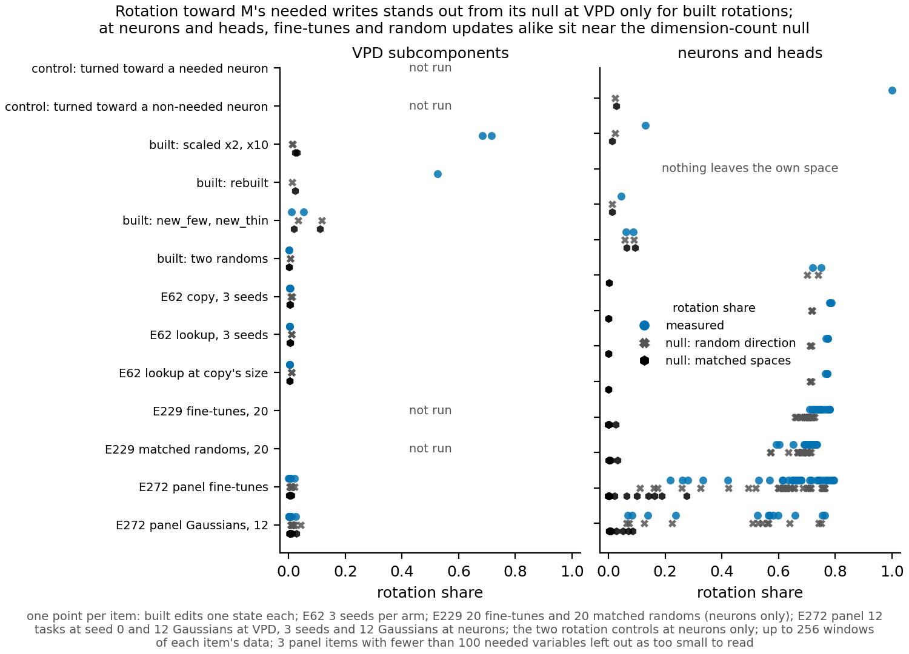

# Does a fine-tune turn a needed variable's write within the space the base model already writes into?

Cell `P1.60`, experiment `E286`, 2026-11-23. A diagnostic beside the frozen reuse definition, not a change to it; no verdict
on reuse is given under it.

## The answer

No trained fine-tune turned its most-needed writes toward the space the base model's other needed variables already use,
beyond what a random direction would do. On VPD subcomponents only the built rotations stood out from the null. At
neurons and heads that space is so wide that random updates fill it as fully as fine-tunes do. The literal "inside the
variable's own write space" share is degenerate and was not used. A pure attention-head gauge rotation reads fully
kept at heads but not at VPD.

In plain words: we asked whether fine-tuning keeps a needed part's output direction inside the directions the base
model already writes, rather than along exactly the base model's direction. We found that this looser reading moves
only for edits built to rotate, and gives trained and random updates the same reading at every featurization we tried.
For `GOALS.md`, the low kept readings of trained fine-tunes are not explained by fine-tunes rotating needed writes
within the base model's needed space, so a rotation-tolerant kept would not rescue them.

## Terms used here

- M is the base model, F the fine-tuned one. A variable is a VPD subcomponent, a neuron, an attention head or a
  remainder, as in `GOALS.md` → Terms.
- A variable's write is what it adds to the residual stream, on every position of up to 256 windows of the item's data,
  in F's own run. The write change is F's write minus M's write on the same input; dd is its summed squared size.
- The read set is the top 1% of needed variables that the update changed, ranked by flips from the saved scan. A flip is
  a tested input pair on which setting the variable to its other-input value changes F's top token.
- Strict kept share: the frozen definition's kept, the part of dd that is M's write times one gain on every row.
- Own-space share: the part of dd inside the directions M's own write for that variable spans, holding 99% of its energy.
- Needed-space share: the part of dd inside the span of that own space and the own spaces of M's other most-needed
  variables at the same site. A site is one matrix at VPD, and one layer's MLP or attention at neurons and heads.
- Rotation share: of the change that leaves the own space, the part that lands in the needed space. It reads 1 when the
  change turns fully toward M's other needed writes and 0 when it goes elsewhere.
- Two nulls for the rotation share. The dimension-count null is what a random direction gives, the needed space's extra
  dimensions over the free dimensions. The matched null swaps the other needed variables for as many non-needed
  variables at the same site.
- Every share is pooled over the read set, weighted by each variable's dd, with remainders left out.

## 1. The literal own-space share is degenerate

The question as first put was "is F's write inside M's own top-k subspace for that variable". For a neuron or a VPD
subcomponent, M's write has one direction on every input. So its own space is one line, and a random direction lands
in it with probability one over the width. That null is 0.001 at both featurizations.

On that line the own-space share credits any change in how strongly the variable fires. So it reads high for random
updates too. The table puts the three shares side by side with each share's exact null for a random direction.

| item class | featurization | strict kept | own-space | own-space null | needed-space | needed-space null |
| --- | --- | --- | --- | --- | --- | --- |
| built doubling and tenfold of MLP columns | VPD | 0.76 | 0.78 | 0.001 | 0.94 | 0.015 |
| two built random updates | VPD | 0.009 | 0.080 | 0.001 | 0.081 | 0.008 |
| copy fine-tunes, 3 seeds | VPD | 0.025 | 0.233 | 0.001 | 0.235 | 0.013 |
| two built random updates | neurons and heads | 0.009 | 0.71 | 0.11 | 0.92 | 0.68 |
| twenty toy fine-tunes | neurons and heads | 0.091 | 0.85 | 0.11 | 0.96 | 0.71 |
| their twenty matched random updates | neurons and heads | 0.009 | 0.65 | 0.080 | 0.90 | 0.61 |

Values are medians over the items in a row. On neurons alone, the random updates' own-space share is 0.82 for the
built pair. It is 0.93 for the toy matched randoms. Both sit far above a single neuron's null of one over 768.

So the own-space share for one-direction variables splits a change into input side and output side. It does not see
rotation. That is why the needed-space share was used instead. Heads are the one exception: a head writes through a
space of about 100 dimensions, and section 3 reads its own-space share directly.

## 2. Built rotations stand out at VPD; nothing trained does, at either featurization

**Reading it.** At VPD only the edits built to keep M's mechanisms read a rotation share far above both nulls. The
doubling and tenfold edits read 0.68 and 0.71 against nulls of at most 0.03. The rebuilt edit reads 0.52. Every trained item
sits on its null, as the built randoms do. At neurons and heads the rotation controls behave as built, but the needed
space at a layer's attention covers most of the residual width. Most fine-tunes and random updates there read 0.6 to 0.8,
and the dimension-count null reads almost the same.

The matched null at neurons and heads reads near zero, but it is not a valid reference there. A layer has six heads, and
the needed ones fill the site, so no non-needed head is left to draw. The matched space then equals the own space. Heads
carry most of the change at that featurization: between 0.64 and 0.98 of dd for every fine-tune.

One line per item class follows. "Above the null" is the rotation share minus the dimension-count null, as a range over
the items.

| item class | featurization | items | rotation share | dimension-count null, median | above the null |
| --- | --- | --- | --- | --- | --- |
| rotation control: a neuron's column turned 30° toward a needed neuron | neurons | 1 | 1.000 | 0.022 | 0.978 |
| rotation control: the same turn toward a non-needed neuron | neurons | 1 | 0.131 | 0.022 | 0.108 |
| built doubling, tenfold | VPD | 2 | 0.68 to 0.71 | 0.014 | 0.67 to 0.70 |
| built doubling, tenfold | neurons | 2 | nothing leaves the own space | none | none |
| built rebuilt | VPD | 1 | 0.52 | 0.013 | 0.51 |
| built rebuilt | neurons | 1 | 0.045 | 0.012 | 0.033 |
| built new_few, new_thin | VPD | 2 | 0.010, 0.052 | 0.075 | −0.066 to −0.023 |
| built new_few, new_thin | neurons | 2 | 0.061, 0.087 | 0.074 | −0.003 to 0.004 |
| two built random updates | VPD | 2 | 0.001 | 0.007 | −0.006 to −0.005 |
| two built random updates | neurons and heads | 2 | 0.72 to 0.75 | 0.72 | 0.010 to 0.019 |
| copy fine-tunes, 3 seeds | VPD | 3 | 0.003 to 0.006 | 0.011 | −0.008 to −0.004 |
| copy fine-tunes, 3 seeds | neurons and heads | 3 | 0.78 to 0.79 | 0.72 | 0.062 to 0.072 |
| lookup fine-tunes, 3 seeds | VPD | 3 | 0.003 | 0.010 | −0.008 to −0.007 |
| lookup fine-tunes, 3 seeds | neurons and heads | 3 | 0.77 | 0.71 | 0.051 to 0.062 |
| lookup at copy's update size, 3 seeds | VPD | 3 | 0.003 to 0.004 | 0.011 | −0.008 to −0.007 |
| lookup at copy's update size, 3 seeds | neurons and heads | 3 | 0.77 | 0.71 | 0.050 to 0.062 |
| toy fine-tunes, 10 tasks, 2 seeds | neurons and heads | 20 | 0.71 to 0.78 | 0.70 | 0.019 to 0.089 |
| their matched random updates | neurons and heads | 20 | 0.59 to 0.74 | 0.69 | 0.015 to 0.038 |
| realistic panel fine-tunes, seed 0 | VPD | 11 | 0.000 to 0.022 | 0.009 | −0.007 to 0.001 |
| realistic panel Gaussians | VPD | 12 | 0.001 to 0.026 | 0.009 | −0.017 to −0.007 |
| realistic panel fine-tunes, 3 seeds | neurons and heads | 34 | 0.22 to 0.80 | 0.63 | 0.009 to 0.13 |
| realistic panel Gaussians | neurons and heads | 12 | 0.068 to 0.76 | 0.54 | 0.005 to 0.035 |

Three panel items had fewer than 100 needed variables and are left out as too small to read: sentiment at VPD, and
category seed 1 and named-entity seed 0 at neurons.

At neurons and heads the trained items sit a few hundredths higher than the randoms. The toy fine-tunes read above
their own matched random on 19 of 20 pairs. The largest such gap is 0.19, and none reaches the 0.2 the filed rotation
rival asked for. On neurons alone the toy fine-tunes' median rotation share is 0.052 against a null of 0.040. Their
matched randoms read 0.038 against 0.035. The rest of the excess sits in the heads, where the needed space is too wide to separate a rotation from a slightly
uneven random direction.

The copy and lookup fine-tunes do not differ on the needed-space share. Copy minus lookup on the three-seed mean is
−0.056 at VPD and 0.002 at neurons and heads, both far inside the filed 0.2.

## 3. Head (2,4) on the copy windows: lost for copy, untouched for lookup, and inside its own space for both

Head (2,4) carries the copy behaviour in the paper's account. It was read alone at the head featurization, on the 206
copy windows, for three seeds of each arm. Its strict kept share is low for copy and near zero for lookup. Its flips
show copy needs it and lookup does not. Its own-space share is about six times its null for both arms.

| arm, seed | strict kept | own-space | own-space null | flips of 256 pairs |
| --- | --- | --- | --- | --- |
| copy, 0 | 0.187 | 0.803 | 0.137 | 252 |
| copy, 1 | 0.130 | 0.800 | 0.137 | 245 |
| copy, 2 | 0.173 | 0.807 | 0.135 | 246 |
| lookup, 0 | 0.013 | 0.852 | 0.133 | 0 |
| lookup, 1 | 0.011 | 0.835 | 0.133 | 1 |
| lookup, 2 | 0.005 | 0.861 | 0.134 | 1 |

**Reading it.** Copy's fine-tune changes head (2,4)'s write mostly by turning it within the head's own write space, not
by a gain. That is what "rotation-tolerant kept" would credit. The lookup fine-tune keeps the head's write just as
inside its own space, so the own-space share alone does not tell the arms apart. What separates them is the flips:
copy depends on the head on nearly every pair, lookup on almost none. The own-space null is one head's write
dimensions over the width, about 104 of 768.

## 4. The attention-head gauge, after Singh 2026

Attention has a symmetry: per head, the query and key matrices can be turned together, and the value and output
matrices likewise, without changing the network's function. A kept reading that is meant to see mechanisms should read
fully kept under such a turn.

**First: a pure gauge turn of M.** M was turned by a random per-head gauge and read as F against M. The turned model's
logits stayed within 2 times the round-trip rounding floor, under the bar of ten times it. At neurons and heads the
turned model reads kept up to rounding: the largest change relative to M's write was 1.2e-12. At VPD it does not. The
strict kept share at write scale reads 0.37, and the needed-space version 0.40.

VPD decomposes the query, key, value and output matrices separately, and each subcomponent spans all six heads of a
layer. So the turn moves each subcomponent's write by more than M's own write, while only their sum is unchanged.
Pooling each layer's attention into one variable reads kept at the rounding floor again. The worst layer changed by
1.1e-12 relative, against the bar of 1.24e-10. The drop at VPD is a property of reading kept per VPD subcomponent, not
a fault in the kept test.

**Second: how much of a trained head update lies along the gauge.** We measured the share of each trained update's squared norm on
the head matrices that lies along the gauge's tangent at M. Each is shown beside a random update matched
in size per matrix.

| updates | count | trained, median | trained, range | matched random, median |
| --- | --- | --- | --- | --- |
| copy and lookup fine-tunes | 9 | 0.0069 | 0.0067 to 0.0069 | 0.043 |
| toy fine-tunes | 20 | 0.012 | 0.0059 to 0.015 | 0.040 |
| realistic panel fine-tunes | 36 | 0.011 | 0.0040 to 0.022 | 0.040 |

Trained head updates put about 1% of their squared norm on gauge directions, under a random update's 4%. Removing that
first-order gauge part from each copy, lookup and toy fine-tune and reading VPD again moved no class by more than 0.0010.
Over all 29 states the readings themselves are at most 0.13 strict and 0.46 on the needed-space share. They fall far
short of kept, so the gauge part of trained updates does not explain the low kept share.
Two classes moved by 0.66 and 0.74 of their seed spread, so the move is small against the readings but not against the
seed spread. This is a claim about trained updates, not that VPD is gauge invariant.

## 5. Deviations

- **The predictions file changed between runs, not its rules.** The stages submitted from 16:59 to 17:18, among them
  the VPD panel, copy and lookup, and head (2,4), ran under the file with sha256 prefix `7f7548627bf2`, commit
  `3ee3bc2d`. The gauge stage at 17:34 ran under `1591657bac1f`, which only adds the gauge block. The gauge follow-ups
  from 18:12, and the toy pairs and neuron panel from 18:50, ran under the current file, prefix `6fb7ee67e6ba`, commit
  `e04b3f86`. With the gauge and gauge follow-up blocks removed, the three versions are identical in settings, readings,
  rules and expected values. This was checked by `diff` on the key-sorted JSON; the gauge block is identical too.
- **The transcription tolerance was amended once, before any scored run.** The check that the doubling edit's summed
  sums repeat the saved arrays was filed at 1e-09 relative. The first rehearsal stopped on it at a deviation of 2.1e-8 on
  an L40S, from fp32 rounding. It was amended to 1e-06 with whip-lead's yes at commit `3ee3bc2d`. The rotation controls
  and every other rule were unchanged.
- **The gauge is the rotary one.** Singh 2026 turns query and key by any invertible matrix and its inverse transpose.
  The 67M applies the rotary embedding over the whole head, so only a turn and a scale per rotary pair of dimensions
  leaves attention unchanged. The query and key gauge and its tangent are restricted to those; value and output keep
  the full group. redteam-lead judged this a correction for a rotary model, not a departure.
- **The pool at VPD is the layer, not the head.** redteam-lead asked for each head's query, key, value and output
  subcomponents pooled per head. VPD's subcomponents span all six heads of a layer, so a per-head pool is not defined
  from them. The layer's attention output was pooled instead.
- **The VPD panel used one derangement of the scan pairs and seed 0 only**, against the original panel's four
  derangements and three seeds, to fit the debug queue.
- **The needed-space share replaced the own-space share** as the main reading, after the degeneracy in section 1.
  whip-lead approved it as a measurement choice inside the approved diagnostic.
- **The summary file mislabels the gauge items.** `results/summary.json` files the gauge and gauge follow-up records
  under keys starting `head24/`, because its writer gives a record with no basis that label. Every number here is read
  from the item files, which are correct.

Departures from the literature: the rotary restriction of Singh 2026's gauge, above. None other.

## 6. For the Discussion: rotation-tolerant kept as a starting point

A natural loosening of "kept" asks only that a fine-tune keep a needed part's output inside the directions the base
model already writes, rather than along exactly the same direction. We tried this as a diagnostic and it did not rescue
the low kept readings of trained fine-tunes. At the subcomponent level it credits only edits built to preserve the base
model's mechanisms. At the neuron and head level the base model's needed directions already fill most of the residual
stream, so random updates pass as easily as trained ones. Two things would make it a usable test. First, a reference
space narrow enough that a random update cannot fill it. Second, a featurization whose variables do not change under
the attention symmetry that leaves the network's function unchanged. One copy head shows the idea can see something:
fine-tuning turned that head's output within its own space rather than scaling it.

## Scorecard

| id | claim in words | rule | read | verdict |
| --- | --- | --- | --- | --- |
| R0 | do-nothing reads exactly kept | dd 0, read set empty, shares 1 | as filed at both featurizations | held |
| R1 | doubling at neurons stays in its own space and repeats saved sums | own share at least 1 − 1e-9, sums within tolerance | own 1.0, sums within 5e-16 | held |
| R2 | strict ≤ own ≤ needed on every variable | within 1e-09 of dd | no miss on any item | held |
| R3 | turned toward a needed neuron reads 1; toward a non-needed one at most 0.5 | as filed | 1.000 and 0.131 | held |
| G0 | the gauge-turned M computes M's function | logits within ten times the round-trip floor | about 2 times | held |
| rivals | rotation share 0.2 above the matched random on most trained items; copy's needed share 0.2 above lookup's | as filed | 0 of 20 toy pairs; gap −0.056 and 0.002 | rival B, rotation not seen |
| stop | trained items within 0.05 of the null at both featurizations drops the rotation guess | as filed | VPD: every trained item; neurons and heads: up to 0.13 above the dimension-count null, with the matched null invalid there | VPD met; neurons and heads no call |

## Not run

- The toy fine-tunes and their randoms at VPD: no VPD scan of them exists.
- The VPD panel's seeds 1 and 2, and three of four derangements.
- Built rotation controls at VPD: a turned subcomponent's change spreads over many subcomponents, so the answer is not
  known by construction.
- A matched null for heads that draws from other layers or from random subspaces of a head's width.
- A per-head pool at VPD, not defined from VPD's pieces.
- Head (2,4) at VPD, and on the lookup windows.

## Provenance

- Plan `reports/plans/2026-11-23_plan_p1-60-rotation-kept.md`; card `experiments/rotation_kept/card.md`; filed values
  `experiments/rotation_kept/results/predictions.json`.
- Items `experiments/rotation_kept/results/items/*.json`; per-variable rows `results/large/items_*.npz`; controls
  `results/stage0_*.json`; gauge `results/gauge_g0.json`, `results/gauge_pool_gp0.json`, `results/gauge_sub_summary.json`;
  logs `results/run_gauge_*.log` and `results/pod_dl/logs/`.
- Figure and page numbers: `experiments/rotation_kept/plot.py` writes `figures/rotation_vs_null.png` and
  `results/page.json`, CPU only, from the files above.
- Cluster L40 and L40S cards; no pod spend recorded under this experiment.
