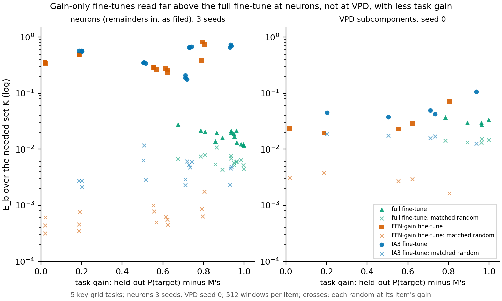

# Does a fine-tune that may only rescale neurons read as kept?

*2026-11-23, definition-lead. Cell P1.61, experiment E290. Plan `reports/plans/2026-11-23_plan_p1-61-ia3-gain-control.md`,
card `experiments/ia3_control/card.md`, filed rules `experiments/ia3_control/results/predictions.json`. Results
`experiments/ia3_control/results/summary.json`, `stage0_*.json`, `items/`, `train/`; figure
`experiments/ia3_control/figures/eb_vs_gain.png` from `experiments/ia3_control/plot.py`.*

We trained fine-tunes of the 67M model that may only turn each neuron's output up or down, on the five key-grid tasks,
and read them with the write share over the needed set beside the full fine-tunes and size-matched random updates. At
neurons they read ten to sixty times higher than the full fine-tunes, but none learned its task as well as the full
fine-tune did, so the filed test of the instrument gives no call. For `GOALS.md` this shows the neuron reading is not
low on every trained update, and says nothing yet about whether the full fine-tunes reuse the model.

## The answer

A fine-tune allowed only to rescale existing neurons reads far higher at neurons than the full fine-tune of the same
task: between ten and sixty-seven times higher, on every task and seed. So the neuron reading can read a trained update
high, and its low readings on full fine-tunes are not a floor of the instrument. But no gain-only fine-tune reached the
full fine-tune's task gain on any task, so the filed comparison makes no call. Read with VPD's subcomponents instead,
the same gain-only fine-tunes read about as low as the full fine-tunes.

## What we were trying to test

Every trained update we had read so far, at every featurization, gave a low write share. A low reading on everything
could mean the fine-tunes change what the model's parts compute, or that the instrument reads low whatever it is
given. This run supplies a trained update whose answer is known by construction.

**The reading.** For each variable of the featurization that the fine-tune needs for the behaviour, the write share
asks how much of the change in that variable's write is explained by the original model's own write times one
positive gain, fitted by least squares. Summed over the needed variables that changed, this is E_b over the needed set
K: 1 when every needed variable writes what the original model wrote up to a gain, 0 when none of the change is of
that kind. The needed set K is found by swapping one variable at a time between inputs and keeping those whose swap
flips the model's top token. Beside every reading we give |K|, the number of needed neurons that changed, and the
median gap between the top two logits; |K| under 100 reads "too small to read". None was: the smallest |K| was 3004
at neurons and 13097 at VPD.

**The arms.** All arms train on the same five tasks, three seeds each, with the full fine-tunes' data, loss, batch and
sampler, and are folded into the weights before reading.
- *FFN-gain fine-tune*, the positive control: only a gain on each MLP neuron's activation trains, 12,288 gains, as on
  `down_proj`'s input. Every neuron then writes its old output times its gain, so each needed neuron is kept exactly.
  It touches no attention head.
- *IA3 fine-tune*, the published method on this model: gains on the keys, the values and the MLP activations, 18,432 in
  all, at the sites HF PEFT uses for llama-style models. Its neurons are kept exactly; its heads are not, because a key
  gain moves the attention pattern.
- *Full fine-tune*, the reference: the saved step-30 updates of the earlier key-grid fine-tunes, every matrix changed.
- *Matched random*, beside every item: a Gaussian change to each changed matrix at that item's size. It rules out that
  any update of this size reads the same.

**The catch in the neuron featurization.** The filed neuron featurization keeps each neuron's strong activations as a
variable and puts the weak part of every neuron of a layer into one remainder variable per layer. A gain on each
neuron is not one gain on the remainder, so even the FFN-gain fine-tune need not read 1 as filed. The check that is 1
by construction is therefore the same reading over the needed neurons only, without the remainders.

**Read step.** Each gain fine-tune is read at the first of steps 10, 30, 100 and 300 where held-out P(target) reaches
one half, else at step 300. The full fine-tunes are read at step 30, as saved.

**Task gain.** The task gain is held-out P(target) minus the original model's. A gain arm counts as reaching the full
fine-tune's gain on a task when its mean share of that gain over three seeds is at least the full fine-tunes' own
spread across seeds, their smallest gain over their largest.

## What we expected, and why

- The neurons-only reading of both gain arms would sit within ten times the rounding floor of 1, since they are kept
  there by construction.
- The FFN-gain arm would reach the full fine-tune's gain on most tasks, with the cipher task the likely exception.
- On the tasks it reached, two rivals were filed. If the instrument reads a gain on the model's own variables as kept,
  the FFN-gain arm would read at least 0.2 above the full fine-tune of the same task and seed. If the instrument reads
  low on any trained update, it would read within 0.2 of it, near the randoms.
- At VPD, everything was descriptive: a gain on one neuron need not be a gain on any subcomponent.

## Stage 0: the controls read as expected

Every job ran its controls alone first and would have stopped on a miss. None missed.

| control | expected | read |
|---|---|---|
| do-nothing, neurons and VPD, seven jobs | no changed variable, largest write change 0, E_b over K 1 | as expected in all seven |
| identity swap at neurons, four jobs | no top-token flip in 788,224 cases each | no flips; largest logit change 5.0e-5 on three jobs, 0.079 on one |
| identity swap at VPD, three jobs | no flip in 6,144 cases each | no flips; largest logit change 2.8e-5 to 4.8e-5 |
| trainer at its start, every gain 1 | folded update exactly 0, P(target) unchanged | 0 nonzero entries; P(target) 0.000275 before and after |
| built gain edit, each neuron times one plus 0.003 times a normal draw | no head changed; neurons-only floor near 1e-10, stop above 1e-6 | no head changed; floor 5.8e-11 over 5596 needed changed neurons |

The one identity job with a largest logit change of 0.079 still flipped nothing; it is listed under Surprises.

## What we observed

### Did the gain fine-tunes learn the tasks as well as the full fine-tune?

**Reading it.** No, on no task, so the filed comparison makes no call. The FFN-gain arm reached 0.8 of the full
fine-tune's gain on copy and 0.71 on rank1, against bars of 0.99 and 0.96. It reached only 0.026 on cipher. The IA3 arm
came closer everywhere, 0.94 on copy and 0.26 on cipher, and also missed every bar. Held-out P(target) rose between
steps 100 and 300 on every task, so this shows what 300 steps of gain training reach, not what gains can reach. Copy
was read at step 100 by the rule, and at step 300 both arms were still below its bar. Cipher is the one task where the
gap reads as evidence that the task needs more than per-neuron gains. There, at step 300, the FFN-gain arm's P(target)
on seed 0 was 0.019, against 0.79 for the full fine-tune. At step 30, where the full fine-tunes are read, the gain arms
had at most 0.32 of the full gain.

| task | full gain, seed 0 | seed 1 | seed 2 | bar | FFN-gain mean share | IA3 mean share | read step of the gain arms |
|---|---|---|---|---|---|---|---|
| copy | 1.00 | 0.99 | 1.00 | 0.99 | 0.8 | 0.94 | 100 |
| rank1 | 0.89 | 0.86 | 0.86 | 0.96 | 0.71 | 0.82 | 300 |
| elicit | 0.96 | 0.95 | 0.95 | 0.98 | 0.59 | 0.77 | 300 |
| cipher | 0.79 | 0.81 | 0.67 | 0.83 | 0.026 | 0.26 | 300 |
| prior_cipher | 0.96 | 0.94 | 0.94 | 0.97 | 0.2 | 0.54 | 300 |

### Do the gain fine-tunes read as kept at neurons?

**Reading it.** Yes on the needed neurons, exactly as built, and far above the full fine-tune as filed. Over the needed
neurons alone, every one of the 30 gain items read 1 to within 2.9e-13, against a bar of ten times the 5.8e-11 floor.
As filed, with the remainders in, the FFN-gain arm read 0.24 to 0.81 and the IA3 arm 0.18 to 0.73, in the left panel.
The full fine-tunes read 0.012 to 0.028 and every matched random at most 0.012. The FFN-gain arm sat between 0.22 and
0.8 above the full fine-tune of the same task and seed, on all 15 pairs. Had the gain bar been met, that is rival A's
pattern; it was not met, so this is a description, not a score.

What pulls the gain arms below 1 is the remainders. For the FFN-gain arm, E_b as filed sits close to one minus the
remainders' share of the needed write change, which ranged 0.19 to 0.77. On the same windows the full fine-tunes'
remainders carried 0.63 to 0.71 of it. The IA3 arm also changed all 24 heads, and without the remainders it read 0.36
to 0.84.

| arm | task | seed | task gain | E_b over K, as filed | matched random | \|K\| | needed changed neurons | median margin | remainders' share |
|---|---|---|---|---|---|---|---|---|---|
| ffn | copy | 0 | 0.80 | 0.73 | 0.0017 | 3263 | 3235 | 2.14 | 0.27 |
| ffn | copy | 1 | 0.79 | 0.39 | 0.00085 | 3014 | 2986 | 2.04 | 0.62 |
| ffn | copy | 2 | 0.80 | 0.81 | 0.00064 | 4881 | 4853 | 2.07 | 0.19 |
| ffn | rank1 | 0 | 0.62 | 0.24 | 0.00055 | 4150 | 4122 | 1.23 | 0.77 |
| ffn | rank1 | 1 | 0.62 | 0.26 | 0.00045 | 5173 | 5145 | 1.23 | 0.74 |
| ffn | rank1 | 2 | 0.61 | 0.28 | 0.00062 | 6215 | 6187 | 1.25 | 0.72 |
| ffn | elicit | 0 | 0.55 | 0.29 | 0.00099 | 4117 | 4089 | 1.27 | 0.72 |
| ffn | elicit | 1 | 0.57 | 0.27 | 0.0005 | 4939 | 4911 | 1.16 | 0.74 |
| ffn | elicit | 2 | 0.56 | 0.29 | 0.00078 | 6036 | 6008 | 1.17 | 0.72 |
| ffn | cipher | 0 | 0.02 | 0.36 | 0.00032 | 7325 | 7297 | 0.52 | 0.66 |
| ffn | cipher | 1 | 0.02 | 0.34 | 0.00061 | 7237 | 7209 | 0.51 | 0.68 |
| ffn | cipher | 2 | 0.02 | 0.36 | 0.00044 | 8048 | 8020 | 0.49 | 0.66 |
| ffn | prior_cipher | 0 | 0.19 | 0.48 | 0.00046 | 5628 | 5600 | 0.65 | 0.53 |
| ffn | prior_cipher | 1 | 0.19 | 0.49 | 0.00075 | 6653 | 6625 | 0.68 | 0.51 |
| ffn | prior_cipher | 2 | 0.19 | 0.49 | 0.00035 | 6200 | 6172 | 0.65 | 0.51 |
| ia3 | copy | 0 | 0.94 | 0.69 | 0.0049 | 4364 | 4336 | 2.18 | 0.14 |
| ia3 | copy | 1 | 0.93 | 0.66 | 0.0023 | 3880 | 3852 | 2.14 | 0.16 |
| ia3 | copy | 2 | 0.93 | 0.73 | 0.0046 | 4498 | 4470 | 2.20 | 0.12 |
| ia3 | rank1 | 0 | 0.71 | 0.19 | 0.0023 | 4051 | 4023 | 1.44 | 0.51 |
| ia3 | rank1 | 1 | 0.71 | 0.21 | 0.0029 | 5376 | 5348 | 1.48 | 0.50 |
| ia3 | rank1 | 2 | 0.72 | 0.18 | 0.0061 | 4168 | 4140 | 1.50 | 0.52 |
| ia3 | elicit | 0 | 0.73 | 0.66 | 0.0048 | 5264 | 5236 | 1.37 | 0.21 |
| ia3 | elicit | 1 | 0.74 | 0.67 | 0.006 | 5166 | 5138 | 1.21 | 0.20 |
| ia3 | elicit | 2 | 0.73 | 0.65 | 0.0053 | 4868 | 4840 | 1.29 | 0.21 |
| ia3 | cipher | 0 | 0.20 | 0.56 | 0.0021 | 6871 | 6843 | 0.77 | 0.29 |
| ia3 | cipher | 1 | 0.20 | 0.57 | 0.0028 | 6156 | 6128 | 0.81 | 0.28 |
| ia3 | cipher | 2 | 0.19 | 0.57 | 0.0028 | 6505 | 6477 | 0.83 | 0.28 |
| ia3 | prior_cipher | 0 | 0.50 | 0.35 | 0.0064 | 6419 | 6391 | 0.98 | 0.42 |
| ia3 | prior_cipher | 1 | 0.51 | 0.34 | 0.0029 | 6021 | 5993 | 1.00 | 0.42 |
| ia3 | prior_cipher | 2 | 0.51 | 0.36 | 0.012 | 5551 | 5523 | 0.96 | 0.41 |
| full | copy | 0 | 1.00 | 0.012 | 0.0045 | 4170 | 4142 | 3.11 | 0.65 |
| full | copy | 1 | 0.99 | 0.012 | 0.0065 | 4038 | 4010 | 2.60 | 0.63 |
| full | copy | 2 | 1.00 | 0.012 | 0.0053 | 3004 | 2976 | 2.81 | 0.68 |
| full | rank1 | 0 | 0.89 | 0.016 | 0.0044 | 4476 | 4448 | 2.51 | 0.71 |
| full | rank1 | 1 | 0.86 | 0.02 | 0.011 | 4787 | 4759 | 2.60 | 0.68 |
| full | rank1 | 2 | 0.86 | 0.014 | 0.0054 | 3961 | 3933 | 2.57 | 0.71 |
| full | elicit | 0 | 0.96 | 0.013 | 0.0062 | 4287 | 4259 | 2.49 | 0.70 |
| full | elicit | 1 | 0.95 | 0.017 | 0.0052 | 5552 | 5524 | 2.37 | 0.66 |
| full | elicit | 2 | 0.95 | 0.019 | 0.0058 | 4581 | 4553 | 2.60 | 0.67 |
| full | cipher | 0 | 0.79 | 0.022 | 0.0076 | 5301 | 5273 | 1.65 | 0.69 |
| full | cipher | 1 | 0.81 | 0.021 | 0.0079 | 7672 | 7644 | 1.56 | 0.66 |
| full | cipher | 2 | 0.67 | 0.028 | 0.0068 | 7343 | 7315 | 1.35 | 0.66 |
| full | prior_cipher | 0 | 0.96 | 0.021 | 0.006 | 6178 | 6150 | 1.83 | 0.68 |
| full | prior_cipher | 1 | 0.94 | 0.021 | 0.0077 | 6054 | 6026 | 2.05 | 0.67 |
| full | prior_cipher | 2 | 0.94 | 0.02 | 0.0069 | 4376 | 4348 | 2.06 | 0.70 |

### Do they read as kept at VPD?

**Reading it.** No: at VPD the gain fine-tunes read about as low as the full fine-tunes, in the right panel, seed 0
only. The full fine-tunes read 0.027 to 0.037. The FFN-gain arm read 0.019 to 0.072, above the full fine-tune only on
copy. The IA3 arm read 0.038 to 0.11, above it on all five tasks by about three times at most. The matched randoms
read 0.0016 to 0.019. A gain on one neuron need not be one gain on any subcomponent, which is why this reading was
filed as descriptive. The full fine-tune's copy reading at VPD is the earlier saved read, whose
margin was not saved.

| arm | task | task gain | E_b over K | matched random | \|K\| | changed in K | median margin |
|---|---|---|---|---|---|---|---|
| ffn | copy | 0.80 | 0.072 | 0.0016 | 13097 | 2532 | 2.14 |
| ffn | rank1 | 0.62 | 0.029 | 0.003 | 13870 | 3483 | 1.23 |
| ffn | elicit | 0.55 | 0.023 | 0.0027 | 23124 | 7255 | 1.27 |
| ffn | cipher | 0.02 | 0.023 | 0.0031 | 34716 | 11559 | 0.52 |
| ffn | prior_cipher | 0.19 | 0.019 | 0.0039 | 29238 | 9519 | 0.65 |
| ia3 | copy | 0.94 | 0.11 | 0.012 | 23332 | 10914 | 2.18 |
| ia3 | rank1 | 0.71 | 0.05 | 0.016 | 22384 | 10575 | 1.44 |
| ia3 | elicit | 0.73 | 0.043 | 0.017 | 31051 | 15525 | 1.37 |
| ia3 | cipher | 0.20 | 0.045 | 0.019 | 36015 | 18506 | 0.77 |
| ia3 | prior_cipher | 0.50 | 0.038 | 0.017 | 32855 | 16284 | 0.98 |
| full | copy | 1.00 | 0.034 | 0.014 | 24665 | 24665 | not saved |
| full | rank1 | 0.89 | 0.03 | 0.013 | 22604 | 22604 | 2.51 |
| full | elicit | 0.96 | 0.027 | 0.015 | 17598 | 17598 | 2.49 |
| full | cipher | 0.79 | 0.037 | 0.014 | 18235 | 18235 | 1.65 |
| full | prior_cipher | 0.96 | 0.03 | 0.013 | 27106 | 27106 | 1.83 |

## What can and cannot be read from this

What it supports:
- The neuron reading, as filed, can read a trained update high. A gain-only fine-tune trained on the same tasks, data
  and loss reads 0.18 to 0.81, ten to sixty-seven times the full fine-tune of the same task and seed. So the full
  fine-tunes' readings near 0.02 are not a floor the instrument puts on every trained update, which was the doubt this
  cell was opened for.
- The arithmetic is right: the neurons-only reading is 1 to rounding on all 30 gain items, and the do-nothing reads 1.
- The remainders set the ceiling of the filed reading on an update that is kept at every neuron, at 0.19 to 0.77 of
  the needed write change for the FFN-gain arm.
- On cipher, gains alone got nowhere near the full fine-tune within 300 steps, consistent with that task needing
  more than rescaling what the model already has.

What it cannot support:
- A filed verdict between the rivals. No arm reached its gain bar, so the comparison is "no call", reported as what was
  read. It opens no amendment.
- That the full fine-tunes are low because they change mechanisms rather than because they did more. The gain arms did
  less of each task and were read later, at step 100 or 300 against step 30. A gain arm matched in task gain is the run
  that would separate these.
- That the reading recognises reuse it was not built around. The gain arms are kept at neurons by construction, so a
  high reading confirms the instrument is not biased low; it does not test it on an update whose answer is unknown.
- Anything about whether the full fine-tunes reuse the model. No verdict on reuse is given here.
- At VPD, that the subcomponents see a gain-only update as kept. They do not, so VPD's low readings on the full
  fine-tunes are not evidence against reuse at the neuron level.

## How compelling is the evidence

The neuron result holds on all five tasks and all three seeds, with |K| in the thousands and matched randoms two to
four orders of magnitude below the gain arms. The spread across seeds was larger than filed: the FFN-gain copy items
read 0.73, 0.39 and 0.81, against the filed seed spread of 0.011 from the full fine-tunes. VPD rests on one seed per
task. The reading is blind to anything the needed set misses: variables whose single swap flips no top token.

## Surprises

- The FFN-gain copy seed 1 read 0.39 where its two siblings read 0.73 and 0.81, with its remainders carrying 0.62 of
  the needed write change. The seed spread of the filed reading on gain updates is far larger than on full fine-tunes.
- One neuron job's identity check had a largest logit change of 0.079, against 5.0e-5 on the other three, with no flip.
  Its other stage-0 checks matched the other jobs. It was not run down.
- The gain arms learned much more slowly than expected: at step 30 the FFN-gain arm had at most 0.11 of the full gain,
  and the plan expected most tasks to reach the bar.

## What next

- A gain-matched run: train the gain arms until they reach the full fine-tune's task gain, or read the full fine-tune
  at the step with matching gain, and read both at the same step. If the gap at neurons stays above 0.2 there, rival A
  holds as filed. It would be the cell's second run, at the user's call; this result opens no amendment.
- A remainder-free reading at neurons for every class, beside the filed one, since the remainders set the ceiling here.

## Scorecard

| id | claim in words | rule | read | verdict |
|---|---|---|---|---|
| R0a | identity swap flips nothing | 0 flips | 0 flips at neurons and VPD | held |
| R0b | do-nothing reads 1 | no changed variable, write change 0, E_b 1 | as expected, seven jobs | held |
| R0c | trainer at start changes nothing | folded update 0, P(target) equal | 0 nonzero, P equal | held |
| R0d | built edit floor | f0 at most 1e-6, no head changed | f0 5.8e-11, no head | held |
| R1 | gain arms kept on needed neurons | 1 minus neurons-only E_b at most ten times f0 | at most 2.9e-13 | held |
| R1b | FFN-gain arm changes no head | 0 changed heads | 0 on all 15 | held |
| R2 | gain arms reach the full gain | mean share at least the bar | no task reached, either arm | not reached |
| R3 | rival A against rival B | on reached tasks only | no reached task | no call |
| R4 | randoms read low | at most 0.05 | at most 0.012 at neurons, 0.019 at VPD | held |

## Departures from the literature

From Liu et al. 2022, arXiv 2205.05638, the source of IA3.
1. Data, loss, steps and batch are the full fine-tunes': cross-entropy on the target plus a divergence term to the
   original model, batch 32, at most 300 steps. The paper trains 1,000 steps at batch 8 with its own three-part loss.
   Why: the cell requires the gain arms to match the full fine-tunes in everything but the parameters.
2. Adam with no schedule, as the full fine-tunes; the paper uses Adafactor with a 60-step warm-up and linear decay. The
   paper's learning rate of 3e-3 is kept.
3. No multitask pre-training of the gains; they start at ones, as the paper's initialisation.
4. This model rotates its keys, so the key gain sits on the key output before the rotation, where HF PEFT puts it.
   The paper's T5 has no rotation.
5. The FFN-gain arm is ours: IA3's MLP site alone, as the clean positive control.
6. The read step follows our first-of-four rule, later than the full fine-tunes' step 30.

## Not run

- A gain arm matched to the full fine-tune's task gain, or the full fine-tune read at matching gain.
- Seeds 1 and 2 at VPD.
- A pass rule for the IA3 arm's heads; they are descriptive only.
- The earlier built-pair gain states read at neurons.
- The cause of the one identity check's 0.079 logit change.

Provenance: the training, neuron and VPD jobs ran on RunPod pods, not on cluster debug as the plan expected. Their
stage-0 files record L40S, RTX 5090 and RTX 4090 cards. Training took about 10 s per state. Gains are in `results/large/`, per-item sums in
`results/large/items_*.npz`.
