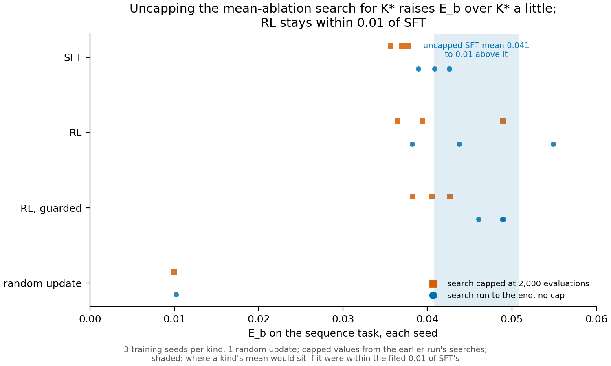

# Does running the mean-ablation search for K* to the end separate RL from SFT on the sequence task?

*P2.61 (E269), compare-lead, 2026-11-23. Card `reports/plans/2026-11-22_plan_p2-61-uncapped-card.md`, predictions
`experiments/kstar_uncapped/results/predictions.json`, summary `experiments/kstar_uncapped/results/summary.json`,
figure `experiments/kstar_uncapped/figures/eb_capped_uncapped.png`. Red-team verdict, 2026-11-23: holds with caveats
as a K\* result (`~/commute-data/agents/compare-lead/note-2026-11-23-redteam-p261-verdict.md`).*

**The answer.** Not over K\*. We reran the mean-ablation search for the set of parts each sequence-task model keeps,
this time to the end instead of stopping it early. The set shrank to about a third of its size and the write share rose
a little for every model. Reinforcement learning still sits above supervised fine-tuning by less than the filed 0.01,
though in the same direction as the re-gating share. Over the definition's own needed set the gap reaches about 0.01,
but those sets are too small to trust, so whether the two readings disagree on this task is open.

## What we were trying to test

Two readings of the same nine fine-tuned models seemed to disagree. Each is the 67M model trained on a day and month
sequence task. Three seeds were trained by supervised fine-tuning on demonstrations, three by reinforcement learning,
and three by reinforcement learning with a guard against collapse onto one answer. A tenth model is a random update of
the same size, the reference for "nothing learned".

The first reading is the **re-gating share**: the share of the task gain carried by changes in which subcomponents
the causal-importance function Γ switches on. It reads reinforcement learning above supervised fine-tuning on this
task. The RL seeds read 0.60 to 1.12, and the SFT seeds 0.35 to 0.43.

The second is the **write share** $E_b$, read over a set of the model's subcomponents. It looks at the members of the
set that the update changed. For each, it takes the part of the write change that a non-negative rescaling of the base
model's write explains; $E_b$ is the sum of those parts over the sum of the write changes. The unchanged model reads 1;
an update with nothing to do with the base model's writes reads near 0.

Which set matters. The frozen definition of 2026-11-22 reads $E_b$ over the **needed set** $K$: the variables whose
value, swapped one at a time from a second input, changes the model's output. Every earlier $E_b$ on these models was
read instead over $K^*$, found by the **mean-ablation search**: the smallest set of subcomponents that keeps the
behaviour when every other subcomponent is mean-ablated. It must close 90% of the gap,
$\mathrm{KL}(F \| F_{K}) \le 0.1\,\mathrm{KL}(F \| F_\emptyset)$. Over $K^*$, $E_b$ read RL and SFT within 0.01 in
the earlier run. This run changes only $K^*$; the needed-set reading comes from a separate run on the same models.

That earlier run stopped every mean-ablation search early. The search ranks subcomponents, takes the shortest ranked
prefix that passes the bar, about 15,000 to 33,000 members, and then tries removing members in small chunks. Each try
costs one evaluation. At 2,000 evaluations the search had tried between a twentieth and a fifth of the prefix, so
every $K^*$ still held many members it might not need. If those spare members padded RL's and SFT's sets alike, they
could have hidden a real difference. This run lets the search try every member, with every other setting unchanged,
and reads $E_b$ again from the same saved arrays.

## What we expected, and why

Two outcomes were filed before the run, each as the gap between a kind's mean $E_b$ over $K^*$ for its three seeds and
the SFT mean:

- **The cap hid the order.** Padding with unneeded members dilutes the share alike for every model, so trimming it
  would let RL rise above SFT, as the re-gating share has it. Filed as both gaps at least 0.01.
- **The cap does not matter.** $E_b$ over $K^*$ keeps RL near SFT whatever the search budget. Filed as both gaps under
  0.01 in size.

The bar of 0.01 is about twice the spread of the six RL seeds' capped readings, 0.0044. We also expected the random
update to stay near its capped 0.0099, under every trained model.

## What we observed

### Does RL rise past the bar once the search runs to the end?

**Reading it.** No: both RL kinds stay under the filed 0.01 above SFT. The uncapped SFT mean is 0.041, and the RL
means sit 0.0048 and 0.0072 above it. Both gaps are positive, in the re-gating share's direction. They are about 1.1 and
1.6 times the RL seeds' spread, with three seeds each. In the figure every blue dot sits to the right of its orange
square, so the uncapped search raised $E_b$ for all ten models. For the trained ones the rise was 0.0012 to 0.0085.
One RL seed reads 0.055 and stands alone above the shaded band, as the same seed did when capped. The guarded RL gap
roughly doubled, from 0.0037 to 0.0072. The random update read 0.0102, up 0.0002, far under every trained model.

The two columns are not one search stopped at two points. No uncapped $K^*$ is a subset of its capped one, on any of
the ten models, so the uncapped search took a different path and did not only trim longer. The settings differ only in
the cap, but the sets compared differ by more; the reproduction check below shows where the paths split.

### How much did the search trim?

**Reading it.** The searches ran 14,471 to 37,340 evaluations and tried every member. The trained models' $K^*$ ended at
0.28 to 0.37 of the capped size, and the random update's at 0.42. The table lists every model.

| model | $E_b$ capped | $E_b$ uncapped | $K^*$ size capped | size uncapped | evaluations |
|---|---|---|---|---|---|
| SFT seed 0 | 0.0370 | 0.0409 | 21,027 | 7,087 | 22,413 |
| SFT seed 1 | 0.0377 | 0.0389 | 19,993 | 7,299 | 22,999 |
| SFT seed 2 | 0.0357 | 0.0426 | 20,295 | 7,544 | 22,679 |
| RL seed 0 | 0.0394 | 0.0438 | 23,720 | 6,703 | 23,860 |
| RL seed 1 | 0.0365 | 0.0382 | 17,566 | 5,543 | 18,445 |
| RL seed 2 | 0.0489 | 0.0549 | 12,835 | 4,520 | 14,471 |
| guarded RL seed 0 | 0.0426 | 0.0488 | 22,968 | 6,378 | 22,688 |
| guarded RL seed 1 | 0.0382 | 0.0460 | 24,652 | 7,917 | 25,931 |
| guarded RL seed 2 | 0.0405 | 0.0490 | 14,971 | 5,289 | 16,543 |
| random update | 0.0099 | 0.0102 | 32,305 | 13,449 | 37,340 |

### Does the reading over the definition's needed set agree?

**Reading it.** Not clearly. A separate run read $E_b$ over the needed set $K$ of the same nine models, sampled from
256 pairs of inputs. There the SFT mean is 0.0272, and RL and guarded RL sit 0.0104 and 0.0130 above it, at or past the
bar. But SFT's needed sets hold only 150 to 390 variables, against about 20,000 in $K^*$. A set that small is likely
under-sampled, so this reading is provisional.

| kind, mean of 3 seeds | over $K^*$, capped | over $K^*$, uncapped | over $K$ | gap to SFT, uncapped $K^*$ | gap to SFT, $K$ |
|---|---|---|---|---|---|
| SFT | 0.037 | 0.041 | 0.0272 | | |
| RL | 0.042 | 0.046 | 0.0377 | 0.0048 | 0.0104 |
| guarded RL | 0.040 | 0.048 | 0.0403 | 0.0072 | 0.0130 |

### Did the uncapped search repeat the capped one up to 2,000 evaluations?

**Reading it.** Not exactly. Each run's log gives the size of the set at 2,000 evaluations. It matched the earlier
run's capped size within 1.3% on nine of ten models, and was 5.0% larger on SFT seed 1. The search ran on a different
card, and a small numerical difference can flip a removal near the bar, after which the two searches diverge. That is
why no uncapped $K^*$ is inside its capped one.

## What we learned

This is a reading, not a verdict under a definition. Uncapping the mean-ablation search leaves RL within 0.01 of SFT on
$E_b$ over $K^*$. Over the definition's needed set the gap reaches about 0.01, but on needed sets too small to trust.
Whether $E_b$ and the re-gating share disagree on this task is open. The cap is closed as an explanation for $K^*$; the
open question is now the needed set's size on the SFT models.

## How compelling is the evidence

- Three seeds per kind, one task, one random update; the uncapped SFT seeds span 0.0036.
- $E_b$ is read from the earlier run's saved arrays, so only $K^*$ changed. The score script first recomputed every
  capped $E_b$ from the earlier saved $K^*$ and matched it exactly.
- The capped and uncapped sets come from different search paths, as the failed subset check shows.
- Over $K^*$ the gaps are positive in both RL kinds, so "under the bar" is not "equal".
- The needed-set reading rests on 150 to 390 variables for SFT.
- $E_b$ is blind to changes in which subcomponents are active that leave the writes unchanged, which is what the
  re-gating share reads.

## Surprises

- The filed expectation that each uncapped $K^*$ would be a subset of its capped one failed on all ten, because the
  search paths split before 2,000 evaluations. Sizes are all smaller, as expected.
- The guarded RL gap roughly doubled, toward the bar but not past it.
- Over the needed set, the same models cross the bar that $K^*$ keeps them under.

## What next

- Nothing more on the cap for $K^*$.
- Read the needed set on the SFT models from more input pairs, until its size stops growing. If the gap over $K$ stays
  at 0.01 or more, $E_b$ and the re-gating share agree on this task; if it falls, they disagree. This needs a cell.

## Scorecard

| id | claim in words | rule | read | verdict |
|---|---|---|---|---|
| rival a | the cap hid an RL-above-SFT order over K* | both gaps ≥ 0.01 | RL 0.0048, guarded RL 0.0072 | not supported |
| rival b | E_b over K* keeps RL within 0.01 of SFT without the cap | both gaps under 0.01 in size | as above | **holds** |
| reproduction | size at 2,000 evaluations equals the capped size | equal | within 1.3% on 9 of 10, 5.0% on SFT seed 1 | missed, reported |
| subset | uncapped K* inside capped K* | subset | 0 of 10 | missed, reported |
| random | random stays near 0.0099, under every trained model | descriptive | 0.0102 | as expected |

Red-team verdict: holds with caveats as a $K^*$ result.

## Departures from the literature

None. $K^*$, its bar and $E_b$ are the project's own; the one change from the earlier run's settings is the evaluation
cap.

## Not run

- The guarded-size random updates and random seeds 1 and 2: only one random update was searched uncapped.
- The brackets and addition tasks, and the repeat-task RL states.
- A rerun of the capped search on this card, which would make the capped and uncapped sets one search path.
- A larger sample of input pairs for the needed set on the SFT models.
- Any reading other than $E_b$; the re-gating share was not recomputed.

## Provenance

- Ten RunPod L40S pods, one model each, 1.6 to 5.0 hours per search. Cost about $40, approximate, from the runner's
  report; no spend record was found for these pods.
- Code `experiments/kstar_uncapped/run.py`, scoring `experiments/kstar_uncapped/score.py`, figure
  `experiments/kstar_uncapped/plot.py`. Per-model search records `experiments/kstar_uncapped/results/kstar/`, logs
  `experiments/kstar_uncapped/results/logs/run_*.log`.
- Capped readings `experiments/rb_states/results/items/p256-sequence_*.json`; needed-set readings
  `experiments/kstar_needed/results/summary.json`, keys `E_b_K` and `size_K`; re-gating shares
  `experiments/procedural_rl/results/read_sequence.json` and `read_guarded_sequence.json`, key `share.share.lo`.
